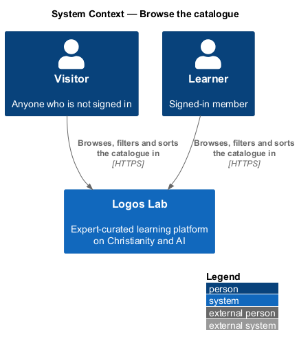
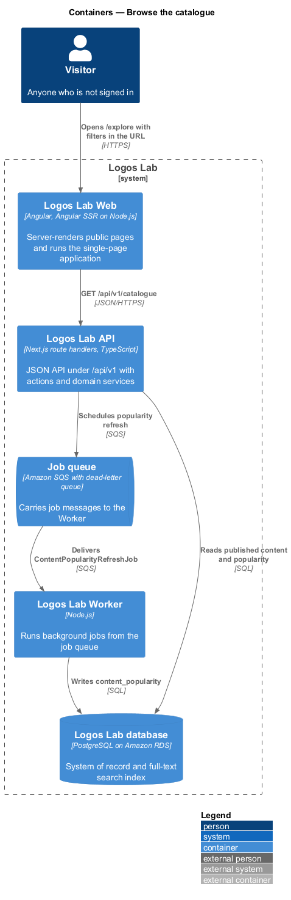
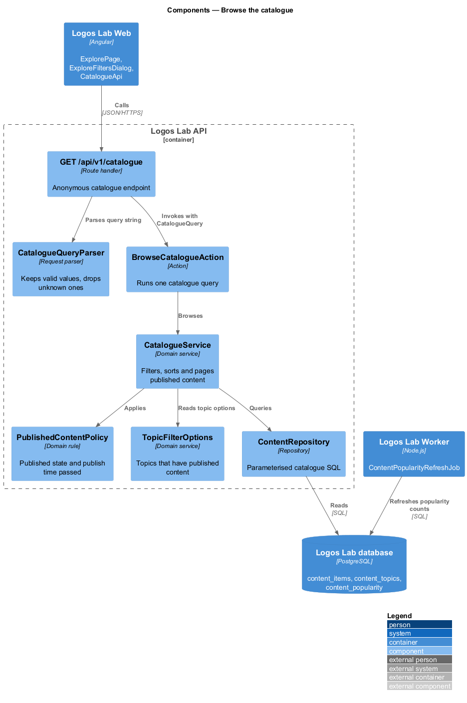
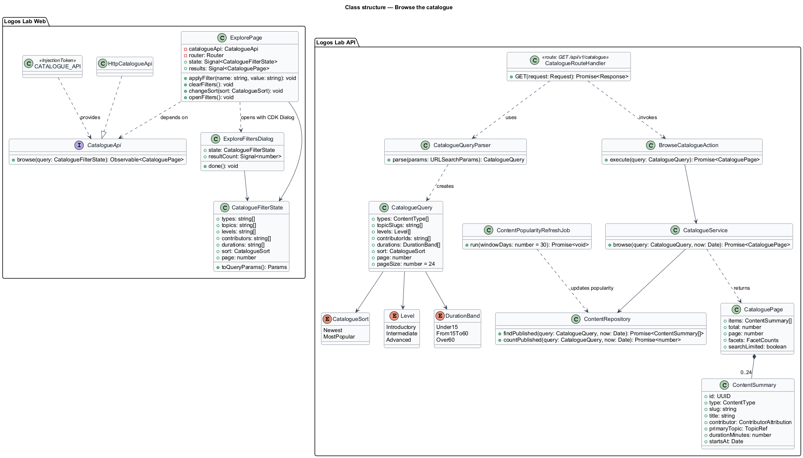
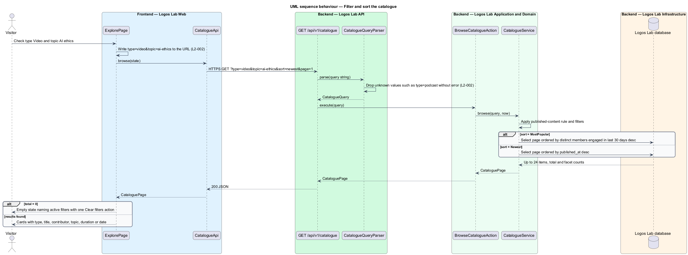
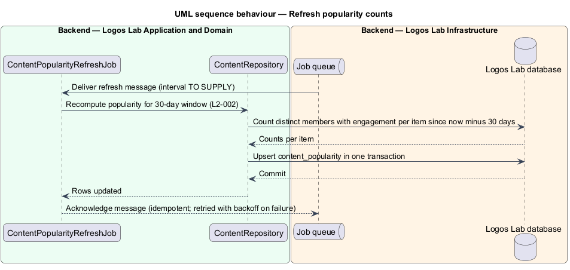

# Browse the catalogue

## Overview

The *catalogue* is the complete, browsable list of published Logos Lab content at `/explore`. It sits
in the discovery subsystem beside the home page, search and topic pages, and it is the place a
person goes to look across everything rather than to find one known thing.

The catalogue lists courses, learning modules, videos, articles, collections and events together. A
person narrows the list with filters and changes its order with a sort. Terms used below:

- **filter** — constraint on one content attribute (type, topic, level, contributor or duration) that
  removes non-matching items from the results
- **active filter** — filter whose value is currently applied and shown as a removable pill
- **contributor** — expert or Logos Lab, credited as the author of an item
- **popularity** — number of distinct members who engaged with an item in the last 30 days

The filter state lives in the URL query string. A filtered view can therefore be shared, bookmarked
and reopened with the same results.

## Description

The slice runs from `ExplorePage` in Logos Lab Web to the Logos Lab API and the Logos Lab database.

**Logos Lab Web**

- **`ExplorePage`** — routed standalone component for `/explore`, server-rendered for the first
  page. It reads the filters and sort from the route's query parameters and writes them back on each
  change, so the URL always reflects the visible results.
- **`ExploreFiltersDialog`** — sheet opened with the Angular CDK `Dialog` service on small viewports.
  It holds the same filters as the sidebar. Its primary button states the outcome, for example
  "Show 24 courses", and shows a busy state while the count loads.
- **Design-system components** — `ll-search-filter-toolbar` (count and sort), `ll-checkbox` (filter
  options with counts), `ll-select` (sort), `ll-chip` (active-filter pills), `ll-content-card`
  (results), `ll-pagination`, `ll-empty-state`, `ll-alert`, `ll-skeleton` and `ll-dialog`.
- **`CatalogueApi`** — contract with `browse(query: CatalogueQuery)`. `CATALOGUE_API` is its token
  and `HttpCatalogueApi` its HTTP implementation.
- **Screen states** — `docs/mocks/pages/explore/` covers `default`, `selected` (filtered to courses),
  `loading`, `no-results`, `empty`, `error`, `partial` (search degraded, catalogue still loads) and
  `long`. `docs/mocks/dialogs/explore-filters/` covers `default`, `selected` and `busy`.

**Logos Lab API**

- **`GET /api/v1/catalogue`** — anonymous route handler. Query parameters: `type`, `topic`, `level`,
  `contributor`, `duration`, `sort` and `page`. It returns one page of `ContentSummary` items, the
  total count and the option counts for each filter.
- **`CatalogueQueryParser`** — turns raw query parameters into a `CatalogueQuery`. It drops unknown
  values (for example `type=podcast`) without error and keeps the valid ones.
- **`BrowseCatalogueAction`** — runs the query through `CatalogueService` and returns the page.
- **`CatalogueService`** — applies `PublishedContentPolicy`, the filters and the sort, and pages the
  results at 24 items per page.
- **`ContentRepository`** — builds the filtered SQL query over `content_items`, `content_topics` and
  `content_popularity`. Every value is a bound parameter.
- **`ContentPopularityRefreshJob`** — Worker job that recomputes `content_popularity`, the count of
  distinct members who engaged with each item in the last 30 days. The set of events that count as
  engagement and the refresh interval are `<TO SUPPLY>`.
- **`TopicFilterOptions`** — lists only topics that have published content (`L2-005`).

The catalogue reads the database directly, not the search index. When search is degraded, the
catalogue still loads every item and shows a notice that search is limited (`L2-141`).

**Key rules**

- Default: 24 items per page, sorted by "Newest".
- Each card shows type, title, contributor, topic, and duration or date.
- Filters: type; topic; level (Introductory, Intermediate, Advanced); contributor (an expert or Logos
  Lab); duration (`<15 min`, `15-60 min`, `>60 min`).
- Example URL encoding: type "Video" and topic "AI ethics" yield `type=video&topic=ai-ethics`.
- A URL with valid filter parameters pre-applies them and the controls show the selected values.
- Unknown filter values are ignored; the remaining filters apply; no error is shown.
- No matches: an empty state names the active filters and offers a single "Clear filters" action.
- "Most popular": items ordered by distinct engaged members in the last 30 days, descending.

## Requirements

| L2 ID | Refines (L1) | Requirement |
|-------|--------------|-------------|
| `L2-002` | `L1-001` | **Catalogue browsing and filtering.** The catalogue (`/explore`) shall list all published content and shall let users filter and sort it. Filter state shall be reflected in the URL so that it can be shared and bookmarked. |

## Diagrams

### System context

Visitors and learners browse the catalogue in Logos Lab. No external system takes part in this
slice.

### Containers

Logos Lab Web calls the catalogue endpoint in the Logos Lab API, which reads the Logos Lab
database. The Worker refreshes the popularity counts that the "Most popular" sort reads.

### Components

The route handler parses the query, dropping unknown values, and invokes `BrowseCatalogueAction`.
`CatalogueService` applies the published-content rule, filters, sort and paging.

### Class structure

`ExplorePage` and `ExploreFiltersDialog` share one `CatalogueFilterState`. On the API side,
`CatalogueQuery` holds only valid filter values, typed by enumerations for type, level, duration and
sort.

### Behaviour — filter and sort the catalogue

A filter change updates the URL, then calls the API. The parser ignores unknown values, and the page
shows either the results or an empty state that names the active filters.

### Behaviour — refresh popularity counts

The Worker recomputes the 30-day distinct-member engagement counts that the "Most popular" sort
reads, so the sort never aggregates engagement at request time.

