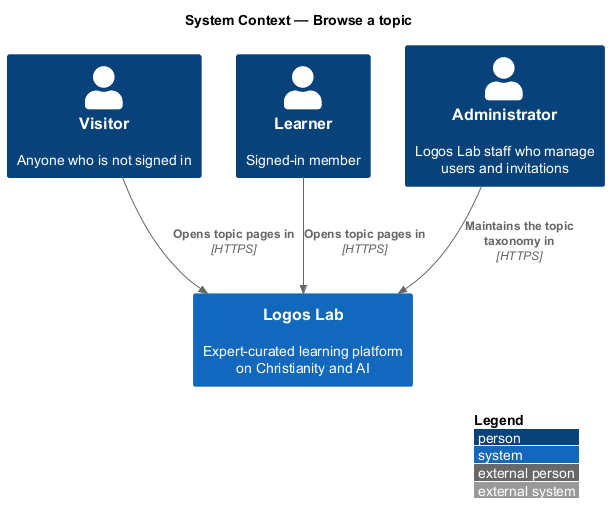
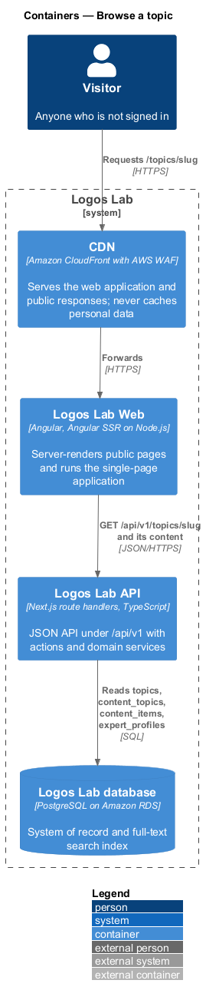
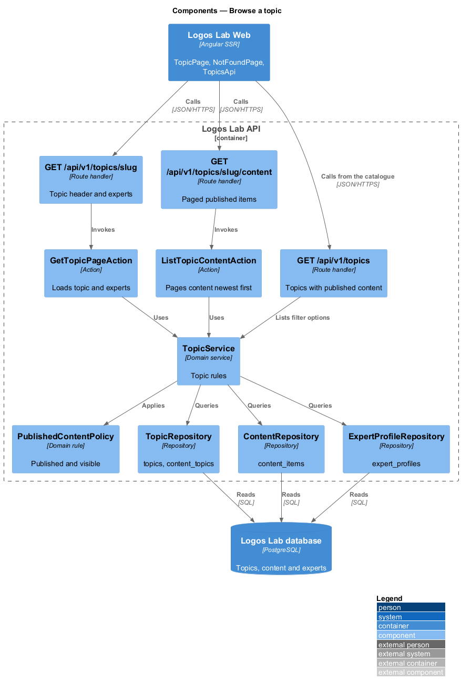
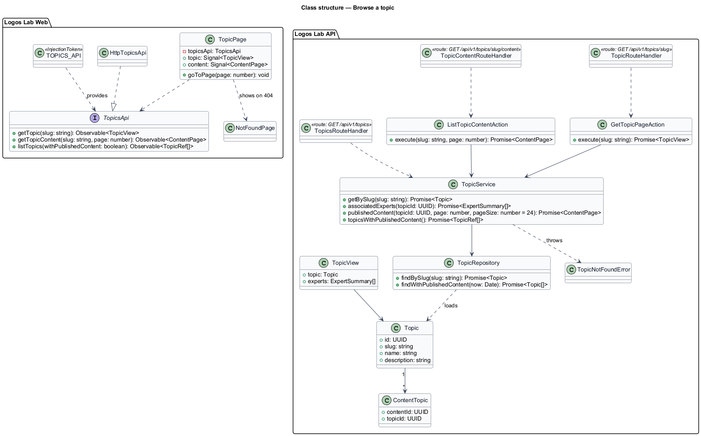
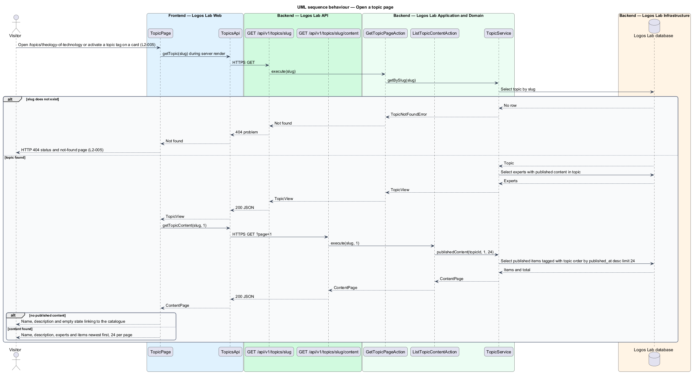
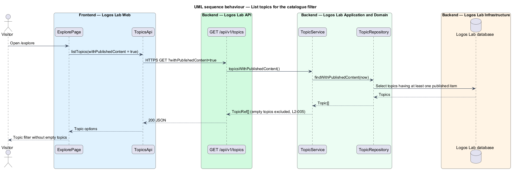

# Browse a topic

## Overview

Logos Lab organises its content under a *controlled taxonomy*, a fixed list of topics that
administrators maintain. A *topic* is a named subject in that taxonomy, such as "Theology of
technology" or "AI ethics", with a slug and a description. Each content item is tagged with one or
more topics.

This feature gives every topic a public page at `/topics/{slug}`. The page lists the topic's
published content and the experts associated with it. It sits in the discovery subsystem beside the
home page, catalogue and search, and it is the target of every topic tag on a content card.

- **topic tag** — link on a content card that names one of the item's topics and opens that topic's page
- **associated expert** — expert who has published content tagged with the topic

## Description

The slice runs from `TopicPage` in Logos Lab Web to the Logos Lab API and the Logos Lab database.

**Logos Lab Web**

- **`TopicPage`** — routed standalone component for `/topics/{slug}`, server-rendered. When the API
  returns `404`, the server render sets HTTP status 404 and shows `NotFoundPage`.
- **`NotFoundPage`** — the branded not-found page with a search field and ways back in
  (`docs/mocks/pages/not-found/`).
- **Design-system components** — `ll-breadcrumb`, `ll-page-header` (name and description),
  `ll-person-list` (associated experts), `ll-content-card` (items, with topic tags as links),
  `ll-pagination`, `ll-empty-state`, `ll-skeleton` and `ll-error-page`.
- **Topic tags** — `ll-content-card` renders each topic tag as a link to `/topics/{slug}` on every page
  that shows cards.
- **`TopicsApi`** — contract with `getTopic(slug)` and `getTopicContent(slug, page)`. `TOPICS_API` is its
  token and `HttpTopicsApi` its HTTP implementation.
- **Screen states** — `docs/mocks/pages/topic/` covers `default`, `empty`, `loading`, `error` and
  `long`.

**Logos Lab API**

- **`GET /api/v1/topics/{slug}`** — anonymous route handler. It returns the topic's name, description
  and associated experts, or `404` when the slug does not exist.
- **`GET /api/v1/topics/{slug}/content`** — anonymous route handler with a `page` parameter. It
  returns published items tagged with the topic, newest first, 24 per page.
- **`GET /api/v1/topics?withPublishedContent=true`** — anonymous route handler that returns only
  topics with at least one published item. The catalogue topic filter reads it.
- **`GetTopicPageAction`** and **`ListTopicContentAction`** — one use case each.
- **`TopicService`** — loads the topic by slug, finds the associated experts and pages the content
  through `PublishedContentPolicy`.
- **`TopicRepository`** — reads `topics` and `content_topics`. **`ContentRepository`** reads
  `content_items`, and **`ExpertProfileRepository`** reads `expert_profiles`.
- **`Topic`** — entity with `id`, `slug`, `name` and `description`.

**Key rules**

- `/topics/theology-of-technology` shows the topic's name and description, its published content
  (newest first, 24 per page) and the experts who have published content in it.
- An unknown slug returns HTTP 404 and the not-found page.
- A topic with no published content shows an empty state and is not listed in the catalogue topic
  filter.
- Activating a topic tag on any content card opens that topic's page.

## Requirements

| L2 ID | Refines (L1) | Requirement |
|-------|--------------|-------------|
| `L2-005` | `L1-001` | **Topic pages.** Every topic in the controlled taxonomy shall have a public page (`/topics/{slug}`) listing its published content and the experts associated with it. |

## Diagrams

### System context

Visitors and learners open topic pages in Logos Lab. Administrators maintain the taxonomy that
defines the topics.

### Containers

Logos Lab Web server-renders the topic page from the Logos Lab API, which reads topics, content and
experts from the Logos Lab database.

### Components

Two route handlers serve the topic header and its paged content. A third serves the topic options
that the catalogue filter reads.

### Class structure

`TopicPage` depends on the `TopicsApi` contract. `TopicService` combines the `Topic` entity, the
published content tagged with it and its associated experts.

### Behaviour — open a topic page

The server render resolves the slug. An unknown slug produces HTTP 404 and the not-found page; a
topic with no published content produces the empty state.

### Behaviour — list topics for the catalogue filter

The catalogue requests only topics with published content, so an empty topic never appears as a
filter option.

