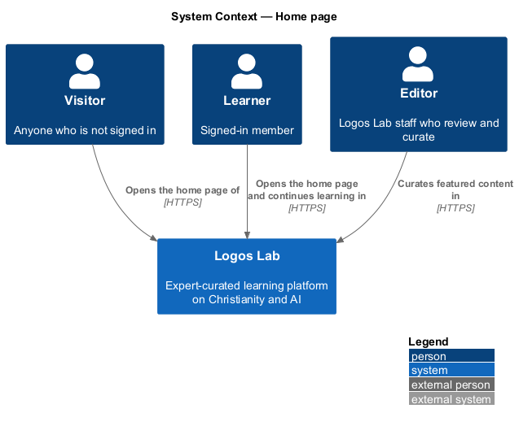
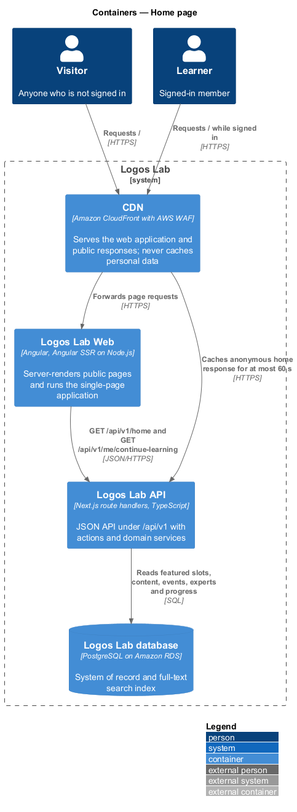
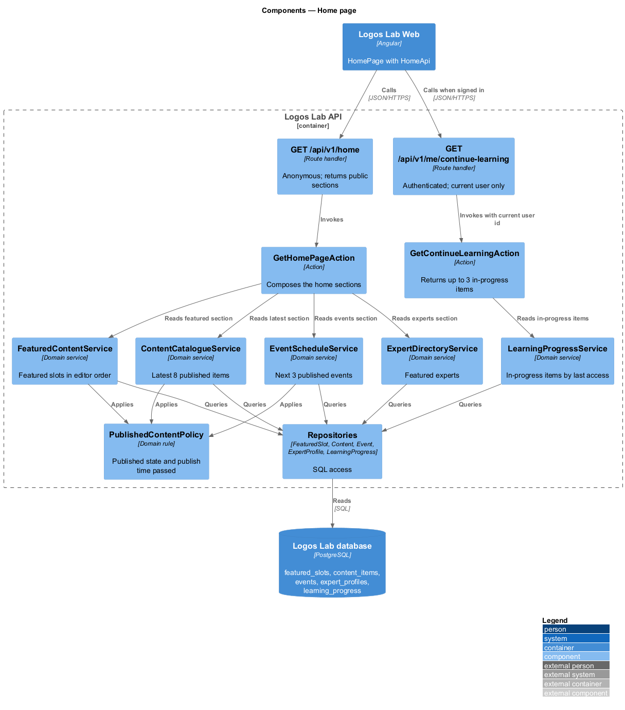
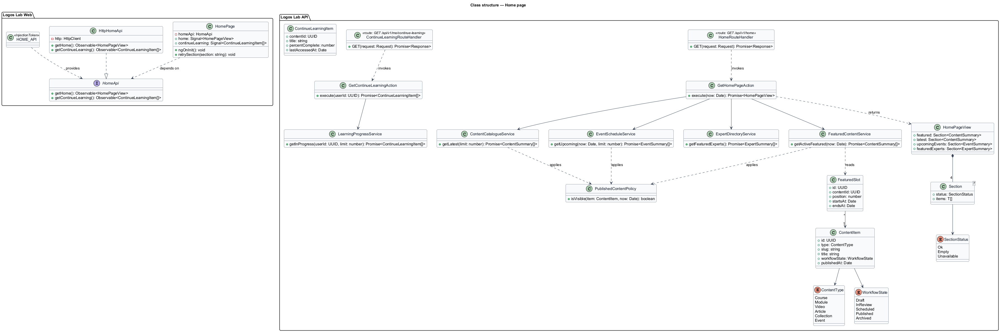
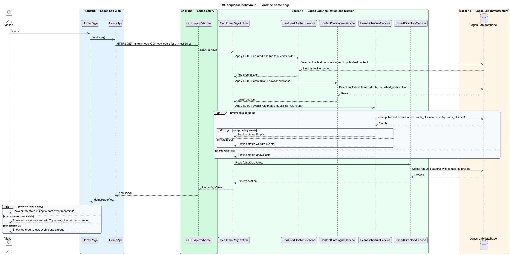
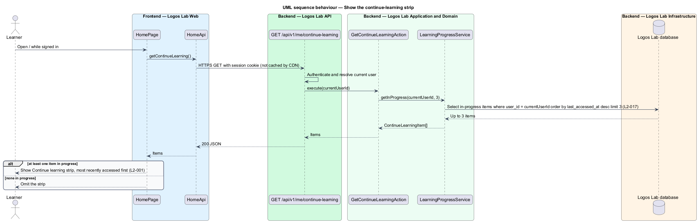

# Home page

## Overview

Logos Lab is an expert-curated learning platform on Christianity and artificial intelligence. The
*discovery* subsystem holds the public ways into its content: the home page, the catalogue, site-wide
search and topic pages. This feature covers the home page at `/`, the first screen most visitors see.

The home page gathers five kinds of content into one screen and offers a direct path to search and
to the catalogue. Its sections are defined as follows.

- **featured item** — published content an editor has placed on the home page, in an editor-set order
- **latest item** — published content ordered by publish time, newest first, across all content types
- **upcoming event** — published event whose start time is in the future
- **featured expert** — expert profile shown on the home page to introduce the people who teach
- **continue-learning strip** — row of a signed-in learner's in-progress items, most recently accessed first

*Published* content is content whose workflow state is Published and whose publish time has passed.
Draft, scheduled and archived items never appear on the home page. Editors curate the featured list in
a separate administration feature (`L2-097`); this feature only reads it.

## Description

The slice runs from the server-rendered `HomePage` in Logos Lab Web to the Logos Lab API and the
Logos Lab database.

**Logos Lab Web**

- **`HomePage`** — routed standalone component for `/`. Angular SSR renders it so that the initial
  HTML holds the hero, the featured, latest, events and experts sections. It depends on the
  `HomeApi` contract only.
- **Design-system components** — `ll-hero` (heading, lead, search field and "Browse the catalogue"
  link), `ll-content-card` (featured and latest items), `ll-event-row` (upcoming events),
  `ll-person-list` (featured experts), `ll-progress-bar` (continue-learning items), `ll-empty-state`,
  `ll-alert`, `ll-skeleton` and `ll-top-bar` (global header with the search field).
- **`HomeApi`** — contract in the shared API library with `getHome()` and `getContinueLearning()`.
  `HOME_API` is its injection token and `HttpHomeApi` its HTTP implementation, bound at the
  application's composition root.
- **Screen states** — the mocks in `docs/mocks/pages/home/` cover `default`, `signed-in`, `loading`,
  `empty` (no upcoming events), `partial` (events section failed, other sections shown), `error` and
  `long`. In `error` and `partial`, the hero, search field and catalogue link stay usable.

**Logos Lab API**

- **`GET /api/v1/home`** — anonymous route handler. It calls `GetHomePageAction` and returns the four
  public sections. Each section carries its own status, so one failed section does not fail the page.
  The response holds no personal data, so the CDN may cache it. The cache lifetime shall not exceed
  60 seconds, so that a saved featured order reaches the home page within the `L2-097` window.
- **`GET /api/v1/me/continue-learning`** — authenticated route handler. It calls
  `GetContinueLearningAction` and returns at most 3 items for the current user. The CDN does not
  cache it.
- **`GetHomePageAction`** — composes the sections from four domain services and applies the
  published-content filter to each.
- **`FeaturedContentService`** — reads the featured slots whose start and end window contains the
  current time, keeps the editor's order, and omits items that are no longer published.
- **`ContentCatalogueService`** — returns the 8 most recently published items across all content
  types, newest first.
- **`EventScheduleService`** — returns the next 3 published events by start time, excluding past and
  draft events. An empty result produces the empty state that links to past event recordings.
- **`ExpertDirectoryService`** — returns the featured experts. The selection rule and count are
  `<TO SUPPLY>`; the specification does not define them.
- **`GetContinueLearningAction`** and **`LearningProgressService`** — return up to 3 of the current
  user's in-progress items, most recently accessed first. The query takes the current user's id
  (`L2-017`).
- **`PublishedContentPolicy`** — single rule that an item is visible when its workflow state is
  `Published` and its publish time has passed. Every query in this slice applies it.
- **Repositories and tables** — `FeaturedSlotRepository` (`featured_slots`),
  `ContentRepository` (`content_items`), `EventRepository` (`events`), `ExpertProfileRepository`
  (`expert_profiles`) and `LearningProgressRepository` (`learning_progress`).

**Logos Lab Web decisions**

- **Start here panel** — the visitor's "Start with twelve short pieces" panel is editorial copy that
  ships with the page, not API data: the mocks show it unchanged while the sections load.
- **Card facts** — the page formats each card's facts from `ContentSummary` for the locale (`L2-148`):
  course — lessons and duration ("24 lessons", "5 h 40 min"); module — duration and "Scored"; video —
  "Free preview" for a public preview, otherwise its topic (the duration sits on the cover); article —
  reading time ("12 min read"); collection — item count ("8 items"); event — start and attendance.
- **Dates and times** — formatted with the platform's `Intl` for the active locale in the viewer's time
  zone with the zone named ("Tue, Oct 27, 12:00 PM EDT"), as `L2-148` requires, rather than the mocks'
  hand-written "Tue 27 Oct, 12:00 pm ET".
- **"See everything"** — the Latest section links to the catalogue without a total, because the home
  response carries no count.

**Key rules**

- Featured: up to 6 items, in the order the editor set.
- Latest: the 8 most recently published items, newest first, across all content types.
- Upcoming events: the next 3 published events by start time; no past or draft events.
- No upcoming events: the events section becomes an empty state that links to past event recordings.
- Continue learning: shown only to a signed-in learner with at least one course in progress; up to 3
  items, most recently accessed first.
- Draft, scheduled or archived items appear nowhere on the page.

## Requirements

| L2 ID | Refines (L1) | Requirement |
|-------|--------------|-------------|
| `L2-001` | `L1-001` | **Home page.** The home page (`/`) shall present featured content, the newest published content, upcoming events and featured experts, and shall give every visitor a direct path to search and to the catalogue. |

## Diagrams

### System context

Visitors and learners open the home page of Logos Lab. Editors curate the featured list that the
home page reads.

### Containers

Logos Lab Web server-renders the page and calls the Logos Lab API, which reads the Logos Lab
database. The CDN caches the anonymous home response but never the continue-learning response.

### Components

Inside the Logos Lab API, `GetHomePageAction` composes four domain services, each of which applies
`PublishedContentPolicy` through its repository.

### Class structure

`HomePage` depends on the `HomeApi` contract. On the API side, the action returns a `HomePageView`
whose sections each carry a `SectionStatus`, so one failed section does not fail the page.

### Behaviour — load the home page

The page requests all public sections in one call. The action applies the `L2-001` rules per section;
an empty events result yields the recordings empty state, and a failed section returns an
unavailable status that the page shows as an inline error.

### Behaviour — show the continue-learning strip

For a signed-in learner, the page makes a second, uncached call scoped to the current user and shows
the strip only when at least one item is in progress.

