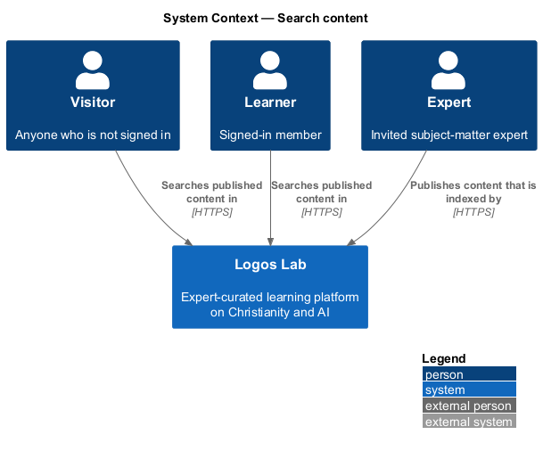
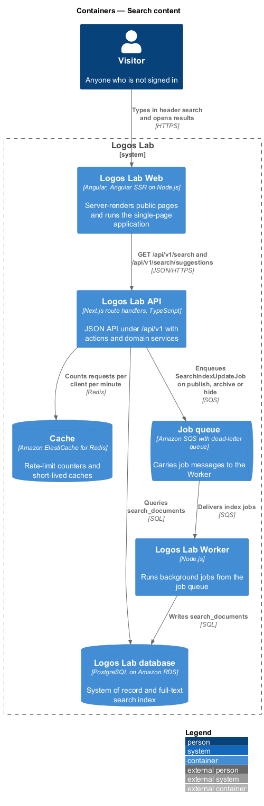
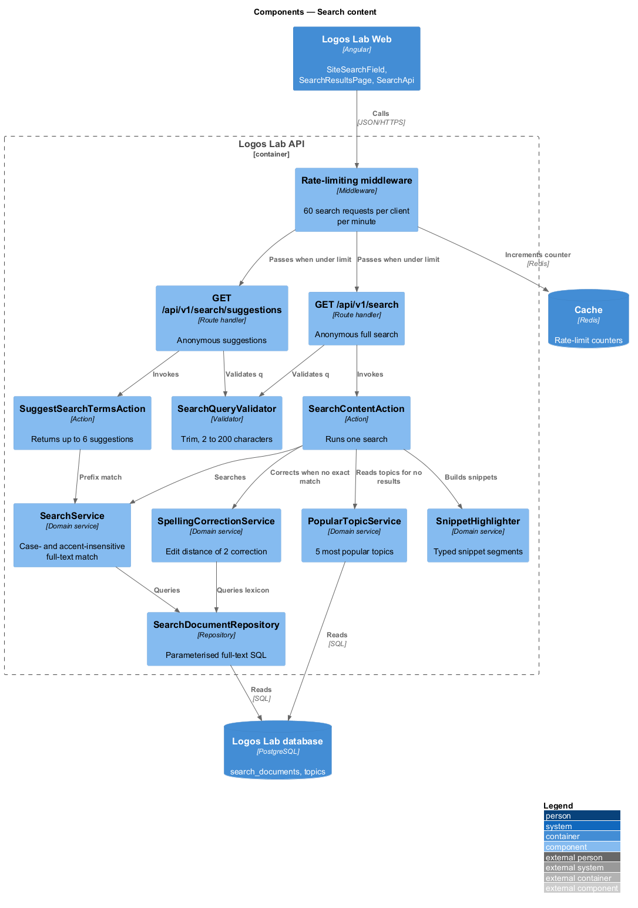
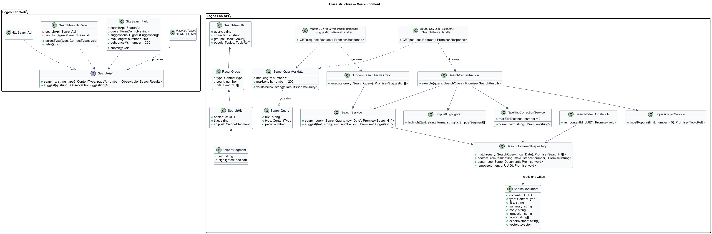
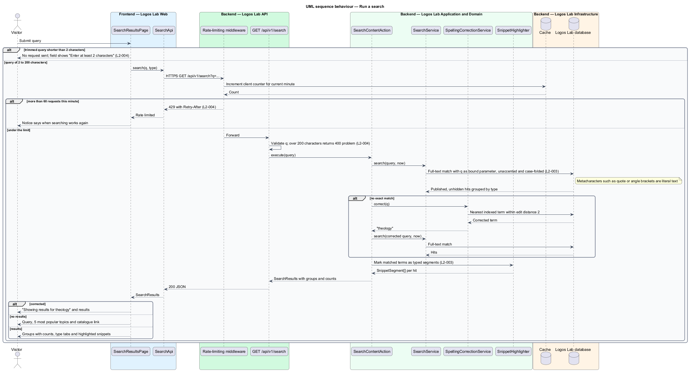
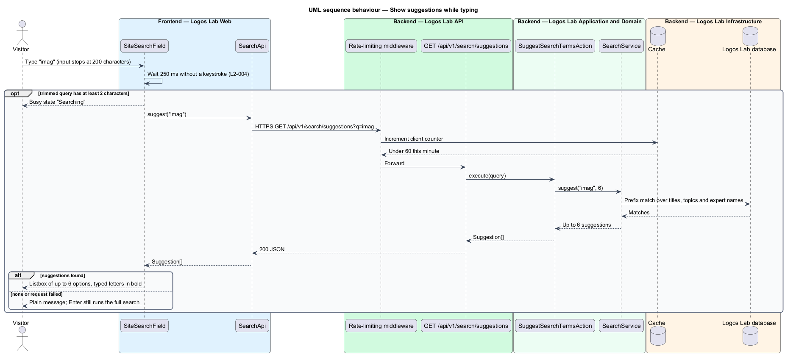
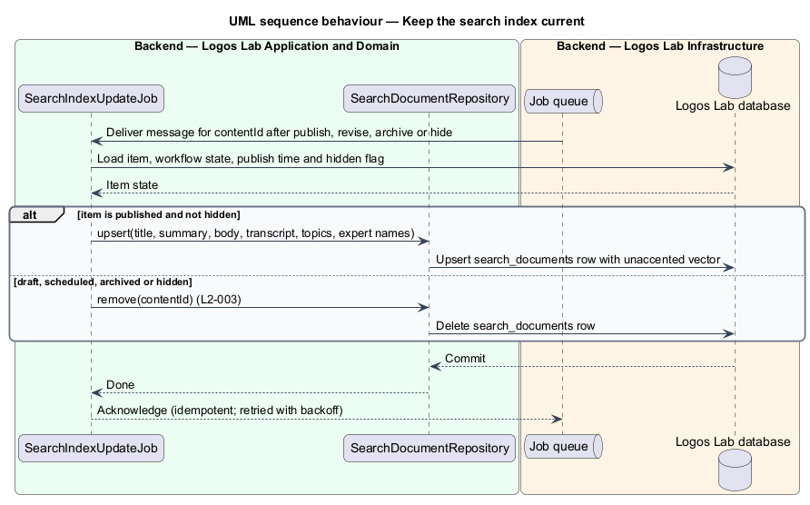

# Search content

## Overview

Site-wide search lets a person find published Logos Lab content by typing words. It sits in the
discovery subsystem beside the home page, catalogue and topic pages. The global header holds the
search field on every public page, and a results page shows the full results.

Search covers titles, summaries, body text, video transcripts, topics and expert names. It matches
words regardless of case and accents, corrects small misspellings, and highlights the matched words
in each result. Terms used below:

- **query** — text a person submits to search, trimmed of leading and trailing spaces
- **suggestion** — short match offered under the header search field while a person types
- **search document** — indexed record of one published item, holding the text search matches against
- **snippet** — short excerpt of a result with the matching terms highlighted
- **corrected term** — indexed term within an edit distance of 2 of a misspelled query term

Search reads a full-text index held in the Logos Lab database. Only published, visible content is
indexed or returned.

## Description

The slice runs from the header search field and `SearchResultsPage` in Logos Lab Web to the Logos
Lab API, the Cache and the Logos Lab database.

**Logos Lab Web**

- **`SiteSearchField`** — application component in the global header (`ll-top-bar`). It binds
  `ll-combobox` with `ll-suggestion` options, sets `maxlength="200"`, waits 250 ms after the last
  keystroke, and requests suggestions only when the trimmed query has at least 2 characters. Enter
  opens the results page.
- **`SearchResultsPage`** — routed standalone component for the results page. Its route is `/search`
  with `q` and `type` query parameters (baseline choice; the specification does not fix the route).
- **Design-system components** — `ll-text-field`, `ll-tabs` (one tab per type with a count),
  `ll-content-card`, `ll-person-list` (expert results), `ll-alert` (corrected, partial and
  rate-limited notices), `ll-chip` (popular topics), `ll-empty-state` and `ll-skeleton`.
- **`SearchApi`** — contract with `search(query, type, page)` and `suggest(query)`. `SEARCH_API` is its
  token and `HttpSearchApi` its HTTP implementation.
- **Snippet rendering** — the page renders each snippet from typed segments (`text`, `highlighted`)
  with `<mark>` elements created by the template. It never binds API text as HTML.
- **Screen states** — `docs/mocks/pages/search-results/` covers `default`, `selected`, `corrected`,
  `no-results`, `empty`, `invalid`, `loading`, `partial`, `rate-limited`, `error` and `long`.
  `docs/mocks/dialogs/search-suggest/` covers `default`, `busy`, `empty`, `failed`, `invalid` and
  `long`.

**Logos Lab API**

- **`GET /api/v1/search`** — anonymous route handler with `q`, `type` and `page` parameters.
- **`GET /api/v1/search/suggestions`** — anonymous route handler with a `q` parameter. It returns up
  to 6 suggestions.
- **Rate limiting** — the rate-limiting middleware counts search requests per client in the Cache.
  The 61st request in one minute receives `429` with a `Retry-After` header. The client key (session
  or network address) is `<TO SUPPLY>`.
- **`SearchQueryValidator`** — trims the query and rejects queries longer than 200 characters with a
  `400` problem response. Queries shorter than 2 characters are also rejected, as a defence behind the
  client check.
- **`SearchContentAction`** and **`SuggestSearchTermsAction`** — one use case each.
- **`SearchService`** — builds the full-text query from the query as a bound parameter, matching
  case- and accent-insensitively. It groups results by content type with a count per type and filters
  by type when one is chosen.
- **`SpellingCorrectionService`** — when no exact match exists, finds an indexed term within an edit
  distance of 2 and reruns the search with it, returning the notice text.
- **`SnippetHighlighter`** — produces snippets as typed segments. The application marks the
  highlighted ranges; user input never supplies markup.
- **`PopularTopicService`** — returns the 5 most popular topics for the no-results state. The
  popularity measure for topics is `<TO SUPPLY>`.
- **`SearchDocumentRepository`** — reads `search_documents`, a table with a full-text vector over title,
  summary, body, transcript, topics and expert names, and a trigram index for correction.
- **`SearchIndexUpdateJob`** — Worker job that adds, refreshes or removes a search document when an
  item is published, revised, archived, hidden or unpublished. Queries also apply
  `PublishedContentPolicy` and the moderation-hidden flag at read time.

**Key rules**

- Matching is case-insensitive and accent-insensitive ("imago dei" finds "imago Dei").
- Results are grouped by content type with a count per type; a person can narrow to one type.
- A misspelling within an edit distance of 2 with no exact matches shows corrected results with the
  notice "Showing results for theology" (for the query "theolgy").
- No matches: the state shows the query, suggests the 5 most popular topics and links to the
  catalogue.
- Draft, scheduled, archived or moderator-hidden content is never returned.
- Highlight markup is generated by the application, never taken from user input.
- A trimmed query shorter than 2 characters sends no request; the field shows "Enter at least 2
  characters".
- A query longer than 200 characters receives `400`; the field prevents typing beyond 200 characters.
- SQL or HTML metacharacters are literal text and render safely.
- Suggestions: up to 6, after 250 ms without a keystroke, when the query has at least 2 characters.
- Performance: p95 latency of 400 ms or less at 200 concurrent searches against the production-sized
  index. A load test in the delivery pipeline checks the budget; its tool is `<TO SUPPLY>`.
- More than 60 search requests from one client in a minute: `429` with `Retry-After`.
- When search is unavailable, the results page shows an inline error and offers the catalogue
  (`L2-141`).

## Requirements

| L2 ID | Refines (L1) | Requirement |
|-------|--------------|-------------|
| `L2-003` | `L1-001` | **Site-wide search.** A search field shall be available from the global header on every public page. Search shall cover titles, summaries, body text, transcripts, topics and expert names across all published content. |
| `L2-004` | `L1-001` | **Search input handling and performance.** Search shall validate its input and shall respond quickly enough to support type-ahead suggestions. |

## Diagrams

### System context

Visitors and learners search Logos Lab from the header on every public page. Experts and editors
publish the content that search indexes.

### Containers

Logos Lab Web calls the search endpoints in the Logos Lab API. The API counts requests in the Cache
and queries the index in the Logos Lab database. The Worker keeps the index current through the job
queue.

### Components

Middleware applies the 60-per-minute limit before the route handler validates the query. The search
action combines the full-text query, spelling correction and snippet highlighting.

### Class structure

`SearchResultsPage` and `SiteSearchField` depend on the `SearchApi` contract. Results carry
`SnippetSegment` values rather than HTML, so the page creates every highlight element itself.

### Behaviour — run a search

The client blocks queries under 2 characters. The API applies the rate limit, the length limit, the
full-text match and, when nothing matches exactly, the edit-distance correction.

### Behaviour — show suggestions while typing

The header field waits 250 ms after the last keystroke, then requests up to 6 suggestions for a
query of at least 2 characters.

### Behaviour — keep the search index current

A publish, archive or hide event enqueues `SearchIndexUpdateJob`, which writes or removes the search
document for that item.

