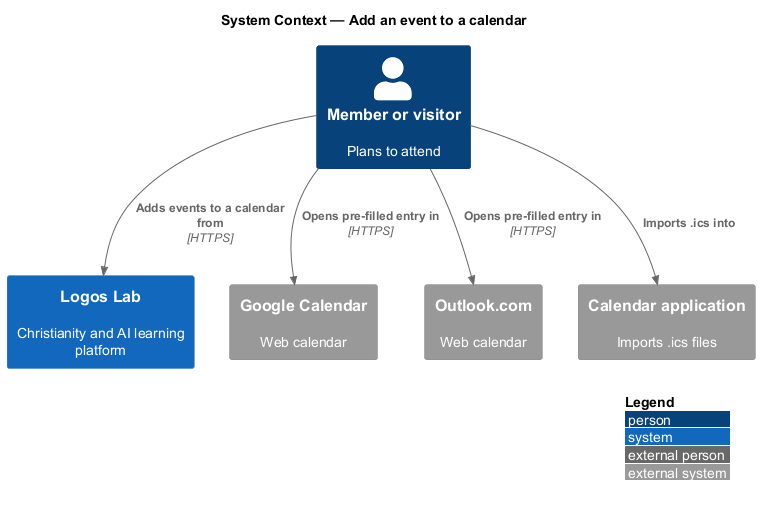
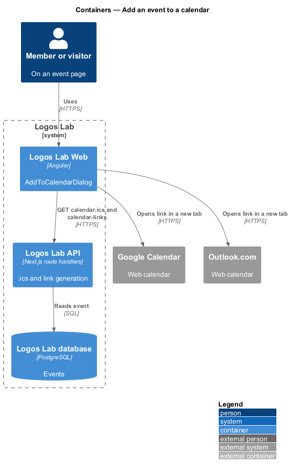
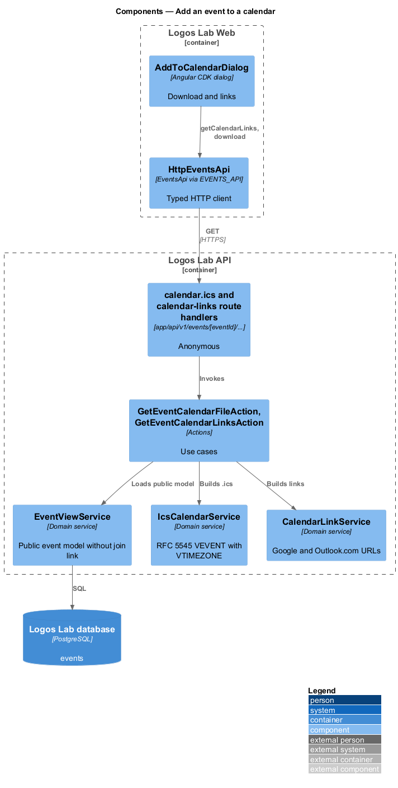
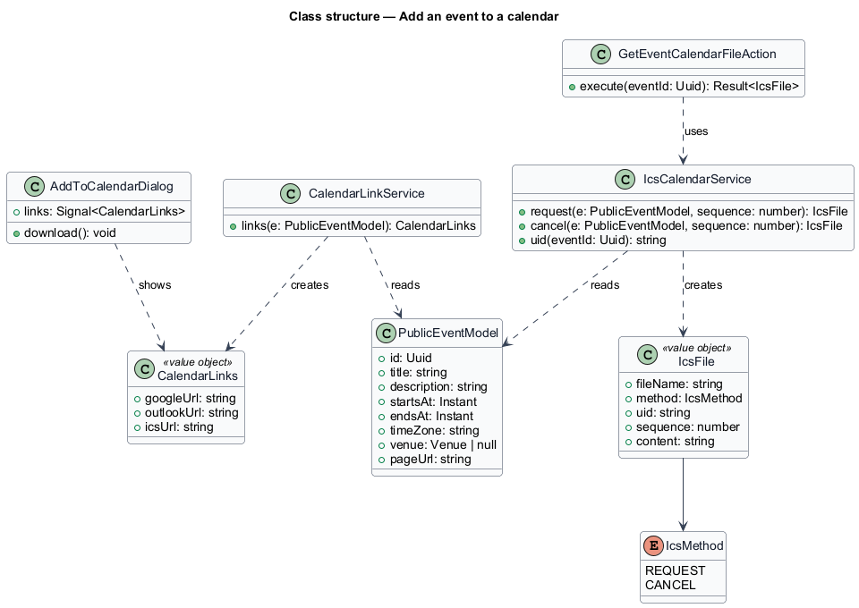
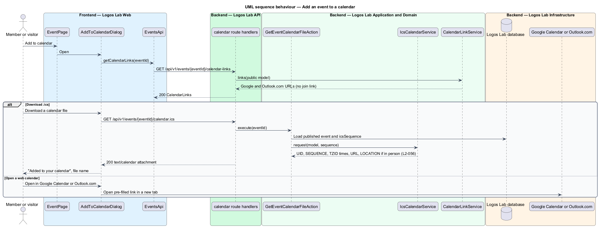

# Add an event to a calendar

## Overview

Members keep their plans in their own calendar applications. This feature lets anyone on an event page put
the event into a calendar: by downloading an `.ics` file, or by opening a pre-filled Google Calendar or
Outlook.com entry. The same `.ics` generator also produces the files attached to registration
confirmations, change notices and cancellations elsewhere in the events subsystem.

Terms used below:

- **iCalendar file (`.ics`)** — text file in the iCalendar format (RFC 5545) that calendar applications import
- **UID** — identifier that names one calendar entry across every file sent for it
- **SEQUENCE** — revision number of an entry; a higher value tells the calendar to replace the stored entry
- **TZID** — iCalendar parameter naming the time zone of a date-time, defined by a `VTIMEZONE` block in the same file
- **pre-filled link** — web address that opens a calendar's new-entry form with title, times, details and location already filled in

## Description

### Screens and states

- **`AddToCalendarDialog`** — `docs/mocks/dialogs/add-to-calendar/` (`default`, `success`). It names the
  event and time, and offers "Download a calendar file (.ics)", "Open in Google Calendar" and "Open in
  Outlook.com", both links opening in a new tab. The success state names the downloaded file and states
  that later changes replace the entry.
- **Entry points** — "Add to calendar" in the event head on `EventPage`
  (`docs/mocks/pages/event-page/`) and "Update my calendar" in the changed notice (`changed.html`).
- **Shared components** — `ll-dialog`, `ll-list`, `ll-button`, `ll-inline-message`.

### API contract

- **`EventsApi`** (token `EVENTS_API`) gains `getCalendarLinks(eventId)` and `calendarFileUrl(eventId)`.

| Method | Path | Purpose |
|---|---|---|
| `GET` | `/api/v1/events/{eventId}/calendar.ics` | Returns the current `.ics` with `Content-Type: text/calendar` and `Content-Disposition: attachment`; anonymous |
| `GET` | `/api/v1/events/{eventId}/calendar-links` | Returns the Google Calendar and Outlook.com pre-filled URLs; anonymous |

### Application and domain

- **`GetEventCalendarFileAction`** and **`GetEventCalendarLinksAction`** — load a published event and call
  the services below.
- **`IcsCalendarService`** — builds a `VCALENDAR` with one `VEVENT` and the `VTIMEZONE` for the event's
  zone. Fields:
  - `UID` — stable per event, derived from the event id (for example `event-{eventId}@logoslab.ca`).
  - `SEQUENCE` — the event's `icsSequence`, raised by each published change (`L2-056` criterion 3).
  - `DTSTART;TZID=...` and `DTEND;TZID=...` — start and end in the event's own zone.
  - `SUMMARY`, `DESCRIPTION`, `URL` (the event page).
  - `LOCATION` — venue name and address for in-person events.
  - `METHOD:REQUEST` for downloads and notices; `METHOD:CANCEL` with `STATUS:CANCELLED` for
    cancellations.
  - Never the online join link (`L2-056` criterion 2, `L2-058`). The builder takes the public event model,
    which has no join-link field.
- **`CalendarLinkService`** — builds the Google Calendar template URL and the Outlook.com compose deep
  link from the same public model, with times in UTC and the event page URL in the details.

### Rules from the acceptance criteria

- "Add to calendar" offers an `.ics` download and pre-filled Google Calendar and Outlook.com links
  (`L2-056` criterion 1).
- The `.ics` has a stable UID, start and end with the event's TZID, title, description, event page URL and,
  for in-person events, the location. It never contains the join link (criterion 2).
- A new `.ics` after an update keeps the UID and has a higher SEQUENCE (criterion 3).

Open point: `L2-056` names the location for in-person events only; whether hybrid events carry their venue
as `LOCATION` is `<TO SUPPLY>`. The UID domain part is `<TO SUPPLY>`.

## Requirements

The feature realizes the following level-2 (L2) requirements. Each L2 requirement refines the level-1 (L1) requirement cited beside it.

| L2 ID | Refines (L1) | Requirement |
|-------|--------------|-------------|
| `L2-056` | `L1-010` | **Calendar integration.** Members shall be able to add events to their calendar. |

## Diagrams

### System context

Users download an `.ics` file from Logos Lab, or open a pre-filled entry in Google Calendar or Outlook.com.

### Containers

The API generates the `.ics` and the links; the browser hands them to the user's calendar.

### Components

`IcsCalendarService` and `CalendarLinkService` both read the public event model, so neither can include the
join link.

### Class structure

`IcsFile` is built from `PublicEventModel` with the event's `icsSequence`; `CalendarLinks` carries the two
pre-filled URLs.

### Behaviour — add to calendar

The dialog loads the links, then either downloads the `.ics` or opens a calendar link in a new tab.

