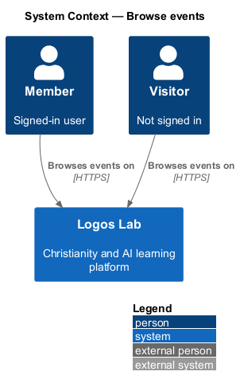
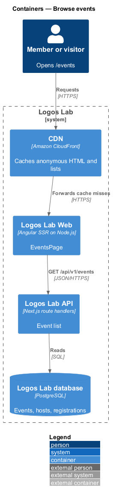
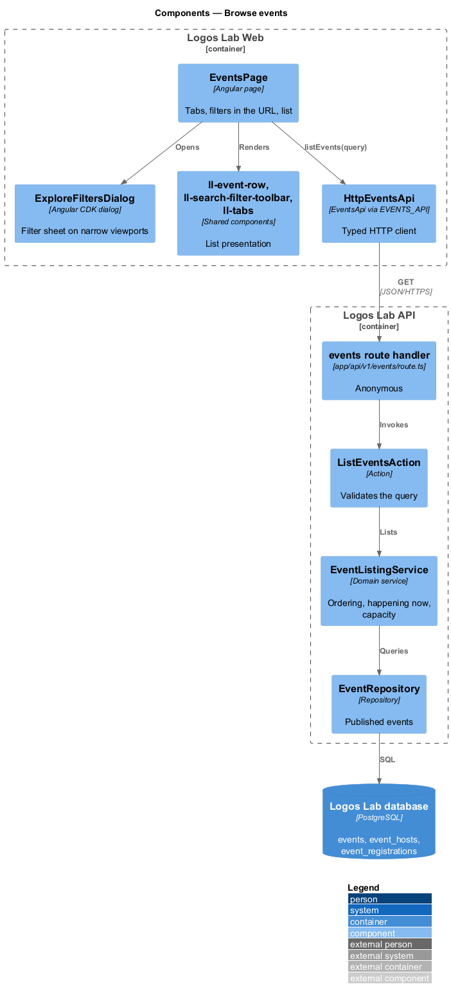
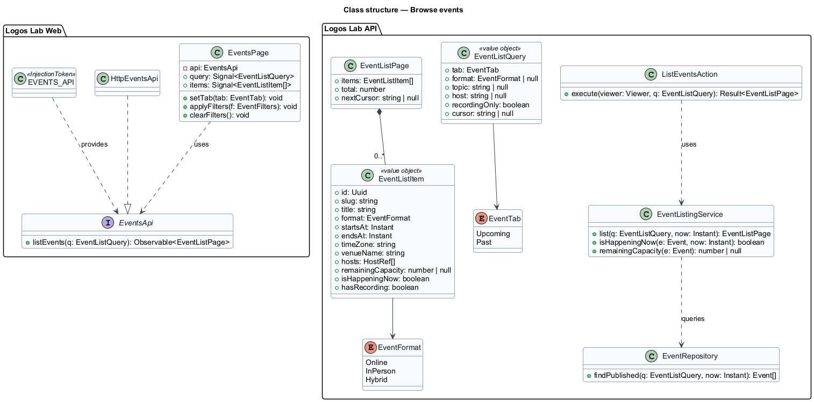
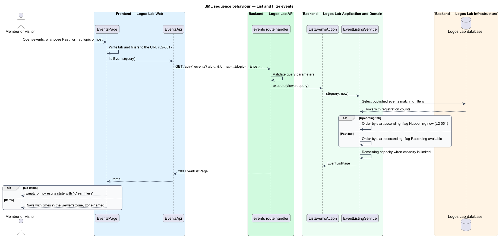

# Browse events

## Overview

Logos Lab runs live events: Q&As, workshops, panels and evenings with experts, online, in person or both.
The events page at `/events` is where anyone, signed in or not, finds what is coming up and what has
already happened. It is the entry point of the events subsystem; each row leads to an event page
(`view-event`).

Terms used below:

- **event format** — how an event is attended: Online, In person or Hybrid (online and at a venue at once)
- **upcoming event** — published event whose end time is still in the future
- **past event** — published event whose end time has passed
- **happening now** — upcoming event whose start time has passed and whose end time has not
- **remaining capacity** — capacity minus confirmed registrations, shown only for events with limited capacity
- **viewer's time zone** — IANA time zone of the person viewing the page, used to show event times

## Description

### Screens and states

- **`EventsPage`** — routed page at `/events`, server-rendered (`L2-142`). It covers
  `docs/mocks/pages/events/`: `default` (upcoming, soonest first), `live` ("Happening now" leads the list),
  `past` (newest first, with the "Recording available" filter), `empty`, `no-results` (names the filters,
  "Clear filters"), `loading`, `error` and `long`.
- **`ExploreFiltersDialog`** — the filter sheet on narrow viewports, covering the event variant of
  `docs/mocks/dialogs/explore-filters/` (`default`, `selected`, `busy`).
- **Shared components** — `ll-page-header`, `ll-tabs` (Upcoming, Past), `ll-search-filter-toolbar`
  (format, topic, host selects; active filter pills), `ll-event-row` (date block, title, time with the zone
  named, format and venue, host, badges), `ll-badge` ("Happening now", "You're registered", "Full ·
  waitlist open", "Recording available"), `ll-pagination` ("Show more events"), `ll-empty-state`,
  `ll-skeleton`.

### URL and filters

The URL holds the state, so a filtered list is shareable and survives reload (`L2-051` criterion 3):
`/events?tab=past&format=online&topic={topicSlug}&host={hostSlug}&recording=1`. `EventsPage` reads the
query parameters on load and writes them back on each change with the Angular router.

### Time zones

The API returns instants in UTC with the event's own IANA zone. Logos Lab Web formats times in the viewer's
time zone with `Intl.DateTimeFormat` and names the zone (for example "ET"). During server rendering the
viewer's zone is not known, so the server renders the member's saved zone when signed in, and the event's
zone otherwise; the browser re-renders in its own zone after hydration (baseline choice, `L2-148`).

### API contract

- **`EventsApi`** contract, **`EVENTS_API`** token, **`HttpEventsApi`** implementation; method
  `listEvents(query)`.

| Method | Path | Purpose |
|---|---|---|
| `GET` | `/api/v1/events?tab=&format=&topic=&host=&recording=&cursor=` | Lists published events; anonymous |

Each item holds id, slug, title, format, start, end, event time zone, venue name, hosts, remaining
capacity (null when unlimited), `isHappeningNow`, `hasRecording`, and, for a signed-in caller, the caller's
registration status.

### Application and domain

- **`ListEventsAction`** — validates the query and calls `EventListingService`.
- **`EventListingService`** — upcoming: `ends_at > now`, ordered by `starts_at` ascending (`L2-051`
  criterion 1); past: `ends_at <= now`, ordered by `starts_at` descending (criterion 2). It computes
  `isHappeningNow` as `starts_at <= now < ends_at` (criterion 4) and remaining capacity from confirmed
  registrations. The `recording=1` filter keeps events with a recording (`L2-059`).
- **`EventRepository`** — reads `events`, `event_hosts`, `content_topics` and a count of
  `event_registrations`. Only published events are returned; cancelled events stay listed with their
  state (baseline choice, `<TO SUPPLY>` confirmation).
- **Caching** — the anonymous response may be cached by the CDN for a short time (`L2-124`); the
  caller-specific registration badges come from a separate authenticated call after hydration.

Open points: page size for "Show more events" is `<TO SUPPLY>`. CDN cache lifetime for the anonymous list
is `<TO SUPPLY>`.

## Decisions for the web build

- **Contract.** `EventsApi.listEvents(query)` returns `EventList`: `events`, `total` (matching the filters),
  `totalEvents` (on this tab, unfiltered, for "see all 9"), `nextCursor` (`null` on the last batch), and the
  `topics` and `hosts` the filter selects offer (`slug` and `name`, whatever the filters). An item is the home
  page's `EventSummary` plus `hosts` (names), `happeningNow`, `hasRecording` and, for a signed-in caller,
  `registration` (`registered`, or `waitlisted` with the caller's `waitlistPosition`). One request carries
  the registration; there is no second authenticated call in the browser.
- **Address.** `/events?tab=past&format=online&topic={slug}&host={slug}&recording=1`. Anything else is
  ignored: a `tab` other than `past` is Upcoming; a `format` other than `online`, `in-person` or `hybrid`
  is dropped; a `topic` or `host` that is not a slug is dropped; `recording` counts only on the Past tab. A
  filter change replaces the address and starts the list again; the tabs keep no filters.
- **Batches.** The list grows in place with "Show {n} more events", not pages: `n` is the smaller of 12 (the
  batch size, `<TO SUPPLY>` in the design) and what is left, so 3 of 9 reads "Show 6 more events". The
  next batch is requested with `cursor`, appended below the last row, and focus moves to its first row
  (pagination AC-17, AC-25). A failed batch leaves the list as it was and says so beside the button.
- **Times.** The viewer's time zone is the browser's. A row reads "Thu, Oct 22, 7:00 to 9:00 p.m. ET" with the
  generic short zone name, and the page's sub-line names it in full: "Eastern Time (ET)".
- **Rows.** The where line is the format, then the venue (for Hybrid, "online and in {venue}"), then "hosted
  by" the hosts. Side, in this order: a "Happening now" badge; "You're registered" or, for a waitlisted
  member, a warning badge "Full · you're number {n} on the waitlist"; otherwise "Full · waitlist open" for a
  full event, or "{n} places left" when capacity is limited. A live row also says "started {n} minutes ago"
  after the time, worked out when the list loads. A past row says "ended" after its date and carries
  "Recording available" and a quiet "Watch" link when it has a recording.
- **Filters.** Format, Topic and Host are selects in the toolbar at every width, and the Past tab adds a
  "Recording available" checkbox. Each filter that is on also shows as a removable pill under the toolbar.
  The filter sheet below LG (`ExploreFiltersDialog`) is not part of this build: the selects stay inline.
- **States.** No upcoming events at all: "No events scheduled right now" with a "See past events" link.
  Filters with no match: the count line names them, and the empty state offers "Clear filters" and says how
  many there are without them. The Past tab with no events has the count "No past events" and an empty state
  titled "No past events yet". Loading shows three skeleton rows and the disabled toolbar; a failure shows
  "We couldn't load events" with "Try again" and "Contact support".

## Requirements

The feature realizes the following level-2 (L2) requirements. Each L2 requirement refines the level-1 (L1) requirement cited beside it.

| L2 ID | Refines (L1) | Requirement |
|-------|--------------|-------------|
| `L2-051` | `L1-010` | **Event listing.** The events page (`/events`) lists published events. |

## Diagrams

### System context

Members and visitors browse events on Logos Lab without signing in.

### Containers

Logos Lab Web server-renders `/events` from the API's event list; the CDN caches the anonymous response.

### Components

`EventsPage` keeps filters in the URL and calls `EventsApi`; `ListEventsAction` uses
`EventListingService` for ordering, "Happening now" and remaining capacity.

### Class structure

`EventListQuery` carries the tab and filters; `EventListItem` carries what one `ll-event-row` shows.

### Behaviour — list and filter events

A filter change updates the URL and reloads the list; the service applies the ordering and labels from
`L2-051`.

