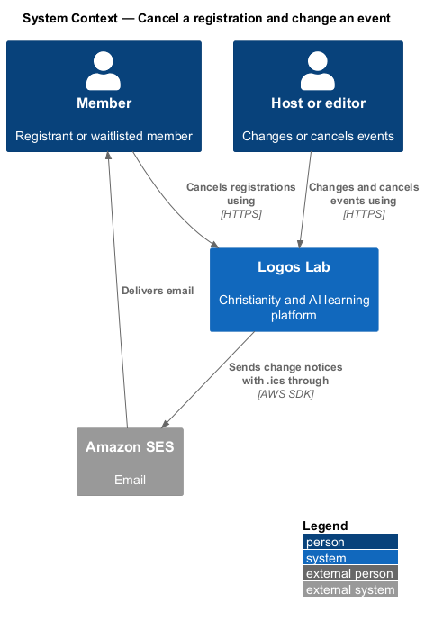
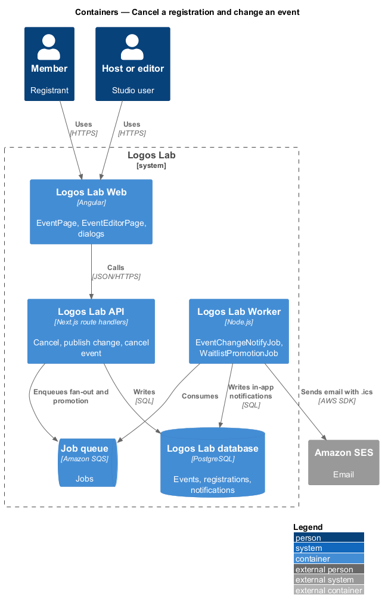
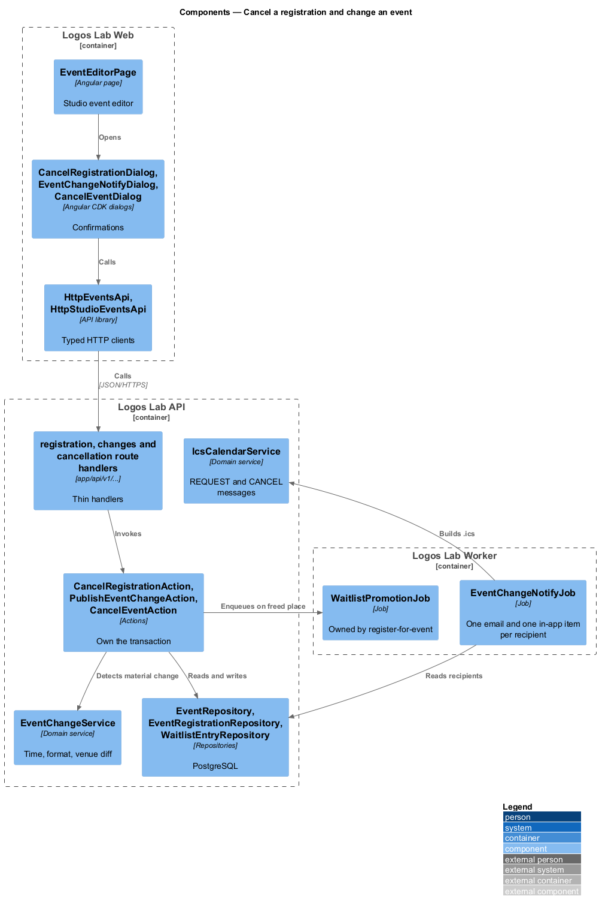
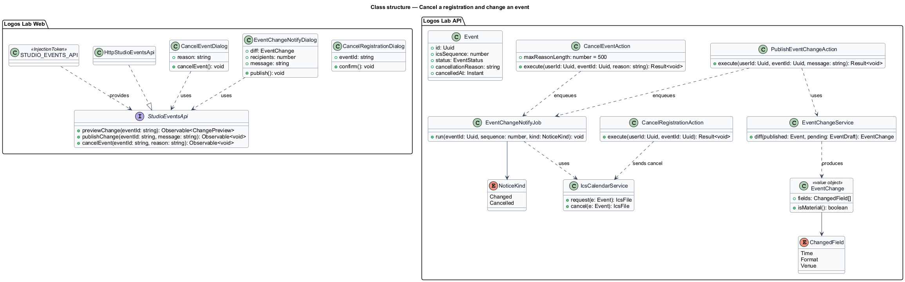
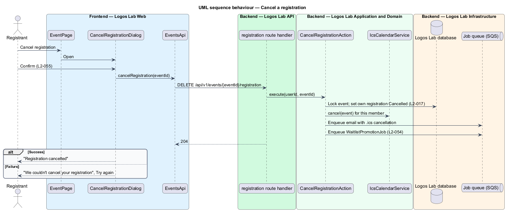
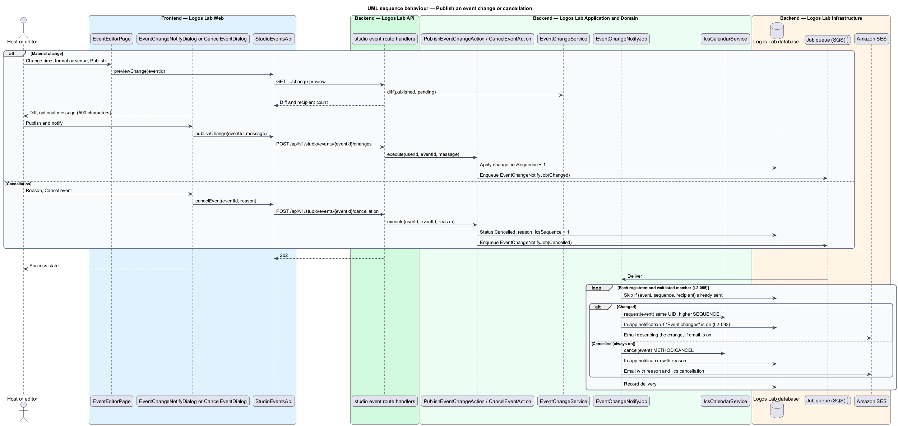

# Cancel a registration and change an event

## Overview

Plans change on both sides of an event. A member may no longer be able to attend, and a host or editor may
move an event, change its format or venue, or cancel it outright. This feature covers those three changes
and how everyone affected hears about them, including an updated calendar entry.

The feature sits in the events subsystem. A member's cancellation frees a place, which triggers the waitlist
promotion owned by `register-for-event`. Event changes reuse the `.ics` generation from
`add-event-to-calendar`, so calendars update the existing entry instead of adding a second one.

Terms used below:

- **registrant** — member with a confirmed registration for the event
- **waitlisted member** — member with an active waitlist entry for the event
- **material change** — published change to an event's time, format or venue
- **event cancellation** — publication of an event's cancellation with a reason, after which registration is unavailable
- **`.ics` cancellation** — calendar message with `METHOD:CANCEL` and the event's stable UID that removes the entry from the recipient's calendar

## Description

### Screens and states

- **`CancelRegistrationDialog`** — `docs/mocks/dialogs/cancel-registration/` (`default`, `busy`, `failed`,
  `success`), opened from "Cancel registration" in `ll-rsvp-panel` on `EventPage`.
- **`EventEditorPage`** — Studio editor for an event, route `/studio/events/{eventId}` (baseline choice). It
  covers `docs/mocks/pages/event-editor/` (`default`, `empty`, `in-person`, `invalid`, `cancelled`, `past`,
  `loading`, `error`). Its aside shows registrations, the waitlist and the reminder schedule; its
  danger zone (`ll-danger-zone`) holds "Cancel event".
- **`EventChangeNotifyDialog`** — `docs/mocks/dialogs/event-change-notify/` (`default`, `busy`, `failed`,
  `success`). It shows the change as a diff (`ll-diff`) and takes an optional message of up to 500
  characters.
- **`CancelEventDialog`** — `docs/mocks/dialogs/cancel-event/` (`default`, `invalid`, `busy`, `failed`,
  `success`). The reason is required, up to 500 characters, and is shown on the event page and in the
  notification.
- **Member-facing results** — `docs/mocks/pages/event-page/changed.html` and `cancelled.html`, and the
  warning and danger notification items in `docs/mocks/notifications/notification/`.

### API contract

- **`EventsApi`** (token `EVENTS_API`) gains `cancelRegistration`.
- **`StudioEventsApi`** contract, **`STUDIO_EVENTS_API`** token and **`HttpStudioEventsApi`** implementation,
  with `getEvent`, `saveDraft`, `previewChange`, `publishChange` and `cancelEvent`.

| Method | Path | Purpose |
|---|---|---|
| `DELETE` | `/api/v1/events/{eventId}/registration` | Cancels the caller's registration and frees the place |
| `GET` | `/api/v1/studio/events/{eventId}/change-preview` | Returns the material-change diff and the number of people to notify |
| `POST` | `/api/v1/studio/events/{eventId}/changes` | Publishes the pending change and notifies registrants and waitlisted members |
| `POST` | `/api/v1/studio/events/{eventId}/cancellation` | Cancels the event with a reason |

Studio endpoints require the event's host or an editor (`L2-016`).

### Application and domain

- **Actions** — `CancelRegistrationAction`, `PublishEventChangeAction` and `CancelEventAction`.
- **`EventChangeService`** — compares the published and pending versions and reports which of time, format
  and venue changed. Only those fields trigger the `L2-055` notice. Each published material change and
  each cancellation increments the event's `icsSequence`.
- **`IcsCalendarService`** — builds the updated `.ics` (`METHOD:REQUEST`, same UID, higher SEQUENCE) and the
  cancellation (`METHOD:CANCEL`).
- **`EventChangeNotifyJob`** — fans out one email and one in-app notification per registrant and waitlisted
  member, with the `.ics` attached. It is idempotent per (event, sequence, recipient). Event changes honour
  the member's "Event changes" preference; cancellations are always on (`L2-093`).
- **Cancellation of a registration** — `CancelRegistrationAction` sets the registration to `Cancelled`, sends
  the member an `.ics` cancellation, and enqueues `WaitlistPromotionJob` (`L2-054`).
- **Entities and tables** — `Event` (`events`: `ics_sequence`, `status`, `cancellation_reason`,
  `cancelled_at`), `EventRegistration`, `WaitlistEntry`, `Notification` (`notifications`).

### Rules from the acceptance criteria

- A registrant who chooses "Cancel registration" and confirms in a dialog loses the registration, and the
  waitlist is promoted (`L2-055` criterion 1).
- A published change to time, format or venue sends every registrant and waitlisted member an email and an
  in-app notification describing it, with an updated `.ics` (criterion 2).
- A published cancellation notifies every registrant and waitlisted member with the reason and sends an
  `.ics` cancellation (criterion 3).

Spec and mock gap: the `cancel-event` and `event-change-notify` dialogs count only "registered people",
while `L2-055` includes waitlisted members. This design follows `L2-055`; the dialog copy is `<TO SUPPLY>`.
Whether a material change to a published event first passes editorial review (`L2-080`) is `<TO SUPPLY>`.

## Requirements

The feature realizes the following level-2 (L2) requirements. Each L2 requirement refines the level-1 (L1) requirement cited beside it.

| L2 ID | Refines (L1) | Requirement |
|-------|--------------|-------------|
| `L2-055` | `L1-010` | **Registration cancellation and event changes.** Members shall be able to cancel registrations, and they shall be told when an event changes. |

## Diagrams

### System context

Members cancel registrations, and hosts and editors change or cancel events. Logos Lab notifies those
affected through Amazon SES and in-app notifications.

### Containers

The API records the change in one transaction and enqueues the fan-out; the Worker sends each email with
its `.ics` file.

### Components

`EventChangeService` detects material changes; `IcsCalendarService` builds calendar messages;
`EventChangeNotifyJob` delivers them once per recipient.

### Class structure

`Event` carries `icsSequence` and its cancellation fields; `EventChange` lists the changed fields that drive
the notice.

### Behaviour — cancel a registration

The member confirms in `CancelRegistrationDialog`; the place is freed, a calendar cancellation is sent,
and the waitlist is promoted.

### Behaviour — publish a change or cancel an event

The host or editor confirms in `EventChangeNotifyDialog` or `CancelEventDialog`. The sequence increases and
each registrant and waitlisted member is notified with the matching `.ics`.

