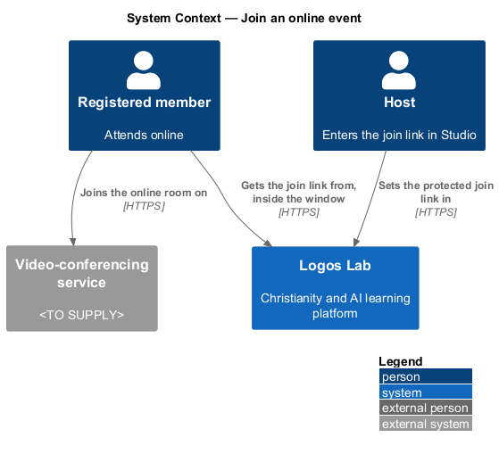
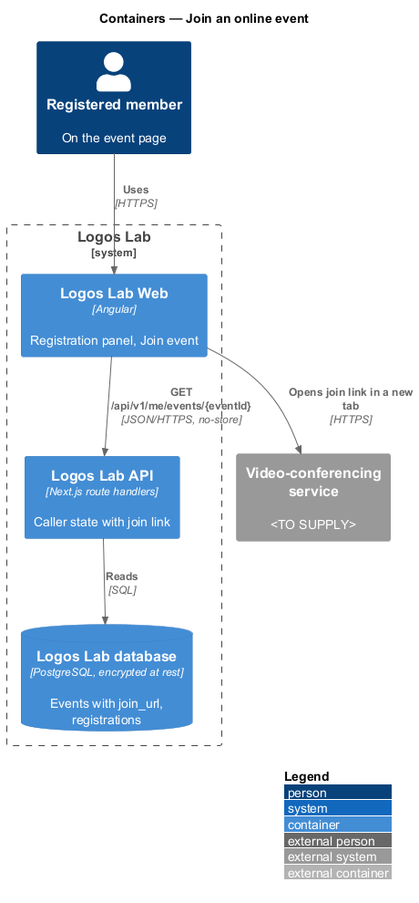
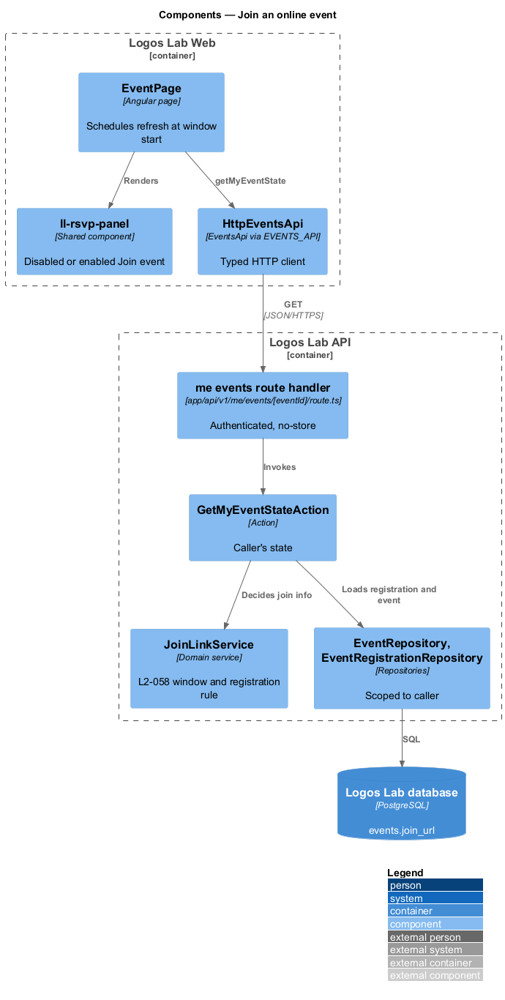
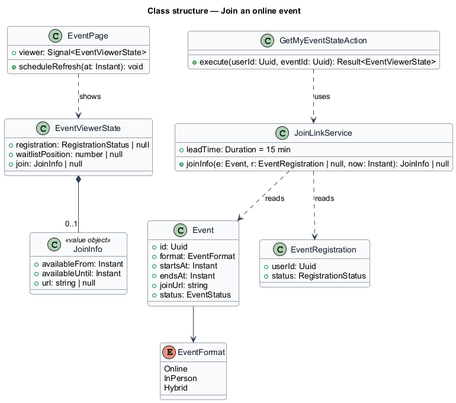
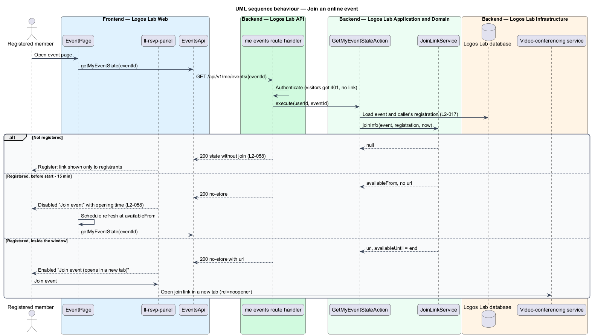

# Join an online event

## Overview

Online and hybrid Logos Lab events take place in a video-conferencing room outside Logos Lab. Anyone who
holds the room's address can walk in, so the address is protected. This feature shows the join link only to
registered members, and only from 15 minutes before the start until the event ends.

The feature sits in the events subsystem on the event page (`view-event`), inside the registration panel.
It relies on `register-for-event` for the registration and on the Studio event editor, where the host
enters the link.

Terms used below:

- **join link** — HTTPS address of the external video-conferencing room for an online or hybrid event
- **join window** — interval from 15 minutes before the event start until the event end, during which a registrant may see the join link
- **video-conferencing service** — external system that hosts the online room (`<TO SUPPLY>`; any provider reachable by HTTPS link)

## Description

### Screens and states

- **`EventPage`** registration panel (`ll-rsvp-panel`) in `docs/mocks/pages/event-page/`:
  - `registered` — "Join event" is disabled and states when it becomes available (for example "The join
    link appears here from 11:45 am ET on Tue 27 Oct, 15 minutes before the start").
  - `join-open` — "Join event (opens in a new tab)" is enabled, with "Please don't share the link".
  - `live` — "Happening now", with Join event and the end time.
  - `default` and `visitor` — no link; the panel states that the link is shown only to registered members.
- **`EventEditorPage`** — the protected "Join link" field (`docs/mocks/pages/event-editor/default.html`):
  "Never shown on the public page or in calendar files". The `invalid` state refuses a link that does not
  start with `https://`.
- **Client timing** — the panel switches from disabled to enabled at the window start by re-reading the
  caller's state from the API. The browser clock only schedules the refresh; the server decides.

### API contract

- **`EventsApi`** (token `EVENTS_API`) method `getMyEventState(eventId)`.

| Method | Path | Purpose |
|---|---|---|
| `GET` | `/api/v1/me/events/{eventId}` | Returns registration state and `join`: `availableFrom`, `availableUntil`, and `url` only inside the window |
| `GET` | `/api/v1/events/by-slug/{slug}` | Public event detail; never includes the join link |

Responses carrying the join link set `Cache-Control: private, no-store`, so neither the CDN nor a shared
cache keeps them (`L2-113`).

### Application and domain

- **`GetMyEventStateAction`** — loads the caller's registration and calls `JoinLinkService`.
- **`JoinLinkService`** — returns the URL only when the caller holds a `Registered` registration, the event
  format is Online or Hybrid, the event is not cancelled, and `startsAt - 15 min <= now < endsAt`. Otherwise
  it returns the window times without a URL.
- **Data** — `events.join_url`, encrypted at rest with the database (`L2-112`). Only `JoinLinkService` and
  the Studio editor read it. The public model, `.ics` builder and notification templates have no join-link
  field.
- **Logging** — structured logs never include the join link (`L2-137`).

### Rules from the acceptance criteria

- From 15 minutes before the start until the event ends, a registrant sees an enabled "Join event" button
  that opens the link in a new tab (`L2-058` criterion 1).
- Earlier, the button is disabled and states when it becomes available (criterion 2).
- For a member who is not registered, or a visitor, the event-detail API omits the join link (criterion 3).

## Requirements

The feature realizes the following level-2 (L2) requirements. Each L2 requirement refines the level-1 (L1) requirement cited beside it.

| L2 ID | Refines (L1) | Requirement |
|-------|--------------|-------------|
| `L2-058` | `L1-010` | **Online join link protection.** Online event join links shall be visible only to registered members, and only near the start time. |

## Diagrams

### System context

Registered members get the join link from Logos Lab and then enter the room on the external
video-conferencing service.

### Containers

The API returns the join link only inside the window, in a private, uncached response.

### Components

`JoinLinkService` holds the window and registration rule; the public model has no join-link field.

### Class structure

`JoinInfo` always carries the window times; its `url` is set only when `JoinLinkService` allows it.

### Behaviour — join an online event

Before the window, the panel shows a disabled button with the opening time. Inside it, the API returns the
URL and the button opens the room in a new tab.

