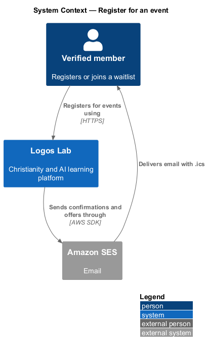
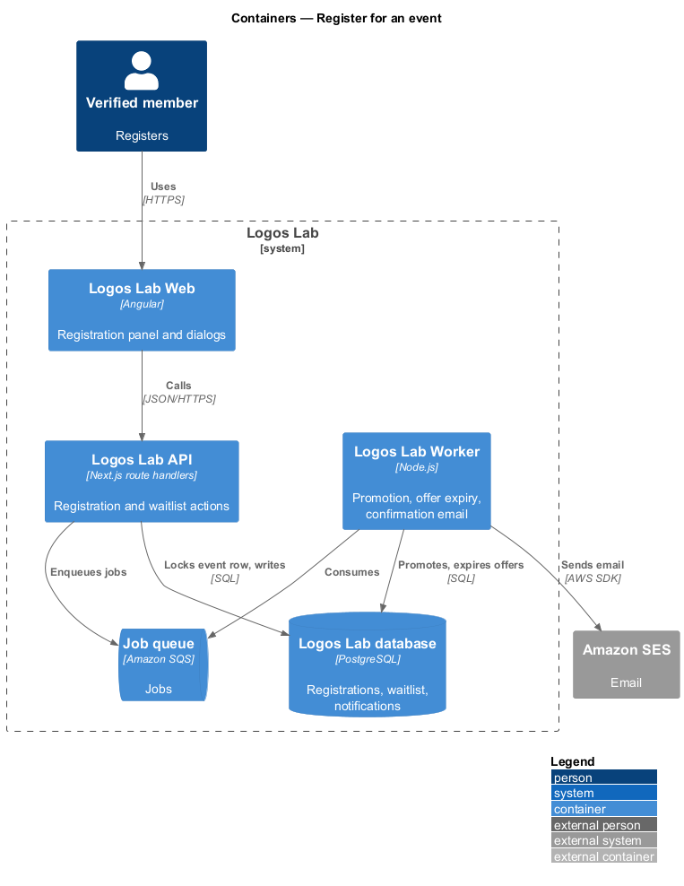
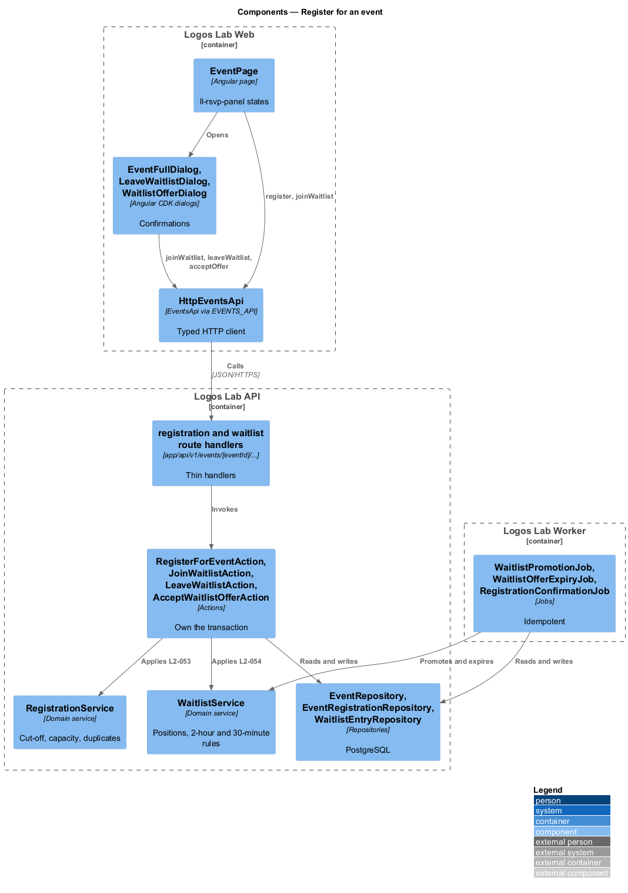
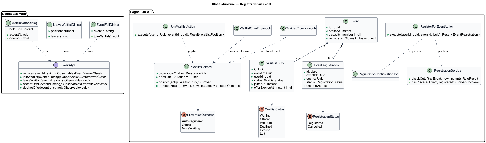
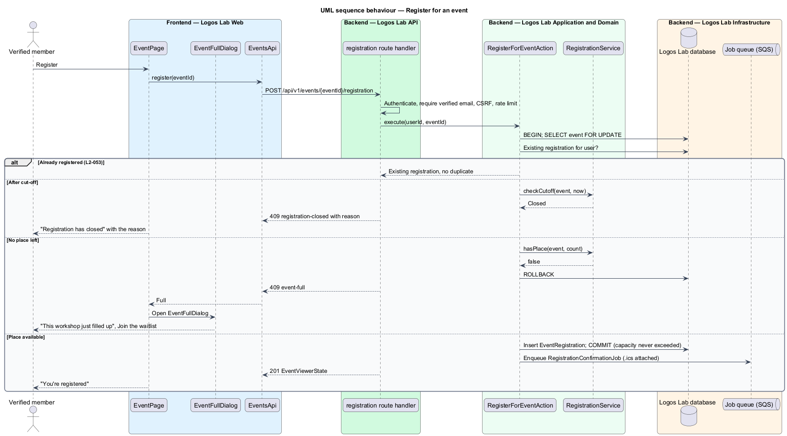
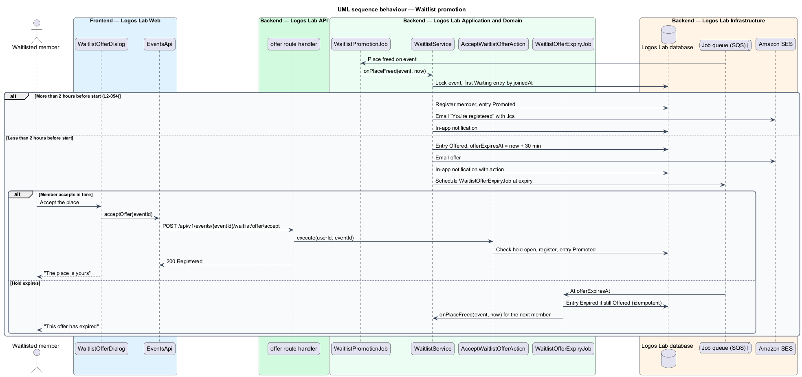

# Register for an event

## Overview

Members register for Logos Lab events to hold a place, receive a calendar file and get reminders. Some
events have limited capacity; when every place is taken, members may join a waitlist and are promoted
automatically when a place frees up. This feature covers registration, capacity, the registration
cut-off and the waitlist.

The feature sits in the events subsystem behind the registration panel of the event page (`view-event`).
Cancelling a registration, which frees a place, belongs to `cancel-registration-and-change-event`; this
feature owns the promotion that follows.

Terms used below:

- **verified member** — signed-in member whose email address is verified (`L2-007`)
- **registration** — record that a member holds a place at an event
- **capacity** — maximum number of registrations; empty means unlimited
- **registration cut-off** — time after which registration is refused; the event start by default, or an earlier time set by the host
- **waitlist** — ordered queue of members waiting for a place at a full event
- **waitlist offer** — place held for the first waitlisted member for 30 minutes when it frees up less than 2 hours before the start

## Description

### Screens and states

- **`EventPage`** registration panel (`ll-rsvp-panel`) states from `docs/mocks/pages/event-page/`:
  `default` (Register, places left), `registered` ("You're registered"), `full` (Join the waitlist),
  `waitlisted` (position, Leave the waitlist), `closed` (cut-off passed) and `visitor` (Sign in to register).
- **`EventFullDialog`** — `docs/mocks/dialogs/event-full/` (`default`, `busy`, `success`). Opens when the
  last place went to someone else at the same moment, and offers the waitlist.
- **`LeaveWaitlistDialog`** — `docs/mocks/dialogs/leave-waitlist/` (`default`, `busy`, `failed`, `success`).
- **`WaitlistOfferDialog`** — `docs/mocks/dialogs/waitlist-offer/` (`default` with the hold time, `busy`,
  `expired`, `success`). Opened from the offer notification (`docs/mocks/notifications/notification/with-action.html`).
- **Notifications** — waitlist position and promotion items use `ll-notification-item` and `ll-toast`
  (`docs/mocks/notifications/notification/`).

### API contract

- **`EventsApi`** (token `EVENTS_API`) gains `register`, `joinWaitlist`, `leaveWaitlist`, `acceptOffer` and
  `declineOffer`.

| Method | Path | Purpose |
|---|---|---|
| `POST` | `/api/v1/events/{eventId}/registration` | Registers the caller; 409 `event-full` or `registration-closed` with the reason |
| `POST` | `/api/v1/events/{eventId}/waitlist` | Adds the caller at the end of the waitlist; returns the position |
| `DELETE` | `/api/v1/events/{eventId}/waitlist` | Removes the caller from the waitlist |
| `POST` | `/api/v1/events/{eventId}/waitlist/offer/accept` | Accepts a held place while the hold is open |
| `POST` | `/api/v1/events/{eventId}/waitlist/offer/decline` | Declines a held place; it passes to the next member |

All require a verified member and the CSRF check; registration endpoints are rate limited (`L2-107`).

### Application and domain

- **Actions** — `RegisterForEventAction`, `JoinWaitlistAction`, `LeaveWaitlistAction`,
  `AcceptWaitlistOfferAction`, `DeclineWaitlistOfferAction`.
- **`RegistrationService`** — applies the cut-off and capacity rules. It locks the event row
  (`SELECT ... FOR UPDATE`) inside the action's transaction, counts confirmed registrations, and inserts
  only when a place remains, so capacity is never exceeded (`L2-053` criterion 2).
- **Duplicate guard** — a partial unique index on `event_registrations (event_id, user_id)` where the status
  is `Registered` makes a repeat request return the existing registration (criterion 4).
- **`WaitlistService`** — derives each position from join order among active entries, so leaving moves
  everyone behind up one place without rewriting rows (`L2-054` criterion 4). It promotes when a place
  frees: more than 2 hours before the start, the first waitlisted member is registered and notified by
  email and in-app (criterion 2); less than 2 hours before, the place is offered for 30 minutes
  (criterion 3).
- **Jobs** — `WaitlistPromotionJob` runs after a place frees; `WaitlistOfferExpiryJob` runs at the hold's
  expiry and passes the place to the next member. `RegistrationConfirmationJob` sends the confirmation
  email with an `.ics` attachment through Amazon SES (`L2-053` criterion 1), built by `IcsCalendarService`
  (`add-event-to-calendar`). In-app items go through `NotificationService` (`L2-091`).
- **Entities and tables** — `EventRegistration` (`event_registrations`), `WaitlistEntry`
  (`event_waitlist_entries`: status, joined time, offer expiry).

### Rules from the acceptance criteria

- With capacity remaining, Register creates the registration, sends a confirmation email with an `.ics`
  attachment, and the page shows "You're registered" (`L2-053` criterion 1).
- Two simultaneous requests for the last place confirm exactly one; the other member is offered the
  waitlist (criterion 2).
- Registration closes at the start time by default, or at the host's cut-off, and a late request is
  refused with the reason (criterion 3).
- A repeat registration creates no duplicate (criterion 4).
- Joining a full event's waitlist adds the member at the end and shows the position (`L2-054` criterion 1).

Open points: the behaviour when a hold would run past the start or the cut-off is `<TO SUPPLY>`. The
mechanism that runs `WaitlistOfferExpiryJob` at an exact time is `<TO SUPPLY>` (SQS delays stop at 15
minutes). Whether a member waitlisted at a cut-off can still be promoted is `<TO SUPPLY>`. The
`expired` mock says the member stays on the list after a hold lapses, while `L2-054` only says the place
passes to the next member; the lapsed member's new position is `<TO SUPPLY>`.

## Requirements

The feature realizes the following level-2 (L2) requirements. Each L2 requirement refines the level-1 (L1) requirement cited beside it.

| L2 ID | Refines (L1) | Requirement |
|-------|--------------|-------------|
| `L2-053` | `L1-010` | **Event registration and capacity.** Verified members shall be able to register for events with limited or unlimited capacity. |
| `L2-054` | `L1-010` | **Event waitlist.** When an event is full, members shall be able to join a waitlist that is promoted automatically. |

## Diagrams

### System context

Members register and join waitlists on Logos Lab, which emails confirmations and offers through Amazon SES.

### Containers

The API applies capacity in a database transaction and enqueues email and promotion jobs for the Worker.

### Components

`RegistrationService` and `WaitlistService` hold the rules; the jobs promote, expire offers and send
confirmations.

### Class structure

An `Event` has many `EventRegistration` rows and many `WaitlistEntry` rows; positions derive from join order.

### Behaviour — register with capacity

The action locks the event row, checks the cut-off and capacity, and either registers or returns
`event-full`, which opens `EventFullDialog`.

### Behaviour — waitlist promotion

When a place frees more than 2 hours before the start, the first member is registered; closer to the start,
the place is held for 30 minutes and then passes on.

