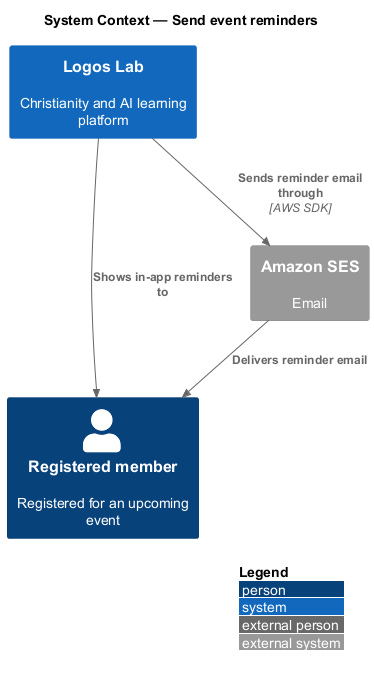
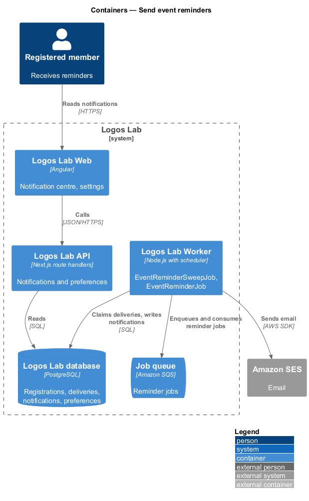
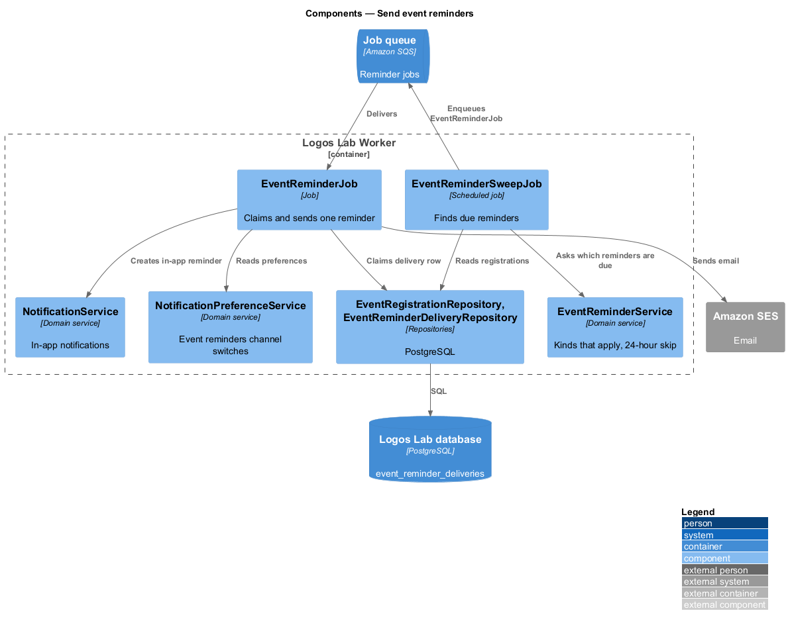
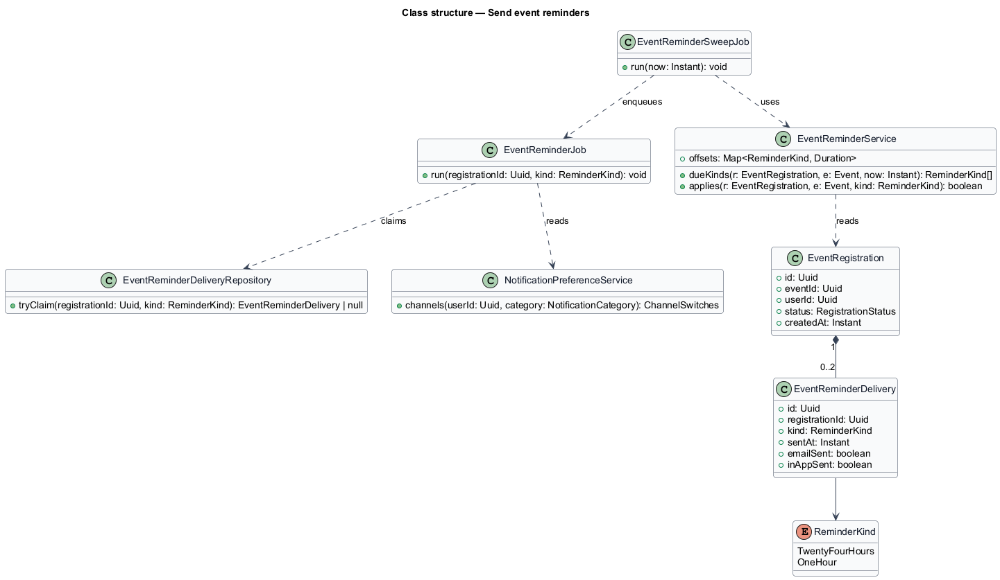
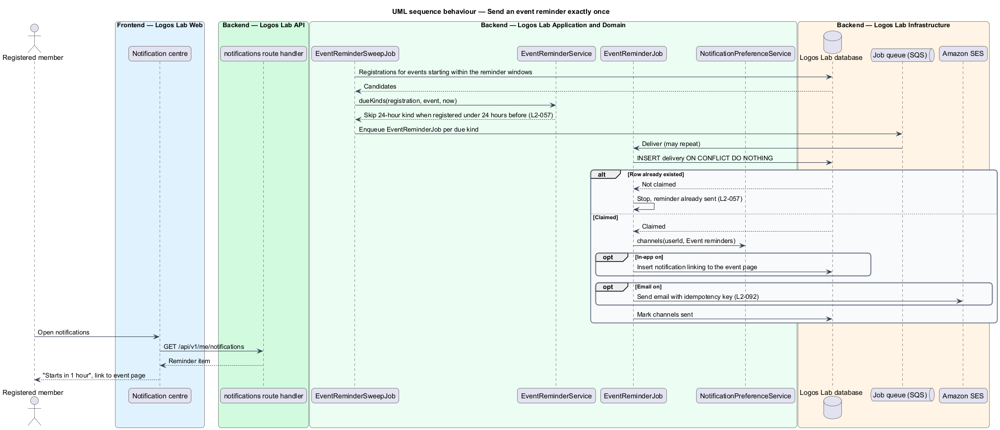

# Send event reminders

## Overview

Registered members receive two reminders before an event: one a day ahead and one an hour ahead. The
reminders reduce no-shows and, for online events, point members to the event page where the join link
appears. This feature is a background slice of the events subsystem with no screen of its own apart from
the notification items and the "Event reminders" preference.

Terms used below:

- **reminder** — email and in-app notification sent to a registrant at a fixed offset before the event start
- **24-hour reminder** — reminder due 24 hours before the start
- **1-hour reminder** — reminder due 1 hour before the start
- **reminder delivery** — record that one reminder kind was sent to one registrant for one event, used to guarantee a single send
- **reminder sweep** — periodic job run that finds reminders that are due and not yet delivered

## Description

### Screens and states

- **Notifications** — reminder items use `ll-notification-item` in the notification centre and `ll-toast`
  (`docs/mocks/notifications/notification/`).
- **Preference** — the "Event reminders" row of `SettingsNotificationsPage`
  (`docs/mocks/pages/settings-notifications/default.html`), described there as "24 hours and 1 hour before
  events you've registered for", with separate in-app and email switches (`L2-093`).
- **Event page and editor** — `docs/mocks/pages/event-page/default.html` states "remind you a day and an
  hour before", and the event editor aside shows "Reminders: 24 hours and 1 hour before".

### Mechanism

- **`EventReminderSweepJob`** — started by the Worker's scheduler at a fixed interval (`<TO SUPPLY>`). It
  selects registrations whose event start falls inside the window for each reminder kind and enqueues one
  `EventReminderJob` per due (registration, kind).
- **`EventReminderJob`** — for one registrant and one kind, it inserts an `event_reminder_deliveries` row
  with a unique key on (registration id, kind) using `INSERT ... ON CONFLICT DO NOTHING`. Only the run that
  inserts the row sends. A repeat run finds the row and stops, so each member receives each reminder exactly
  once (`L2-057` criterion 4, `L2-140`).
- **Sending** — the job reads the member's preferences through `NotificationPreferenceService`, writes the
  in-app notification through `NotificationService` if in-app is on, and sends the email through Amazon SES
  if email is on. The SES send carries an idempotency key derived from the delivery id, so a retried send is
  not delivered twice (`L2-092`).
- **Content** — both reminders link to the event page. For online events the 1-hour reminder states that the
  join link is available there; the reminder itself never contains the join link (`L2-058`).

### Application and domain

- **`EventReminderService`** — decides which kinds apply: the 24-hour reminder is skipped for a
  registration created less than 24 hours before the start (`L2-057` criterion 3). Cancelled registrations
  and cancelled events receive no reminder.
- **Entities and tables** — `EventRegistration` (`event_registrations`), `EventReminderDelivery`
  (`event_reminder_deliveries`: registration, kind, sent time, channels), `Notification`
  (`notifications`), `NotificationPreference` (`notification_preferences`).

### Rules from the acceptance criteria

- At 24 hours before the start, a registrant receives an email and an in-app reminder unless event
  reminders are off (`L2-057` criterion 1).
- At 1 hour before the start, a registrant receives a second reminder; for online events it links to the
  event page where the join link is available (criterion 2).
- A registration made less than 24 hours before the start skips the 24-hour reminder (criterion 3).
- Repeated job runs deliver each reminder exactly once (criterion 4).

Open points: the sweep interval and the tolerance around each offset are `<TO SUPPLY>`. Whether waitlisted
members receive reminders is not stated; this design sends reminders to registrants only.

## Requirements

The feature realizes the following level-2 (L2) requirements. Each L2 requirement refines the level-1 (L1) requirement cited beside it.

| L2 ID | Refines (L1) | Requirement |
|-------|--------------|-------------|
| `L2-057` | `L1-010` | **Event reminders.** Registered members shall receive reminders before events start. |

## Diagrams

### System context

Logos Lab sends reminders to registered members by email through Amazon SES and in the app.

### Containers

The Worker's scheduler starts the sweep; reminder jobs run on the Worker and record deliveries in the
database.

### Components

`EventReminderSweepJob` finds due reminders; `EventReminderJob` claims a delivery row before it sends.

### Class structure

`EventReminderDelivery` is unique per registration and kind; `EventReminderService` decides which kinds
apply.

### Behaviour — send a reminder exactly once

The sweep enqueues due reminders. Each job claims its delivery row, honours preferences, and stops if the
row already exists.

