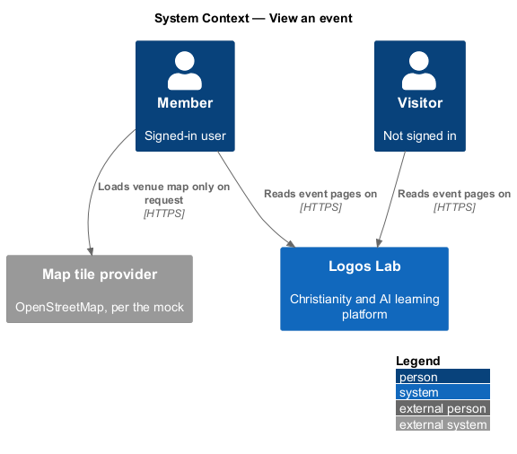
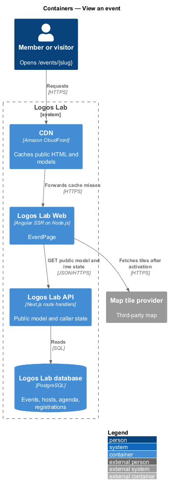
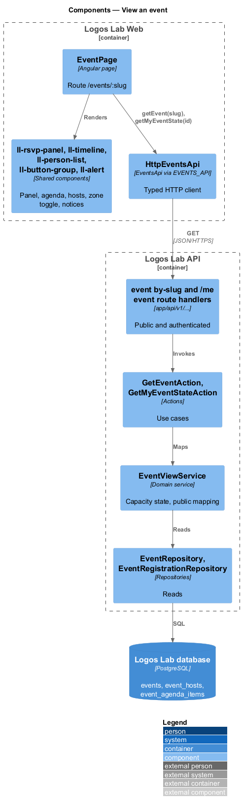
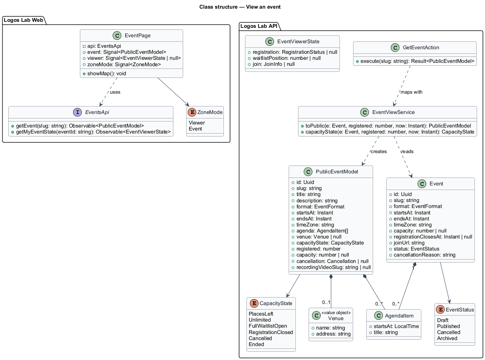
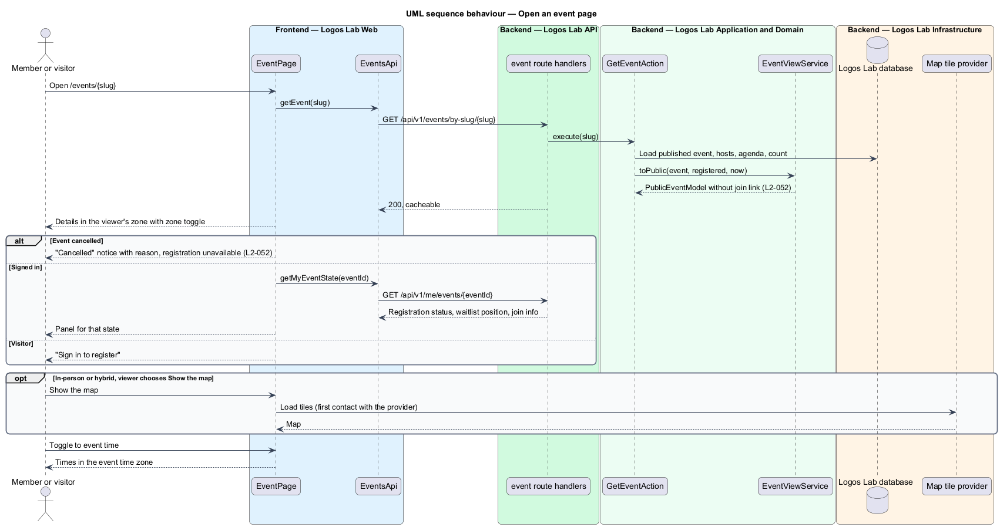

# View an event

## Overview

Each published Logos Lab event has a page at `/events/{slug}`. The page tells a newcomer what the event is,
when and where it happens, who hosts it, and whether places remain. It is also where a member registers,
joins a waitlist, adds the event to a calendar, joins online, or watches the recording afterwards.

This feature covers the page itself and its read-only content. The actions on the page belong to sibling
features in the events subsystem: `register-for-event`, `cancel-registration-and-change-event`,
`add-event-to-calendar`, `join-online-event` and `watch-event-recording`.

Terms used below:

- **event time zone** — IANA time zone in which the host scheduled the event (for example `America/Toronto`)
- **time zone toggle** — two-button control that switches displayed times between the viewer's zone and the event time zone
- **agenda** — ordered list of timed items within the event
- **capacity state** — one of: places left, full with a waitlist, unlimited, registration closed
- **venue** — named physical place with an address, used by in-person and hybrid events

## Description

### Screens and states

- **`EventPage`** — routed page at `/events/:slug`, server-rendered (`L2-142`). It covers
  `docs/mocks/pages/event-page/`: `default` (online, before registering), `visitor` (times in the visitor's
  zone, "Sign in to register"), `in-person` (venue, maps link, map on request), `full`, `closed`
  (registration cut-off passed), `registered`, `waitlisted`, `join-open`, `live`, `changed`, `cancelled`,
  `past`, `loading` and `error`.
- **Sections and components** — `ll-breadcrumb`; the event head (date block, title, full date and time,
  format, venue, hosts); the time zone toggle (`ll-button-group` with "Your time (ET)" and "Event time
  (ET)"); "About" (`ll-prose`, topic `ll-chip` links); "Agenda" (`ll-timeline`); "Where" (venue name,
  address, "Open in your maps app", "Show the map"); "Host" (`ll-person-list`); the registration panel
  (`ll-rsvp-panel`); `ll-alert` for the changed and cancelled notices.
- **Venue map** — the venue block (`venue-map` in the mock) shows no third-party map until the user
  activates "Show the map" (`L2-052` criterion 2). The mock names OpenStreetMap as the tile source. The
  design-system page for this block is `<TO SUPPLY>`. The maps-app link format is `<TO SUPPLY>`.

### API contract

- **`EventsApi`** (token `EVENTS_API`) method `getEvent(slug)`.

| Method | Path | Purpose |
|---|---|---|
| `GET` | `/api/v1/events/by-slug/{slug}` | Returns the public event model; anonymous. 404 when not published |
| `GET` | `/api/v1/me/events/{eventId}` | Returns the caller's registration state and, when allowed, the join link (`join-online-event`) |

The public model holds title, description, hosts, format, start, end, event time zone, agenda, venue
(name, address) for in-person and hybrid events, capacity state, registration cut-off, cancellation state
and reason, change notice, recording reference and topics. It never contains the join link (`L2-052`
criterion 3, `L2-058`), so the CDN may cache it. The caller-specific part comes from the `/me` call after
hydration.

### Application and domain

- **`GetEventAction`** — loads a published event by slug and maps it with `EventViewService`.
- **`EventViewService`** — computes the capacity state and excludes the join link by construction: the
  public model type has no join-link field.
- **Entities and tables** — `Event` (`events`), `EventHost` (`event_hosts`), `AgendaItem`
  (`event_agenda_items`), and the registration count from `event_registrations`.

### Rules from the acceptance criteria

- The page shows title, description, hosts, format, start and end in the viewer's zone with a toggle to the
  event's zone, agenda, capacity state and registration action (`L2-052` criterion 1).
- In-person and hybrid events show venue name and address with a maps link; no third-party map loads until
  activated (criterion 2).
- The join link is never shown on the public page (criterion 3).
- A cancelled event shows a prominent "Cancelled" notice with the reason, and registration is unavailable
  (criterion 4).

## Decisions for the web build

This build is the read-only page. The actions that the registration panel and the head lead to belong to
sibling features and are not built here: registering, joining and leaving the waitlist, cancelling a
registration, Add to calendar and Update my calendar, the Join event button, and the recording player.

- **Contract.** `EventsApi.getEvent(slug)` returns `EventPageModel`: `id`, `slug`, `title`, `description`
  (paragraphs of plain text), `attendance`, `startsAt`, `endsAt`, `timeZone` (IANA), `hosts` (`name`, `slug`
  or `null` for Logos Lab itself, `meta`, `photoUrl`), `topics` (`slug`, `name`), `agenda` (`startsAt`,
  `text`), `venue` (`name`, `address`) or `null`, `registeredCount`, `capacity` or `null`, `waitlistCount`,
  `registrationClosesAt` or `null`, `cancellation` (`cancelledOn`, `reason`) or `null`, and `change`
  (`previousStartsAt`, `previousEndsAt`, `note`) or `null` for a changed time. It has no join link.
  `getMyEvent(id)` returns `EventViewerState`: `status` (`none`, `registered` or `waitlisted`) and
  `waitlistPosition`. A `404` for the slug means no published event, and shows the not-found page. The
  member's state is requested after the page shows, and only for a signed-in member; a visitor gets the
  sign-in panel.
- **Times.** The head, the agenda and the closing notes show times in the viewer's zone ("Your time (PT)")
  or in the event's ("Event time (ET)"). The toggle starts on the viewer's zone and is not remembered. The
  zones are named in the generic short form, and the agenda's note names the zone in full.
- **Head.** The date block, the title as the page's only h1, "Tuesday 27 October 2026, 12:00 to 1:00 pm ET",
  the format with its venue ("In person · St. Brigid's Hall, Ottawa"; "Hybrid · online and at …"), and
  "Hosted by". A cancelled event strikes the title and reads "Was …". A past event reads "… · ended".
- **Sections.** About (the description, then the topics as links), Agenda (when the event has one), Where
  (for in-person and hybrid events: the venue name and address and "Open in your maps app", a `geo:` link
  on the address), and Host. The map is not built: its provider and the venue's coordinates are
  `<TO SUPPLY>`, and nothing third-party loads, which satisfies `L2-052` criterion 2 on its own.
- **The panel's state**, first match wins:
  1. Cancelled: "Registration is unavailable", "This event was cancelled on Tue 13 Oct 2026. If you were
     registered, there is nothing more to do." and a danger alert above the head with the reason and "See
     other events".
  2. Ended: "This event has ended", "This event took place on Thu 24 Sep 2026.", "See upcoming events".
  3. Registration closed, for someone who is not registered: "Registration has closed", the cut-off, and
     how many people are coming.
  4. A registered member: "You're registered" with the places meter. Before the join window an online or
     hybrid event adds "The join link appears here from 11:45 am ET on Tue 27 Oct, 15 minutes before the
     start." From 15 minutes before the start the status reads "Registered · starts in 12 minutes", and
     once it has started the panel is "Happening now" with a Happening now badge and "Registered".
  5. A waitlisted member: "You're on the waitlist", "You're number 3 of 3", and how a place is offered.
  6. A visitor: "Sign in to register" with a Sign in link that returns here and "Create an account".
  7. A member who is not registered and the event is full: "This event is full", the number waiting and how
     the waitlist works; otherwise "Register for this event" with the meter.
  The panel's wording is the same for every kind of event ("this event"), not "this Q&A" or "this
  workshop", because the model has no kind. The meter's note is "311 registered · 189 places left", "40
  registered · no places left", or "312 registered, including you" when the member is in and capacity is
  open.
- **Changed time.** A warning alert above the head: "The time of this event has changed", the host's note,
  "It now runs 1:00 to 2:00 pm ET on Tue 27 Oct (it was 12:00 to 1:00 pm)." and, for a registered member,
  "You're still registered."
- **States.** Loading is the skeleton head and panel with the status "Loading the event…". A failure
  shows "We couldn't load this event" with Try again and Contact support. A failed member state leaves the
  visitor's panel in place and says nothing, so the page is never worse than a visitor's.

## Requirements

The feature realizes the following level-2 (L2) requirements. Each L2 requirement refines the level-1 (L1) requirement cited beside it.

| L2 ID | Refines (L1) | Requirement |
|-------|--------------|-------------|
| `L2-052` | `L1-010` | **Event page.** Each published event has a page at `/events/{slug}`. |

## Diagrams

### System context

Members and visitors read event pages on Logos Lab. The map provider is contacted only when the viewer asks
for the map.

### Containers

Logos Lab Web server-renders the public model; the caller-specific state arrives after hydration from an
authenticated call.

### Components

`EventPage` composes the shared components; `GetEventAction` uses `EventViewService`, whose public model
has no join-link field.

### Class structure

`PublicEventModel` holds the public facts; `EventViewerState` holds what only the caller may see.

### Behaviour — open an event page

The page renders the public model, then loads the caller's state. The map loads only on request, and a
cancelled event shows its notice in place of registration.

