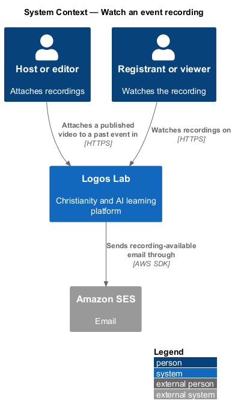
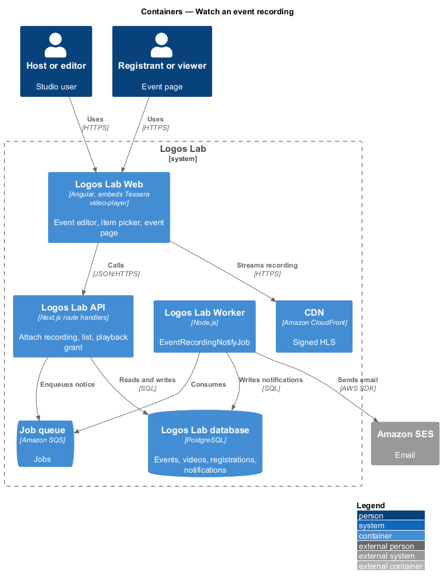
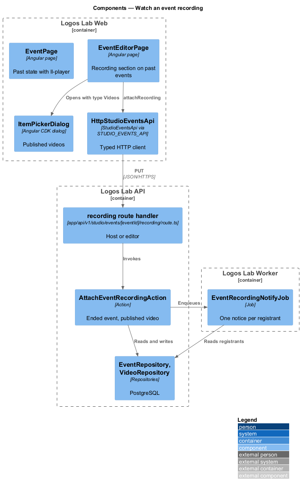
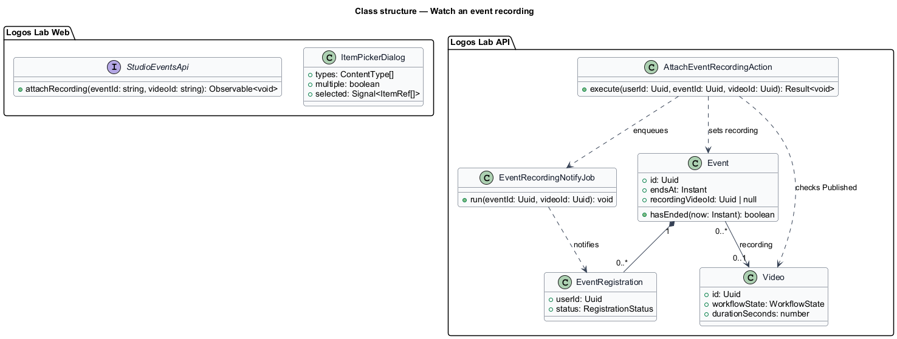
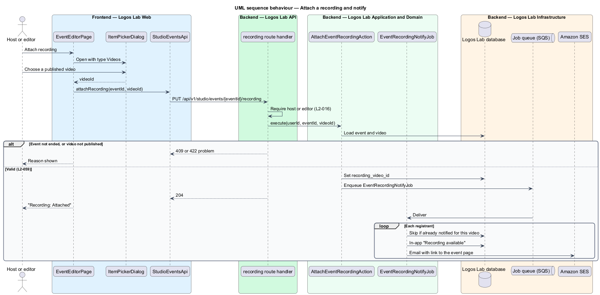

# Watch an event recording

## Overview

Many Logos Lab events are recorded. After an event ends, a host or editor may attach a published video as
its recording. The event page then plays the recording, the events list marks the event "Recording
available", and everyone who registered is told it is ready.

The feature joins the events and videos subsystems. The recording is an ordinary published video, so its
upload, captions, playback and access rules come from `upload-and-process-video`,
`provide-captions-and-transcripts`, `play-video` and `protect-video-delivery`. The Past tab filter lives in
`browse-events`.

Terms used below:

- **past event** — published event whose end time has passed
- **recording** — published video attached to a past event and shown on its page
- **item picker** — dialog that searches published items and returns the chosen one

## Description

### Screens and states

- **`EventEditorPage`** `past` state (`docs/mocks/pages/event-editor/past.html`) — details are read-only;
  the "Recording" section offers attach or change. The aside shows "Recording: Attached, 58 min".
- **`ItemPickerDialog`** — `docs/mocks/dialogs/item-picker/` (`default`, `selected`, `busy`, `empty`,
  `no-results`, `invalid`), opened with the type fixed to Videos and a single selection.
- **`EventPage`** `past` state (`docs/mocks/pages/event-page/past.html`) — `ll-player` plays the recording
  with captions and a transcript note; the panel reads "This event has ended".
- **`EventsPage`** `past` state (`docs/mocks/pages/events/past.html`) — the "Recording available" filter and
  badge, and a "Watch" link.
- **Notification** — "recording available" item in `docs/mocks/notifications/notification/`.

### API contract

- **`StudioEventsApi`** (token `STUDIO_EVENTS_API`) method `attachRecording(eventId, videoId)`; the picker
  uses the shared catalogue search with `type=video` and `state=published`.

| Method | Path | Purpose |
|---|---|---|
| `PUT` | `/api/v1/studio/events/{eventId}/recording` | Attaches or changes the recording; body `{ videoId }` |
| `GET` | `/api/v1/events?tab=past&recording=1` | Past events with a recording (`browse-events`) |

The endpoint requires the event's host or an editor (`L2-016`).

### Application and domain

- **`AttachEventRecordingAction`** — checks that the event has ended and that the video is published, sets
  `events.recording_video_id`, and enqueues `EventRecordingNotifyJob` for the first attachment.
- **`EventRecordingNotifyJob`** — sends each registrant an in-app notification and an email through
  Amazon SES. It is idempotent per (event, video, recipient) (`L2-140`).
- **Playback** — the event page passes the recording's video id to `ll-player`, which requests a playback
  grant under the video rules (`L2-043`).
- **Entities and tables** — `Event` (`recording_video_id`), `Video`, `EventRegistration`, `Notification`.

### Rules from the acceptance criteria

- When a host or editor attaches a published video to a past event, the event page shows the recording and
  registrants are notified (`L2-059` criterion 1).
- With a recording attached, the event is included when the Past tab is filtered by "Recording available"
  (criterion 2).

Open points: whether changing an attached recording notifies registrants again is `<TO SUPPLY>`. Which
notification category (`L2-093`) governs the recording notice is `<TO SUPPLY>`. Whether visitors may play a
recording that is not a public preview follows `L2-043`; any event-specific rule is `<TO SUPPLY>`.

## Requirements

The feature realizes the following level-2 (L2) requirements. Each L2 requirement refines the level-1 (L1) requirement cited beside it.

| L2 ID | Refines (L1) | Requirement |
|-------|--------------|-------------|
| `L2-059` | `L1-010` | **Event recordings.** Hosts or editors can attach a recording to a past event. |

## Diagrams

### System context

Hosts and editors attach recordings in Logos Lab; registrants are notified through Amazon SES and in the
app, and watch on the event page.

### Containers

The API records the attachment and enqueues the notice; the Worker sends it; playback uses the CDN like any
video.

### Components

`AttachEventRecordingAction` validates the event and the video; `EventRecordingNotifyJob` notifies each
registrant once.

### Class structure

`Event` references at most one recording `Video` through `recordingVideoId`.

### Behaviour — attach a recording and notify

The editor picks a published video; the action checks the event has ended, saves the reference, and the job
notifies registrants.

