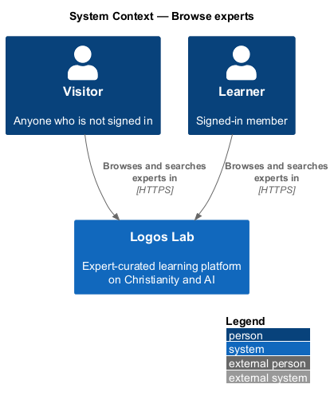
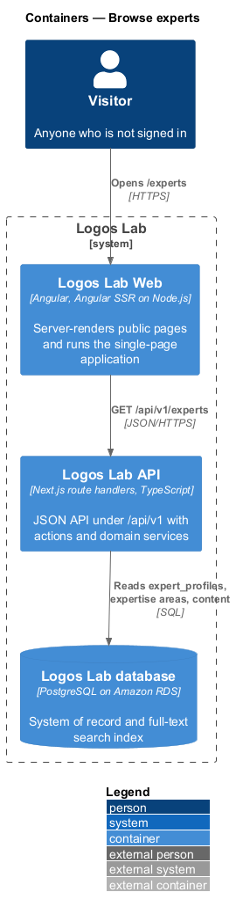
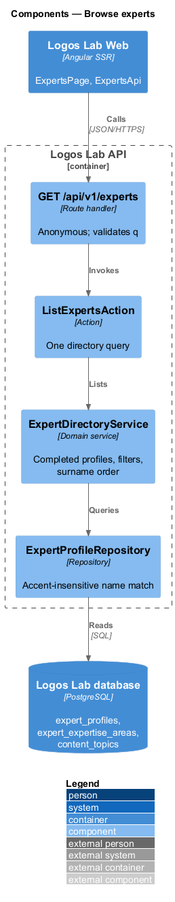
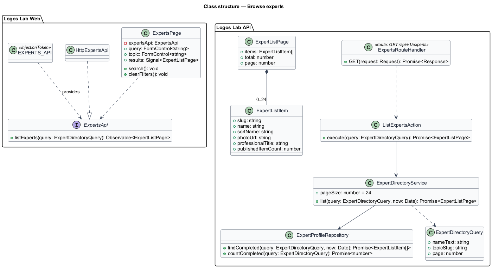
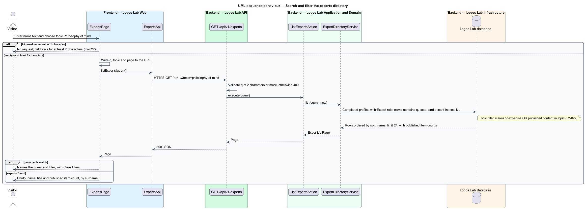

# Browse experts

## Overview

The *experts directory* is the public list of Logos Lab experts at `/experts`. It belongs to the
experts subsystem and gives a person one place to find who teaches on the platform before opening an
individual expert profile.

The directory lists every expert who has a completed profile, sorted by surname. A person can narrow
it by topic or by a name search. Terms used below:

- **completed profile** — expert profile whose required fields (photo, professional title, bio and at
  least one area of expertise) are filled
- **sort name** — surname-first form of an expert's name used for alphabetical order, ignoring
  honorifics such as "Rev. Dr."
- **published item count** — number of published items the expert contributed

## Description

The slice runs from `ExpertsPage` in Logos Lab Web to the Logos Lab API and the Logos Lab database.

**Logos Lab Web**

- **`ExpertsPage`** — routed standalone component for `/experts`, server-rendered. It keeps `q`,
  `topic` and `page` in the URL query string. A name search shorter than 2 characters sends no
  request and the field asks for at least 2 characters.
- **Design-system components** — `ll-search-filter-toolbar`, `ll-text-field` (name search),
  `ll-select` (topic), `ll-person-list` (photo, name, title and published item count),
  `ll-pagination`, `ll-empty-state`, `ll-alert` and `ll-skeleton`.
- **`ExpertsApi`** — contract shared with the profile feature, with `listExperts(query)`.
  `EXPERTS_API` is its token and `HttpExpertsApi` its HTTP implementation.
- **Screen states** — `docs/mocks/pages/experts/` covers `default`, `selected` (topic filter),
  `invalid` (one-letter search), `no-results`, `empty`, `loading`, `error` and `long`. The topic page
  (`docs/mocks/pages/topic/`) reuses the same person list.

**Logos Lab API**

- **`GET /api/v1/experts`** — anonymous route handler with `q`, `topic` and `page` parameters. A `q`
  shorter than 2 characters after trimming receives a `400` problem response.
- **`ListExpertsAction`** — runs one directory query.
- **`ExpertDirectoryService`** — keeps only experts who hold the Expert role and have a completed
  profile, orders by sort name, and pages 24 per page.
- **`ExpertProfileRepository`** — matches the name with case- and accent-insensitive comparison
  (`unaccent` and case folding over bound parameters). The topic filter matches an area of expertise
  or published content tagged with the topic.
- **Sort name** — stored as `sort_name` on `expert_profiles`. How it is set (derived from the name
  or entered by the expert or an editor) is `<TO SUPPLY>`.

**Key rules**

- Experts are shown alphabetically by surname, 24 per page, each with photo, name, title and their
  number of published items.
- With the topic filter set, only experts with that area of expertise or published content in that
  topic are shown.
- A name search of at least 2 characters shows experts whose name contains the text, case- and
  accent-insensitively.

### Directory page decisions

These settle what the design left open when `ExpertsPage` was built against the mocks in
`docs/mocks/pages/experts/`.

- **Address.** `/experts?q=&topic=&page=`. `q` is the trimmed name search, `topic` a topic slug, `page`
  a whole number from 2 (page 1 is left out). A value that is not usable is dropped.
- **Contract.** `ExpertsApi.listExperts(query)` calls `GET /api/v1/experts` with the same parameters
  and returns `ExpertDirectory`: `experts` (`{ slug, name, photoUrl, title, focus, itemCount }`),
  `total` (matches), `totalExperts` (all experts, whatever the filters), `page`, `pageCount` and
  `topics` (`{ slug, name }`, the options of the topic select). The page size is 24.
- **Header.** The eyebrow "Who teaches here", the heading "Experts" and the sub line "38 theologians,
  ethicists, historians, philosophers and engineers, sorted by surname." with `totalExperts`.
- **Toolbar.** A name search (a search pill named "Search experts by name", placeholder "Name, at least
  2 characters", button "Search") and the select "Topic" with "Any topic" first. Choosing a topic or
  searching replaces the address and returns to page 1.
- **Count line.** "Showing 1–24 of 38 experts". With a topic or a search and one page: "2 experts in
  Philosophy of mind", "1 expert matching “Ortega”" or "1 expert matching “Ortega” in Philosophy of
  mind"; with more pages the same note follows "Showing 1–24 of 30 experts". When nothing matches it
  reads "No experts match “Bonhoeffer” in Pastoral care".
- **Experts.** Each expert is a person row: the name linking to `/experts/{slug}`, the line
  "Christian ethicist · technology and moral formation" and "11 published items".
- **Validation.** A trimmed search of one character sends no request and shows the summary "One thing
  to fix before you search" and the field error "Enter at least 2 characters of a name"; the list
  stays as it was.
- **States.** Loading keeps the toolbar, says "Loading experts…" and shows skeleton rows with one
  status message. Failure says "We couldn't load the experts" with "Try again". No matches names the
  search and topic and offers "Clear filters". No experts at all says "Our first experts are
  finishing their profiles" and offers the catalogue.

## Requirements

| L2 ID | Refines (L1) | Requirement |
|-------|--------------|-------------|
| `L2-022` | `L1-004` | **Experts directory.** A public directory at `/experts` lists every expert who has a completed profile. |

## Diagrams

### System context

Visitors and learners browse the experts directory in Logos Lab.

### Containers

Logos Lab Web server-renders the directory from the Logos Lab API, which reads the Logos Lab
database.

### Components

The route handler validates the name search and invokes `ListExpertsAction`.
`ExpertDirectoryService` applies the completed-profile rule, the filters and the surname order.

### Class structure

`ExpertDirectoryQuery` carries the name text, topic and page. `ExpertListItem` holds the four fields
each row shows.

### Behaviour — search and filter the directory

The page blocks one-letter searches. The API filters by name and topic, sorts by surname and returns
24 experts per page.

