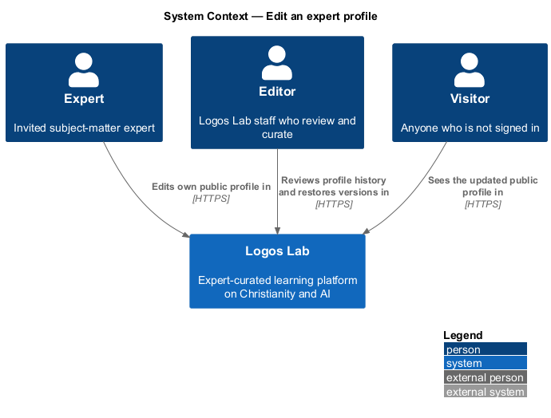
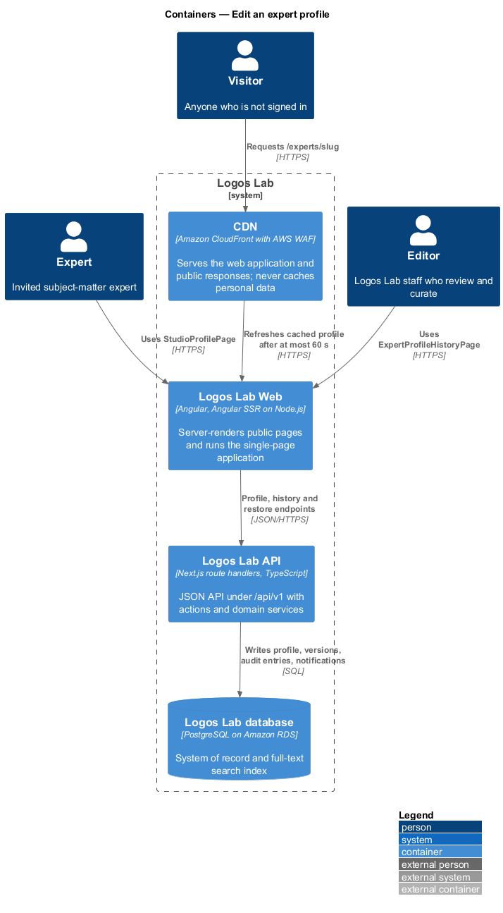
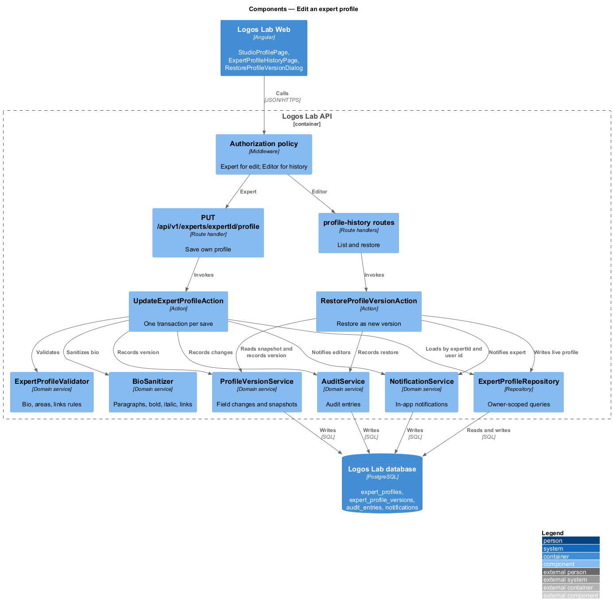
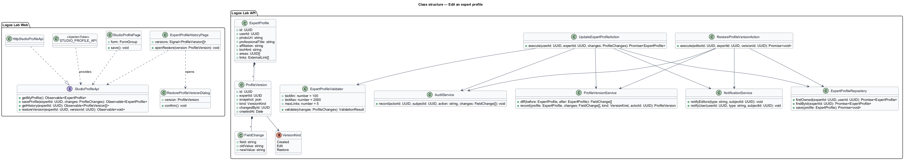
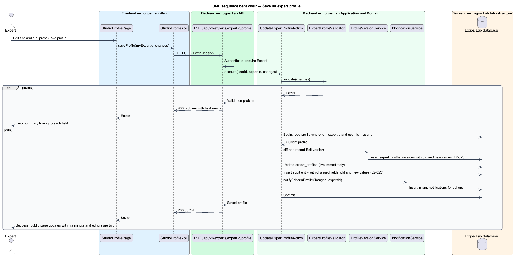
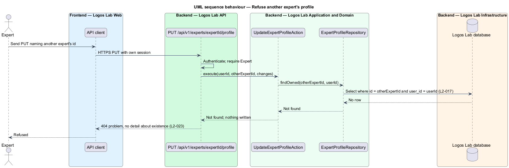
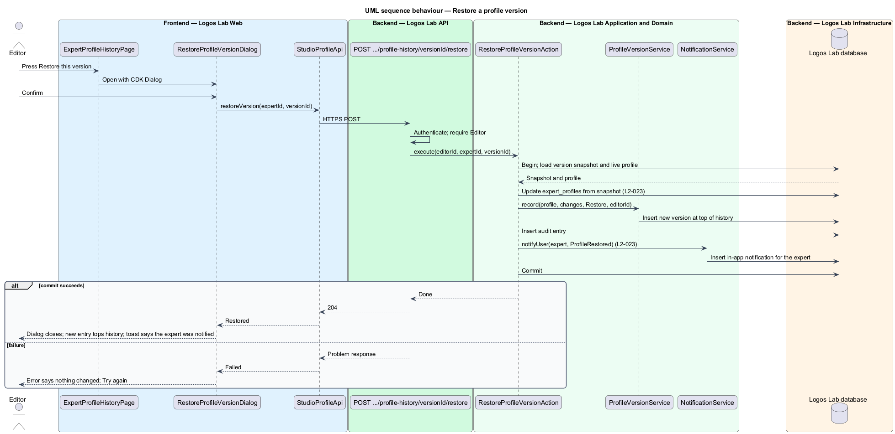

# Edit an expert profile

## Overview

An expert maintains their own public profile from *Studio*, the authoring workspace for experts and
editors. Unlike content, a profile change does not wait for editorial review: it goes live
immediately and is logged so that editors can review it afterwards. This feature belongs to the
experts subsystem and supplies the data that the public expert profile shows.

Terms used below:

- **profile version** — saved snapshot of an expert profile, with the fields that changed and their
  old and new values
- **profile history** — list of an expert's profile versions, newest first, that editors review
- **restore** — editor action that makes an earlier profile version live again as a new version
- **audit entry** — immutable record of who changed what and when

## Description

The slice runs from Studio pages in Logos Lab Web to the Logos Lab API, the Logos Lab database and
the CDN.

**Logos Lab Web**

- **`StudioProfilePage`** — routed page where the expert edits photo, professional title,
  affiliation, bio, areas of expertise and up to 5 links, then presses "Save profile". Its route is
  `/studio/profile` (baseline choice). Mocks: `docs/mocks/pages/studio-profile/` (`default`,
  `loading`, `invalid`, `submitting`, `success`, `restored`, `error`, `onboarding`).
- **`ExpertProfileHistoryPage`** — routed page for editors listing an expert's profile versions with
  old and new values and "Restore this version" on earlier ones. Its route is
  `/studio/experts/{expertId}/history` (baseline choice). Mocks:
  `docs/mocks/pages/expert-profile-history/` (`default`, `empty`, `loading`, `error`, `forbidden`).
- **`RestoreProfileVersionDialog`** — CDK confirmation dialog that names what will change and who is
  told. Mocks: `docs/mocks/dialogs/restore-profile-version/` (`default`, `busy`, `failed`, `success`).
- **Design-system components** — `ll-form-field`, `ll-text-field`, `ll-textarea` with a character
  count, `ll-rich-editor` limited to bold, italic and link for the bio, `ll-chip` (areas),
  `ll-file-upload` (photo), `ll-alert` (error summary and notices), `ll-timeline`, `ll-diff`,
  `ll-dialog`, `ll-toast` and `ll-notification-item` (`docs/mocks/notifications/notification/`).
- **`StudioProfileApi`** — contract with `getMyProfile()`, `saveProfile(expertId, changes)`,
  `getHistory(expertId)` and `restoreVersion(expertId, versionId)`. `STUDIO_PROFILE_API` is its token
  and `HttpStudioProfileApi` its HTTP implementation.

**Logos Lab API**

- **`GET /api/v1/studio/profile`** — Expert only; returns the current user's profile.
- **`PUT /api/v1/experts/{expertId}/profile`** — Expert only. `ExpertProfileRepository` loads the
  profile with both `expertId` and the current user's id. Another expert's id finds no row and
  receives `404` (`L2-017`).
- **`GET /api/v1/experts/{expertId}/profile-history`** — Editor only.
- **`POST /api/v1/experts/{expertId}/profile-history/{versionId}/restore`** — Editor only.
- **`UpdateExpertProfileAction`** — validates, sanitizes the bio, saves the profile, writes the version
  and the audit entry, and notifies editors, in one transaction.
- **`ExpertProfileValidator`** — bio 100-2,000 characters, at least one area of expertise, at most 5
  links, each an `https://` URL. The mock caps the professional title at 120 characters.
- **`ProfileVersionService`** — computes `FieldChange` values (field, old value, new value) and writes
  a `ProfileVersion` row in `expert_profile_versions`.
- **`AuditService`** — writes an audit entry with the changed fields and their old and new values.
- **`NotificationService`** — creates in-app notifications for editors on each change, and for the
  expert on a restore.
- **`RestoreProfileVersionAction`** — copies an earlier version's snapshot to the live profile, records
  a new version of kind `Restore`, writes an audit entry and notifies the expert.
- **Freshness** — public profile responses carry a shared-cache lifetime of at most 60 seconds, so a
  saved change is public within 60 seconds (baseline choice).

**Key rules**

- After a successful save, the public profile shows the change within 60 seconds.
- Each saved change creates an audit entry with the changed fields and their old and new values, and
  editors receive an in-app notification.
- An editor viewing an expert's profile history can restore any earlier version, and the expert is
  notified of the restoration.
- An expert changing another expert's profile through the API is refused with 404.

## Requirements

| L2 ID | Refines (L1) | Requirement |
|-------|--------------|-------------|
| `L2-023` | `L1-004` | **Expert self-service profile editing.** Experts shall be able to edit their own public profile. Profile changes go live immediately and are logged so that editors can review them afterwards. |

## Diagrams

### System context

Experts edit their profile in Logos Lab, and editors review and restore profile versions there.

### Containers

The API writes the profile, versions, audit entries and notifications to the Logos Lab database. The
CDN serves the public profile with a lifetime of at most 60 seconds.

### Components

`UpdateExpertProfileAction` and `RestoreProfileVersionAction` share the version, audit and
notification services. The repository scopes every write to the owning expert.

### Class structure

`ProfileVersion` holds a snapshot and a list of `FieldChange` values, and its `VersionKind` tells an
expert edit from an editor's restore.

### Behaviour — save the profile

The expert saves; the action validates, applies the change live, records the version and audit
entry, and notifies editors in one transaction.

### Behaviour — refuse another expert's profile

A request that names another expert's id finds no row under the ownership-scoped query and receives
`404`, revealing nothing.

### Behaviour — restore an earlier version

The editor confirms in the dialog. The action makes the earlier snapshot live as a new version and
notifies the expert.

