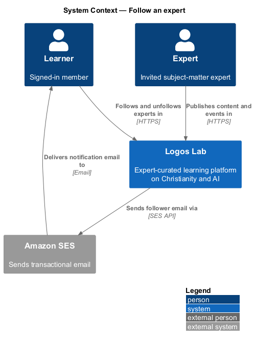
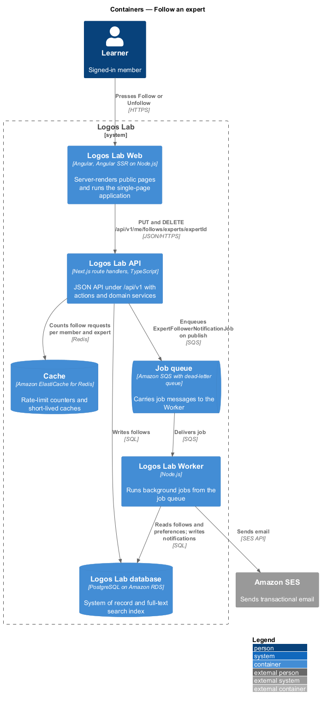
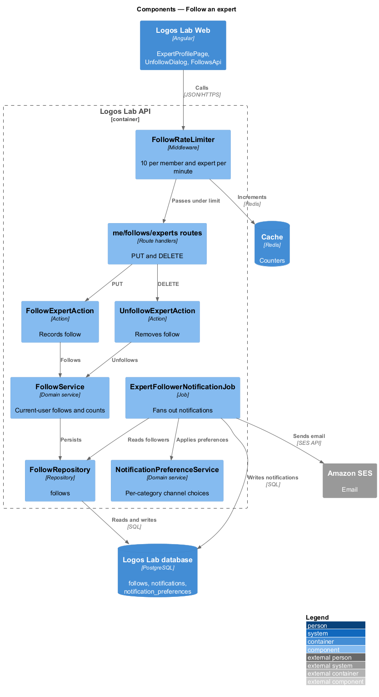
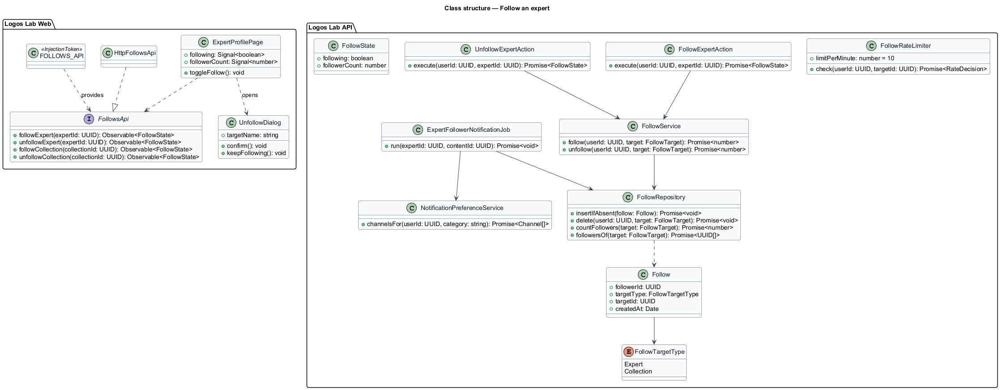
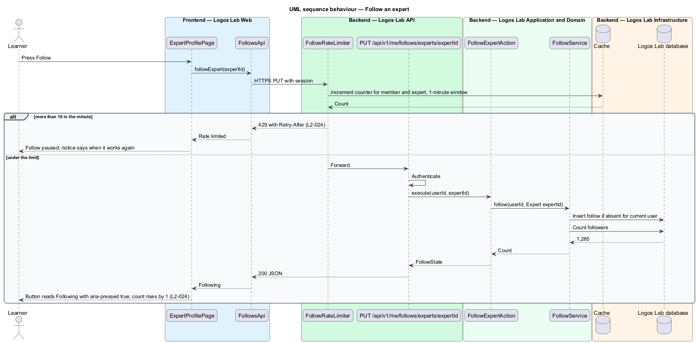
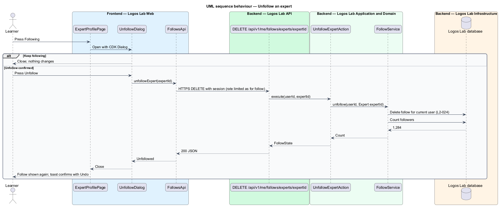
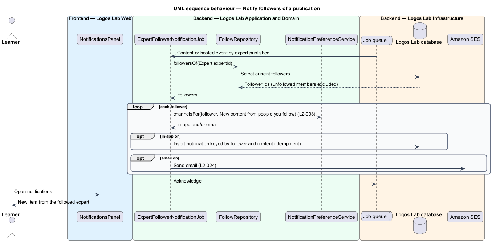

# Follow an expert

## Overview

A member *follows* an expert to hear when that expert publishes. A *follow* is a member's standing
request to be notified about an expert's new content and events. This feature belongs to the experts
subsystem and connects the public expert profile to the notifications subsystem.

The Follow button sits on the expert profile. Pressing it records the follow and raises the expert's
follower count. Pressing "Following" opens a confirmation, and confirming "Unfollow" removes the follow.
The member's full list of follows lives in the dashboard (`L2-074`). Terms used below:

- **follower count** — number of members who currently follow an expert
- **follower notification** — notification sent to followers when an expert's content or hosted event
  is published
- **notification preference** — member's per-category, per-channel choice of in-app and email delivery
  (`L2-093`)

## Description

The slice runs from `ExpertProfilePage` in Logos Lab Web to the Logos Lab API, the Cache, the Logos
Lab database, the Job queue, the Worker and Amazon SES.

**Logos Lab Web**

- **`ExpertProfilePage`** — holds the Follow toggle (`ll-button` with `aria-pressed`) and the follower
  count in `ll-profile-header`. A visitor pressing Follow is asked to sign in first (`L2-015`).
- **`UnfollowDialog`** — CDK confirmation dialog with "Keep following" and "Unfollow". Mocks:
  `docs/mocks/dialogs/unfollow/` (`default`, `busy`, `failed`, `success`).
- **Design-system components** — `ll-button`, `ll-profile-header`, `ll-dialog`, `ll-toast` (with
  Undo), `ll-alert` (rate-limited notice) and `ll-notification-item`.
- **Screen states** — `docs/mocks/pages/expert-profile/following.html` (Following, count 1,285, status
  message) and `rate-limited.html`; `docs/mocks/notifications/notification/info.html` shows a follower
  notification.
- **`FollowsApi`** — contract with `followExpert(expertId)` and `unfollowExpert(expertId)`, shared with
  the collection follow feature. `FOLLOWS_API` is its token and `HttpFollowsApi` its HTTP
  implementation.

**Logos Lab API**

- **`PUT /api/v1/me/follows/experts/{expertId}`** — authenticated, idempotent. Calls
  `FollowExpertAction` and returns the new follower count.
- **`DELETE /api/v1/me/follows/experts/{expertId}`** — authenticated, idempotent. Calls
  `UnfollowExpertAction`.
- **`FollowRateLimiter`** — counts follow and unfollow requests per member and expert in the Cache.
  More than 10 in one minute receives `429` with `Retry-After`.
- **`FollowService`** — inserts or deletes the `Follow` row for the current user only and returns the
  follower count.
- **`FollowRepository`** — reads and writes `follows` (`follower_id`, `target_type`, `target_id`,
  `created_at`), unique on the three key columns.
- **`ExpertFollowerNotificationJob`** — Worker job enqueued when an item contributed by the expert, or
  an event the expert hosts, is published. It reads the current followers, applies each member's
  preference for "New content from people you follow" (`L2-093`), writes in-app notifications and
  sends email through Amazon SES.

**Key rules**

- Pressing "Follow" changes the button to "Following" with `aria-pressed="true"` and raises the
  follower count by 1.
- A follower receives a notification, according to their preferences, when the expert's content or an
  event they host is published.
- Pressing "Following" and confirming "Unfollow" removes the follow; no further notifications are
  sent.
- More than 10 follow and unfollow requests for the same expert in a minute are refused with `429`.

## Decisions for the web build

- **Who may follow.** `Session.member` decides. A signed-in member sees the Follow toggle. A visitor sees
  the same "Follow" button, and pressing it opens the sign-in dialog (`dialogs/sign-in-required`) instead
  of sending a request.
- **Returning after sign-in (`L2-015`).** The dialog's "Sign in" and "Create account" links carry the
  profile's address as `returnUrl`. The member lands back on the profile, where Follow is one press away.
  The follow is not replayed on return, so nothing changes until the member presses the button.
- **Contract.** `ExpertProfile` gains `id` and `following` (`false` for a visitor). `FollowsApi` has
  `followExpert(expertId)` and `unfollowExpert(expertId)`, each returning `FollowResult { followerCount }`.
  The page shows the returned count, so two tabs cannot drift.
- **Follow.** The button is `aria-pressed="false"` "Follow". On success it becomes the quiet
  `aria-pressed="true"` "Following", the count in the header changes, and a polite status line says
  "Following. You'll hear when Dr. Abena Mensah publishes or announces an event." The mock's "Dr. Mensah"
  needs a short name the profile does not carry, so the status names the expert in full. While the request runs the
  button is `aria-disabled` and the count is unchanged. A failure keeps "Follow" and shows a danger alert
  "We couldn't follow just now" with the reason to try again.
- **Unfollow.** Pressing "Following" opens `UnfollowDialog` (focus on "Keep following", the safe choice).
  "Unfollow" shows "Unfollowing…" and disables both buttons and Escape. On success the dialog closes,
  focus returns to the button, which reads "Follow", and the status line says "Unfollowed. You can follow
  again at any time." On failure the dialog stays open with the danger alert from the `failed` mock and
  "Try again".
- **Rate limit.** `429` with `Retry-After` keeps the button `aria-disabled` and `aria-describedby` the
  warning alert "Give it a minute", which names the time Follow works again, in the member's locale and
  time zone. The button is not removed from the tab order. After that time the alert clears on the next
  press. Counting is per member and expert, as in the API rules above.
- **Undo toast deferred.** The `success` mock confirms an unfollow with a toast and "Undo". The toast
  component and its live region belong to the notification work (Phase 2). Until then the status line
  above carries the confirmation, and following again is one press. The toast and its Undo are added when
  that component exists.
- **Dialog frame.** `UnfollowDialog` and the sign-in dialog use the shared `ll-dialog` frame
  (`docs/specs/components/dialog.md`).

## Requirements

| L2 ID | Refines (L1) | Requirement |
|-------|--------------|-------------|
| `L2-024` | `L1-004` | **Follow an expert.** Members shall be able to follow experts to be notified when they publish new content or announce events. |

## Diagrams

### System context

Learners follow experts in Logos Lab. When an expert publishes, Logos Lab notifies followers in-app
and by email through Amazon SES.

### Containers

The API records follows in the database and counts requests in the Cache. On publication, the Worker
fans out notifications and sends email.

### Components

The follow routes pass through `FollowRateLimiter` before the actions. `ExpertFollowerNotificationJob`
applies notification preferences per follower.

### Class structure

`Follow` links a member to a target by `FollowTargetType`. The same entity serves expert and
collection follows.

### Behaviour — follow an expert

The member presses Follow. Under the rate limit, the action records the follow and returns the new
count; over it, the page shows the paused notice.

### Behaviour — unfollow an expert

The member confirms in `UnfollowDialog`. The action deletes the follow, so later publications send
nothing to this member.

### Behaviour — notify followers

A publication enqueues the job, which notifies each current follower through the channels their
preferences allow.

