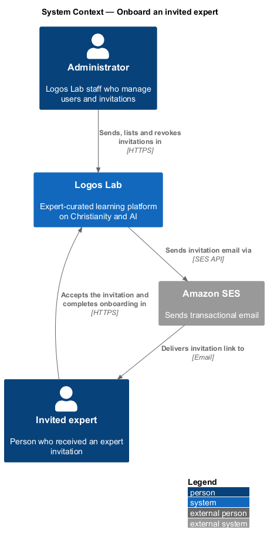
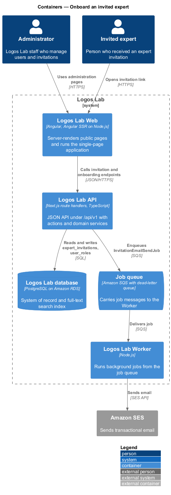
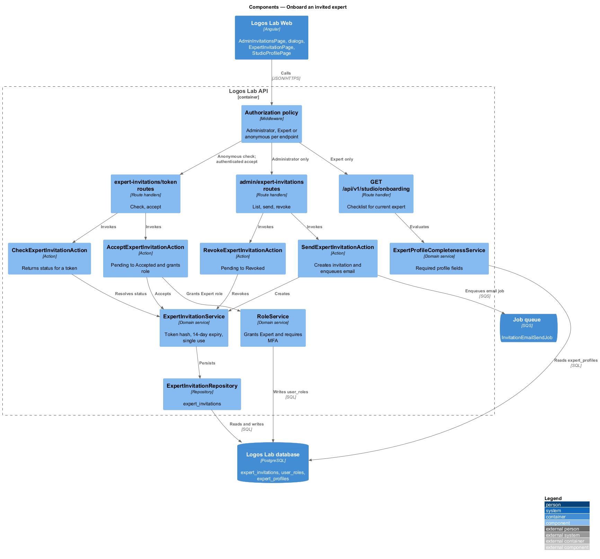
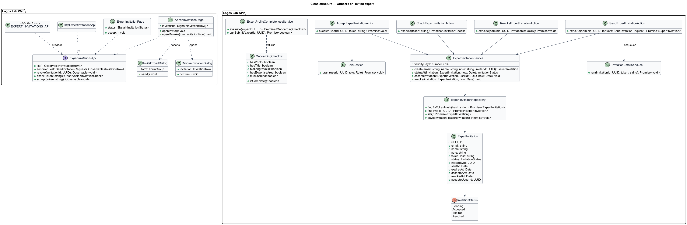
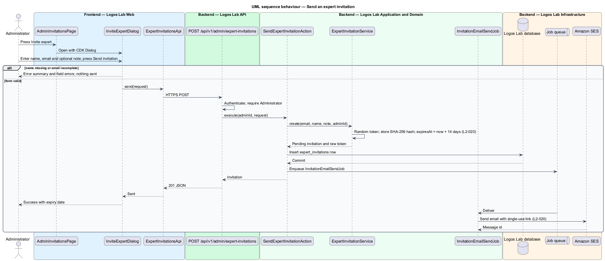
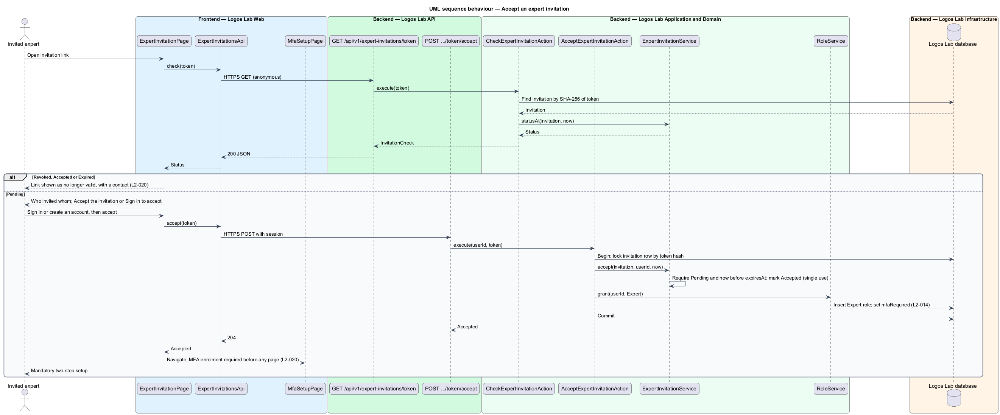
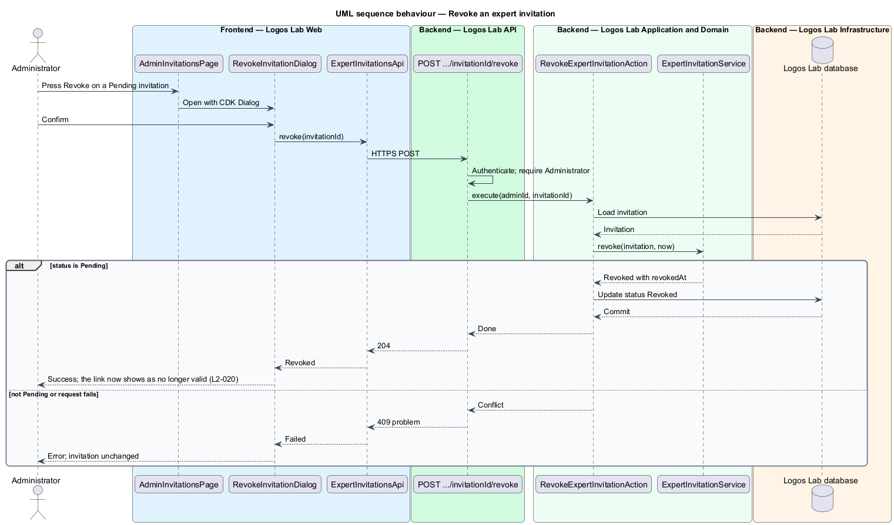
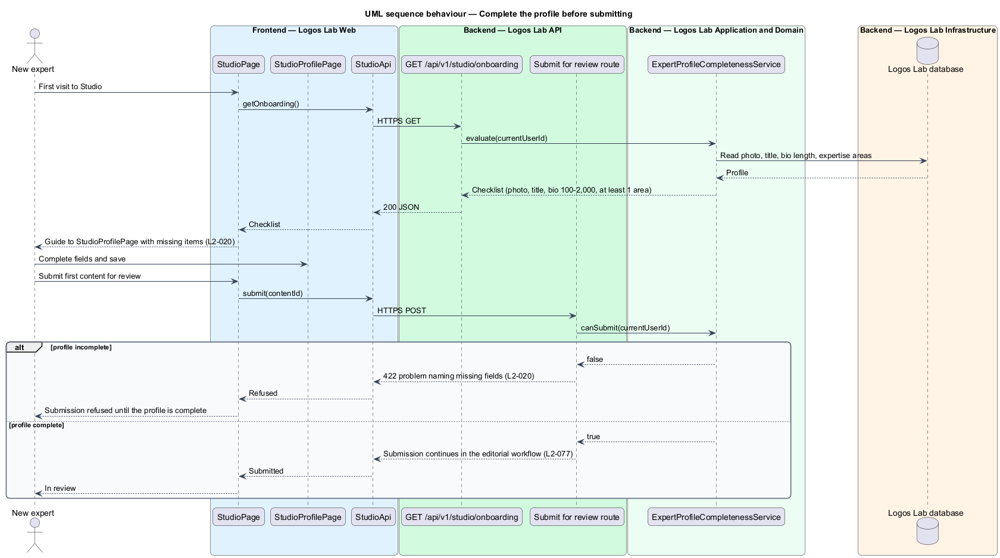

# Onboard an invited expert

## Overview

Logos Lab content comes from *experts*, subject-matter specialists who author courses, modules,
videos, articles and collections. Experts cannot register themselves. The *experts* subsystem covers
how an expert joins, how the public sees them and how members follow them; this feature covers the
first step, joining.

An administrator invites a person by email. The invited person accepts, becomes an expert, sets up
two-step verification and completes a public profile before any content can be submitted. Terms used
below:

- **expert invitation** — record of an administrator's offer of the Expert role to one email address,
  with a single-use link
- **invitation link** — single-use URL that carries a secret token and expires 14 days after sending
- **invitation status** — one of Pending, Accepted, Expired or Revoked
- **required profile fields** — photo, professional title, bio of 100-2,000 characters and at least one
  area of expertise
- **onboarding checklist** — list in Studio that shows which required profile fields are still missing

Multi-factor authentication (MFA) enrolment is owned by the accounts subsystem (`L2-014`); this
feature makes it required on acceptance and hands over to it.

## Description

The slice runs from administration and invitation pages in Logos Lab Web to the Logos Lab API, the
Logos Lab database, the Job queue, the Worker and Amazon SES.

**Logos Lab Web**

- **`AdminInvitationsPage`** — routed page listing invitations with status, inviter and dates, and a
  Revoke action on each pending one. Its route is `/admin/invitations` (baseline choice). Mocks:
  `docs/mocks/pages/admin-invitations/` (`default`, `empty`, `loading`, `error`, `long`).
- **`InviteExpertDialog`** — CDK dialog with name, email and an optional personal note. The mock caps
  the note at 500 characters. Mocks: `docs/mocks/dialogs/invite-expert/` (`default`, `invalid`,
  `busy`, `failed`, `success`).
- **`RevokeInvitationDialog`** — CDK confirmation dialog. Mocks: `docs/mocks/dialogs/revoke-invitation/`
  (`default`, `busy`, `failed`, `success`).
- **`ExpertInvitationPage`** — routed page opened from the invitation link, at `/invitations/{token}`
  (baseline choice). It offers "Accept the invitation" (create an account) and "Sign in to accept".
  Mocks: `docs/mocks/pages/expert-invitation/` (`default`, `loading`, `expired`, `revoked`, `error`,
  `success`).
- **`MfaSetupPage`** — the accounts page, shown in its `mandatory` state after acceptance
  (`docs/mocks/pages/mfa-setup/mandatory.html`).
- **`StudioPage`** and **`StudioProfilePage`** — show the onboarding guide and checklist on the new
  expert's first visit (`docs/mocks/pages/studio/onboarding.html`,
  `docs/mocks/pages/studio-profile/onboarding.html`).
- **Design-system components** — `ll-table`, `ll-badge` (status), `ll-dialog`, `ll-form-field`,
  `ll-text-field`, `ll-textarea`, `ll-alert`, `ll-auth-card`, `ll-spinner`, `ll-sidebar-navigation`,
  `ll-list` (checklist), `ll-empty-state` and `ll-skeleton`.
- **`ExpertInvitationsApi`** — contract with `list()`, `send()`, `revoke()`, `check(token)` and
  `accept(token)`. `EXPERT_INVITATIONS_API` is its token and `HttpExpertInvitationsApi` its HTTP
  implementation.

**Logos Lab API**

- **`GET /api/v1/admin/expert-invitations`** — Administrator only. Lists invitations with status,
  inviter and dates.
- **`POST /api/v1/admin/expert-invitations`** — Administrator only. Calls `SendExpertInvitationAction`.
- **`POST /api/v1/admin/expert-invitations/{invitationId}/revoke`** — Administrator only. Calls
  `RevokeExpertInvitationAction` for a Pending invitation.
- **`GET /api/v1/expert-invitations/{token}`** — anonymous. Calls `CheckExpertInvitationAction` and
  returns the invitation's status and the invitee's name, never the token hash.
- **`POST /api/v1/expert-invitations/{token}/accept`** — authenticated. Calls
  `AcceptExpertInvitationAction`.
- **`GET /api/v1/studio/onboarding`** — Expert only. Returns the onboarding checklist for the current
  user.
- **`ExpertInvitationService`** — creates the token from a cryptographically random source, stores
  only its SHA-256 hash, sets `expiresAt` to 14 days after sending, and derives Expired when the
  current time passes `expiresAt`. Acceptance is single-use: it moves Pending to Accepted in the same
  transaction that grants the role.
- **`RoleService`** — grants the Expert role and sets the account's `mfaRequired` flag, so the next
  page request redirects to MFA enrolment (`L2-014`). Role-change rules are owned by `L2-018`.
- **`ExpertProfileCompletenessService`** — evaluates the required profile fields. The authoring
  workspace's submit endpoint (reached through `StudioApi`, `L2-077`) calls it and refuses submission
  until every field is complete.
- **`InvitationEmailSendJob`** — Worker job that sends the invitation email through Amazon SES.
- **`ExpertInvitation`** — entity in `expert_invitations` with `id` (UUID), `email`, `name`, `note`,
  `tokenHash`, `status`, `invitedById`, `sentAt`, `expiresAt`, `acceptedAt`, `revokedAt` and
  `acceptedUserId`. **`ExpertInvitationRepository`** reads and writes it.

**Key rules**

- The invitation email carries a single-use link that expires after 14 days.
- Opening the link lets the invitee sign in to an existing account or create one; on completion the
  Expert role is granted and MFA enrolment is required.
- A new expert opening the authoring workspace is guided to complete the required profile fields and
  cannot submit content until they are complete.
- A revoked, unaccepted invitation shows as no longer valid when its link is opened.
- The invitation list shows status (Pending, Accepted, Expired, Revoked), the inviter and the dates.
- Whether the accepting account's email shall match the invited email is `<TO SUPPLY>`. The mock
  states "Create an account with meilin.chen@example.ca, or sign in to the one you have".

## Requirements

| L2 ID | Refines (L1) | Requirement |
|-------|--------------|-------------|
| `L2-020` | `L1-004` | **Expert invitation and onboarding.** Experts join by invitation only. Administrators invite experts by email, and the invited expert completes their profile before their first content can be submitted. |

## Diagrams

### System context

An administrator invites an expert through Logos Lab, which emails the link through Amazon SES. The
invited expert accepts and completes onboarding in Logos Lab.

### Containers

The API stores invitations in the Logos Lab database and enqueues the email job. The Worker sends the
email through Amazon SES.

### Components

Five route handlers map to one action each. `ExpertInvitationService` owns the token and status
rules, `RoleService` grants the role, and `ExpertProfileCompletenessService` gates submission.

### Class structure

`ExpertInvitation` holds an `InvitationStatus` and a token hash. The pages and dialogs depend on the
`ExpertInvitationsApi` contract.

### Behaviour — send an invitation

The administrator submits the dialog. The action stores a hashed single-use token with a 14-day
expiry and enqueues the email.

### Behaviour — accept an invitation

The invitee opens the link, signs in or registers, and accepts. A Pending, unexpired invitation
grants the Expert role and requires MFA enrolment; any other status shows the link as no longer valid.

### Behaviour — revoke an invitation

The administrator confirms the revocation. Only a Pending invitation moves to Revoked, and its link
then shows as no longer valid.

### Behaviour — complete the profile before submitting

On the first Studio visit the checklist names the missing fields. A submission attempt is refused
until every required profile field is complete.

