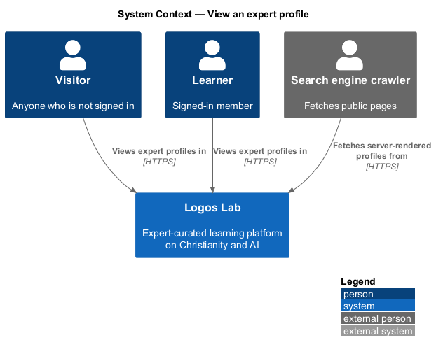
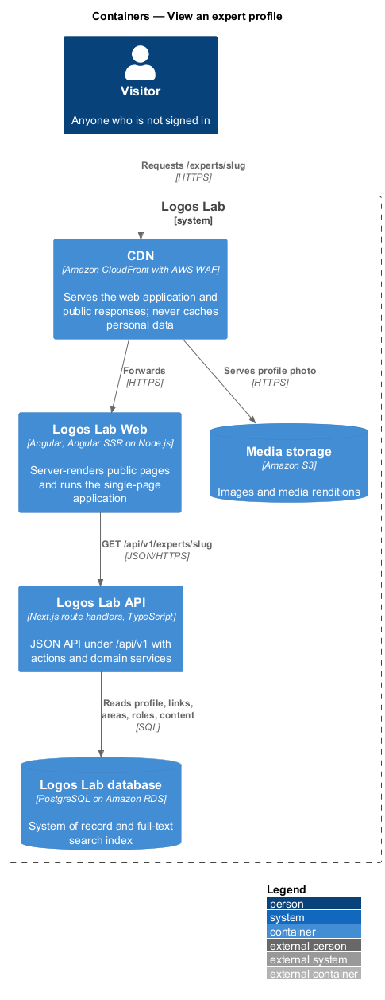
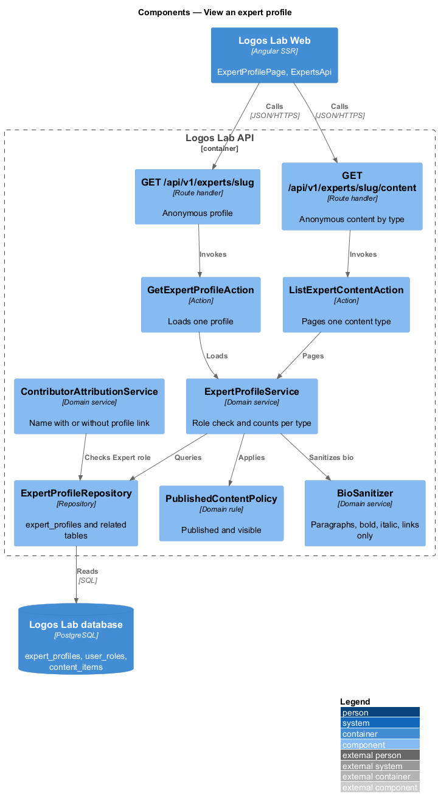
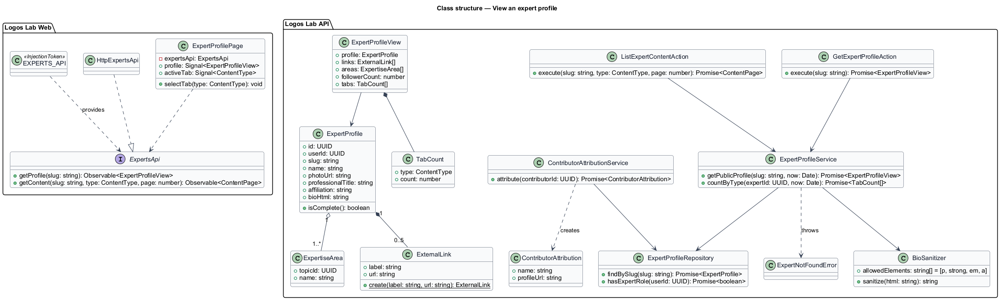
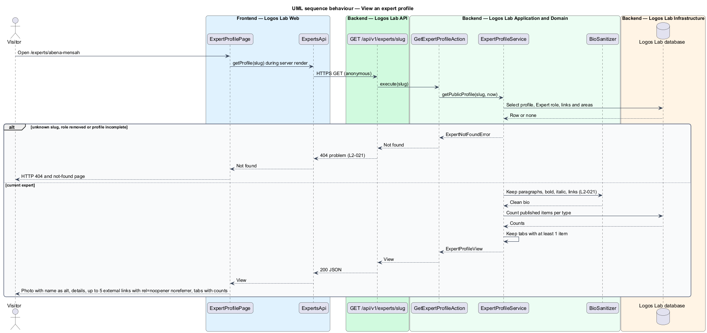
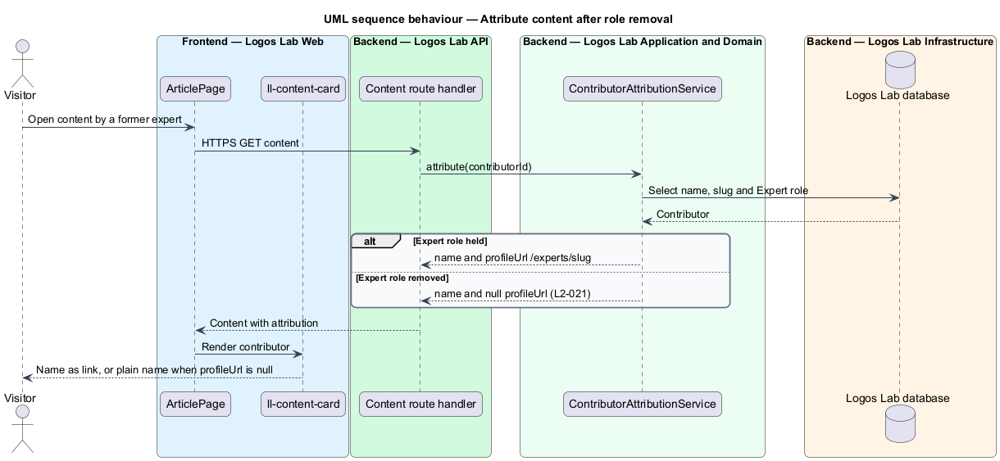

# View an expert profile

## Overview

Every Logos Lab expert has a public *expert profile*, a page at `/experts/{slug}` that presents who the
expert is and everything they have contributed. It belongs to the experts subsystem, beside onboarding,
the directory, profile editing and following. Content cards across the site link a contributor's name
to this page.

Terms used below:

- **completed profile** — expert profile whose required fields (photo, professional title, bio and at
  least one area of expertise) are filled
- **area of expertise** — topic from the Logos Lab taxonomy that an expert names as their field
- **external link** — `https://` address on a profile that points outside Logos Lab
- **content tab** — tab on the profile that lists one type of the expert's published content
- **attribution** — credit that names an item's contributor, with or without a profile link

An expert whose Expert role has been removed has no public profile, but their past published content
stays attributed to them by name.

## Description

The slice runs from the server-rendered `ExpertProfilePage` in Logos Lab Web to the Logos Lab API and
the Logos Lab database.

**Logos Lab Web**

- **`ExpertProfilePage`** — routed standalone component for `/experts/{slug}`, server-rendered. When
  the API returns `404`, the server render sets HTTP status 404 and shows `NotFoundPage`.
- **Design-system components** — `ll-breadcrumb`, `ll-profile-header` (photo, name, title,
  affiliation, follower count and Follow button), `ll-prose` (bio), `ll-chip` (areas of expertise),
  `ll-link` (external links), `ll-tabs` (content tabs with counts), `ll-content-card`,
  `ll-empty-state` and `ll-skeleton`.
- **External links** — rendered with `target="_blank"`, `rel="noopener noreferrer"` and visually
  hidden text that identifies the link as external and opening in a new tab.
- **Photo** — rendered with `alt` set to the expert's name.
- **`ExpertsApi`** — contract with `getProfile(slug)` and `getContent(slug, type, page)`. `EXPERTS_API`
  is its token and `HttpExpertsApi` its HTTP implementation.
- **Screen states** — `docs/mocks/pages/expert-profile/` covers `default`, `empty` (nothing published),
  `loading`, `error` and `long`; `docs/mocks/pages/not-found/` covers the 404 page.

**Logos Lab API**

- **`GET /api/v1/experts/{slug}`** — anonymous route handler. Returns the profile and the count per
  content type, or `404` when no current expert with a completed profile has that slug.
- **`GET /api/v1/experts/{slug}/content`** — anonymous route handler with `type` and `page` parameters.
  Returns the expert's published items of one type.
- **`GetExpertProfileAction`** and **`ListExpertContentAction`** — one use case each.
- **`ExpertProfileService`** — loads the profile, checks that the account still holds the Expert role,
  and counts published content per type through `PublishedContentPolicy`. It returns only types with
  at least one item.
- **`BioSanitizer`** — keeps paragraphs, bold, italic and links, and removes every other element and
  attribute. It runs when the bio is saved (`L2-023`) and again when the profile is read. The
  sanitizing library is `<TO SUPPLY>`.
- **`ExternalLink`** — value object that accepts only `https://` URLs. A profile holds at most 5.
- **`ContributorAttributionService`** — builds the attribution for content cards and pages. It sets
  `profileUrl` to null when the contributor no longer holds the Expert role.
- **`ExpertProfileRepository`** — reads `expert_profiles`, `expert_profile_links`,
  `expert_expertise_areas` and `user_roles`.

**Key rules**

- The profile shows photo (alt text set to the expert's name), name, professional title, affiliation,
  bio, areas of expertise and up to 5 external links.
- Content tabs follow the order Courses, Modules, Videos, Articles, Collections, Events; only tabs with
  items show, each with a count.
- An external link shall be an `https://` URL when saved. It opens in a new tab with
  `rel="noopener noreferrer"` and is identified as external to assistive technology.
- An expert whose Expert role has been removed returns 404; their past published content remains
  attributed to them with no profile link.
- The bio keeps only paragraphs, bold, italic and links.

### Profile page decisions

These settle what the design left open when `ExpertProfilePage` was built against the mocks in
`docs/mocks/pages/expert-profile/`. Following an expert is a separate feature (follow-expert); the
Follow button, the follower toggle and their dialogs are not part of this page yet, and the header
shows the follower count only.

- **Route and title.** `/experts/:slug`; the browser title is "Dr. Abena Mensah - Logos Lab" once the
  profile is known and "Expert - Logos Lab" until then.
- **Contract.** `ExpertsApi.getProfile(slug)` calls `GET /api/v1/experts/{slug}` and returns
  `ExpertProfile`: `slug`, `name`, `photoUrl`, `title`, `affiliation`, `bioHtml` (already sanitized),
  `followerCount`, `itemCount`, `expertise` (`{ slug, name }`), `links` (`{ label, url }`, `https`
  only, at most 5) and `counts` (`{ type, count }`, only types with items). `ExpertsApi.getContent(slug,
  type, page)` calls `GET /api/v1/experts/{slug}/content?type=&page=` and returns `ExpertContent`:
  `items`, `total`, `page` and `pageCount`. An unknown slug answers `404`.
- **Header.** A breadcrumb "Experts › Dr. Abena Mensah"; the photo (its alternative text is the
  name), the name as the page's heading, "Associate Professor of Systematic Theology, Kingsgate
  Theological College" and the facts "1,284 followers" and "7 published items".
- **About.** A visually hidden heading "About Dr. Abena Mensah" and the bio. The bio is rendered with
  Angular's own HTML sanitizer on top of the server's, so a script or an event handler in it is
  removed.
- **Aside.** "Areas of expertise" lists chips that link to the topic pages; "Elsewhere" lists the
  external links. Each opens in a new tab with `rel="noopener noreferrer"` and visually hidden text
  " (external site, opens in a new tab)".
- **Published.** "Published on Logos Lab" holds tabs, one for each type that has items, in the order
  Courses, Modules, Videos, Articles, Collections, Events, each with its count; one shared panel shows
  the selected type's cards. The first tab is selected on arrival. A type with more than 24 items
  pages with a pager named for the tab.
- **States.** While the profile loads the header, the text and the chips are skeletons and the
  content shows three skeleton cards ("Loading published content…"). A profile with nothing
  published shows "Nothing published yet" in place of the tabs. A failed request shows the heading
  "We couldn't load this profile" with "Try again". An unknown slug shows the not-found page.

## Requirements

| L2 ID | Refines (L1) | Requirement |
|-------|--------------|-------------|
| `L2-021` | `L1-004` | **Public expert profile.** Each expert has a public profile at `/experts/{slug}`. |

## Diagrams

### System context

Visitors and learners view expert profiles in Logos Lab. Search engines fetch the server-rendered
profile.

### Containers

Logos Lab Web server-renders the profile from the Logos Lab API, which reads the Logos Lab database.

### Components

`ExpertProfileService` checks the Expert role and counts content per type; `BioSanitizer` cleans the
bio on read, and `ContributorAttributionService` decides whether attributions carry a profile link.

### Class structure

`ExpertProfile` composes up to 5 `ExternalLink` values and one or more areas of expertise.
`ExpertProfileView` carries only non-empty content tabs.

### Behaviour — view a profile

The server render requests the profile. A removed or unknown expert produces HTTP 404; otherwise the
page shows the profile and the non-empty content tabs.

### Behaviour — attribute content after role removal

Content pages ask for attribution of each contributor. A contributor without the Expert role keeps
the name credit but no profile link.

