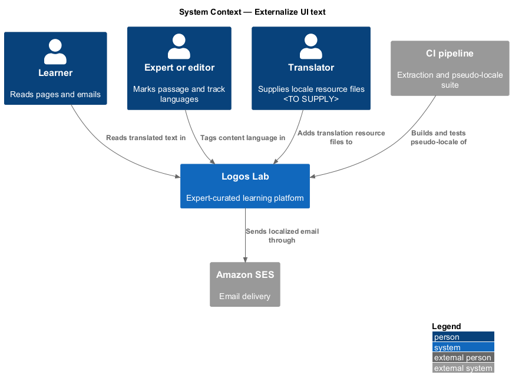
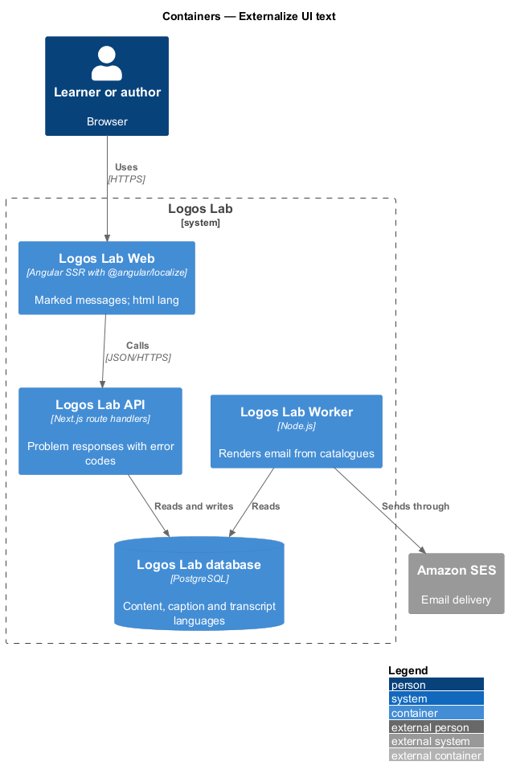
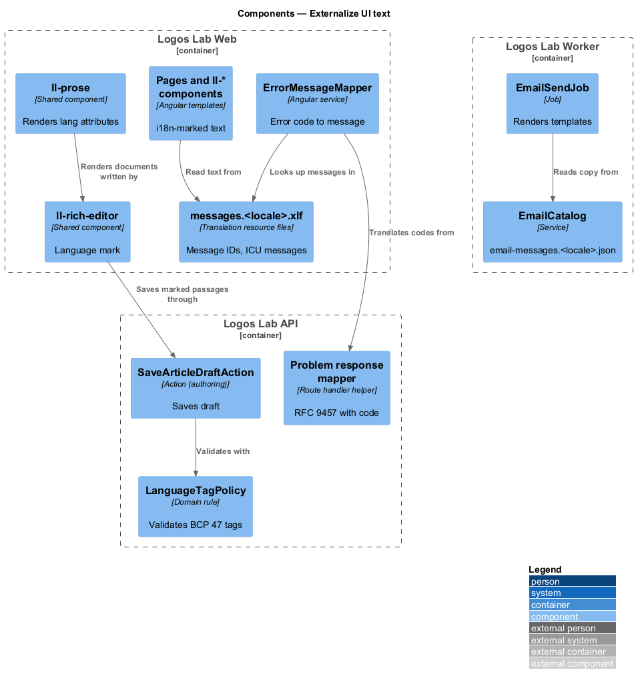
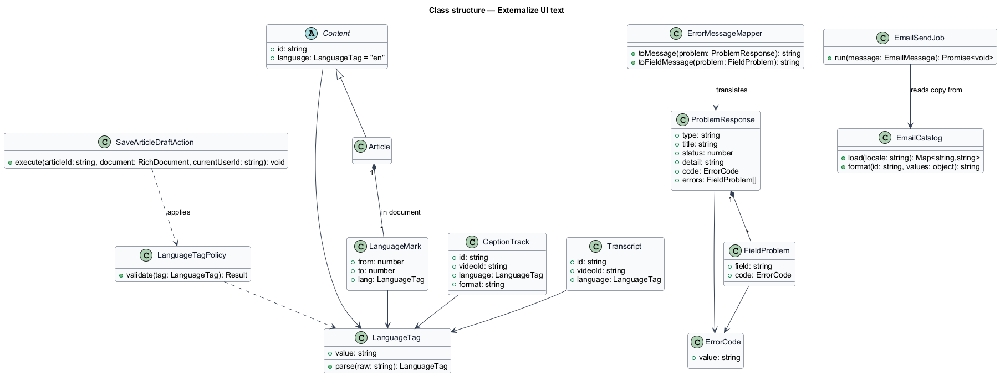
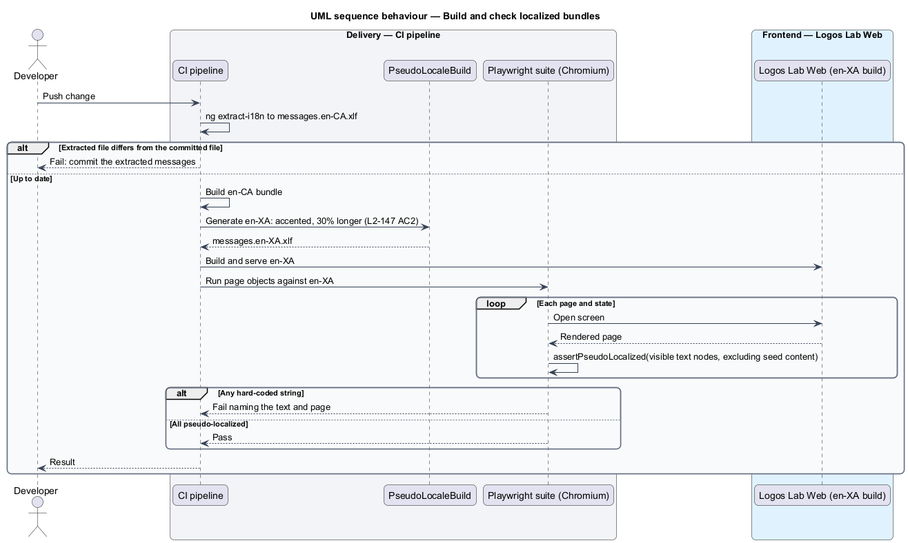
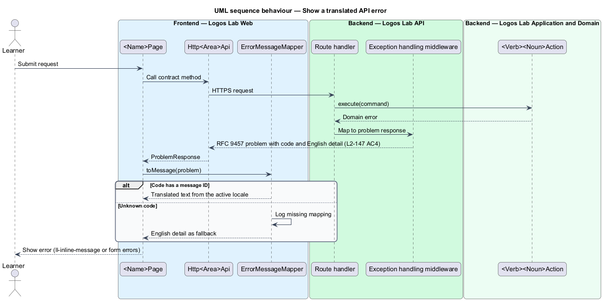
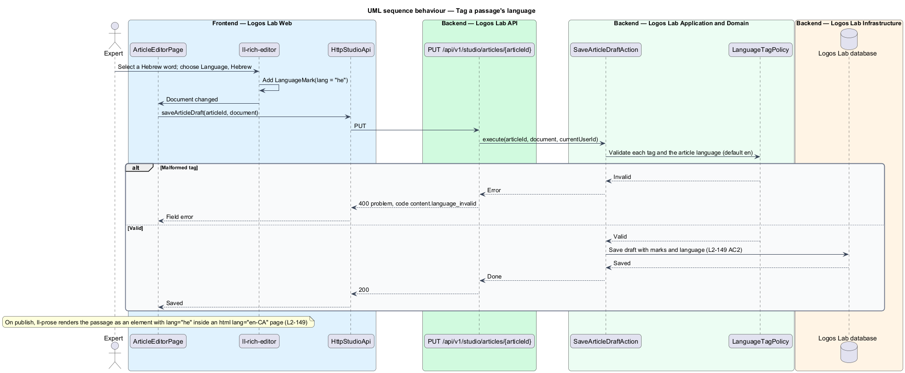

# Externalize UI text

## Overview

Logos Lab launches in Canadian English (en-CA) and is built so that French can be added later without
changing application code (`L1-025`). That is possible only if no user-facing text is written into
components, templates or emails. This feature moves every string into translation resource files, and
records the language of each page and each piece of content.

The feature belongs to the internationalization subsystem, next to format for locale. It spans Logos
Lab Web (interface text and `lang` attributes), Logos Lab API (error codes and content language) and
the Worker (email templates).

- **message ID** — stable key that names one user-facing string, independent of its wording
- **translation resource file** — file that maps message IDs to text for one locale
- **source locale** — locale in which strings are first written; for Logos Lab, en-CA
- **pseudo-locale** — generated test locale whose strings are accented and lengthened, so any string
  that is not externalized stands out
- **ICU message format** — Unicode syntax for messages with variables, plurals and selections, for
  example `{count, plural, one {# lesson} other {# lessons}}`
- **error code** — stable, machine-readable identifier of an API error, such as
  `pagination.limit_exceeded`
- **language tag** — BCP 47 code, such as `en-CA`, `fr-CA`, `he` or `la`, that declares the language of
  a page or passage

## Description

### Interface text in Logos Lab Web

- **Angular i18n** — baseline choice: `@angular/localize`, with `i18n` attributes in templates and
  `$localize` in TypeScript. Each message has an explicit ID (`@@course.enrol.button`). Labels,
  messages, errors, accessible names (`aria-label`) and page titles are all marked (`L2-147` AC1). The
  build-time versus run-time choice is to be confirmed by an ADR.
- **Translation resource files** — `src/locale/messages.en-CA.xlf` (source) and one file per added
  locale, in XLIFF 2.0. `ng extract-i18n` regenerates the source file in CI and fails the build when it
  changes without being committed.
- **ICU messages** — counts and variables use ICU plural and select syntax. String concatenation of
  translated fragments is not allowed (`L2-147` AC3). Examples from the mocks are "35 of 120
  characters" and "1,284 words · 6 min read" in `docs/mocks/pages/article-editor/`.
- **Shared components** — every `ll-*` component takes its text through inputs or its own marked
  messages, including default accessible names such as "Close" on `ll-dialog`.
- **`PseudoLocaleBuild`** — CI stage that generates the `en-XA` pseudo-locale from the source file:
  each string accented and lengthened by 30%. The Playwright suite then runs against that build. A
  page-object helper, `assertPseudoLocalized`, fails on any visible text node that is not
  pseudo-localized (`L2-147` AC2). Seed content, such as course titles, is excluded because it is
  content, not interface text.

### Email text

- **Email templates** — the Worker's `EmailSendJob` renders templates whose copy comes from
  `email-messages.en-CA.json`, keyed by message ID and written in ICU format (`L2-147` AC1). The
  baseline choice for rendering is the `intl-messageformat` library.
- **`EmailCatalog`** — Worker service that loads the catalogue for the recipient's locale and falls
  back to en-CA.

### API error codes

- **Problem responses** — every RFC 9457 problem response from Logos Lab API carries a `code` member
  with a stable error code, and a `detail` in English (`L2-147` AC4). Field errors carry a code per
  field.
- **`ErrorMessageMapper`** — Logos Lab Web service. It maps each error code to a translated message ID
  (`@@error.<code>`). It shows the API's English `detail` only when no mapping exists, and logs the
  missing code.

### Language tagging

- **Page language** — the server render sets `<html lang>` from the active locale; at launch every page
  has `lang="en-CA"` (`L2-149` AC1). The mocks show this on every page.
- **Content language** — each content entity (course, module, video, article, collection, event) has a
  `language` column, default `en` (`L2-149` AC2). The editor shows it as a field.
- **Passage language** — `ll-rich-editor` has a "Language" toolbar control that marks a selected
  passage with a language tag, for example a Hebrew word or a Latin phrase. The stored document keeps
  the mark, and `ll-prose` renders it as an element with the matching `lang` attribute (`L2-149` AC2).
  Mocks: `docs/mocks/pages/article-editor/scripture.html` (`lang="he"` and `lang="he-Latn"`) and
  `docs/mocks/pages/article-page/default.html` (`lang="la"`).
- **`LanguageTagPolicy`** — domain rule that validates a tag as well-formed BCP 47 before content is
  saved. The list of offered languages is `<TO SUPPLY>`.
- **Caption tracks and transcripts** — `caption_tracks.language` and `transcripts.language` record each
  track's language (`L2-149` AC3). The track upload form asks for it. Mock:
  `docs/mocks/pages/studio-video-captions/` (states `default`, `uploading`, `generating`,
  `review-required`, `invalid`, `empty`, `error`, `loading`). The player renders each track with
  `srclang`, and `ll-transcript` renders its list with `lang`.
- **Save path** — `PUT /api/v1/studio/articles/{articleId}` calls `SaveArticleDraftAction` of the
  authoring design, which applies `LanguageTagPolicy` before it writes the draft.

## Requirements

| L2 ID | Refines (L1) | Requirement |
|-------|--------------|-------------|
| `L2-147` | `L1-025` | **Externalized UI text.** All user-facing text shall be externalized so that it can be translated. |
| `L2-149` | `L1-025` | **Language tagging.** Pages and content shall declare their language. |

## Diagrams

### System context

Learners read Logos Lab pages and emails in en-CA. Translators supply further locales through
resource files, and the CI pipeline proves that no string is hard-coded.

### Containers

Logos Lab Web and the Worker read translation resource files. Logos Lab API returns error codes and
stores content, caption and passage languages.

### Components

Templates mark messages for Angular i18n, and `ErrorMessageMapper` translates API error codes.
`LanguageTagPolicy` validates language tags before content is saved.

### Class structure

`ProblemResponse` carries an `ErrorCode` that `ErrorMessageMapper` translates. Content, caption tracks
and transcripts each carry a `LanguageTag`.

### Behaviour — build and check localized bundles

CI extracts messages, builds en-CA and the pseudo-locale, and runs the Playwright suite against the
pseudo-locale build.

### Behaviour — show a translated API error

The API returns a problem response with a stable code. The page shows the translated text for that
code, or the English detail as a fallback.

### Behaviour — tag a passage's language

An author marks a passage as Hebrew. The draft stores the tag, and the published page renders the
passage with `lang="he"`.

