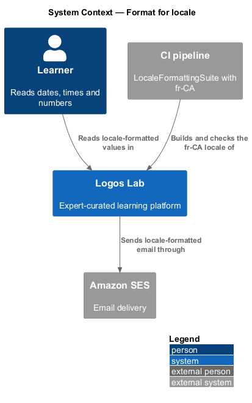
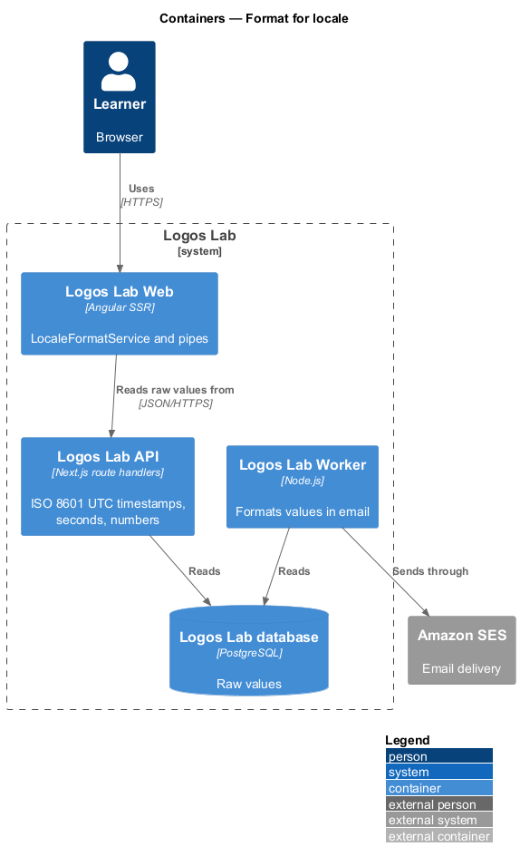
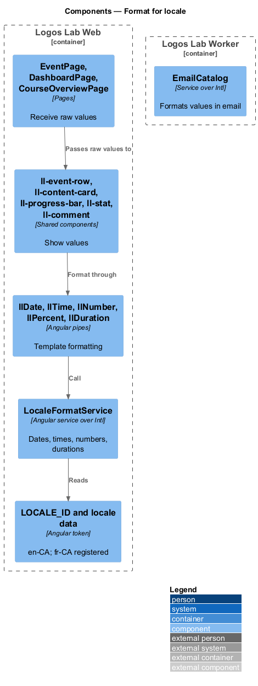
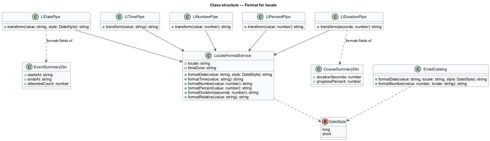
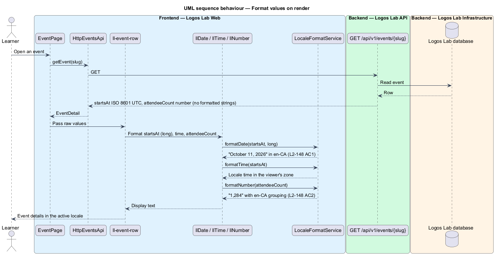
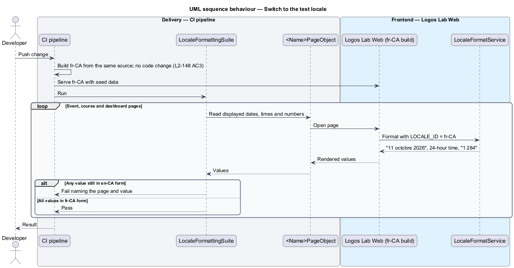

# Format for locale

## Overview

Logos Lab shows many dates, times, numbers and durations: event start times, course lengths, word
counts, progress percentages and timestamps on comments. Each locale writes these differently. Canadian
English writes "October 11, 2026" and "1,284", while Canadian French writes "11 octobre 2026" and
"1 284". This feature makes every such value follow the active locale, so that adding French needs no
code change.

The feature belongs to the internationalization subsystem, next to externalize UI text. It lives in
Logos Lab Web and the Worker, which format values. Logos Lab API supplies raw values only.

- **locale** — BCP 47 tag, such as `en-CA` or `fr-CA`, that selects language and formatting conventions
- **long date** — date written with the month name, for example "October 11, 2026" in en-CA
- **short date** — locale's compact date form, used where space is limited
- **grouping separator** — character between groups of digits, such as the comma in "1,284"
- **duration** — length of time, such as a video length or a course's estimated hours
- **test locale** — locale used only to prove that formatting follows the locale; for Logos Lab,
  fr-CA

## Description

### Formatting in Logos Lab Web

- **`LOCALE_ID`** — Angular token set from the active locale; en-CA at launch. The en-CA and fr-CA
  locale data are registered at the composition root.
- **`LocaleFormatService`** — Logos Lab Web service over the browser's `Intl` API and Angular's
  locale-aware pipes. It is the single place that turns raw values into display text:
  - `formatDate(value, 'long')` — long date, "October 11, 2026" in en-CA (`L2-148` AC1)
  - `formatDate(value, 'short')` — the locale's short form, used everywhere else (`L2-148` AC1)
  - `formatTime(value)` — the locale's time form in the viewer's time zone
  - `formatNumber(value)` and `formatPercent(value)` — locale grouping and decimal separators
    (`L2-148` AC2)
  - `formatDuration(seconds)` — hours and minutes through an ICU message with plural rules
  - `formatRelative(value)` — relative time through `Intl.RelativeTimeFormat`
- **Pipes** — `llDate`, `llTime`, `llNumber`, `llPercent` and `llDuration` call the service from
  templates. No component builds a date or number string by hand (`L2-148` AC1).
- **Components that show values** — `ll-event-row` and `ll-rsvp-panel` (event dates and times),
  `ll-content-card` (durations), `ll-progress-bar` and `ll-stat` (percentages and counts),
  `ll-comment` and `ll-notification-item` (timestamps), and `ll-certificate` (completion date).
- **Raw values from the API** — Logos Lab API returns timestamps as ISO 8601 in UTC, durations as whole
  seconds and numbers as JSON numbers. It returns no formatted strings.

### Formatting in email

- **`EmailCatalog`** — the Worker's message catalogue (externalize UI text) formats dates, times and
  numbers in email with `Intl` for the recipient's locale, using the same rules as Logos Lab Web.

### Open points

- **Date style in the mocks** — the mocks and the cast in `docs/mocks/README.md` write dates as
  "Tue 13 Oct 2026" or "13 Oct 2026". `L2-148` AC1 requires the long form "October 11, 2026". Which
  surfaces use the long form and which use the short form is `<TO SUPPLY>`. The implementation follows
  `L2-148` until the mocks change.
- **Time zone** — the mocks show times in the viewer's zone with the zone named, for example
  "10:24 am ET", and relative time up to 7 days. `L2-148` does not state these rules. They are taken
  from the mocks, and the source of the viewer's zone (browser or account setting) is `<TO SUPPLY>`.

### Verification

- **`LocaleFormattingSuite`** — Playwright tests in Chromium, run against an fr-CA build with fr-CA
  locale data and the seed data. Page objects read the event, course and dashboard values and assert
  the fr-CA forms of dates, times and numbers. No application code changes between the en-CA and fr-CA
  runs (`L2-148` AC3).

## Requirements

| L2 ID | Refines (L1) | Requirement |
|-------|--------------|-------------|
| `L2-148` | `L1-025` | **Locale-aware formatting.** Dates, times, numbers and durations shall be formatted for the user's locale. |

## Diagrams

### System context

Learners read dates, times and numbers in their locale on pages and in email. The CI pipeline checks
that the fr-CA test locale changes the formats.

### Containers

Logos Lab API returns raw values. Logos Lab Web and the Worker format them for the active locale.

### Components

Pipes in templates call `LocaleFormatService`, which reads `LOCALE_ID` and the registered locale data
through the `Intl` API.

### Class structure

`LocaleFormatService` exposes 1 method per value kind. The pipes and `EmailCatalog` depend on the same
`Intl` formatters.

### Behaviour — format values on render

A page receives raw ISO timestamps and numbers from the API. The pipes format them through
`LocaleFormatService` for the active locale.

### Behaviour — switch to the test locale

CI builds the fr-CA locale without code changes. The suite asserts that dates, numbers and times change
format.

