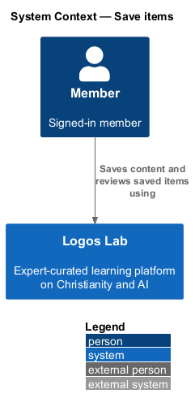
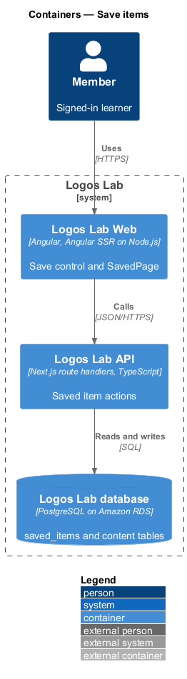
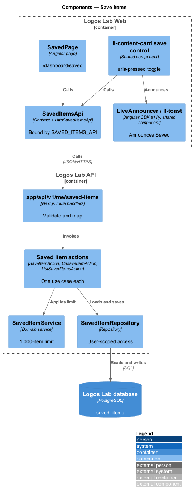
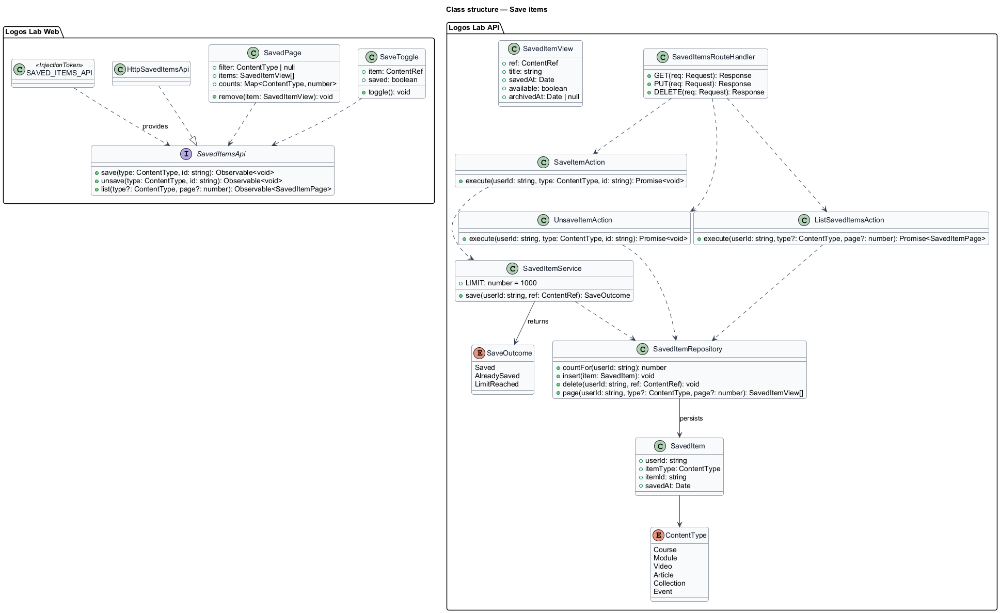
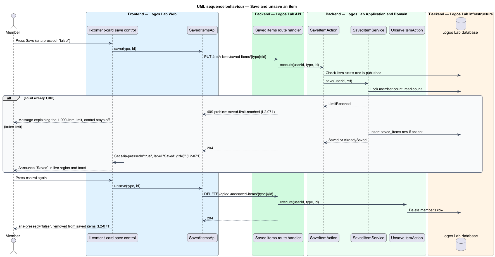
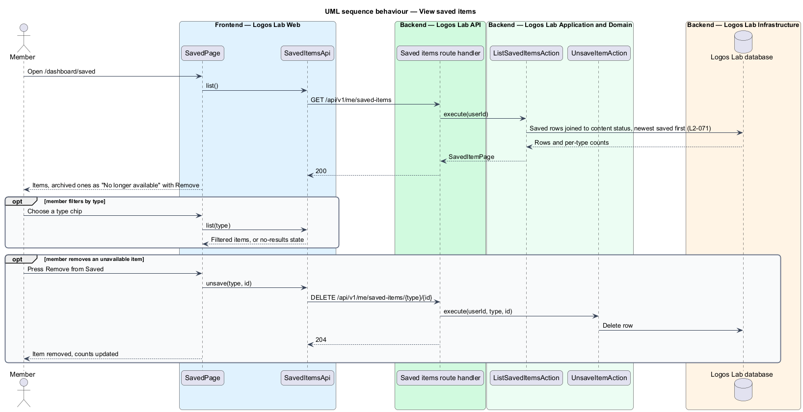

# Save items

## Overview

Members often find something worth returning to before they have time for it. Saving keeps a pointer
to that item in the member's dashboard. A **saved item** is a member's bookmark of one piece of
content: a course, module, video, article, collection or event.

- **save control** — toggle button on a content card or content page that saves or unsaves the item
- **saved list** — page at `/dashboard/saved` that lists a member's saved items
- **unavailable item** — saved item whose content has since been archived

This feature covers the save control, the saved list and the 1,000-item limit (`L2-071`).

## Description

### Screens

- **Save control** — the `content-card__save` icon button of `ll-content-card`, and the same control
  on content pages. It is a toggle with `aria-pressed`. Its label is "Save {title}" when off and
  "Saved: {title}" when on. Saving announces "Saved" through a polite live region and an `ll-toast`.
- **`SavedPage`** — `/dashboard/saved`, with the lead "Things you've kept for later, newest saved
  first. Saved holds up to 1,000 items." An `ll-chip` filter row offers All, Courses, Modules, Videos,
  Articles, Collections and Events with counts. Items render as `ll-content-card` with "Saved {date}".
  An unavailable item shows "No longer available", the archive date and "Remove from Saved".
- **Limit notice** — `ll-alert` "Saved is full" explains the 1,000-item limit and names the item that
  was not saved.
- **Mock states** — `docs/mocks/pages/saved/` covers `default`, `loading`, `empty`, `error`,
  `no-results`, `unavailable`, `limit` and `long`. `docs/mocks/pages/article-page/saved.html` shows
  the control on a page. `docs/mocks/notifications/toast/` holds the toast. The `long` state uses
  `ll-pagination`; its page size is `<TO SUPPLY>`.

### API contract

`SavedItemsApi` in `projects/api`, bound through `SAVED_ITEMS_API` to `HttpSavedItemsApi`.

| Method | Endpoint | Action |
|---|---|---|
| `PUT` | `/api/v1/me/saved-items/{itemType}/{itemId}` | `SaveItemAction` (idempotent) |
| `DELETE` | `/api/v1/me/saved-items/{itemType}/{itemId}` | `UnsaveItemAction` |
| `GET` | `/api/v1/me/saved-items?type=&page=` | `ListSavedItemsAction` |

Content list and page responses include a `saved` flag for the signed-in member, so the control
renders its state without a separate call.

### Application and domain

- **`SaveItemAction`** — checks that the item exists and is published, then calls `SavedItemService`.
- **`SavedItemService`** — holds the limit of 1,000 saved items per member (`L2-071`). It locks the
  member's saved-item count and inserts in one transaction, so concurrent saves cannot pass the limit.
  A save beyond the limit returns a 409 problem of type `saved-limit-reached` (baseline choice). Saving
  an item already saved returns success without a second row.
- **`UnsaveItemAction`** — deletes the member's row. Removing an unavailable item uses the same
  action.
- **`ListSavedItemsAction`** — orders by `savedAt` descending, filters by type and returns counts per
  type. A row whose content is archived returns `available: false` with the archive date.
- **Entity** — `SavedItem` (`userId`, `itemType`, `itemId`, `savedAt`), unique on the triple.
  `ContentType` holds `Course`, `Module`, `Video`, `Article`, `Collection` and `Event`.
- **Repository and table** — `SavedItemRepository` over `saved_items`. Every query takes the current
  user's id (`L2-017`).

## Requirements

| L2 ID | Refines (L1) | Requirement |
|-------|--------------|-------------|
| `L2-071` | `L1-012` | **Saved items.** Members shall be able to save any content for later. |

## Diagrams

### System context

Members save content and review their saved list in Logos Lab. No external system takes part.

### Containers

Logos Lab Web calls the Logos Lab API, which stores saved items in the Logos Lab database.

### Components

The save control and `SavedPage` call `SavedItemsApi`. The save action enforces the limit through
`SavedItemService`.

### Class structure

`SavedItem` links a member to one content item. `SavedItemService` owns the 1,000-item limit.

### Behaviour — save and unsave

Pressing the control saves the item, sets `aria-pressed="true"` and announces "Saved". Pressing it
again removes the item, and a save past the limit is refused.

### Behaviour — view saved items

The saved list loads newest first with a type filter. Archived items show "No longer available" with a
Remove action.

