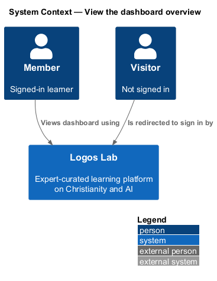
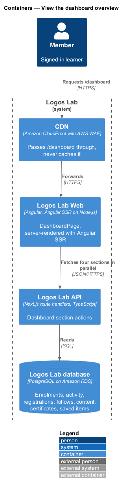
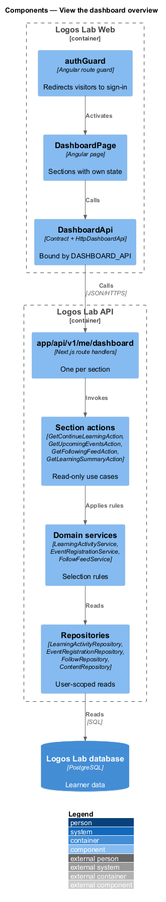
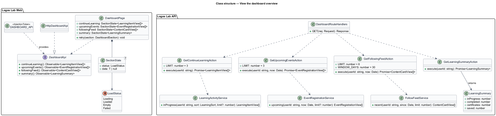
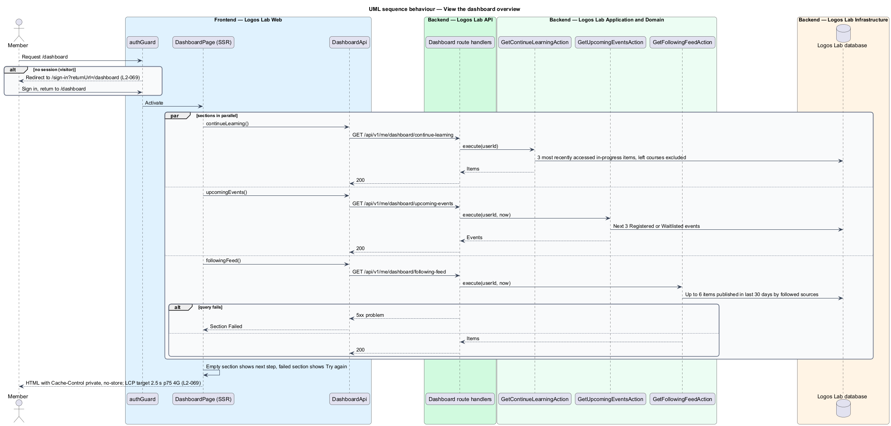

# View the dashboard overview

## Overview

The learner dashboard is a signed-in member's personal space on Logos Lab. Its landing page,
`/dashboard`, is the first screen a member sees after signing in. It answers three questions at a
glance: what to continue, what is coming up, and what is new from the people the member follows.

- **dashboard overview** — landing page at `/dashboard` that summarizes a member's learning and next steps
- **in-progress item** — course, module or video that a member has started and not completed
- **followed source** — expert or collection a member follows
- **section** — independently loaded block of the overview, such as "Continue learning"

This feature covers the overview page (`L2-069`). The detail pages it links to are the sibling features
`view-my-learning`, `save-items`, `view-my-events`, `view-my-certificates` and `view-following`.

## Description

### Screens

- **`DashboardPage`** — `/dashboard`, protected by `authGuard`. It greets the member ("Good morning,
  Miriam") and renders the sections below.
  - **"Continue learning"** — up to 3 most recently accessed in-progress items, each with an
    `ll-progress-bar` and a resume action ("Continue the lesson", "Resume", "Retry").
  - **"Upcoming events"** — the member's next 3 registered events as `ll-event-row`, with status
    ("Registered", "Waitlisted · number 3") and a "My events" link.
  - **"Your learning so far"** — `ll-stat` tiles for In progress, Completed, Certificates and Saved.
    The mock shows this block; `L2-069` does not require it.
  - **"New from people you follow"** — up to 6 items published in the last 30 days by followed experts
    or collections, as `ll-content-card`, with "Manage who you follow".
- **Empty and error parts** — each section has its own `ll-empty-state` with a next step ("Explore
  courses", "Browse events", "Find experts to follow"), so no section is blank. A failed section shows
  an `ll-alert` with "Try again" while the rest of the page stays usable. `ll-skeleton` covers loading.
- **Mock states** — `docs/mocks/pages/dashboard/` covers `default`, `loading`, `empty`, `partial` and
  `error`.

### API contract

`DashboardApi` in `projects/api`, bound through `DASHBOARD_API` to `HttpDashboardApi`. Each section has
its own endpoint, so one failure leaves the others intact (the `partial` state).

| Method | Endpoint | Action |
|---|---|---|
| `GET` | `/api/v1/me/dashboard/continue-learning` | `GetContinueLearningAction` |
| `GET` | `/api/v1/me/dashboard/upcoming-events` | `GetUpcomingEventsAction` |
| `GET` | `/api/v1/me/dashboard/following-feed` | `GetFollowingFeedAction` |
| `GET` | `/api/v1/me/dashboard/summary` | `GetLearningSummaryAction` |

### Application and domain

- **`GetContinueLearningAction`** — asks `LearningActivityService` for in-progress items ordered by
  last access and keeps 3. Courses the member has left (`L2-027`) are excluded.
- **`GetUpcomingEventsAction`** — asks `EventRegistrationService` for the next 3 events whose start
  is after now and whose registration is `Registered` or `Waitlisted`.
- **`GetFollowingFeedAction`** — `FollowFeedService` reads the member's follows and selects published
  items by those experts or in those collections. It keeps items published in the last 30 days and
  returns at most 6, newest first.
- **`GetLearningSummaryAction`** — counts in-progress items, completed items, certificates and saved
  items.
- **Repositories and tables** — `LearningActivityRepository` (`enrolments`, `learning_activity`),
  `EventRegistrationRepository` (`event_registrations`), `FollowRepository` (`follows`),
  `ContentRepository` (published content), `CertificateRepository` (`certificates`) and
  `SavedItemRepository` (`saved_items`). Every query takes the current user's id (`L2-017`).

### Access and performance

- A visitor who requests `/dashboard` is redirected by `authGuard` to sign-in with
  `returnUrl=/dashboard`, and returns to the dashboard afterwards (`L2-069`).
- Logos Lab Web renders the page on the server with Angular SSR. The SSR request forwards the session
  cookie and fetches the four sections in parallel. Hydration reuses the fetched data through the
  Angular transfer state.
- Responses carry `Cache-Control: private, no-store`, so the CDN never caches the page (`L2-113`).
- The performance target is Largest Contentful Paint of 2.5 seconds or less at p75 on a 4G mobile
  profile (`L2-069`). Images carry explicit sizes, and the first visible card image loads with
  priority. A CI performance stage with a 4G mobile profile checks the budget on each build (baseline
  choice). Field measurement through real-user monitoring is `<TO SUPPLY>`.

## Requirements

| L2 ID | Refines (L1) | Requirement |
|-------|--------------|-------------|
| `L2-069` | `L1-012` | **Dashboard overview.** Signed-in members land on `/dashboard`, which summarizes their learning and next steps. |

## Diagrams

### System context

Signed-in members open the dashboard in Logos Lab. Visitors are sent to sign in first.

### Containers

The CDN passes the personal page through uncached. Logos Lab Web renders it on the server from four
Logos Lab API calls.

### Components

`DashboardPage` calls `DashboardApi`. Each section endpoint has its own action and domain service.

### Class structure

The four actions return one view model per section, and the page composes the views with per-section
state.

### Behaviour — load the dashboard

The guard redirects visitors. For members, server rendering fetches the four sections in parallel, and
a failed section degrades on its own.

