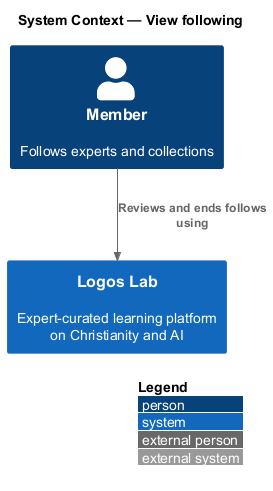
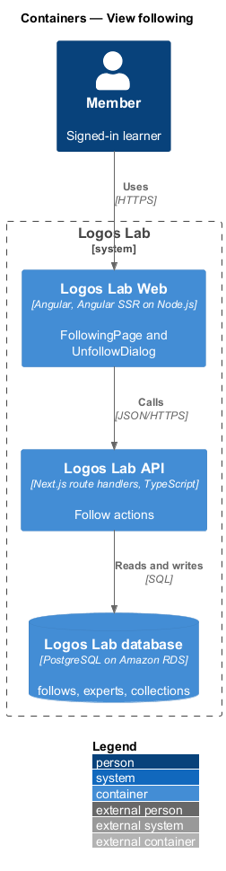
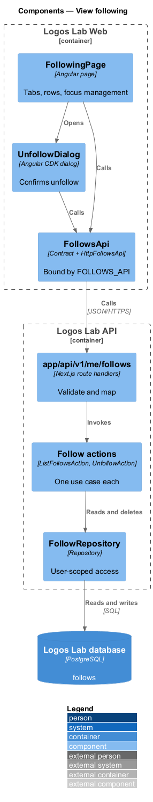
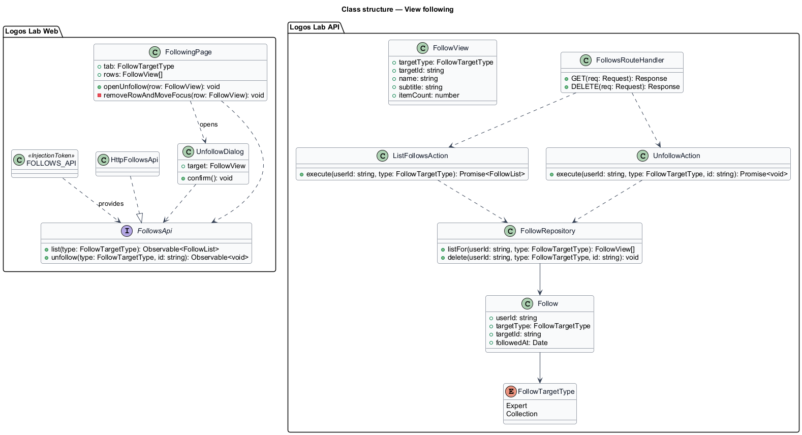
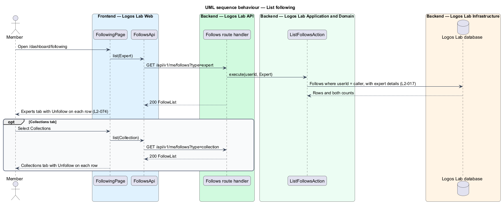
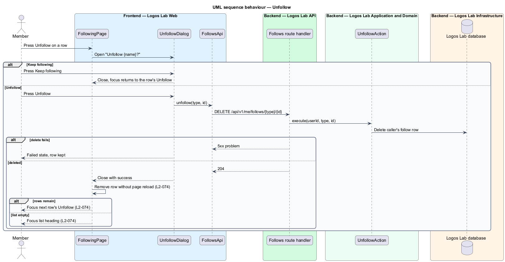

# View following

## Overview

Members follow experts and collections to hear when they publish or add something. "Following" is the
dashboard page that lists everything a member follows and lets them stop following.

- **follow** — member's subscription to an expert or a collection
- **followed expert** — expert profile a member follows
- **followed collection** — curated collection a member follows

This feature covers the page at `/dashboard/following` and unfollowing from it (`L2-074`). Following
from an expert profile or a collection page belongs to the experts and collections subsystems; the
same unfollow dialog serves them.

## Description

### Screens

- **`FollowingPage`** — `/dashboard/following`, with the lead "Experts and collections you follow. You
  hear when they publish or add something." `ll-tabs` holds "Experts" and "Collections" with counts.
  Each tab has a list heading ("Experts you follow") and rows with `ll-avatar`, name, field, item
  count, latest activity and an "Unfollow" `ll-button` (`L2-074`).
- **`UnfollowDialog`** — "Unfollow {name}?", with "Keep following" and "Unfollow". It states that
  notifications stop and that the member can follow again at any time.
- **Focus rule** — after a confirmed unfollow the row leaves the list without a page reload. Focus
  moves to the next row's Unfollow control. When no row remains, focus moves to the list heading,
  which carries `tabindex="-1"` (`L2-074`).
- **Mock states** — `docs/mocks/pages/following/` covers `default`, `collections`, `loading`, `empty`
  and `error`. `docs/mocks/dialogs/unfollow/` covers `default`, `busy`, `failed` and `success`.

### API contract

`FollowsApi` in `projects/api`, bound through `FOLLOWS_API` to `HttpFollowsApi`.

| Method | Endpoint | Action |
|---|---|---|
| `GET` | `/api/v1/me/follows?type=expert\|collection` | `ListFollowsAction` |
| `DELETE` | `/api/v1/me/follows/{targetType}/{targetId}` | `UnfollowAction` |

### Application and domain

- **`ListFollowsAction`** — returns the member's follows of one type, with display data and both tab
  counts. The list order is `<TO SUPPLY>`; the mock does not state it.
- **`UnfollowAction`** — deletes the member's follow. Unfollowing an item not followed returns success,
  so a repeated request is harmless. Notifications from that source stop because notification fan-out
  reads the `follows` table.
- **Entity** — `Follow` (`userId`, `targetType`, `targetId`, `followedAt`), unique on the triple.
  `FollowTargetType` holds `Expert` and `Collection`.
- **Repository and table** — `FollowRepository` over `follows`. Queries take the current user's id
  (`L2-017`).

## Requirements

| L2 ID | Refines (L1) | Requirement |
|-------|--------------|-------------|
| `L2-074` | `L1-012` | **Following.** `/dashboard/following` lists the experts and collections a member follows. |

## Diagrams

### System context

A member reviews and ends follows in Logos Lab. No external system takes part.

### Containers

Logos Lab Web calls the Logos Lab API, which reads and deletes follows in the Logos Lab database.

### Components

`FollowingPage` and `UnfollowDialog` call `FollowsApi`. Two actions share `FollowRepository`.

### Class structure

`Follow` links a member to an expert or collection. The page keeps the rows and moves focus after each
removal.

### Behaviour — list following

The page loads the Experts tab first. The Collections tab loads on selection.

### Behaviour — unfollow

After confirmation the row leaves the list without a reload. Focus moves to the next row or to the
list heading.

