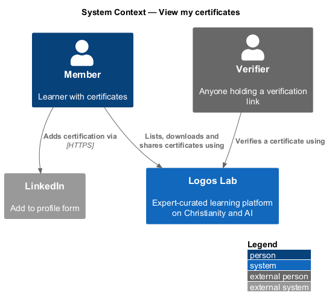
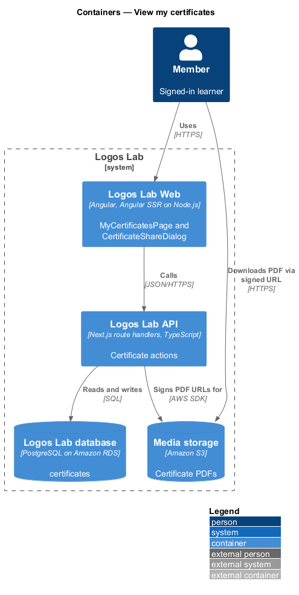
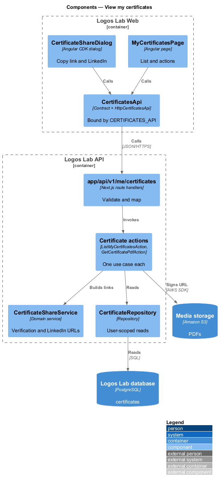
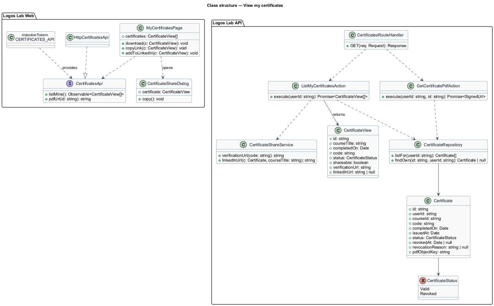
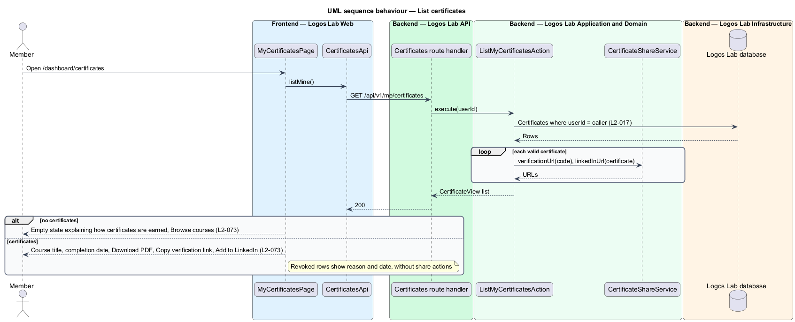
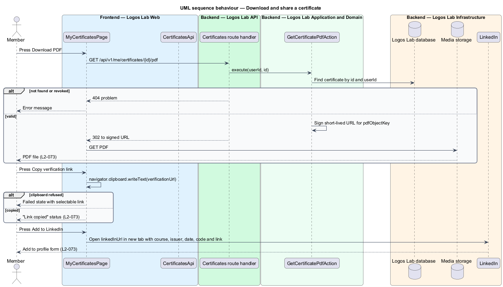

# View my certificates

## Overview

A member who completes every required lesson of a course earns a certificate. "My certificates" is
the dashboard page that lists those certificates and lets the member download, share and prove them.

- **certificate** — record that a named member completed a named course on a date, identified by a code
- **certificate code** — public identifier of a certificate, such as `LL-7K4Q-29XM`
- **verification link** — public URL at which anyone can confirm a certificate's validity from its code
- **revoked certificate** — certificate that Logos Lab has withdrawn and that no longer verifies

This feature covers the page at `/dashboard/certificates` and its actions (`L2-073`). Issuing,
verifying and revoking certificates belong to the courses subsystem.

## Description

### Screens

- **`MyCertificatesPage`** — `/dashboard/certificates`, with the lead "Certificates you've earned by
  completing courses." Each certificate row shows the course title, completion date, course author,
  lesson count, code and a "Valid" `ll-badge`. It offers "Download PDF", "Copy verification link" and
  "Add to LinkedIn" (`L2-073`).
- **Revoked row** — states the reason, "It no longer verifies", the revocation date and "Ask about this
  decision". It offers no share actions.
- **Aside** — an `ll-card` "How certificates work" with a "Find a course" link.
- **Empty state** — `ll-empty-state` "No certificates yet", which explains how certificates are earned
  and links to the course catalogue with "Browse courses".
- **`CertificateShareDialog`** — "Share certificate", opened from the certificate page
  (`/dashboard/certificates/{id}`). It holds the verification link with "Copy link" and the LinkedIn
  "Add to profile on LinkedIn" action.
- **Mock states** — `docs/mocks/pages/my-certificates/` covers `default`, `revoked`, `loading`,
  `empty` and `error`. `docs/mocks/dialogs/certificate-share/` covers `default`, `failed` and
  `success`.

The mocks show two verification paths: `logoslab.ca/certificates/{code}` in the share dialog and
`logoslab.ca/verify` in "How certificates work". The canonical verification URL is `<TO SUPPLY>`.

### API contract

`CertificatesApi` in `projects/api`, bound through `CERTIFICATES_API` to `HttpCertificatesApi`.

| Method | Endpoint | Action |
|---|---|---|
| `GET` | `/api/v1/me/certificates` | `ListMyCertificatesAction` |
| `GET` | `/api/v1/me/certificates/{id}/pdf` | `GetCertificatePdfAction` |

Each certificate in the list response carries `verificationUrl` and `linkedInUrl`.

### Application and domain

- **`ListMyCertificatesAction`** — returns the member's certificates, newest first, with status and
  share links. Revoked certificates carry `shareable: false`.
- **`GetCertificatePdfAction`** — checks that the certificate belongs to the caller and is valid. It
  then answers with a redirect to a short-lived signed URL for the PDF in Media storage. The URL
  lifetime is `<TO SUPPLY>`.
- **`CertificateShareService`** — builds the verification URL from the code. It also builds the
  LinkedIn "Add to profile" URL with the course name, Logos Lab as issuer, the issue date, the code and
  the verification URL. The LinkedIn organization identifier is `<TO SUPPLY>`.
- **Copy verification link** — the page writes the URL with the Clipboard API and announces "Link
  copied" in an inline status. A failed copy shows the `failed` state with the URL selectable.
- **Entity** — `Certificate` (`id`, `userId`, `courseId`, `code`, `completedOn`, `issuedAt`, `status`,
  `revokedAt`, `revocationReason`, `pdfObjectKey`), with `CertificateStatus` (`Valid`, `Revoked`).
- **Repository and table** — `CertificateRepository` over `certificates`. Queries take the current
  user's id (`L2-017`).

## Requirements

| L2 ID | Refines (L1) | Requirement |
|-------|--------------|-------------|
| `L2-073` | `L1-012` | **My certificates.** `/dashboard/certificates` lists all certificates the learner has earned. |

## Diagrams

### System context

A member lists and shares certificates in Logos Lab. LinkedIn receives the "Add to profile" request
in the member's browser.

### Containers

The Logos Lab API reads certificates from the Logos Lab database and signs PDF links to Media storage.

### Components

`MyCertificatesPage` calls `CertificatesApi`. The actions use `CertificateShareService` and
`CertificateRepository`.

### Class structure

`Certificate` holds the code, dates, status and PDF key. The list view adds the share links.

### Behaviour — list certificates

The page lists valid and revoked certificates, or shows the empty state with a link to the catalogue.

### Behaviour — download and share

Download follows a signed link. Copy writes the verification link to the clipboard, and LinkedIn opens
in a new tab.

