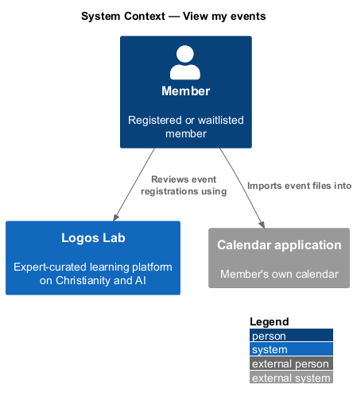
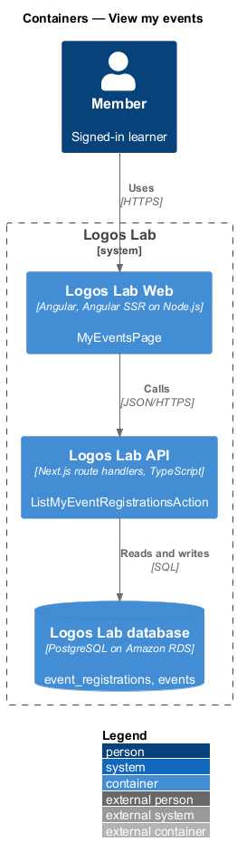
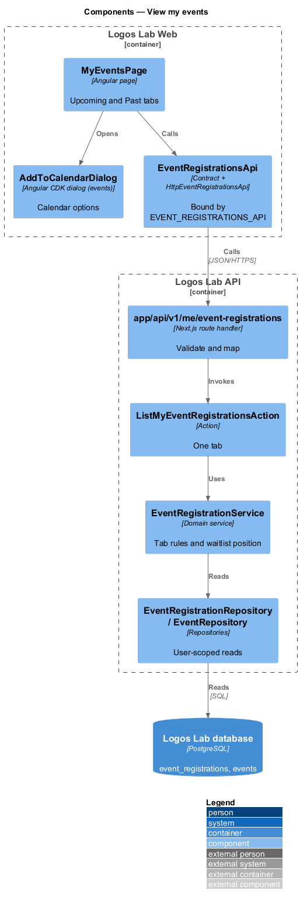
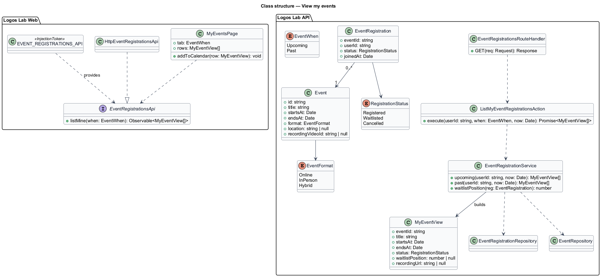
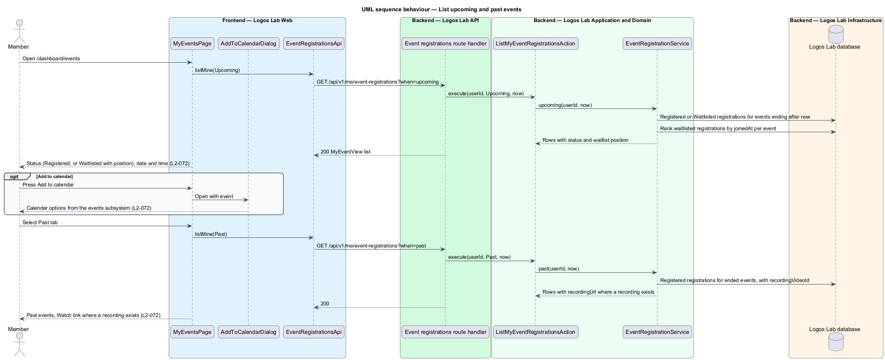

# View my events

## Overview

Members register for Logos Lab events such as live Q&As, workshops and evenings, and may join a
waitlist when an event is full. "My events" is the dashboard page that gathers those registrations in
one place, split into upcoming and past events.

- **event registration** — member's place on an event, either confirmed or on the waitlist
- **waitlist position** — member's place in the order of waitlisted registrations for one event
- **recording** — video of a past event published after it ends

This feature covers the page at `/dashboard/events` (`L2-072`). Registration, waitlists, reminders and
calendar files belong to the events subsystem; this page reads them and reuses the calendar action.

## Description

### Screens

- **`MyEventsPage`** — `/dashboard/events`, with the lead "Events you've registered for or are waiting
  on." `ll-tabs` holds "Upcoming" (with a count) and "Past".
- **Upcoming rows** — `ll-event-row` with the date tile, title, date and time, format and place. An
  `ll-badge` shows "Registered" or "Waitlisted · number {n}". Each row has an "Add to calendar" action
  that opens `AddToCalendarDialog` from the events subsystem. A footnote links "Change reminders".
- **Past rows** — `ll-event-row` with "ended" and attendance. Where a recording exists, it shows
  "Recording available · {length}" and a "Watch" link (`L2-072`).
- **Mock states** — `docs/mocks/pages/my-events/` covers `default`, `past`, `loading`, `empty` and
  `error`. `docs/mocks/dialogs/add-to-calendar/` covers the calendar dialog.

The mock shows times in Eastern time (ET). The source of the member's display time zone is
`<TO SUPPLY>`.

### API contract

`EventRegistrationsApi` in `projects/api`, bound through `EVENT_REGISTRATIONS_API` to
`HttpEventRegistrationsApi`.

| Method | Endpoint | Action |
|---|---|---|
| `GET` | `/api/v1/me/event-registrations?when=upcoming\|past` | `ListMyEventRegistrationsAction` |

The calendar file endpoint belongs to the events subsystem.

### Application and domain

- **`ListMyEventRegistrationsAction`** — calls `EventRegistrationService` with `upcoming` or `past`.
- **`EventRegistrationService`** — "upcoming" returns registrations with status `Registered` or
  `Waitlisted` for events that end after now, ordered by start time. "Past" returns `Registered`
  registrations for events that have ended, newest first. Cancelled registrations appear in neither
  tab. The waitlist position is the registration's rank among the event's waitlisted registrations,
  ordered by when each joined.
- **Entities** — `EventRegistration` (`eventId`, `userId`, `status`, `joinedAt`), `RegistrationStatus`
  (`Registered`, `Waitlisted`, `Cancelled`) and `Event` (`id`, `title`, `startsAt`, `endsAt`,
  `format`, `location`, `recordingVideoId`).
- **Repositories and tables** — `EventRegistrationRepository` (`event_registrations`) and
  `EventRepository` (`events`). Queries take the current user's id (`L2-017`).

## Requirements

| L2 ID | Refines (L1) | Requirement |
|-------|--------------|-------------|
| `L2-072` | `L1-012` | **My events.** `/dashboard/events` lists the member's event registrations. |

## Diagrams

### System context

A member reviews registered and past events in Logos Lab and adds events to a personal calendar.

### Containers

Logos Lab Web calls the Logos Lab API, which reads registrations and events from the Logos Lab
database.

### Components

`MyEventsPage` calls `EventRegistrationsApi`. One action and `EventRegistrationService` build both
tabs.

### Class structure

An `EventRegistration` refers to its `Event`, and the view adds the waitlist position and recording
link.

### Behaviour — list upcoming and past events

The Upcoming tab shows status, date and calendar action. The Past tab adds recordings where they exist.

