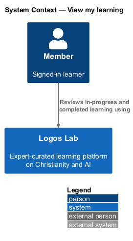
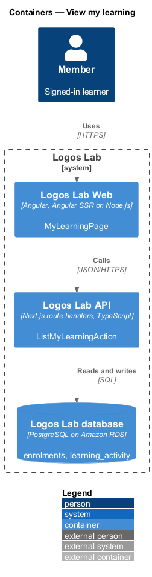
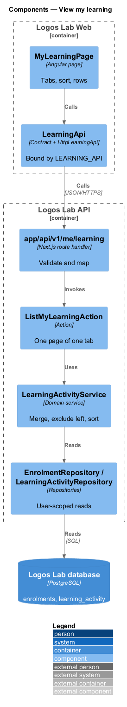
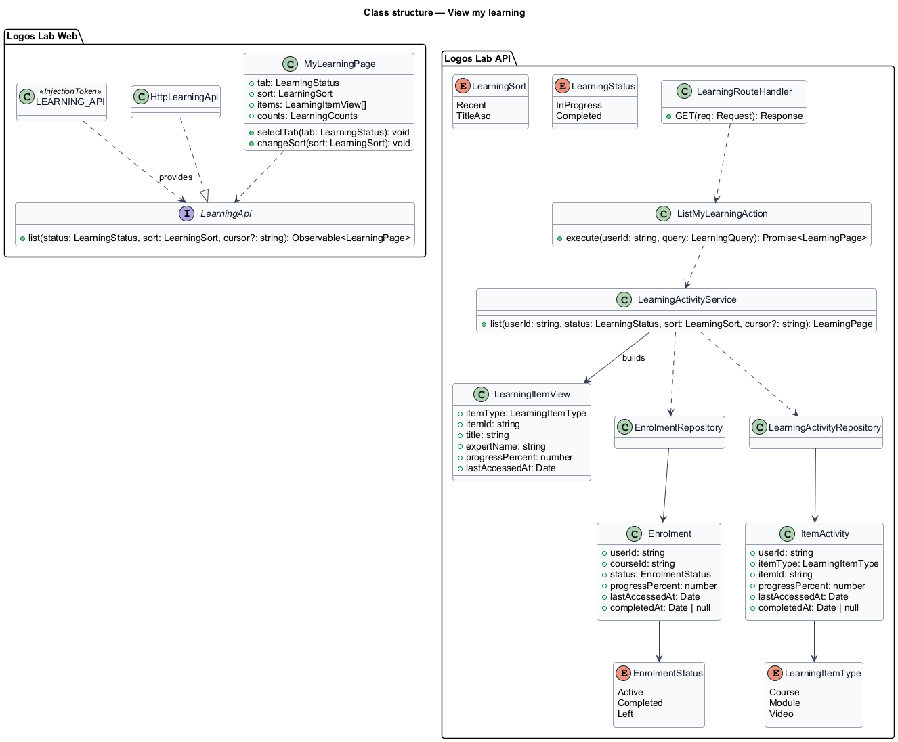
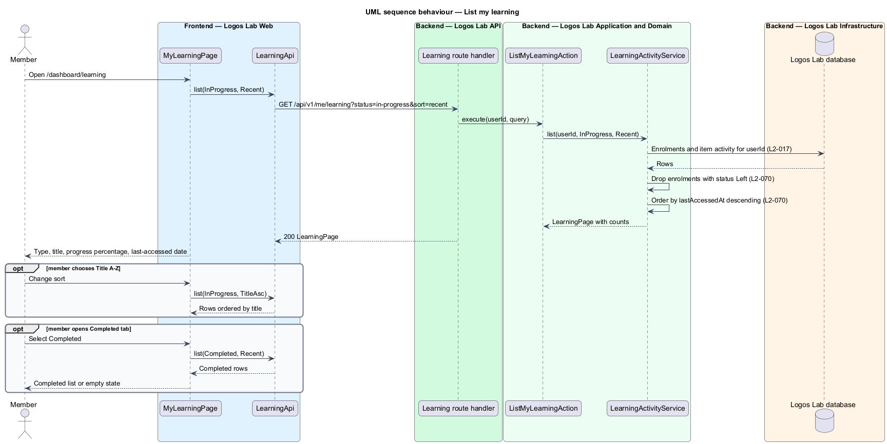

# View my learning

## Overview

"My learning" is the dashboard page that lists everything a member has started or finished. It is the
full record behind the overview's "Continue learning" section, split between work still in progress
and work completed.

- **learning item** — course, module or video in which a member has an enrolment or recorded activity
- **in-progress item** — learning item started and not completed
- **completed item** — learning item whose completion has been recorded
- **left course** — course the member has chosen to leave under `L2-027`

This feature covers the page at `/dashboard/learning` (`L2-070`). Progress itself is recorded by the
courses, modules and videos subsystems; this page reads it.

## Description

### Screens

- **`MyLearningPage`** — `/dashboard/learning`. `ll-page-header` with the lead text "Everything you've
  started or finished, with your progress." `ll-tabs` holds "In progress" and "Completed", each with a
  count. The active tab is kept in the query string (`?tab=completed`).
- **Sort** — on "In progress" an `ll-select` labelled "Sort by" offers "Recently opened" (default) and
  "Title A–Z".
- **Rows** — each item is an `ll-content-card` with a type `ll-badge` (Course, Module, Video), title,
  expert, `ll-progress-bar` with the percentage and the last-accessed date ("Opened Sun 11 Oct").
- **Mock states** — `docs/mocks/pages/my-learning/` covers `default`, `completed`, `loading`, `empty`,
  `error` and `long`. The page size for the `long` state is `<TO SUPPLY>`.

### API contract

`LearningApi` in `projects/api`, bound through `LEARNING_API` to `HttpLearningApi`.

| Method | Endpoint | Action |
|---|---|---|
| `GET` | `/api/v1/me/learning?status=in-progress\|completed&sort=recent\|title&cursor=` | `ListMyLearningAction` |

The response carries both tab counts with the page of items.

### Application and domain

- **`ListMyLearningAction`** — validates `status` and `sort`, then calls `LearningActivityService`.
- **`LearningActivityService`** — merges course enrolments with module and video activity into
  `LearningItemView` rows. It excludes enrolments with status `Left` from both tabs (`L2-070`). The
  "Recently opened" sort orders by `lastAccessedAt` descending; "Title A–Z" orders by title using the
  locale collation.
- **Entities and read model** — `Enrolment` (`userId`, `courseId`, `status`, `progressPercent`,
  `lastAccessedAt`, `completedAt`), `EnrolmentStatus` (`Active`, `Completed`, `Left`), `ItemActivity`
  (`userId`, `itemType`, `itemId`, `progressPercent`, `lastAccessedAt`, `completedAt`) and the
  `LearningItemView` read model.
- **Repositories and tables** — `EnrolmentRepository` (`enrolments`) and `LearningActivityRepository`
  (`learning_activity`). Both take the current user's id on every query (`L2-017`).

## Requirements

| L2 ID | Refines (L1) | Requirement |
|-------|--------------|-------------|
| `L2-070` | `L1-012` | **My learning.** `/dashboard/learning` lists everything the learner has started or completed. |

## Diagrams

### System context

A signed-in member reviews their learning in Logos Lab. No external system takes part.

### Containers

Logos Lab Web calls the Logos Lab API, which reads enrolments and activity from the Logos Lab database.

### Components

`MyLearningPage` calls `LearningApi`. One action and one domain service build the list.

### Class structure

`LearningActivityService` combines `Enrolment` and `ItemActivity` into `LearningItemView` rows and
drops left courses.

### Behaviour — list my learning

The page loads the chosen tab and sort. The service excludes left courses before it orders the rows.

