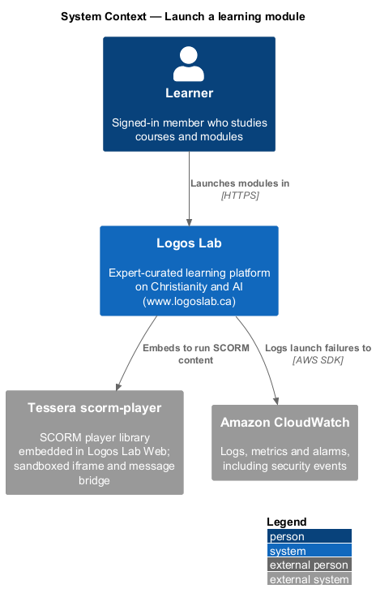
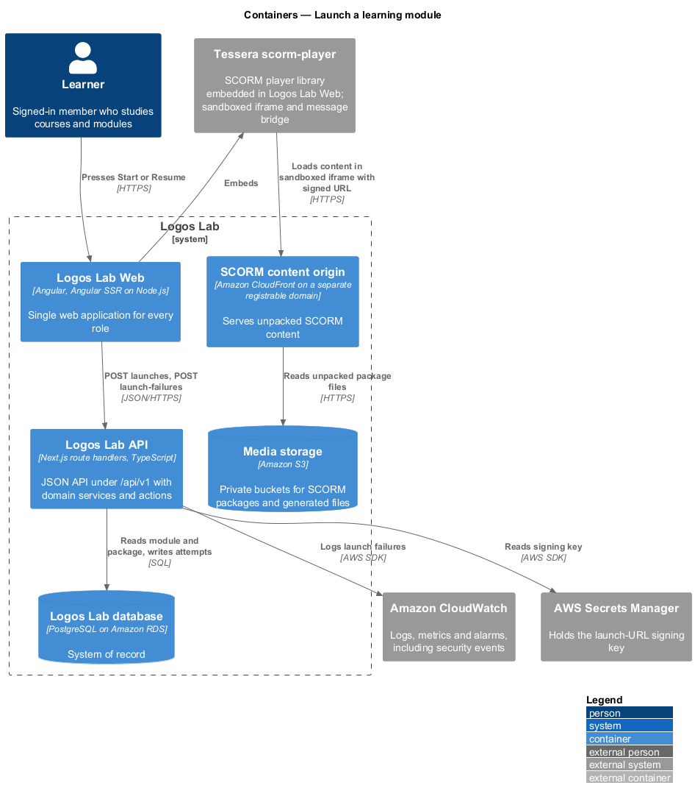
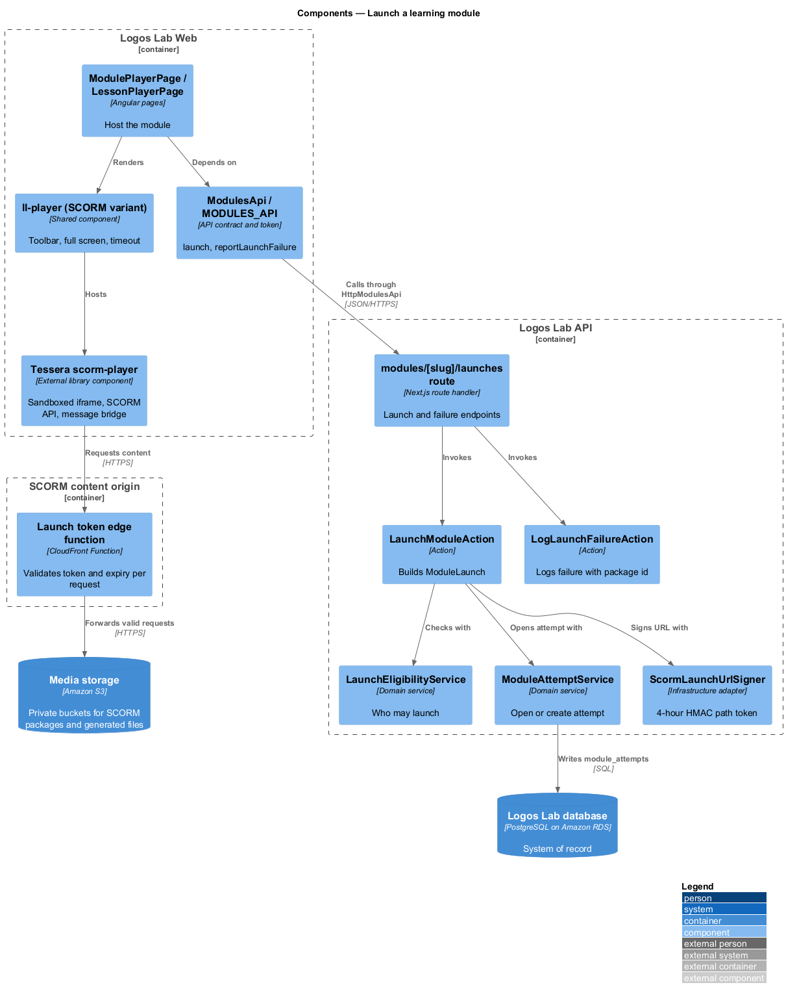
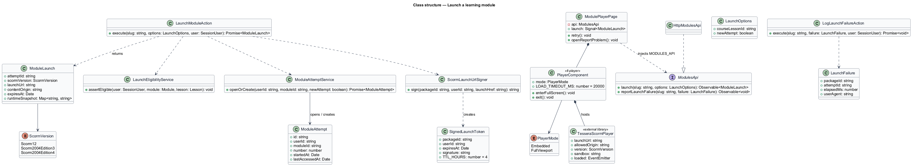
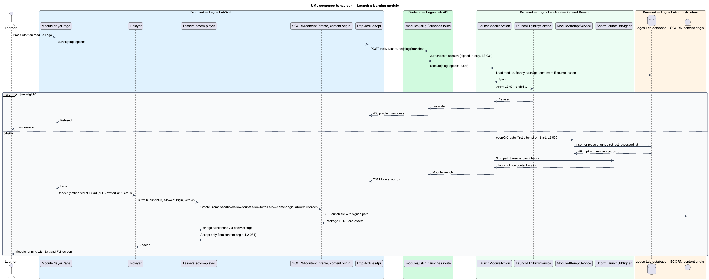
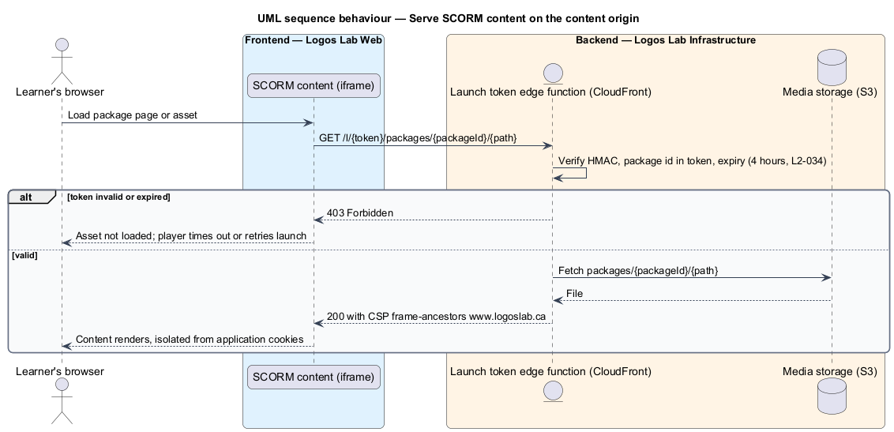
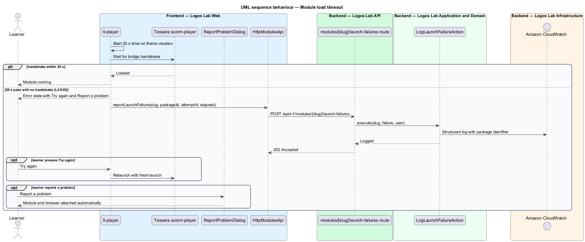

# Launch a learning module

## Overview

Learners **launch** a learning module — open its SCORM content in the Tessera scorm-player and start
or resume an attempt — either from the standalone module page or as a course lesson. An **attempt**
— one run of a learner through a module, with its own runtime data, status and score — is created
when the learner first presses "Start".

SCORM content is untrusted third-party HTML and JavaScript, so launch is also a security boundary.
The content runs in a sandboxed iframe on the **SCORM content origin** — separate registrable domain,
served by Amazon CloudFront, that shares no cookies or storage with `www.logoslab.ca`. Content
requests carry a **signed launch URL** — short-lived URL, valid 4 hours, that authorizes one learner
to load one package. Every SCORM API call between the content and the application crosses the
**message bridge** — Tessera scorm-player channel that relays `postMessage` traffic and accepts
messages only from the expected origin.

The **Tessera scorm-player** is an external library component from
[Tessera](https://github.com/QuinntyneBrown/Tessera/tree/main/src/scorm-player), embedded in Logos
Lab Web. Runtime data and scoring are covered by `record-scorm-runtime-data`; the module page by
`view-module-page`.

## Description

**Frontend (Logos Lab Web)**

- **`ModulePlayerPage`** — routed page for `/modules/:slug/play` (baseline choice). The lesson player
  embeds the same player for Learning module lessons
  (`docs/mocks/pages/lesson-player/module.html`).
- **`ll-player`** (SCORM variant) — shared component that hosts the Tessera scorm-player with a
  toolbar: "Exit", "Full screen" and an inline save status. At LG and XL it is embedded in the page
  with "Full screen" (Fullscreen API on the host element). At XS through MD it opens in full-viewport
  mode with a visible "Exit" control. Its CRD in `docs/specs/components/` precedes the build.
- **Tessera scorm-player** — external library component. It creates the iframe, exposes the SCORM
  API object (`API` for 1.2, `API_1484_11` for 2004) to the content through its content-side bridge,
  and accepts bridge messages only from the configured content origin. Its exact Angular inputs,
  outputs and events are `<TO SUPPLY>` from the Tessera documentation.
- **Iframe sandbox** — `sandbox="allow-scripts allow-forms allow-same-origin"`, where same-origin
  applies to the content origin only. HTML `sandbox` has no fullscreen token, so fullscreen is granted
  with `allow="fullscreen"`; see the clarification below.
- **`ReportProblemDialog`** — shared dialog (also used by video playback, `L2-040`) that attaches the
  module and browser automatically (`docs/mocks/dialogs/report-problem/`). Its endpoint owner is
  `<TO SUPPLY>`.
- **Screen states** — `docs/mocks/pages/module-player/` covers `loading`, `default`, `fullscreen`,
  `saving`, `offline` and `error` (the 20-second timeout with "Try again" and "Report a problem").
  `docs/mocks/pages/module-page/in-progress.html` shows "Resume" with the last-opened date.
- **`ModulesApi`** / **`MODULES_API`** / **`HttpModulesApi`** — methods `launch(slug, options)` and
  `reportLaunchFailure(slug, failure)`.
- **Content Security Policy** — the web application's `frame-src` lists only the content origin.

**API (Logos Lab API) and edge**

- **`POST /api/v1/modules/{slug}/launches`** — handled by **`LaunchModuleAction`**. Body:
  optional `courseLessonId` and `newAttempt`. Returns `ModuleLaunch` (`attemptId`, `scormVersion`,
  `launchUrl`, `contentOrigin`, `expiresAt`, `runtimeSnapshot`).
- **`LaunchEligibilityService`** — signed-in learner, published module with a Ready package; for a
  course lesson, an active enrolment and an unlocked lesson (`L2-028`).
- **`ModuleAttemptService.openOrCreate`** — creates the first attempt on "Start", resumes the open
  attempt otherwise, and updates `last_accessed_at`.
- **`ScormLaunchUrlSigner`** — builds `https://<content origin>/l/{token}/packages/{packageId}/{launchHref}`,
  where the token is an HMAC over package id, user id and an expiry 4 hours ahead. The signing key is
  held in AWS Secrets Manager. The token sits in the path, so relative asset URLs in the package keep
  it.
- **Content-origin edge function** — CloudFront Function on the SCORM content origin. It validates the
  token and expiry on every request and refuses with `403` otherwise. Responses carry
  `Content-Security-Policy: frame-ancestors https://www.logoslab.ca`. This token scheme is a baseline
  choice for an ADR; the content-origin domain is `<TO SUPPLY>`.
- **`POST /api/v1/modules/{slug}/launch-failures`** — handled by **`LogLaunchFailureAction`**, which
  writes a structured log entry with the package identifier, attempt id and elapsed time to Amazon
  CloudWatch.

**Key rules**

- "Start" opens the module in the Tessera scorm-player and creates the first attempt.
- Content loads from a separate content origin that shares no cookies with `www.logoslab.ca`.
- Content requests are authorized by a signed URL valid 4 hours, issued only to signed-in learners
  eligible to launch.
- SCORM API calls pass through the message bridge, which accepts messages only from the expected
  origin.
- If the module has not loaded within 20 seconds, an error offers "Try again" and a link to report a
  problem, and the failure is logged with the package identifier. "Loaded" means the bridge handshake
  from the content frame has arrived.
- After the learner closes the module, the module page's primary action reads "Resume" and shows the
  last-accessed date.
- Spec clarification: `L2-034` lists fullscreen among the sandbox allowances, but HTML `sandbox` has
  no fullscreen token; the design grants it with `allow="fullscreen"` on the same iframe.

## Requirements

| L2 ID | Refines (L1) | Requirement |
|-------|--------------|-------------|
| `L2-034` | `L1-006` | **SCORM content isolation.** SCORM content is untrusted third-party HTML and JavaScript. It shall run isolated from the main application. |
| `L2-035` | `L1-006` | **Launch a learning module.** Learners launch modules in the Tessera scorm-player, either from a standalone module page or as a course lesson. |

## Diagrams

### System context

Learners launch modules in Logos Lab, which embeds the Tessera scorm-player and logs launch failures
to Amazon CloudWatch.

### Containers

Logos Lab Web gets a signed launch from the API, then the sandboxed iframe loads content from the
SCORM content origin, never from the application's own domain.

### Components

`LaunchModuleAction` checks eligibility, opens the attempt and signs the URL; the edge function on the
content origin checks that URL on every request.

### Class structure

`ModuleLaunch` carries everything the player needs; `SignedLaunchToken` binds package, learner and a
4-hour expiry.

### Behaviour — launch a module

"Start" creates the attempt and a signed URL; the player loads the content in the sandbox and
completes the bridge handshake.

### Behaviour — serve content on the content origin

Every content request is checked at the edge before Media storage is read.

### Behaviour — load timeout

Without a handshake inside 20 seconds, the player shows the error state and the failure is logged
with the package identifier.

