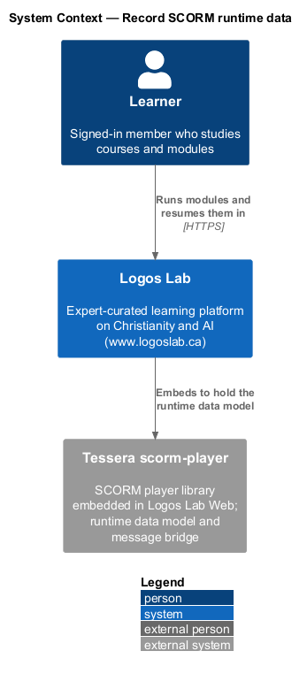
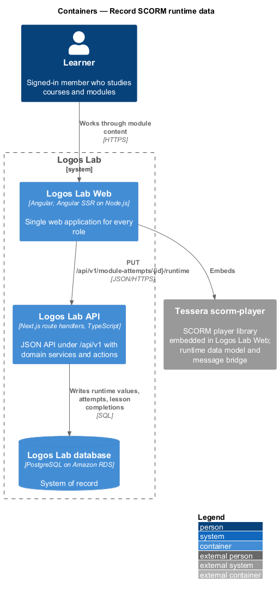
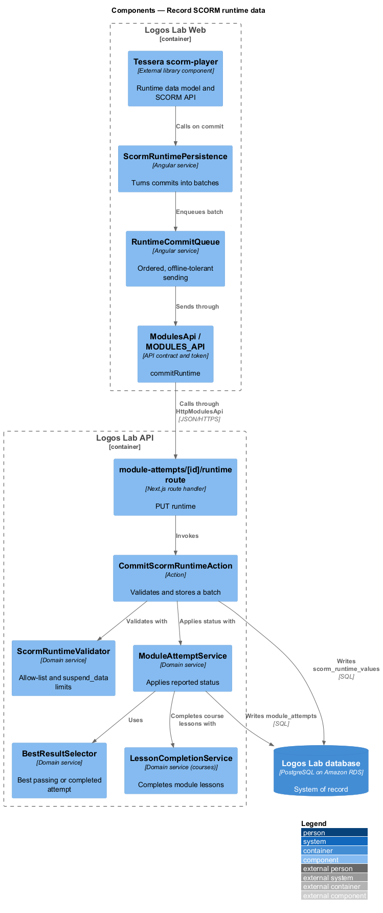
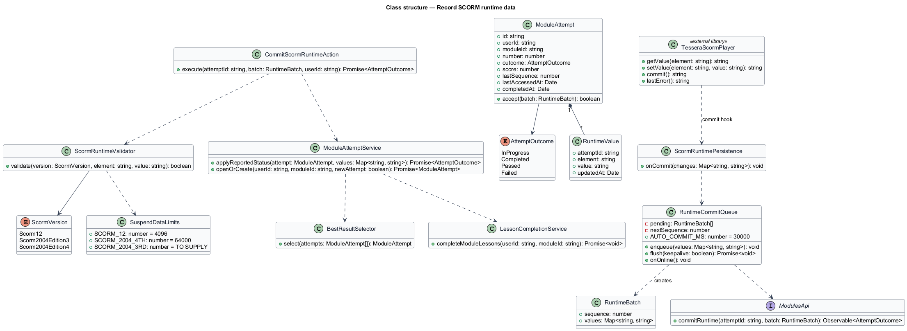
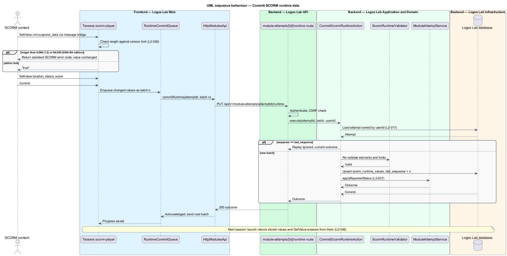
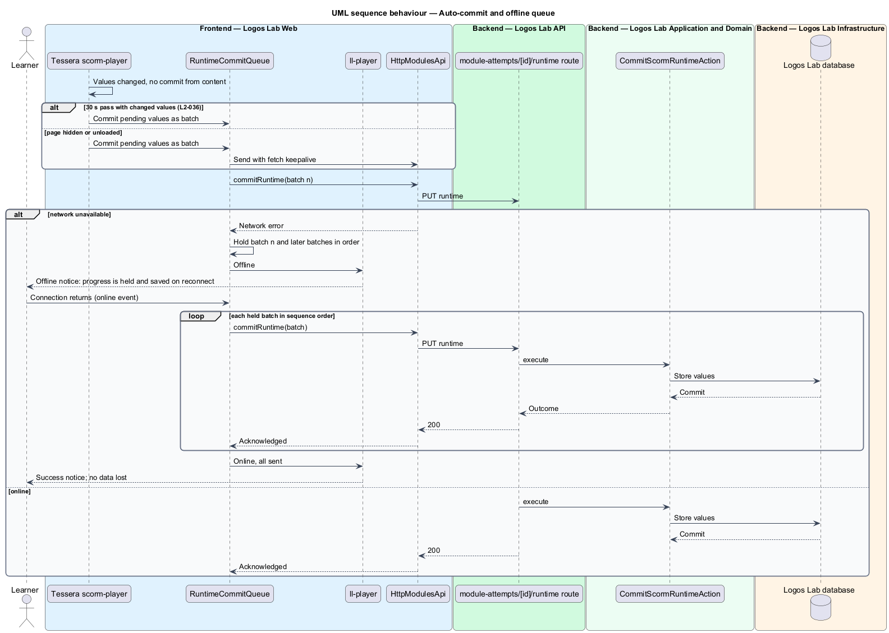
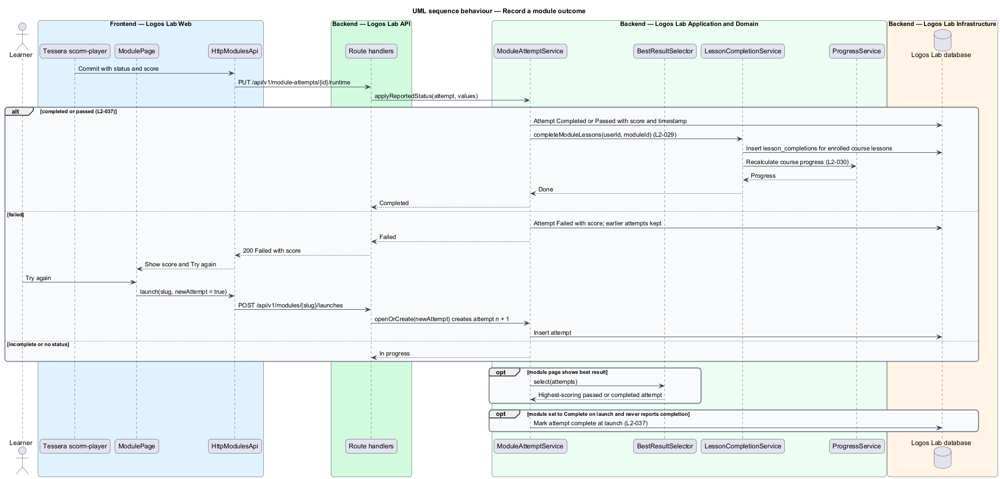

# Record SCORM runtime data

## Overview

While a learning module runs, its content reads and writes the **SCORM run-time data model** — set of
named `cmi.*` elements through which content reports location, suspend data, status and score. The
content calls `LMSSetValue` and `LMSCommit` in SCORM 1.2, or `SetValue` and `Commit` in SCORM 2004.
Logos Lab persists these values on the server so a learner can **resume** — reopen a module in a later
session at the stored location with the stored suspend data.

The same data decides the outcome of each attempt. A module that reports `completed` or `passed`
completes its attempt with the score and time, and completes every course lesson that uses the module.
A module that reports `failed` keeps the attempt as failed and offers "Try again", which starts a new
attempt. The **best result** — highest-scoring attempt with a pass or completion status — is what the
module page shows.

The feature sits after `launch-learning-module` in the learning-modules subsystem and feeds course
progress (`courses/track-course-progress`).

## Description

**Frontend (Logos Lab Web)**

- **Tessera scorm-player** — external library component that holds the runtime data model in the
  page, answers `GetValue` and `SetValue` calls from the content through the message bridge, and
  validates values. A `suspend_data` value longer than the version's limit returns the standard SCORM
  error code for that version and leaves the stored value unchanged. The specific error code per
  version is `<TO SUPPLY>` from the Tessera documentation.
- **`ScormRuntimePersistence`** — Logos Lab adapter given to the player. It turns each commit into a
  numbered batch and passes it to `RuntimeCommitQueue`.
- **`RuntimeCommitQueue`** — ordered in-memory queue. It sends one batch at a time with an increasing
  `sequence`, holds batches while offline, and sends them in order when the `online` event fires.
- **Auto-commit** — the player commits pending values when 30 seconds pass with changed values and no
  commit, and on `visibilitychange` to hidden or `pagehide`; those last sends use
  `fetch` with `keepalive`.
- **`ll-player`** toolbar status — "Progress saved", "Saving…" and the offline message
  (`docs/mocks/pages/module-player/saving.html`, `offline.html`), with the offline notice from
  `docs/mocks/notifications/offline-notice/`.
- **`ModulePage`** failed state — score and "Try again"
  (`docs/mocks/pages/module-page/failed.html`).
- **`ModulesApi`** — adds `commitRuntime(attemptId, batch)`.

**API (Logos Lab API)**

- **`PUT /api/v1/module-attempts/{attemptId}/runtime`** — handled by **`CommitScormRuntimeAction`**.
  Body: `sequence` and a map of element to value. The action checks that the attempt belongs to the
  current user (`L2-017`), ignores a batch whose `sequence` is not above `last_sequence` (a retried
  batch), re-validates elements and limits, and stores the values. Returns the attempt status.
- **`ScormRuntimeValidator`** — server-side allow-list of the elements below and the `suspend_data`
  limits: 4,096 characters for SCORM 1.2 and 64,000 for SCORM 2004 4th edition. The limit for SCORM
  2004 3rd edition is not stated by `L2-036` and is `<TO SUPPLY>`.
- **Persisted elements** — SCORM 1.2: `cmi.core.lesson_location`, `cmi.suspend_data`,
  `cmi.core.lesson_status`, `cmi.core.score.raw`. SCORM 2004: `cmi.location`, `cmi.suspend_data`,
  `cmi.completion_status`, `cmi.success_status`, `cmi.score.scaled`. Stored in
  `scorm_runtime_values` (`attempt_id`, `element`, `value`, `updated_at`) and returned in the next
  launch's `runtimeSnapshot`.
- **`ModuleAttemptService.applyReportedStatus`** — maps the reported status to an `AttemptOutcome`.
  On `completed` or `passed` it records the attempt as complete with score and timestamp, then calls
  `LessonCompletionService.completeModuleLessons` (`L2-029`), which updates progress and course
  completion. On `failed` it records the attempt as failed with its score.
- **`BestResultSelector`** — picks the highest-scoring attempt with a pass or completion status. The
  rule for completed attempts without a score is `<TO SUPPLY>`.
- **Complete on launch** — a module setting (`modules.complete_on_launch`). For a module that never
  reports a completion status, `LaunchModuleAction` records the attempt complete at launch.
- **"Try again"** — `POST /api/v1/modules/{slug}/launches` with `newAttempt: true` creates attempt
  number n + 1; earlier attempts are kept.
- **Entity `ModuleAttempt`** in table `module_attempts` — `id`, `user_id`, `module_id`, `number`,
  `outcome`, `score`, `last_sequence`, `started_at`, `last_accessed_at`, `completed_at`.

**Key rules**

- Values set and committed are persisted and returned in the next session, for both SCORM versions.
- Without a commit, the player commits after 30 seconds of changed values, or when the page is hidden
  or unloaded.
- Over-limit `suspend_data` returns the standard SCORM error code and leaves the stored value
  unchanged.
- With the network down, queued values are sent in order when connectivity returns; no data is lost
  while the learner stays on the page.
- `completed` or `passed` completes the attempt and every course lesson using the module; `failed`
  shows the score and "Try again", and earlier attempts are kept.
- How to treat a learner who launches a module already completed (review or new attempt) is
  `<TO SUPPLY>`.

## Requirements

| L2 ID | Refines (L1) | Requirement |
|-------|--------------|-------------|
| `L2-036` | `L1-006` | **SCORM runtime data and resume.** The platform shall implement the SCORM run-time data model needed for tracking and resume, and shall persist it on the server. |
| `L2-037` | `L1-006` | **Module completion and scoring.** Module status and score shall be recorded per attempt and reflected in course progress. |

## Diagrams

### System context

Learners run modules in Logos Lab; the embedded Tessera scorm-player holds the runtime data model in
the browser.

### Containers

The player's commits travel from Logos Lab Web to the Logos Lab API, which stores runtime values and
attempt outcomes in the Logos Lab database.

### Components

`RuntimeCommitQueue` orders commits; `CommitScormRuntimeAction` validates and stores them and asks
`ModuleAttemptService` to apply the reported status.

### Class structure

`ModuleAttempt` owns its `RuntimeValue` rows and outcome; `RuntimeBatch` carries the sequence number
that keeps commits ordered and idempotent.

### Behaviour — commit runtime data

A commit becomes a numbered batch; the server ignores replays, re-validates limits, and stores values
for the next session.

### Behaviour — auto-commit and offline queue

The player commits on its own after 30 seconds or when the page hides; while offline, batches wait
and are sent in order.

### Behaviour — record the attempt outcome

A completed or passed status completes the attempt and its course lessons; a failed status keeps the
score and offers a new attempt.

