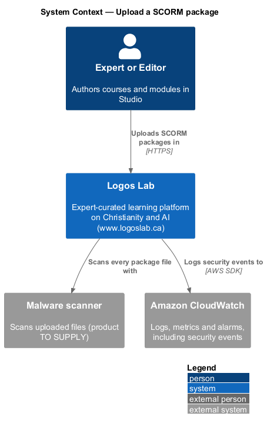
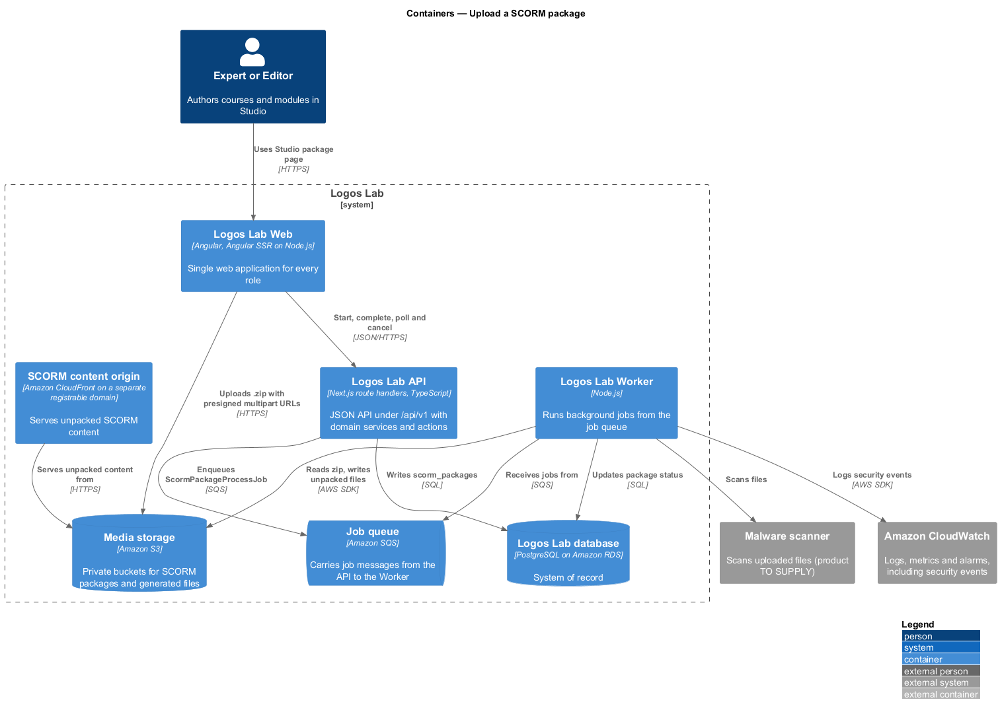
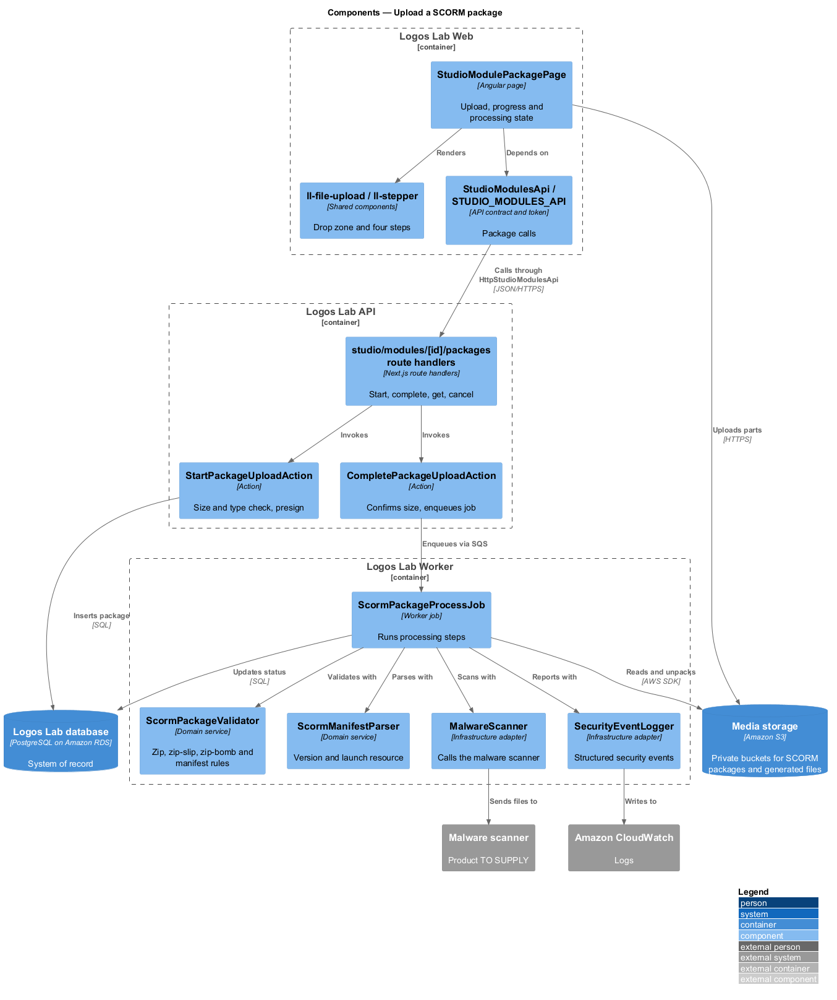
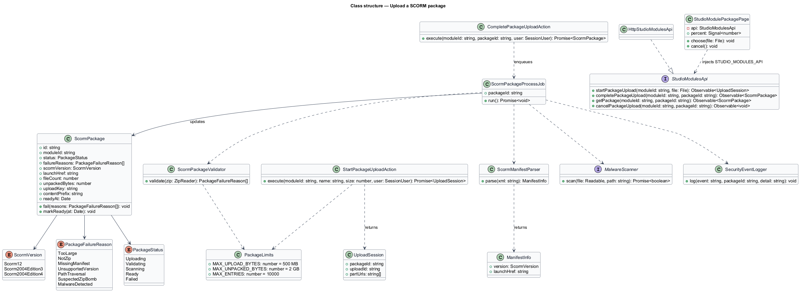
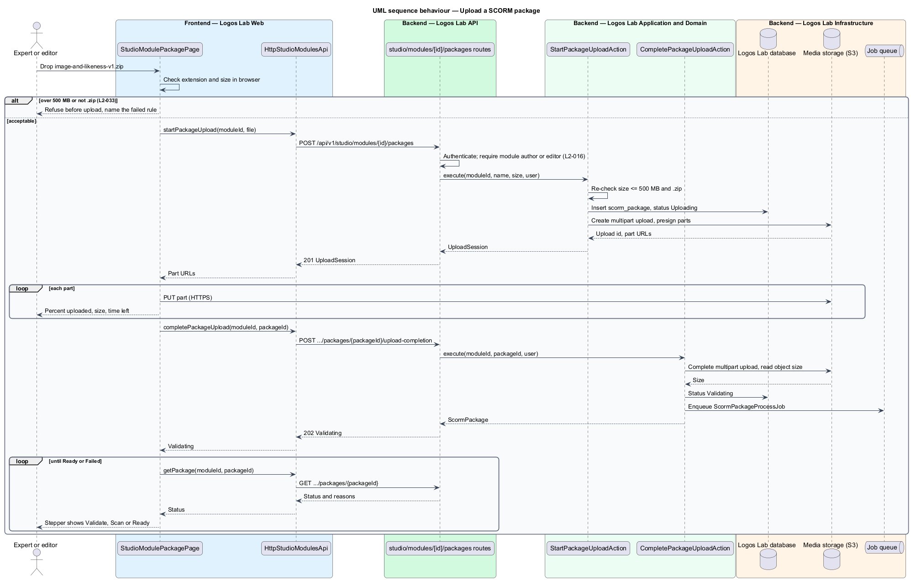
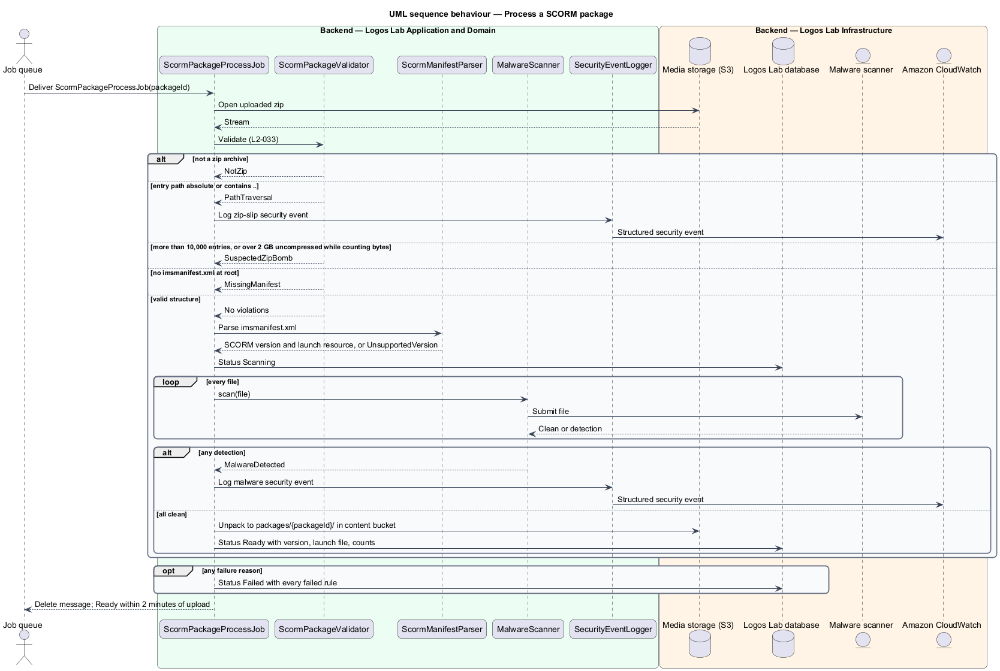

# Upload a SCORM package

## Overview

A **learning module** — interactive lesson built by a third-party authoring tool and played in the
Tessera scorm-player — reaches Logos Lab as a **SCORM package** — `.zip` archive with an
`imsmanifest.xml` manifest at its root that describes the content and its launch file. SCORM
(Sharable Content Object Reference Model) is the e-learning standard the platform supports in
versions SCORM 1.2 and SCORM 2004 3rd and 4th edition.

Experts and editors upload a package to a module in Studio. A package is untrusted third-party
content, so every package is validated and scanned before it can be used. Processing passes through
five **processing states** — stages a package moves through after upload: Uploading, Validating,
Scanning, Ready and Failed. Only a Ready package can be attached to a module.

The feature opens the learning-modules subsystem. Launching a Ready package is covered by
`launch-learning-module`.

## Description

**Frontend (Logos Lab Web)**

- **`StudioModulePackagePage`** — routed Studio page for `/studio/modules/:id/package` (baseline
  choice). It checks size and extension in the browser before upload, shows upload percent, size and
  time left with "Cancel upload", then polls the processing state. "Replace" keeps the current
  package attached until the new one is Ready.
- **Components used** — `ll-file-upload` (drop zone), `ll-stepper` (Upload, Validate, Scan, Ready),
  `ll-progress-bar`, `ll-alert` (ready, failed, quarantined), `ll-list` (package rules and failed
  rules), `ll-description-list`, `ll-button`, `ll-skeleton`, `ll-error-page`.
- **Screen states** — `docs/mocks/pages/studio-module-package/` covers `empty`, `invalid` (612 MB file
  refused before upload), `uploading` (64%), `validating`, `default` (Ready, SCORM 2004 4th edition
  detected, launch file named), `failed` (each failed rule listed), `quarantined` (malware detected),
  `loading` and `error`.
- **`StudioModulesApi`** / **`STUDIO_MODULES_API`** / **`HttpStudioModulesApi`** — methods
  `startPackageUpload(moduleId, file)`, `completePackageUpload(moduleId, packageId)`,
  `getPackage(moduleId, packageId)` and `cancelPackageUpload(moduleId, packageId)`.

**API (Logos Lab API) and Worker**

- **`POST /api/v1/studio/modules/{id}/packages`** — handled by **`StartPackageUploadAction`**. Refuses
  a declared size over 500 MB or a name without `.zip`, creates a `scorm_packages` row in
  `Uploading`, and returns presigned S3 multipart-upload URLs limited to 500 MB. The file goes from the
  browser straight to the upload bucket in Media storage.
- **`POST /api/v1/studio/modules/{id}/packages/{packageId}/upload-completion`** — handled by
  **`CompletePackageUploadAction`**. Confirms the stored object size, sets `Validating` and enqueues
  **`ScormPackageProcessJob`**.
- **`GET /api/v1/studio/modules/{id}/packages/{packageId}`** — returns `status`, `failureReasons`,
  `scormVersion`, `launchHref`, `fileCount` and `unpackedBytes` for polling.
- **`DELETE /api/v1/studio/modules/{id}/packages/{packageId}`** — cancels an upload in progress.
- **`ScormPackageProcessJob`** — Worker job. It runs **`ScormPackageValidator`** (zip signature,
  entry count, total uncompressed size, entry paths, manifest at root), **`ScormManifestParser`**
  (version and launch resource), **`MalwareScanner`** on every file, and finally unpacks the files to
  the content bucket under `packages/{packageId}/`, served by the SCORM content origin.
- **`SecurityEventLogger`** — writes a structured security event to Amazon CloudWatch for zip-slip
  and malware detections.
- **Entity `ScormPackage`** in table `scorm_packages` — `id`, `module_id`, `status`,
  `failure_reasons`, `scorm_version`, `launch_href`, `file_count`, `unpacked_bytes`, `upload_key`,
  `content_prefix`, `uploaded_by`, `created_at`, `ready_at`. Only the module's authors and editors
  may write it (`L2-016`).

**Key rules**

- A `.zip` of 500 MB or less with a valid `imsmanifest.xml` at its root is accepted; its SCORM
  version and launch resource are detected; it is available to attach within 2 minutes.
- A file over 500 MB, not a zip archive, or missing `imsmanifest.xml` is refused with a message
  stating which rule failed.
- Any entry with an absolute path or a `..` segment (zip-slip) refuses the whole package and logs a
  security event.
- An uncompressed size over 2 GB, or more than 10,000 entries, refuses the package as a suspected zip
  bomb. The validator counts bytes while extracting, not only the sizes the archive declares.
- Every file is scanned for malware; any detection refuses the package. The mock shows a
  quarantined state that also tells the security team; the notification channel is `<TO SUPPLY>`.
- The page shows percent uploaded and the processing state.
- The malware scanner product and its per-file timeout are `<TO SUPPLY>`.

## Requirements

| L2 ID | Refines (L1) | Requirement |
|-------|--------------|-------------|
| `L2-033` | `L1-006` | **SCORM package upload and validation.** Experts and editors shall be able to upload SCORM 1.2 and SCORM 2004 (3rd and 4th edition) packages. Each package is validated before it can be used. |

## Diagrams

### System context

Experts and editors upload packages to Logos Lab, which scans them with a malware scanner and logs
security events to Amazon CloudWatch.

### Containers

The browser uploads straight to Media storage; the API records the package and enqueues processing;
the Worker validates, scans and unpacks it for the SCORM content origin.

### Components

`ScormPackageProcessJob` runs the validator, manifest parser and scanner in order and records the
outcome on `ScormPackage`.

### Class structure

`ScormPackage` moves through `PackageStatus`; each refusal records one or more
`PackageFailureReason` values.

### Behaviour — upload a package

The page refuses an oversized or non-zip file before upload, then uploads directly to Media storage
with progress and hands over to processing.

### Behaviour — process a package

The Worker validates, scans and unpacks the package; any failed rule stops processing and is
recorded for the author to see.

