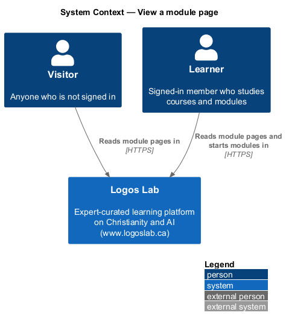
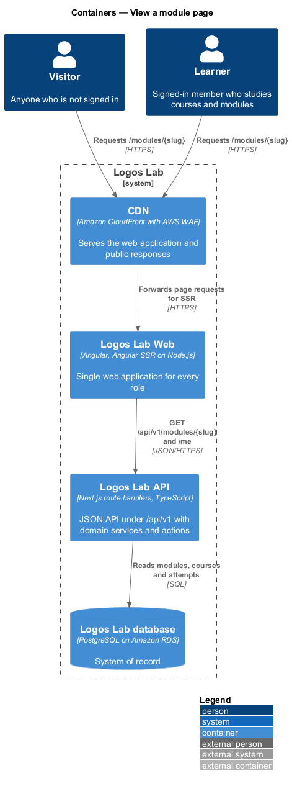
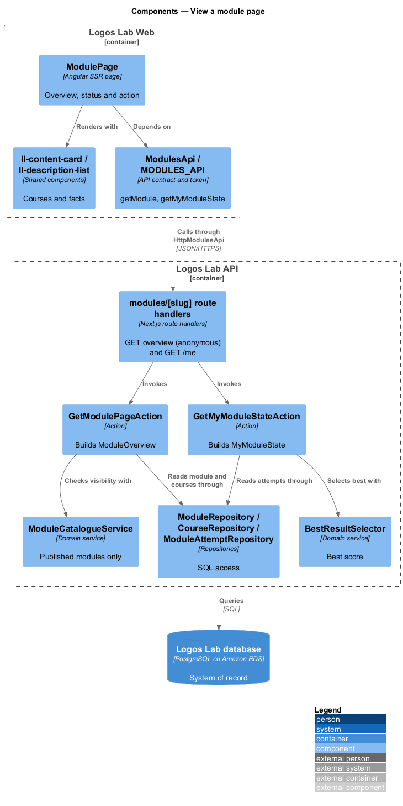
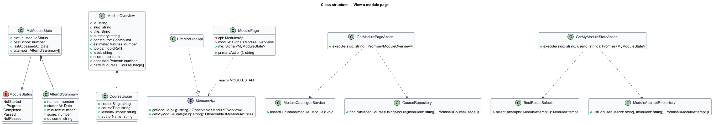
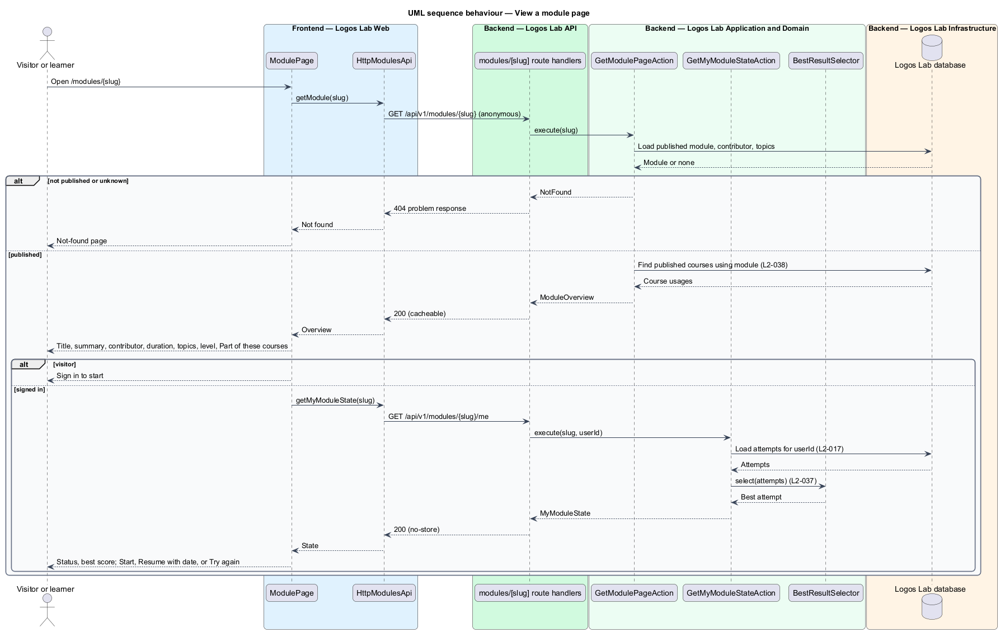

# View a module page

## Overview

Each published learning module has a **module page** — public overview page at `/modules/{slug}` that
describes one module and offers the learner's next action. It is where learners find modules from
search, catalogue cards and expert profiles, and where they start, resume or retry them outside a
course.

The page shows the title, summary, contributor, estimated duration, topics and level to everyone.
Signed-in learners also see their **module status** — learner's standing in a module: not started, in
progress, completed, passed or not passed — and their best score. When the module is used in published
courses, the page lists those courses under "Part of these courses", so a learner can take the module
within a course instead.

The page is the standalone entry point of the learning-modules subsystem. The "Start" and "Resume"
actions hand over to `launch-learning-module`; best score comes from `record-scorm-runtime-data`.

## Description

**Frontend (Logos Lab Web)**

- **`ModulePage`** — routed standalone page for `/modules/:slug`, server-rendered by Angular SSR for
  visitors and crawlers (`L2-142`). After hydration it requests the learner's state.
- **Primary action by state** — visitor: "Sign in to start"; not started: "Start"; in progress:
  "Resume" with the last-opened date; not passed: "Try again"; completed: status shown.
- **Components used** — `ll-breadcrumb`, `ll-page-header`, `ll-button`, `ll-badge` (status),
  `ll-description-list` (length, level, scoring, status, best score, last attempt), `ll-chip`
  (topics), `ll-person-list` ("Made by"), `ll-list` (attempts), `ll-content-card` ("Part of these
  courses" and related content, `L2-047`), `ll-skeleton`, `ll-error-page`.
- **Screen states** — `docs/mocks/pages/module-page/` covers `default`, `visitor`, `in-progress`,
  `completed`, `failed` (64% against a pass mark of 80%, attempt listed, "Try again"), `loading` and
  `error`.
- **`ModulesApi`** — adds `getModule(slug)` and `getMyModuleState(slug)`.

**API (Logos Lab API)**

- **`GET /api/v1/modules/{slug}`** — anonymous endpoint, handled by **`GetModulePageAction`**. Returns
  `ModuleOverview`: title, summary, contributor, estimated duration, topics, level, scoring and pass
  mark when scored, and `partOfCourses` (published courses whose lessons reference the module, each
  with lesson position and author). Holds no personal data, so the CDN may cache it (`L2-113`).
- **`GET /api/v1/modules/{slug}/me`** — authenticated endpoint, handled by
  **`GetMyModuleStateAction`**. Returns `MyModuleState`: status, best score, last-accessed date and
  the attempt list. Sent with `Cache-Control: no-store`.
- **`ModuleCatalogueService`** — only published modules are visible; any other slug returns `404`.
- **`CourseRepository.findPublishedCoursesUsingModule`** — lists the courses for "Part of these
  courses".
- **`BestResultSelector`** — shared with `record-scorm-runtime-data`; picks the best score.
- **`ModuleRepository`** and **`ModuleAttemptRepository`** — read `modules`, `module_contributors`,
  `module_topics` and `module_attempts`; attempt queries take the current user's id (`L2-017`).

**Key rules**

- Anyone sees title, summary, contributor, estimated duration, topics and level of a published module.
- Signed-in learners also see their status and best score.
- A module used in one or more published courses lists those courses under "Part of these courses".
- The ordering of "Part of these courses" is `<TO SUPPLY>`.

## Requirements

| L2 ID | Refines (L1) | Requirement |
|-------|--------------|-------------|
| `L2-038` | `L1-006` | **Standalone module page.** Each published module has an overview page at `/modules/{slug}`. |

## Diagrams

### System context

Visitors and learners read module pages in Logos Lab; no external system takes part.

### Containers

The CDN serves the server-rendered page and the public module response; the learner's state goes to
the API uncached.

### Components

`ModulePage` calls two `ModulesApi` methods; the public action reads course usage and the learner
action reads attempts.

### Class structure

`ModuleOverview` is public and cacheable; `MyModuleState` holds only the current learner's status,
best score and attempts.

### Behaviour — view a module page

The page renders the public overview first and then adds the learner's status and action when a
session exists.

