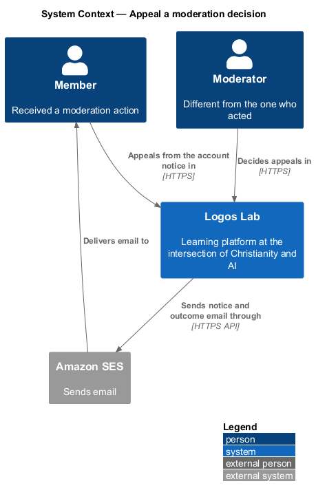
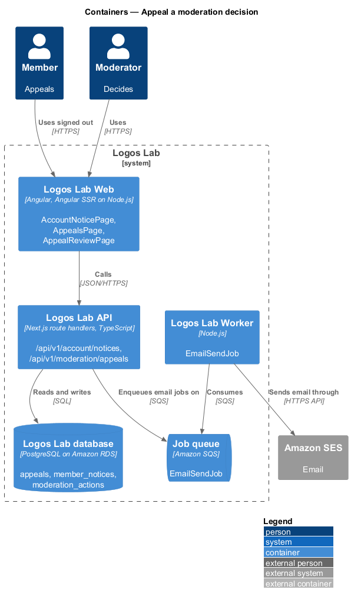
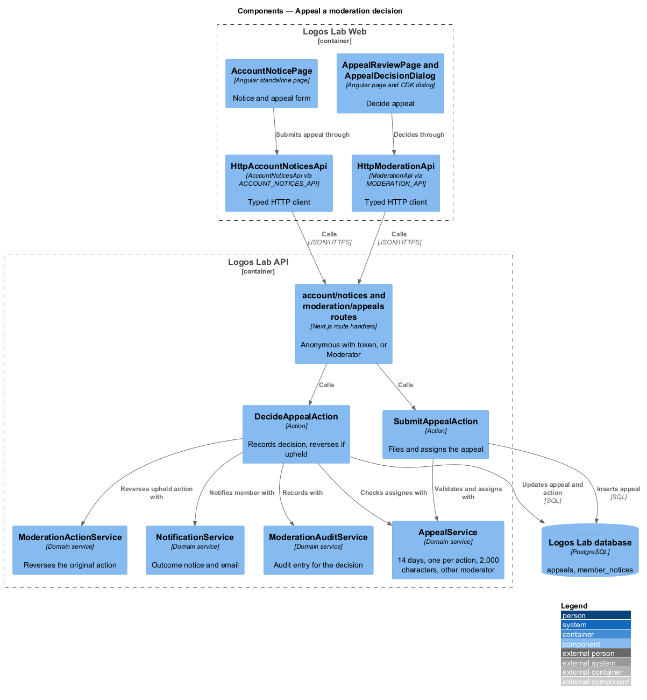
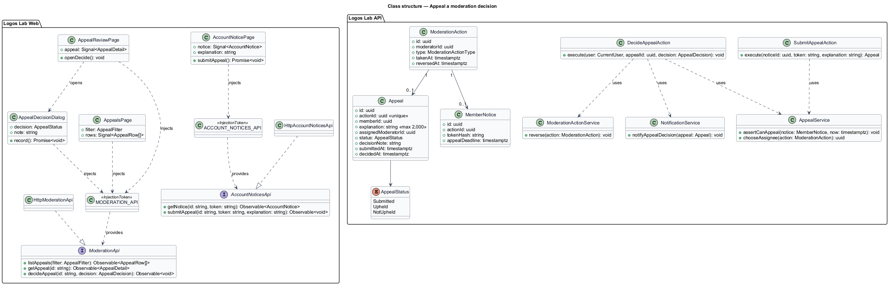
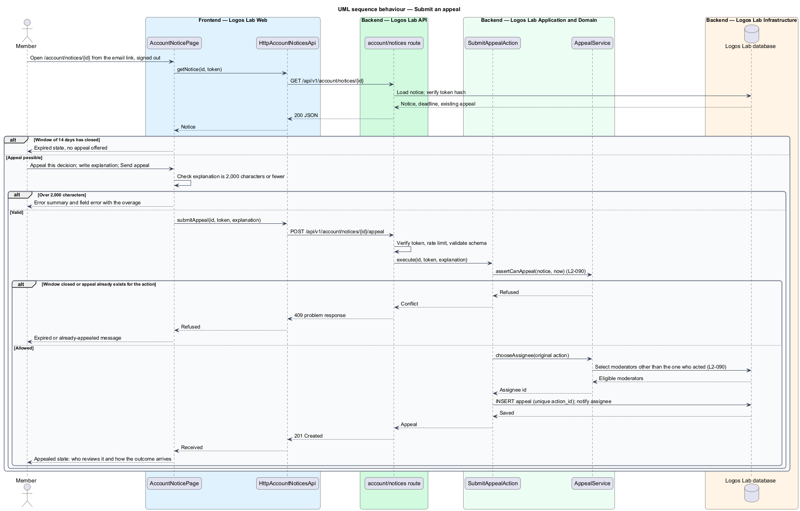
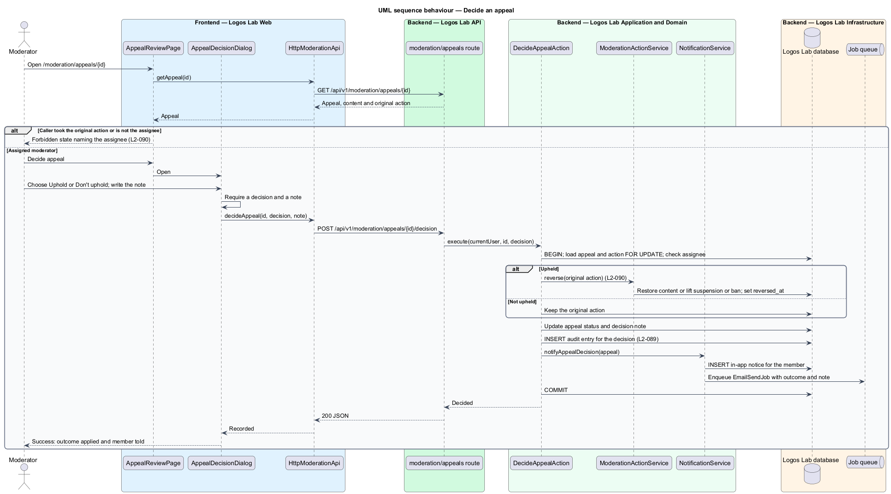

# Appeal a moderation decision

## Overview

A member who was warned, suspended, banned or had content hidden or removed may think the moderator got it wrong.
This feature lets the member ask once for a second look by a different moderator, and reverses the action when the
appeal is upheld.

**appeal** — member's single request, made within 14 days of a moderation action, that a different moderator review
that action

**account notice** — page at `/account/notices/{id}` that states a moderation action against a member and offers
the appeal; it opens from an emailed link and works signed out

**upheld appeal** — appeal decided in the member's favour, which reverses the original action

**appeal window** — 14 days after a moderation action during which the member may appeal it

The appeal closes the loop of the moderation subsystem. It starts from the notice sent by
`docs/detailed-designs/moderation/take-moderation-action/`, and each decision is written to the trail of
`docs/detailed-designs/moderation/record-moderation-audit-trail/`.

## Description

The slice runs from the account notice through the appeals pages to the `appeals` table and back to the member.

**Logos Lab Web**

- **`AccountNoticePage`** — routed page at `/account/notices/{id}`. It works signed out because suspended and banned
  members cannot sign in; access uses the signed token in the emailed link (`L2-019`). It shows the action, reason,
  guideline, the content concerned, the appeal deadline and "Appeal this decision". The appeal form holds an
  explanation (`ll-textarea`) of up to 2,000 characters with a count. Mock states in
  `docs/mocks/pages/account-notice/`: `default`, `appeal`, `submitting`, `invalid`, `appealed`, `decided`,
  `expired`, `loading` and `error`.
- **`AppealsPage`** — routed page at `/moderation/appeals` that lists appeals with member, action appealed, who took
  it, filing time, assignee and status, and a Show filter for open, decided or all. Mock states in
  `docs/mocks/pages/appeals/`: `default`, `loading`, `empty` and `error`.
- **`AppealReviewPage`** — routed page at `/moderation/appeals/{id}` with the member's explanation, the content, the
  original action and "Decide appeal". A moderator who took the original action sees the forbidden state. Mock
  states in `docs/mocks/pages/appeal-review/`: `default`, `decided`, `loading`, `error` and `forbidden`.
- **`AppealDecisionDialog`** — Angular CDK dialog with Uphold or Don't uphold (`ll-radio-group`) and a required
  note to the member (`ll-textarea`). Mock states in `docs/mocks/dialogs/appeal-decision/`: `default`, `busy`,
  `invalid`, `failed` and `success`.
- **In-app notice** — notification (`docs/mocks/notifications/notification/`) telling the member the outcome.
- **API contracts** — `AccountNoticesApi` (`ACCOUNT_NOTICES_API`, `HttpAccountNoticesApi`) with `getNotice(id,
  token)` and `submitAppeal(id, token, explanation)`; `ModerationApi` (`MODERATION_API`, `HttpModerationApi`) with
  `listAppeals(filter)`, `getAppeal(id)` and `decideAppeal(id, decision)`.

**Logos Lab API**

- **`GET /api/v1/account/notices/{id}`** — anonymous endpoint that requires a valid notice token. It returns the
  notice and whether an appeal is still possible.
- **`POST /api/v1/account/notices/{id}/appeal`** — anonymous endpoint with the token. It answers `201` on success,
  `400` when the explanation exceeds 2,000 characters, and `409` when the window has closed or an appeal already
  exists. It is rate limited through the middleware pipeline.
- **`GET /api/v1/moderation/appeals`**, **`GET /api/v1/moderation/appeals/{id}`** and
  **`POST /api/v1/moderation/appeals/{id}/decision`** — moderator endpoints. The decision endpoint answers `403`
  when the caller took the original action or is not the assignee.
- **`GetAccountNoticeAction`**, **`SubmitAppealAction`**, **`ListAppealsAction`** and **`DecideAppealAction`** —
  one action per use case.
- **`AppealService`** — domain rules: window of 14 days, one appeal per action, 2,000-character limit, and
  assignment to a moderator other than the one who took the original action. The assignment picks the eligible
  moderator with the fewest open appeals (baseline choice). When no other moderator exists, the appeal goes to an
  Administrator (`<TO SUPPLY>` confirmation).
- **`ModerationActionService`** — reverses an upheld action: restores hidden or removed content, lifts a suspension
  or ban through `AccountStateService` (`L2-019`), withdraws a warning, and sets `reversedAt` on the action.
- **`NotificationService`** — notifies the member of the decision in the app and by email (`EmailSendJob`).
- **`ModerationAuditService`** — records the decision as an audit entry (`L2-089`).
- **`Appeal`** — entity with `id`, `actionId` (unique), `memberId`, `explanation`, `assignedModeratorId`, `status`
  (`AppealStatus`), `decisionNote`, `submittedAt` and `decidedAt`.
- **`MemberNotice`** — entity with `actionId`, `tokenHash` and `appealDeadline` (action time plus 14 days).
- **Tables** — `appeals` with a unique index on `action_id`, `member_notices`, `moderation_actions`.

**Rules**

- A member who received a moderation action may choose "Appeal" within 14 days and submit an explanation of up to
  2,000 characters.
- Only one appeal per action is allowed. After submission the appeal cannot be changed, as the `appealed` mock
  states.
- An appeal is assigned to a moderator other than the one who took the original action.
- When the appeal is decided, the member is notified. If the appeal is upheld, the original action is reversed.
- A notice whose window has closed shows the `expired` state and offers no appeal.

## Requirements

| L2 ID | Refines (L1) | Requirement |
|-------|--------------|-------------|
| `L2-090` | `L1-014` | **Appeals.** Members shall be able to appeal a moderation action against them. |

## Diagrams

### System context

The member appeals from an emailed link, a different moderator decides, and Logos Lab tells the member the outcome
by email through Amazon SES.

### Containers

Logos Lab Web calls anonymous notice endpoints and moderator appeal endpoints on the API. The Worker sends the
outcome email.

### Components

`SubmitAppealAction` and `DecideAppealAction` share `AppealService`; the decision uses
`ModerationActionService` to reverse an upheld action.

### Class structure

Each `ModerationAction` has at most one `Appeal`, and the `MemberNotice` carries the token and appeal deadline.

### Behaviour — submit an appeal

The notice endpoint checks the token, the 14-day window, the single-appeal rule and the length, then assigns a
different moderator.

### Behaviour — decide an appeal

Only the assigned moderator, who did not take the original action, decides. Upholding reverses the action, and the
member is notified either way.

