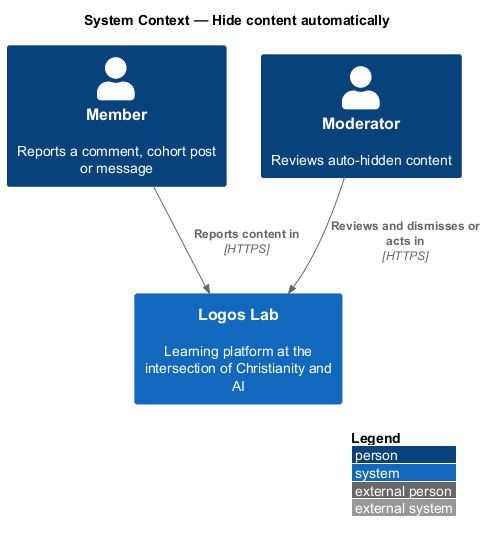
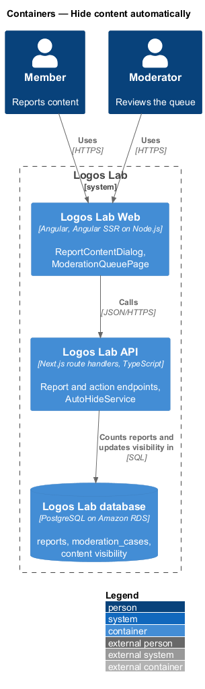
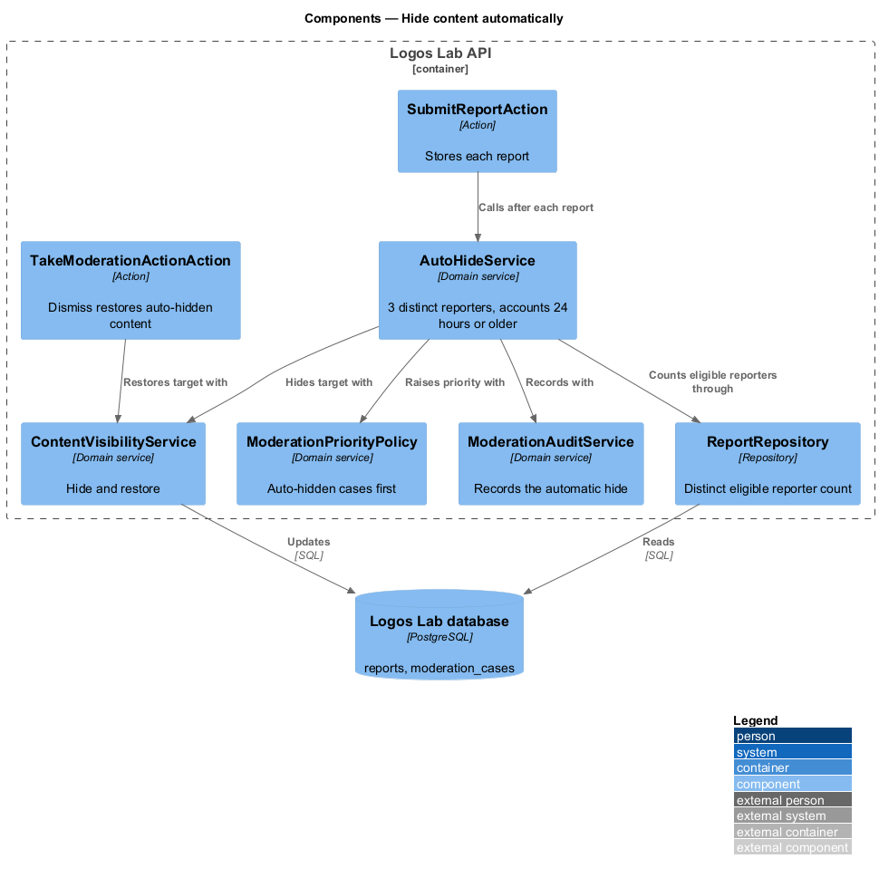
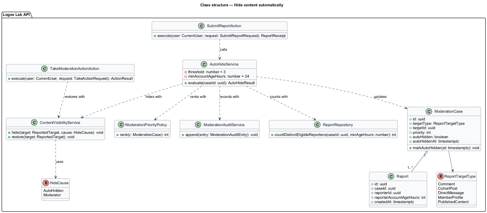
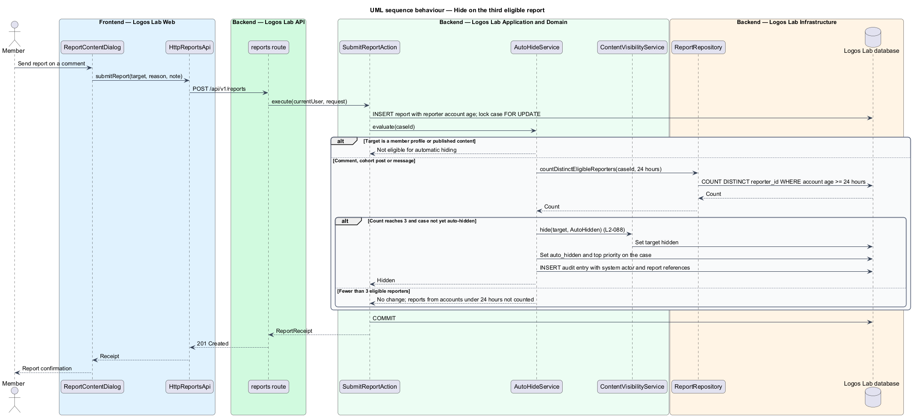
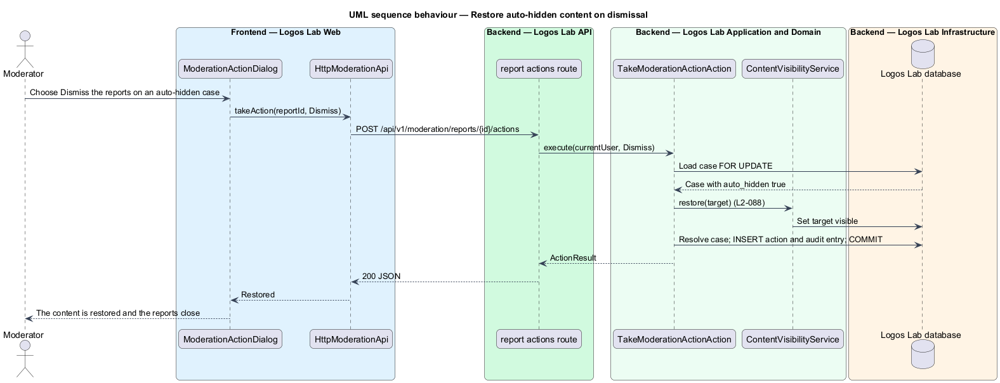

# Hide content automatically

## Overview

Some reported content does harm while it waits for a moderator. When several members independently report the same
comment, cohort post or message, Logos Lab hides it at once and puts it first in the moderation queue.

**auto-hide threshold** — count of distinct eligible reporters at which a reported item is hidden automatically:
3 distinct members

**eligible reporter** — member whose account was at least 24 hours old when the report was made

**auto-hidden content** — comment, cohort post or message hidden by the threshold, pending a moderator's review

This feature runs inside the report flow (`docs/detailed-designs/moderation/report-content/`). It changes the
order of the moderation queue (`docs/detailed-designs/moderation/work-moderation-queue/`) and is undone when a
moderator dismisses the reports (`docs/detailed-designs/moderation/take-moderation-action/`).

## Description

The slice has no screen of its own. It is a domain rule evaluated in the report transaction, with its effect shown
on the queue and report pages.

**Logos Lab Web**

- **`ModerationQueuePage`** — shows an "Auto-hidden" badge (`ll-badge`) on the case and lists it first. Mock
  states `default` and `overdue` in `docs/mocks/pages/moderation-queue/`.
- **`ReportDetailPage`** — shows the hidden item in context, the reports in order and the note "Third report, so
  the comment was hidden automatically". Mock state `default` in `docs/mocks/pages/report-detail/`.
- **Placeholder** — other members see the removed-content placeholder in `ll-comment` while the item is hidden;
  replies remain (`L2-087`).

**Logos Lab API**

- **`AutoHideService`** — domain service called by `SubmitReportAction` after each report is stored. It counts
  distinct reporters on the case whose accounts were at least 24 hours old at the time of their report. When the
  count reaches 3 and the target is a comment, cohort post or message, it hides the target and marks the case.
- **`ContentVisibilityService`** — sets the target's visibility to hidden with cause "auto-hidden", and back to
  visible on restore.
- **`ModerationPriorityPolicy`** — ranks auto-hidden cases above all others.
- **`ModerationAuditService`** — records the automatic hide with the system as actor and the report references
  (`L2-089`; recording a system actor is a baseline choice).
- **`TakeModerationActionAction`** — when a moderator dismisses the reports on an auto-hidden case, it restores the
  content through `ContentVisibilityService`.
- **`ModerationCase`** — holds `autoHidden` and `autoHiddenAt`.
- **`Report`** — holds `reporterAccountAgeHours`, captured at report time so later account age does not change the
  count (baseline choice).
- **Concurrency** — the count runs after `SELECT ... FOR UPDATE` on the case row, so simultaneous reports cannot hide
  twice or miss the threshold.

**Rules**

- When a comment, cohort post or message receives reports from 3 distinct members, the third report hides it
  pending review and moves it to the top of the queue.
- Reports from accounts less than 24 hours old are not counted toward the threshold. They still reach the queue.
- When a moderator dismisses the reports on automatically hidden content, the content is restored.
- Member profiles and published content are not hidden by the threshold; `L2-088` names comments, cohort posts and
  messages only.

## Requirements

| L2 ID | Refines (L1) | Requirement |
|-------|--------------|-------------|
| `L2-088` | `L1-014` | **Automatic hiding.** Heavily reported content shall be hidden automatically until a moderator reviews it. |

## Diagrams

### System context

Members' reports drive the hide inside Logos Lab, and moderators review the hidden item there.

### Containers

The rule runs in the Logos Lab API in the same transaction as the report, against the Logos Lab database.

### Components

`SubmitReportAction` calls `AutoHideService`, which uses `ContentVisibilityService` and the audit service.
Dismissal through `TakeModerationActionAction` reverses the hide.

### Class structure

`AutoHideService` reads the case's `Report` rows and updates `ModerationCase` and the target's visibility.

### Behaviour — hide on the third eligible report

Each new report triggers a count of distinct eligible reporters; the third one hides the item and raises its
priority.

### Behaviour — restore on dismissal

Dismissing the reports on an auto-hidden case makes the content visible again and closes the case.

