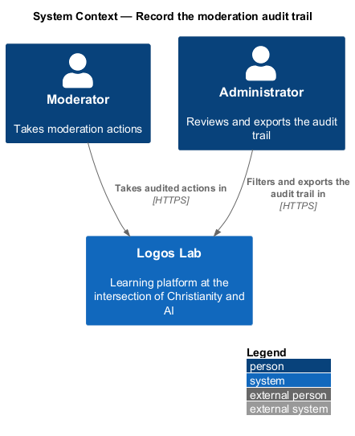
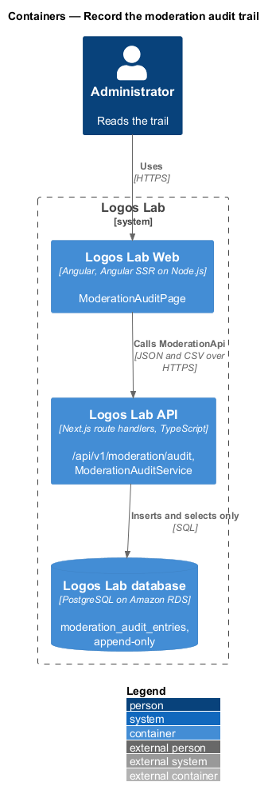
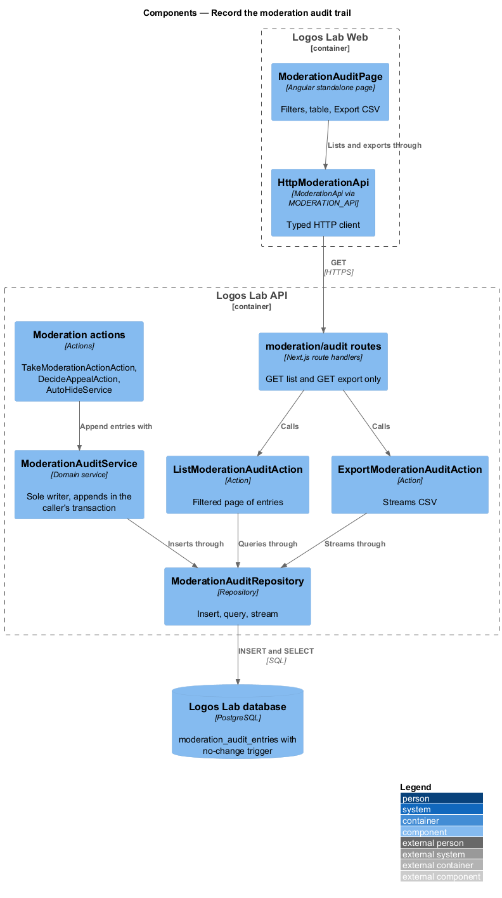
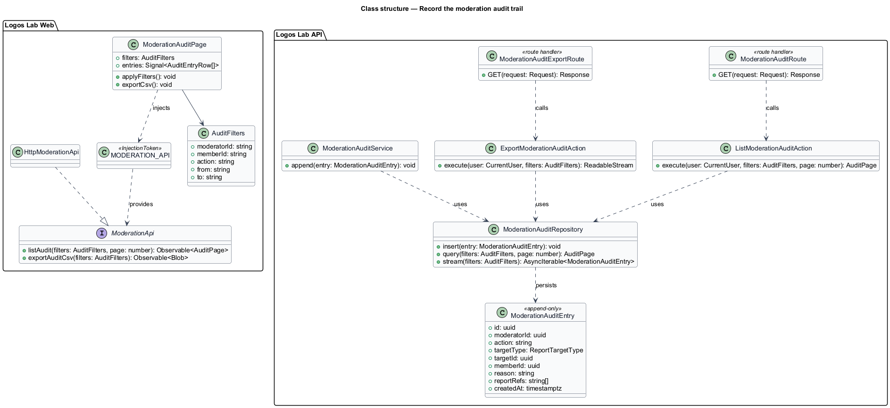
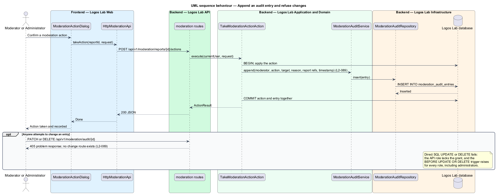
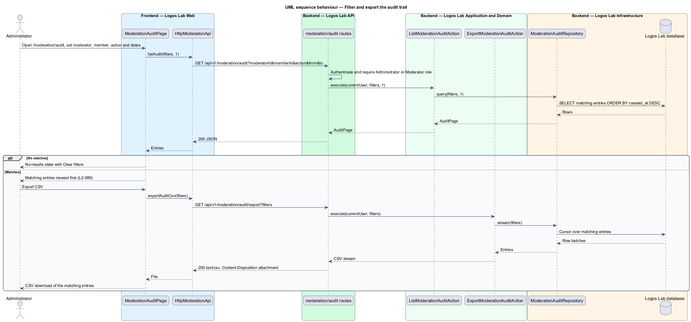

# Record the moderation audit trail

## Overview

Moderation decisions affect members' standing and visibility, so Logos Lab keeps a permanent, unalterable record of
each one. Administrators use the record to review how moderation is applied.

**moderation audit entry** — permanent record of one moderation action: moderator, action, target, reason, report
references and timestamp

**append-only** — property of a store that accepts new entries and refuses every edit or deletion of existing ones

**audit trail** — ordered set of moderation audit entries, viewed at `/moderation/audit`

Every other moderation feature writes to this trail: actions on reports
(`docs/detailed-designs/moderation/take-moderation-action/`), automatic hides
(`docs/detailed-designs/moderation/hide-content-automatically/`) and appeal decisions
(`docs/detailed-designs/moderation/appeal-decision/`). The administration audit trail (`L2-099`) is a separate
record on a separate page.

## Description

The slice runs from the audit page to an append-only table protected by database grants and a trigger.

**Logos Lab Web**

- **`ModerationAuditPage`** — routed page at `/moderation/audit` inside the moderation shell. It offers filters for
  moderator (`ll-select`), member (search `ll-text-field`), action (`ll-select`) and a date range (from and to),
  an "Apply filters" button and an "Export CSV" button. A `ll-table` lists entries newest first with when,
  moderator, action, target, reason and report references, with `ll-pagination`. The page copy states that entries
  cannot be edited or deleted by anyone. Mock states in `docs/mocks/pages/moderation-audit/`: `default`,
  `loading`, `empty`, `error`, `no-results` and `long`.
- **Shared components** — `ll-sidebar-navigation`, `ll-page-header`, `ll-form-field`, `ll-select`,
  `ll-text-field`, `ll-table`, `ll-pagination`, `ll-button`, `ll-skeleton`, `ll-empty-state` and `ll-error-page`.
- **`ModerationApi`** — contract bound through `MODERATION_API` to `HttpModerationApi`. Its methods here are
  `listAudit(filters, page)` and `exportAuditCsv(filters)`. The page offers no edit or delete control.

**Logos Lab API**

- **`GET /api/v1/moderation/audit`** — returns a page of entries filtered by `moderatorId`, `memberId`, `action`,
  `from` and `to`, newest first. Page size is `<TO SUPPLY>`.
- **`GET /api/v1/moderation/audit/export`** — streams the matching entries as `text/csv` with
  `Content-Disposition: attachment`. Columns follow the table: when, moderator, action, target, reason and report
  references. The route streams rows so large ranges do not load into memory.
- **No update or delete endpoints** — the route handlers expose only `GET`. Any `PUT`, `PATCH` or `DELETE` on the
  audit path answers `405`.
- **`ListModerationAuditAction`** and **`ExportModerationAuditAction`** — one action per use case. Both require the
  Administrator role; moderators also view the trail, as the moderation shell in the mocks shows.
- **`ModerationAuditService`** — the only writer. `append(entry)` inserts within the transaction of the action
  that caused it, so an action and its entry commit together or not at all.
- **`ModerationAuditEntry`** — entity with `id`, `moderatorId` (null for a system actor), `action`
  (`ModerationActionType` or appeal decision), `targetType`, `targetId`, `memberId`, `reason`, `reportRefs`
  (array of report references such as `R-1044`) and `createdAt`.
- **`ModerationAuditRepository`** — `insert`, `query(filters, page)` and `stream(filters)`; no update or delete
  methods.
- **Database enforcement (baseline choice)** — the API's database role holds only `INSERT` and `SELECT` on
  `moderation_audit_entries`. A `BEFORE UPDATE OR DELETE` trigger raises an exception for every role, including
  administrators and the owner, and `TRUNCATE` is revoked. Retention is permanent; it is excluded from the
  retention jobs of `L2-140`.

**Rules**

- Each moderation action produces an audit entry recording the moderator, action, target, reason, report
  references and timestamp.
- Any attempt by anyone, including an Administrator, to edit or delete an entry is refused. Entries are
  append-only.
- An Administrator can filter by moderator, member, action or date range, see the matching entries and export them
  as CSV.

## Requirements

| L2 ID | Refines (L1) | Requirement |
|-------|--------------|-------------|
| `L2-089` | `L1-014` | **Moderation audit trail.** Every moderation action shall be recorded permanently. |

## Diagrams

### System context

Moderators' actions write to the trail, and administrators read and export it.

### Containers

The API both appends entries and serves filtered reads and CSV exports from the Logos Lab database.

### Components

Every moderation action calls `ModerationAuditService`; the list and export actions read through
`ModerationAuditRepository`; the database trigger refuses changes.

### Class structure

`ModerationAuditRepository` exposes insert and read methods only, and `ModerationAuditEntry` has no mutators.

### Behaviour — append and refuse changes

An entry is appended in the same transaction as its action. A later attempt to change it fails at the API and again
at the database.

### Behaviour — filter and export

The administrator filters the trail and exports the matching entries as CSV.

