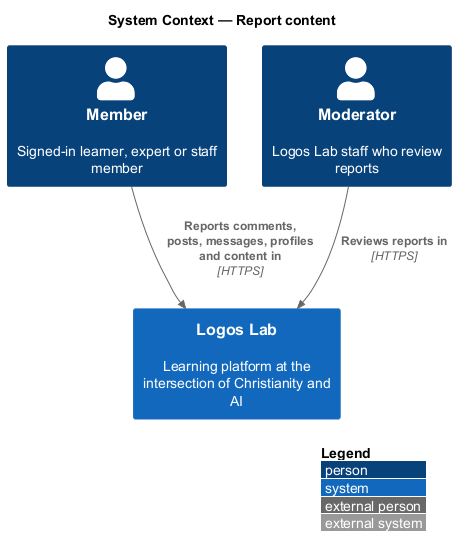
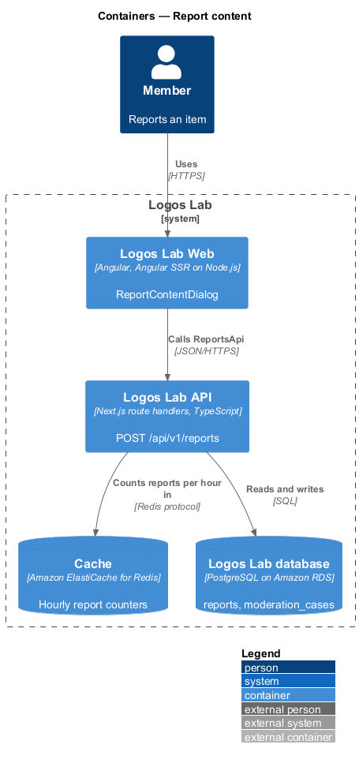
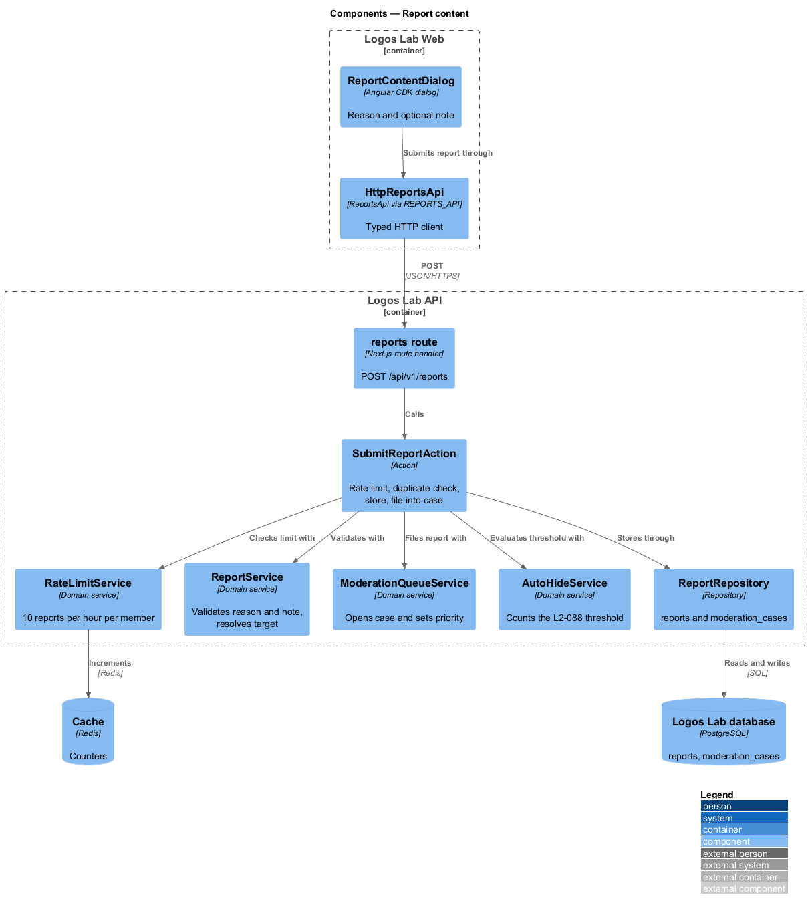
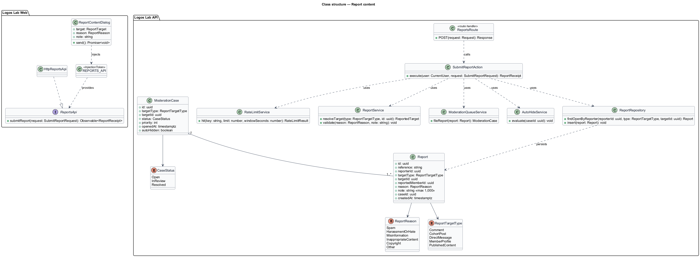
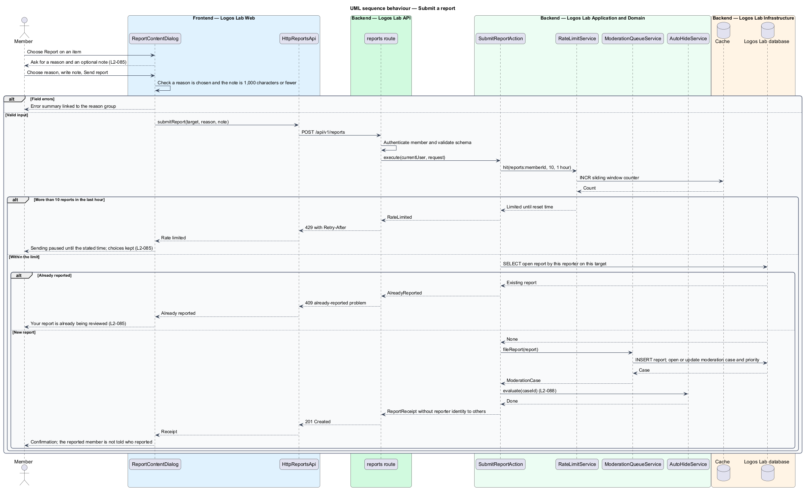

# Report content

## Overview

Logos Lab hosts conversation between members: comments on content, posts in cohort spaces and direct messages.
Members also have profiles, and experts and Logos Lab publish content. Any of these may break the community
guidelines. This feature lets a signed-in member flag such an item for a moderator.

**report** — signed-in member's request that a moderator review one reportable item, with a reason and an optional
note

**reportable item** — comment, cohort post, direct message, member profile or published content item

**moderation queue** — list at `/moderation` of open reports that moderators work through

**moderation case** — record that groups every report on the same reportable item so moderators act once

A report is the entry point of the moderation subsystem. Reports feed the moderation queue
(`docs/detailed-designs/moderation/work-moderation-queue/`), automatic hiding
(`docs/detailed-designs/moderation/hide-content-automatically/`) and moderation actions
(`docs/detailed-designs/moderation/take-moderation-action/`).

## Description

The slice runs from the Report action on a reportable item to the `reports` and `moderation_cases` tables.

**Logos Lab Web**

- **`ReportContentDialog`** — Angular CDK dialog opened from the "Report" action on a comment (`ll-comment` menu),
  cohort post, direct message, member profile or published content page. It shows the reported item, asks for a
  reason (`ll-radio-group`) and offers an optional note (`ll-textarea` with a character count). The copy states that
  a moderator reviews every report and that the reported member is not told who reported them. Mock states in
  `docs/mocks/dialogs/report-content/`: `default`, `busy`, `invalid`, `failed`, `already-reported`,
  `rate-limited` and `success`.
- **`ll-toast`** — confirms that the report reached the moderators after the dialog closes. Mock states in
  `docs/mocks/notifications/toast/`.
- **Shared components** — `ll-dialog`, `ll-radio-group`, `ll-textarea`, `ll-form-field`, `ll-button`,
  `ll-comment`, `ll-alert` and `ll-toast`.
- **`ReportsApi`** — contract in the shared API library, bound through the `REPORTS_API` injection token to
  `HttpReportsApi`. Its method is `submitReport(request)`.

**Logos Lab API**

- **`POST /api/v1/reports`** — accepts `targetType`, `targetId`, `reason` and an optional `note`. It answers
  `201 Created` for a new report, `409` with problem type `already-reported` for a repeat, `429` with
  `Retry-After` when the hourly limit is reached, and `400` with field errors for invalid input. The request
  requires a signed-in member.
- **`SubmitReportAction`** — owns the transaction. It checks the rate limit, resolves the target, refuses a
  duplicate, stores the report, attaches it to the target's open `ModerationCase` and asks `AutoHideService` to
  count the threshold of `L2-088`.
- **`RateLimitService`** — Redis counter per reporter over a sliding 1-hour window, held in the Cache container.
- **`ReportService`** — domain service that validates the reason and note and resolves the reported member.
- **`ModerationQueueService`** — opens a `ModerationCase` for the target when none is open and recomputes its
  priority.
- **`Report`** — entity with `id`, a human reference such as `R-1044`, `reporterId`, `targetType`
  (`ReportTargetType`), `targetId`, `reportedMemberId`, `reason` (`ReportReason`), `note`, `caseId` and
  `createdAt`.
- **`ModerationCase`** — entity with `id`, target, `status` (`CaseStatus`), `priority`, `openedAt` and
  `autoHidden`.
- **Tables** — `reports` holds a unique index on `(reporter_id, target_type, target_id)` for open cases;
  `moderation_cases` holds one open case per target (baseline choice).

**Rules**

- The reason is one of Spam, Harassment or hate, Misinformation, Inappropriate content, Copyright or Other.
- The optional note holds up to 1,000 characters.
- On submission, the reporter sees a confirmation and the item is added to the moderation queue.
- The reported member is never told who reported them. No response or notification to the reported member carries
  the reporter's identity.
- A second report by the same member on the same item creates no duplicate. The member is told that their report is
  already being reviewed.
- A member who has submitted more than 10 reports in an hour is refused with `429`. The dialog shows when sending
  resumes and keeps the member's choices.
- Visitors who are not signed in see no Report action; the endpoint requires authentication.
- Whether a report on an item the reporter cannot see (for example a message in another conversation) is refused
  with `404` follows ownership scoping (`L2-017`).

## Requirements

| L2 ID | Refines (L1) | Requirement |
|-------|--------------|-------------|
| `L2-085` | `L1-014` | **Reporting content.** Members shall be able to report comments, cohort posts, direct messages, member profiles and published content. |

## Diagrams

### System context

A member reports an item through Logos Lab, and moderators later review it in the same system.

### Containers

The dialog in Logos Lab Web calls the Logos Lab API, which counts reports in the Cache and stores them in the
Logos Lab database.

### Components

`ReportContentDialog` calls `HttpReportsApi`. In the API, the reports route calls `SubmitReportAction`, which uses
the rate limiter, the report and queue services and the auto-hide service.

### Class structure

Each `Report` belongs to one `ModerationCase` and carries a `ReportReason` and a `ReportTargetType`.

### Behaviour — submit a report

The action refuses a rate-limited or duplicate report before it stores anything, then files the report into the
target's open case and returns a confirmation.

