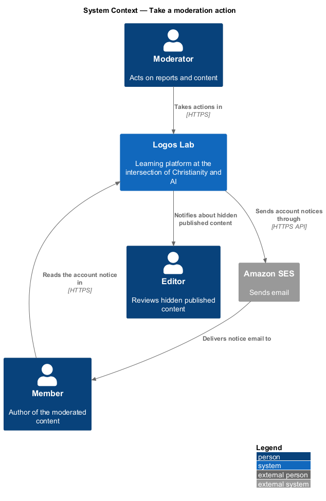
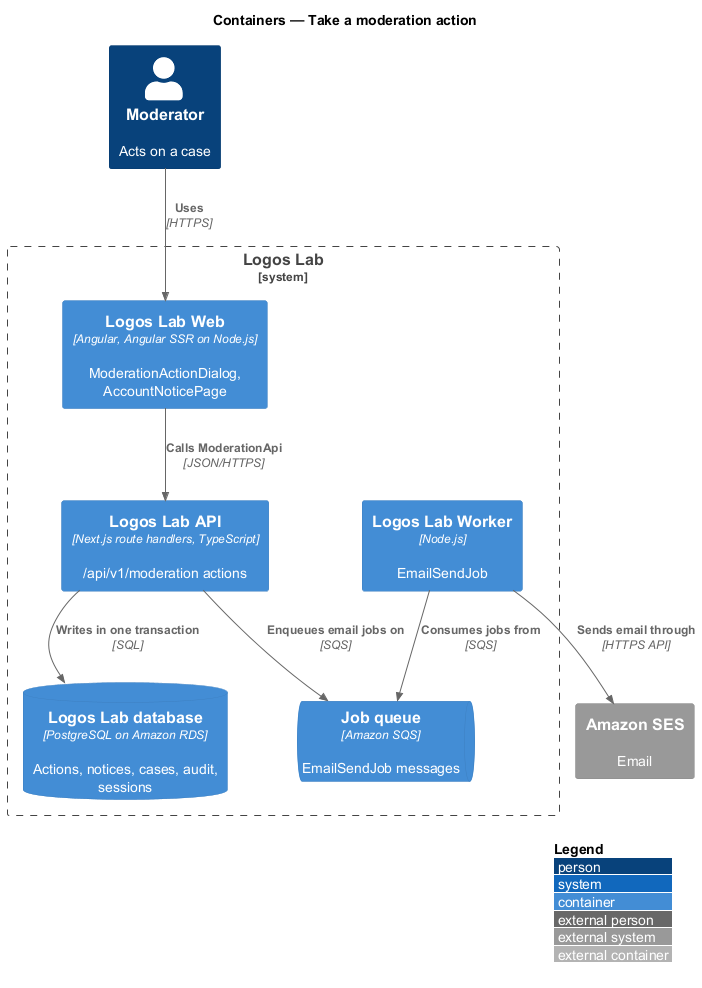
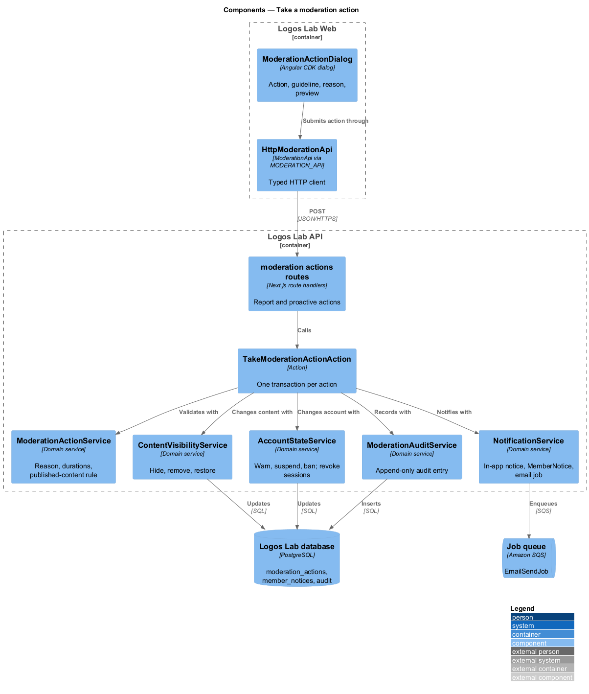
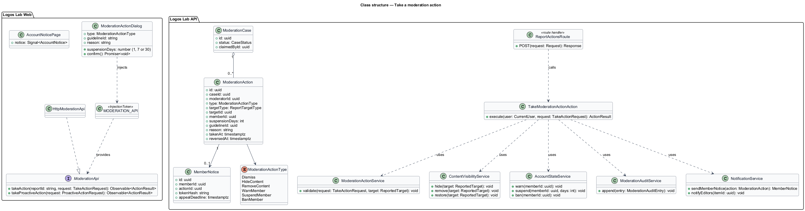
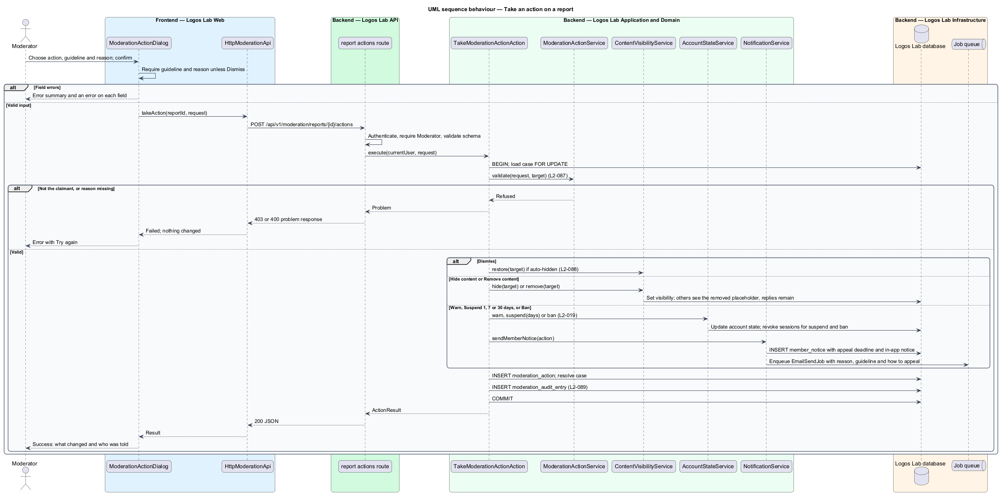
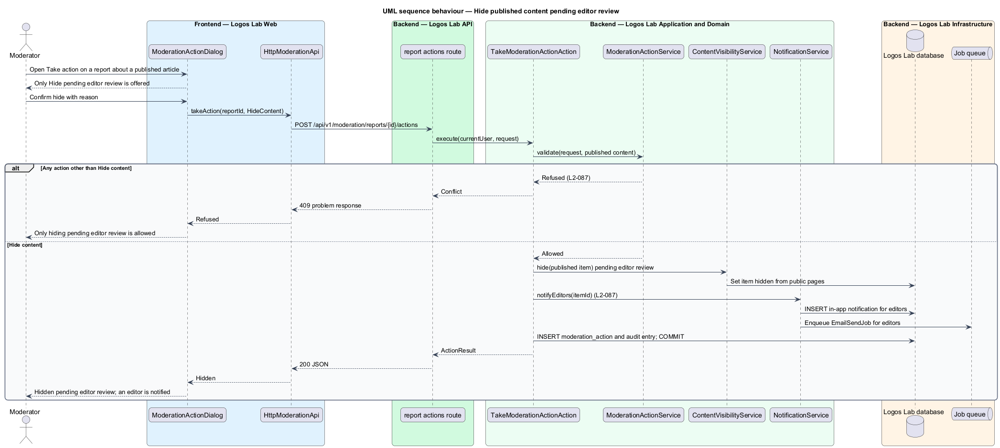

# Take a moderation action

## Overview

A moderator who has reviewed a report, or who finds a problem without one, decides what happens next. The decision
may touch the content, the member who posted it, or neither.

**moderation action** — moderator's recorded decision on a moderation case or on content: Dismiss, Hide content,
Remove content, Warn member, Suspend member or Ban member

**hidden content** — content visible only to moderators, shown to everyone else as removed, and restorable

**removed content** — content withdrawn for breaking the community guidelines

**account notice** — message to a warned, suspended or banned member, sent by email and in the app, that states the
reason, the guideline concerned and how to appeal

**proactive action** — moderation action taken on content that has no open report

This feature sits between the moderation queue (`docs/detailed-designs/moderation/work-moderation-queue/`) and
the audit trail (`docs/detailed-designs/moderation/record-moderation-audit-trail/`). Every action it takes is
audited, and member actions may be appealed (`docs/detailed-designs/moderation/appeal-decision/`).

## Description

The slice runs from the Take action dialog to the content, account and audit tables, and out to Amazon SES.

**Logos Lab Web**

- **`ModerationActionDialog`** — Angular CDK dialog opened from "Take action" on `ReportDetailPage`. It lists the
  actions as an `ll-radio-group`: Dismiss the reports, Hide, Remove, Warn, Suspend for 1 day, Suspend for 7 days,
  Suspend for 30 days and Ban. It asks for a guideline (`ll-select`) and a reason (`ll-textarea`), and previews what
  the member will see. Mock states in `docs/mocks/dialogs/moderation-action/`: `default`, `busy`, `invalid`,
  `failed` and `success`.
- **`ReportDetailPage`** — shows the outcome after the action. Mock state `resolved` in
  `docs/mocks/pages/report-detail/`.
- **Removed-content placeholder** — where hidden or removed content was, `ll-comment` shows "This content was
  removed for violating the community guidelines", and replies stay in place. Mock state `deleted` in
  `docs/mocks/pages/comments/` shows the placeholder pattern; the moderated wording follows `L2-087`.
- **`AccountNoticePage`** — routed page at `/account/notices/{id}` that works signed out from the emailed link. It
  shows the action, reason, guideline, the content concerned and "Appeal this decision". Mock states in
  `docs/mocks/pages/account-notice/`, with `default` for this slice.
- **In-app notice** — a notification (`docs/mocks/notifications/notification/`) linking to the account notice.
- **`ModerationApi`** — contract bound through `MODERATION_API` to `HttpModerationApi`. Its methods here are
  `takeAction(reportId, request)` and `takeProactiveAction(request)`.

**Logos Lab API**

- **`POST /api/v1/moderation/reports/{id}/actions`** — takes an action on a claimed case. Body: `type`,
  `suspensionDays` (1, 7 or 30), `guidelineId` and `reason`.
- **`POST /api/v1/moderation/actions`** — takes a proactive action on content or a member without a report.
- **`TakeModerationActionAction`** — owns one transaction. It validates the request, applies the action, resolves
  the case, writes the audit entry and enqueues notices.
- **`ModerationActionService`** — domain rules: reason required for every action except Dismiss, suspension length
  limited to 1, 7 or 30 days, and the published-content rule below.
- **`ContentVisibilityService`** — sets the visibility of a comment, cohort post, message or published item to
  hidden or removed, and back to visible on Dismiss of an auto-hidden case.
- **`AccountStateService`** — applies warning, suspension or ban to the account (`L2-019`) and revokes the
  member's sessions for a suspension or ban.
- **`ModerationAuditService`** — appends the audit entry (`L2-089`).
- **`NotificationService`** — creates the in-app notice, the `MemberNotice` with a signed access token for the
  emailed link, and enqueues `EmailSendJob`. It notifies editors when published content is hidden.
- **`ModerationAction`** — entity with `id`, `caseId`, `moderatorId`, `type` (`ModerationActionType`),
  `targetType`, `targetId`, `memberId`, `suspensionDays`, `guidelineId`, `reason`, `takenAt` and `reversedAt`.
- **`MemberNotice`** — entity with `id`, `memberId`, `actionId`, `tokenHash`, `appealDeadline` and `createdAt`.
- **Tables** — `moderation_actions`, `member_notices`, `moderation_cases`, `moderation_audit_entries`, plus the
  visibility columns of the target tables.

**Rules**

- The actions are Dismiss, Hide content, Remove content, Warn member, Suspend member (1, 7 or 30 days) and Ban
  member. Each takes effect immediately.
- A reason is required for every action except Dismiss and is recorded.
- Where content is hidden or removed, anyone else sees "This content was removed for violating the community
  guidelines", and replies remain.
- A warned, suspended or banned member receives an email and an in-app notice with the reason, the guideline
  concerned and how to appeal.
- For published expert or Logos Lab content (not a comment), a moderator can only hide it pending editor review,
  and an editor is notified. The API refuses any other action on such content with `409`.
- Only the moderator who claimed the case may act on it; others see the read-only state.
- The content of the email templates is `<TO SUPPLY>` (email templates are not mocked).

## Requirements

| L2 ID | Refines (L1) | Requirement |
|-------|--------------|-------------|
| `L2-087` | `L1-014` | **Moderation actions.** Moderators shall be able to act on reports and on content proactively. |

## Diagrams

### System context

Moderators act in Logos Lab. Members and editors hear about the action by email through Amazon SES and in the app.

### Containers

The dialog calls the API, which changes the database and enqueues email jobs for the Worker to send.

### Components

`TakeModerationActionAction` coordinates the visibility, account, audit and notification services in one
transaction.

### Class structure

A `ModerationAction` belongs to a `ModerationCase` or stands alone as a proactive action, and member actions
produce a `MemberNotice`.

### Behaviour — take an action on a report

The action branches on its type: Dismiss restores and closes, content actions change visibility, and member
actions change the account and send a notice.

### Behaviour — hide published content pending editor review

For published expert or Logos Lab content, the only permitted action is a hide pending editor review, and an editor
is notified.

