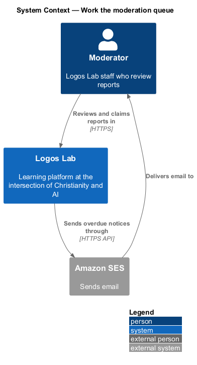
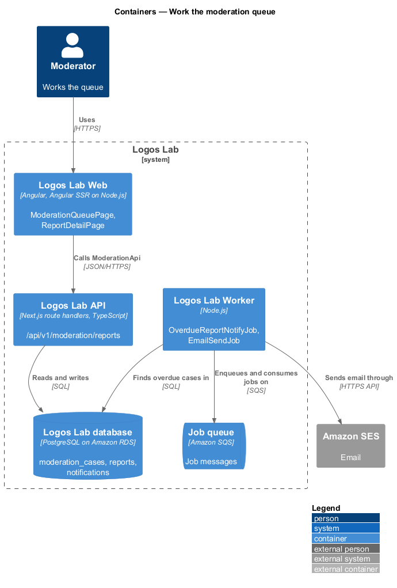
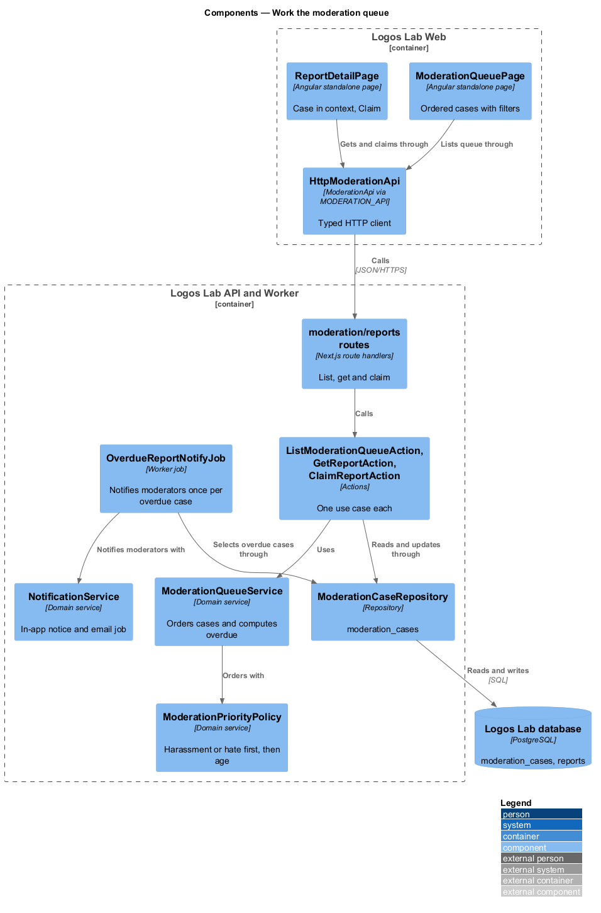
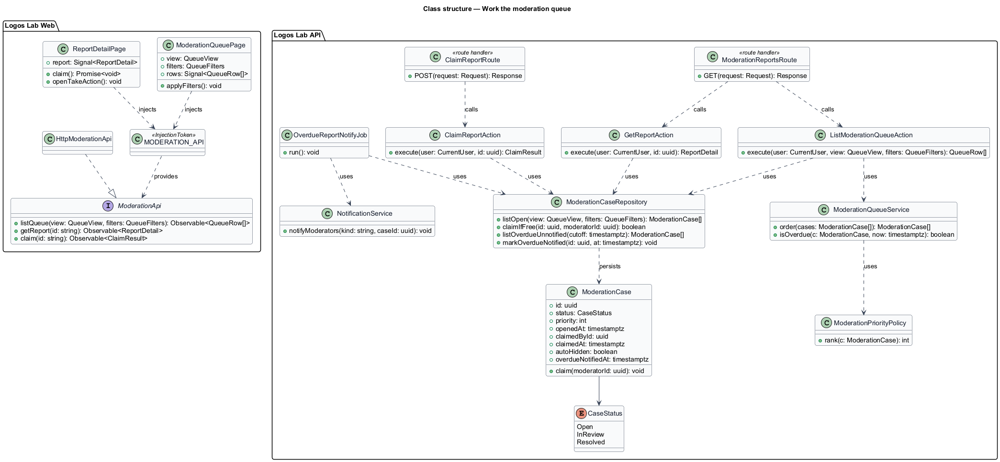
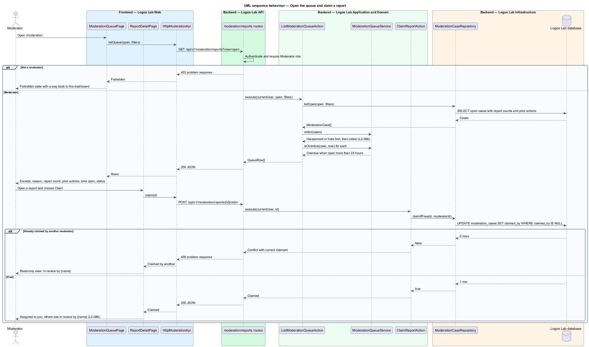
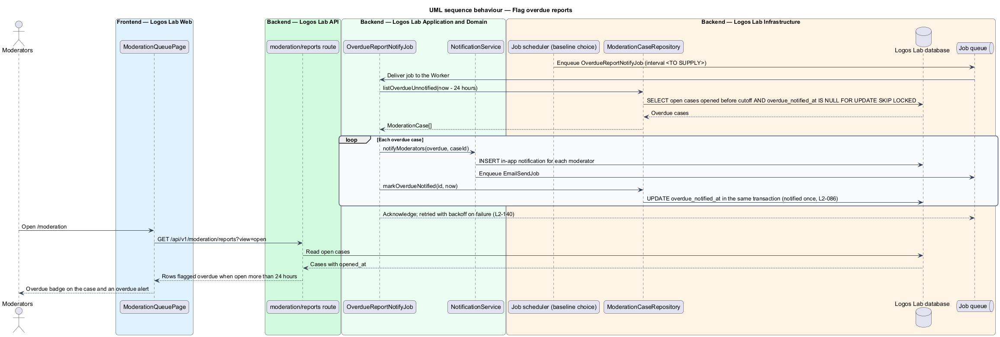

# Work the moderation queue

## Overview

Members report comments, cohort posts, direct messages, member profiles and published content
(`docs/detailed-designs/moderation/report-content/`). Moderators then need one ordered list of what to review
first, a way to take a report without two people working on it, and a warning when a report waits too long.

**moderation queue** — list at `/moderation` of open moderation cases, ordered by priority and then by age

**moderation case** — record that groups every report on the same reportable item

**claim** — moderator's act of assigning an open case to themselves so other moderators see it is taken

**overdue report** — moderation case open for more than 24 hours

The queue is the moderator's workspace. From a case, the moderator takes an action
(`docs/detailed-designs/moderation/take-moderation-action/`). Cases hidden automatically
(`docs/detailed-designs/moderation/hide-content-automatically/`) rise to the top of the same queue.

## Description

The slice runs from the moderation pages in Logos Lab Web to the `moderation_cases` table and a scheduled job in
the Logos Lab Worker.

**Logos Lab Web**

- **`ModerationQueuePage`** — routed page at `/moderation` inside the moderation shell (`ll-sidebar-navigation`
  with Queue, Held for review, Appeals and Audit trail). A `ll-search-filter-toolbar` filters by reason, type and
  status, and a `ll-table` lists cases. Each row shows the content excerpt, reason, report count, the reported
  member's prior actions, time open and claim status ("Unclaimed", "In review by {name}", "Auto-hidden",
  "Overdue"). The Held for review view lists comments held under `L2-062`. Mock states in
  `docs/mocks/pages/moderation-queue/`: `default`, `held`, `overdue`, `loading`, `empty`, `error`, `forbidden`
  and `long`.
- **`ReportDetailPage`** — routed page at `/moderation/reports/{id}`. It shows the reported item in context, every
  report with its note, the member's history, and the Claim and Take action buttons. Mock states in
  `docs/mocks/pages/report-detail/`: `default`, `claimed`, `read-only`, `message-context`, `resolved`, `loading`
  and `error`.
- **Overdue notice** — an `ll-alert` on the queue and a notification (`docs/mocks/notifications/notification/`)
  sent once to moderators.
- **Shared components** — `ll-sidebar-navigation`, `ll-page-header`, `ll-search-filter-toolbar`, `ll-select`,
  `ll-table`, `ll-badge`, `ll-comment`, `ll-timeline`, `ll-description-list`, `ll-button`, `ll-alert`,
  `ll-skeleton`, `ll-empty-state` and `ll-error-page`.
- **`ModerationApi`** — contract in the shared API library, bound through the `MODERATION_API` injection token to
  `HttpModerationApi`. Its methods here are `listQueue(view, filters)`, `getReport(id)` and `claim(id)`.

**Logos Lab API and Worker**

- **`GET /api/v1/moderation/reports?view=open|held`** — returns open cases in queue order, with filters for reason,
  type and status. Moderators only.
- **`GET /api/v1/moderation/reports/{id}`** — returns one case with its reports, the target in context and the
  reported member's prior moderation actions. For a reported direct message, it returns the 6 earlier messages for
  context, as the `message-context` mock shows; the count is a mock choice to confirm (`<TO SUPPLY>`).
- **`POST /api/v1/moderation/reports/{id}/claim`** — assigns the case to the caller. It answers `409` with the
  current claimant when another moderator holds it.
- **`ListModerationQueueAction`**, **`GetReportAction`** and **`ClaimReportAction`** — one action per use case.
- **`ModerationQueueService`** — orders cases and computes overdue status.
- **`ModerationPriorityPolicy`** — ranks Harassment or hate first, then orders by age. Auto-hidden cases move to
  the top (`L2-088`).
- **`ModerationCase`** — entity with `status` (`CaseStatus`), `priority`, `openedAt`, `claimedById`,
  `claimedAt`, `autoHidden` and `overdueNotifiedAt`.
- **`OverdueReportNotifyJob`** — Worker job run on a schedule (interval `<TO SUPPLY>`; baseline choice: every
  5 minutes). It selects open cases older than 24 hours with `overdueNotifiedAt` null, notifies every moderator
  through `NotificationService`, and sets `overdueNotifiedAt` in the same transaction so each case is notified once.
  The job is idempotent and retried with backoff (`L2-140`).

**Rules**

- Items are listed by priority (Harassment or hate first) and then by age.
- Each row shows content excerpt, reason, report count, the reported member's prior actions and time open.
- A moderator who claims a case is assigned to it; other moderators see "In review by {name}" and the case page is
  read-only for them.
- A case open for more than 24 hours is flagged as overdue, and moderators are notified once.
- Learners, experts and editors who open `/moderation` see the forbidden state (`L2-016`); the API answers `403`.

## Requirements

| L2 ID | Refines (L1) | Requirement |
|-------|--------------|-------------|
| `L2-086` | `L1-014` | **Moderation queue.** Moderators work from a queue at `/moderation`. |

## Diagrams

### System context

Moderators work the queue in Logos Lab. Logos Lab emails moderators about overdue cases through Amazon SES.

### Containers

Logos Lab Web calls the API for the queue and claims. The Worker runs the overdue job, which reads the same
database and enqueues email.

### Components

The queue and report pages call `HttpModerationApi`. The list, get and claim actions use
`ModerationQueueService` and `ModerationPriorityPolicy`; the overdue job uses `NotificationService`.

### Class structure

`ModerationCase` holds claim and overdue state. `ModerationQueueService` orders cases with
`ModerationPriorityPolicy`, and `OverdueReportNotifyJob` marks each overdue case once.

### Behaviour — open the queue and claim a report

The queue lists cases in priority order. A claim succeeds only when no other moderator holds the case.

### Behaviour — flag overdue reports

The scheduled job finds cases open for more than 24 hours that have not been notified, notifies moderators and
records the notification so it happens once.

