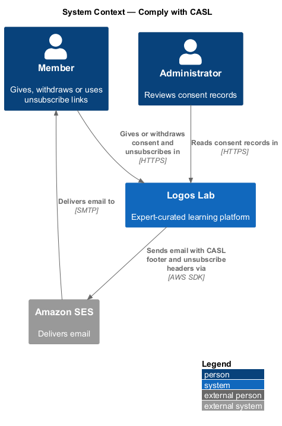
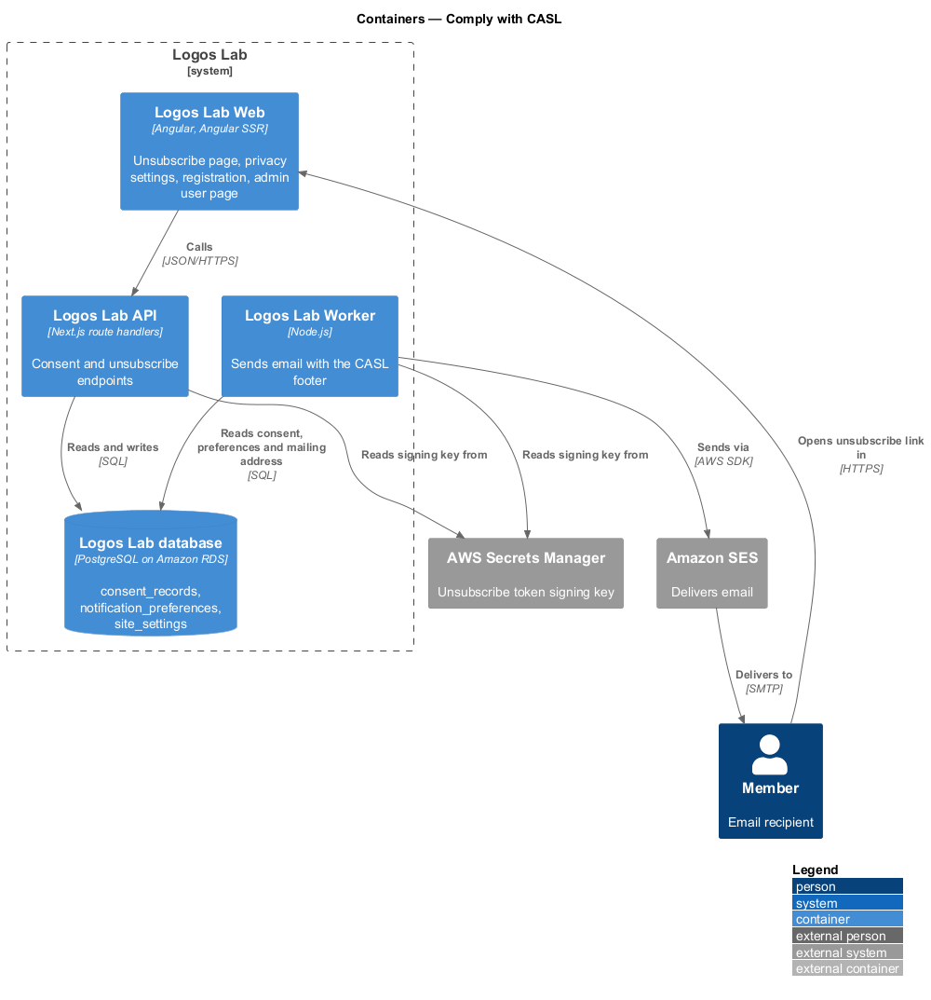
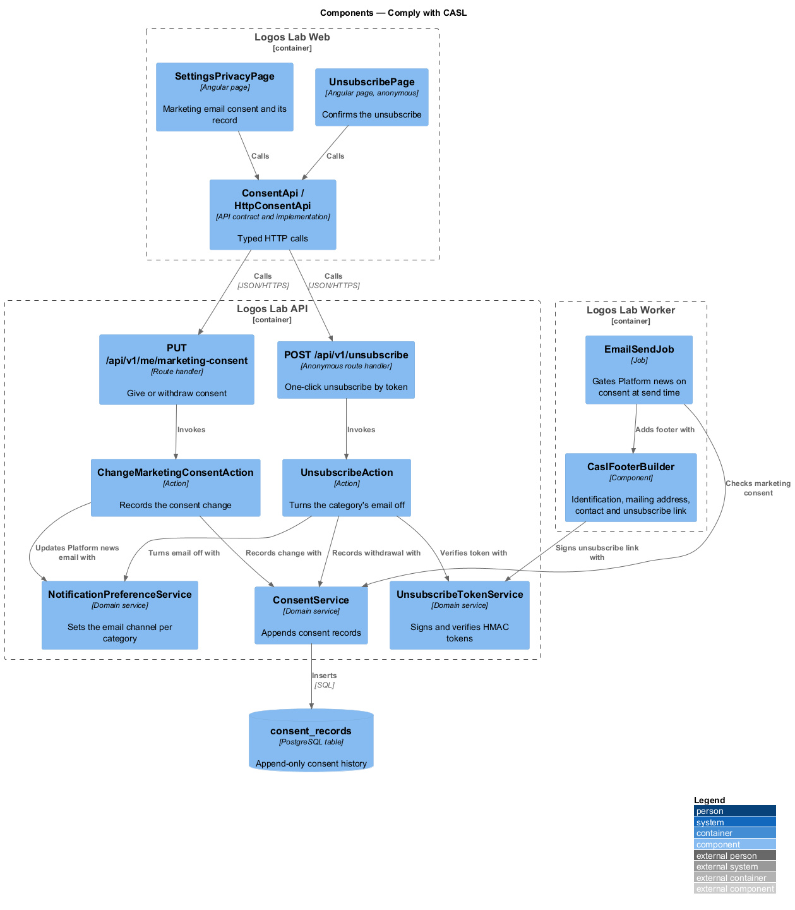
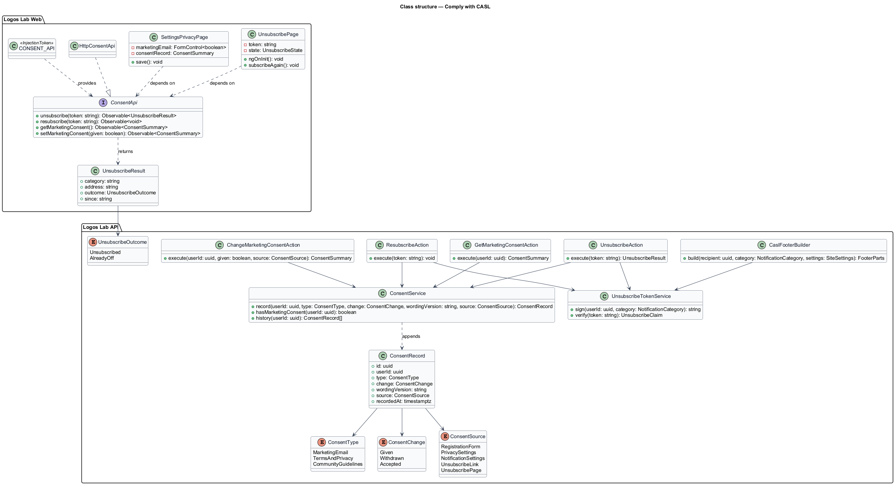
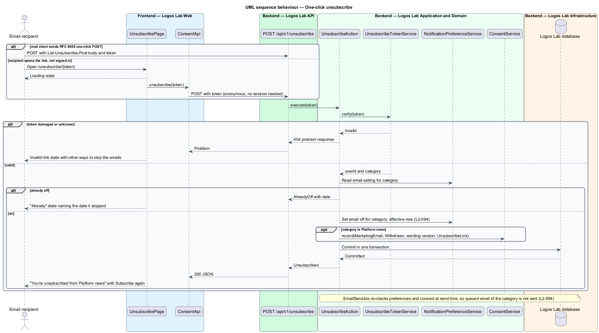
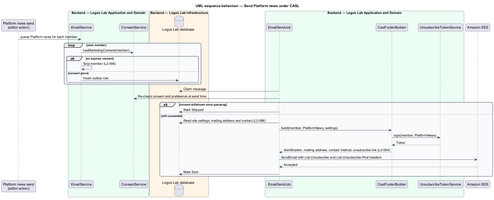
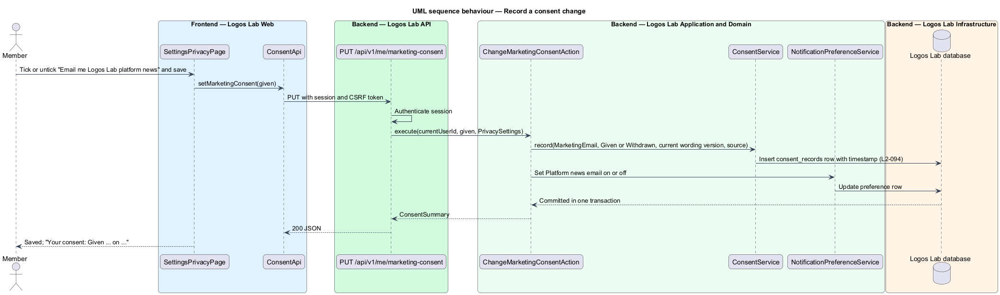

# Comply with CASL

## Overview

Canada's Anti-Spam Legislation (CASL) governs commercial electronic messages sent to people in
Canada. Logos Lab sends one kind of marketing email, Platform news, and several kinds of activity
email. This feature holds the rules that keep that email lawful: who may receive marketing email, what
each non-transactional email shall contain, how a recipient stops it, and how consent is recorded. It
sits in the notifications subsystem and applies to every email the email channel (`L2-092`) sends.

- **commercial electronic message** — email that encourages participation in a commercial activity;
  in Logos Lab, Platform news
- **express consent** — consent a member gives by an explicit act, such as ticking an unticked box
- **non-transactional email** — any email other than the always-on security and account emails
- **one-click unsubscribe** — link in an email that stops that category of email without signing in
- **consent record** — append-only entry that stores the consent type, wording version, source and
  timestamp of one consent change

Platform news reaches only members who gave express consent. Every non-transactional email identifies
Logos Lab with a mailing address and a contact method and carries a one-click unsubscribe link. An
unsubscribe takes effect at once, well inside the 10-business-day limit CASL allows.

## Description

### Logos Lab Web

- **`UnsubscribePage`** — anonymous page at `/unsubscribe/{token}` (route is a baseline choice). It
  posts the token on load and shows the result in an `ll-auth-card` with `ll-alert`,
  `ll-spinner` and `ll-button`. Mock states in `docs/mocks/pages/unsubscribe/`: `loading`, `default`
  ("You're unsubscribed from Platform news" with "Subscribe again" and "Manage all your emails"),
  `already` (the category was already off, with the date it stopped), `invalid-link` (other ways to
  stop the emails, including by reply) and `error` (Try again, and a promise to stop by email).
- **`SettingsPrivacyPage`** — the Marketing email section of Settings > Privacy and messaging, with an
  `ll-checkbox` "Email me Logos Lab platform news" and an `ll-description-list` showing the current
  consent record. Mock: `docs/mocks/pages/settings-privacy/`.
- **`RegisterPage`** — shows an unticked, optional Platform news box (`docs/mocks/pages/register/`).
  The accounts subsystem owns registration and records the consent through `ConsentService`.
- **`AdminUserPage`** — shows the member's consent records, newest first, with wording version and
  source (`docs/mocks/pages/admin-user/default.html`, `L2-095`).
- **Settings > Notifications** — the `locked` state of `docs/mocks/pages/settings-notifications/`
  locks Platform news email until marketing consent is given (`L2-093`).
- **`ConsentApi`** — contract in the shared API library, provided through `CONSENT_API` and
  implemented by `HttpConsentApi`: `unsubscribe`, `resubscribe`, `getMarketingConsent` and
  `setMarketingConsent`.

### Logos Lab API

| Method and path | Action | Notes |
|---|---|---|
| `POST /api/v1/unsubscribe` | `UnsubscribeAction` | Anonymous; body carries the signed token; also accepts the RFC 8058 one-click POST |
| `POST /api/v1/unsubscribe/resubscribe` | `ResubscribeAction` | Anonymous; records new express consent with source `UnsubscribePage` |
| `GET /api/v1/me/marketing-consent` | `GetMarketingConsentAction` | Current consent and its latest record |
| `PUT /api/v1/me/marketing-consent` | `ChangeMarketingConsentAction` | Gives or withdraws consent and sets Platform news email to match |

- **`UnsubscribeTokenService`** — signs and verifies HMAC tokens that carry the user id and the
  category. The key lives in AWS Secrets Manager. Token lifetime is `<TO SUPPLY>`; CASL requires the
  link to work for at least 60 days after sending.
- **`UnsubscribeAction`** — verifies the token, turns the category's email channel off in
  `notification_preferences`, and for Platform news appends a `Withdrawn` consent record, all in one
  transaction. The change applies from that moment.
- **`ConsentService`** — appends `ConsentRecord` rows to `consent_records` and answers
  `hasMarketingConsent`. Rows are never updated or deleted; the latest marketing row decides consent.
- **`ConsentRecord`** — `id`, `userId`, `type` (`ConsentType`), `change` (`ConsentChange`),
  `wordingVersion`, `source` (`ConsentSource`) and `recordedAt`.
- **Who triggers a Platform news send** — the editorial process and its screen are `<TO SUPPLY>`; the
  sending path below applies whatever triggers it.

### Logos Lab Worker

- **`EmailSendJob`** (`L2-092`) — re-checks preferences and, for Platform news, marketing consent at
  send time, so email queued before an unsubscribe or withdrawal is skipped.
- **`CaslFooterBuilder`** — adds to every non-transactional email the Logos Lab identification, the
  mailing address and support contact from site settings (`L2-098`), and a signed one-click
  unsubscribe link. It also sets the `List-Unsubscribe` and `List-Unsubscribe-Post` headers.

## Requirements

| L2 ID | Refines (L1) | Requirement |
|-------|--------------|-------------|
| `L2-094` | `L1-015` | **CASL compliance.** Commercial electronic messages shall comply with Canada's Anti-Spam Legislation. |

## Diagrams

### System context

Members give or withdraw consent and unsubscribe in Logos Lab; administrators read consent records.
Logos Lab sends compliant email through Amazon SES.

### Containers

The API handles consent and unsubscribe requests, and the Worker builds the CASL footer at send time.
Both read the token signing key from AWS Secrets Manager.

### Components

`UnsubscribeAction` and `ChangeMarketingConsentAction` update preferences and append consent records.
`EmailSendJob` gates Platform news on consent and adds the footer from `CaslFooterBuilder`.

### Class structure

`ConsentService` appends `ConsentRecord` entries typed by `ConsentType`, `ConsentChange` and
`ConsentSource`. `UnsubscribeTokenService` both signs links and verifies them.

### Behaviour — one-click unsubscribe

A valid token turns the category's email off at once and, for Platform news, records the withdrawal.
Damaged tokens and categories already off have their own states.

### Behaviour — send Platform news

Members without express consent are skipped when the send is queued and again at send time. Each sent
email carries the identification, mailing address, contact and unsubscribe link.

### Behaviour — record a consent change

Giving or withdrawing consent appends a consent record with type, wording version, source and
timestamp, and sets Platform news email to match, in one transaction.

