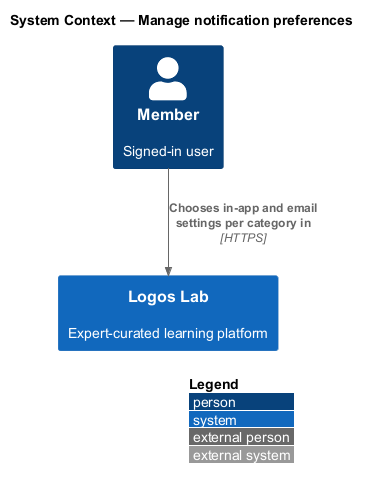
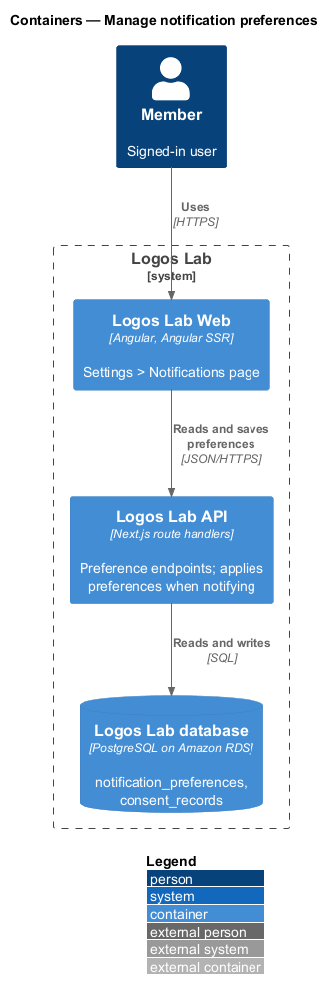
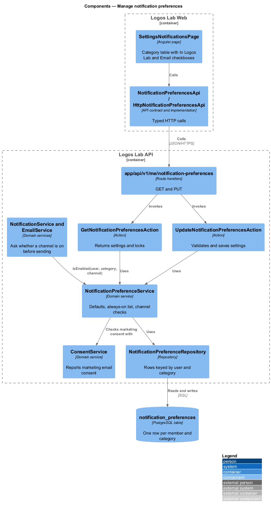
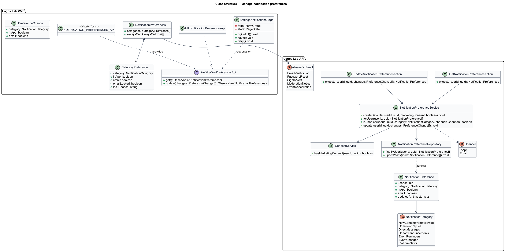
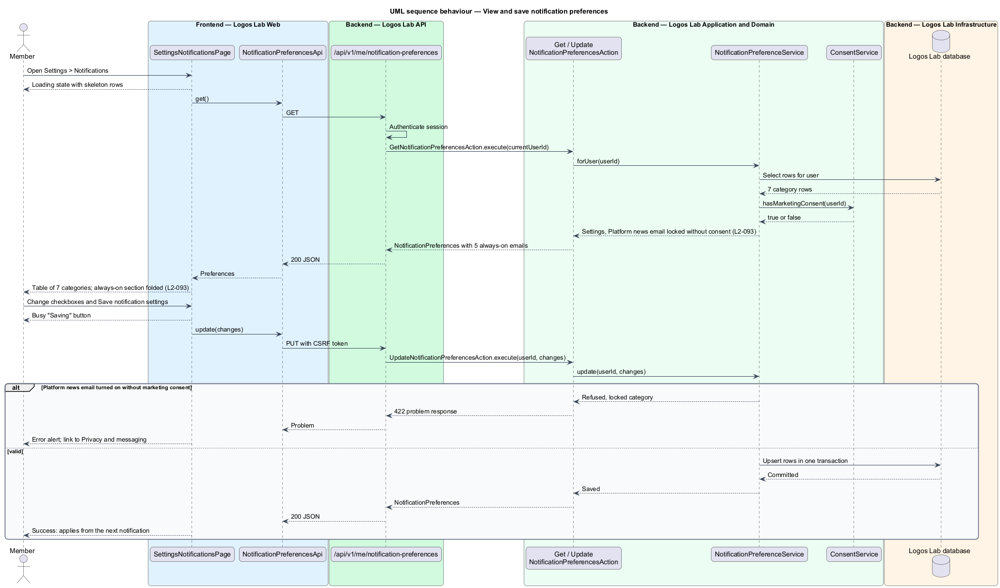
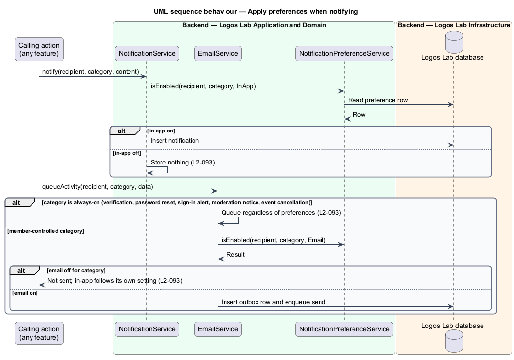
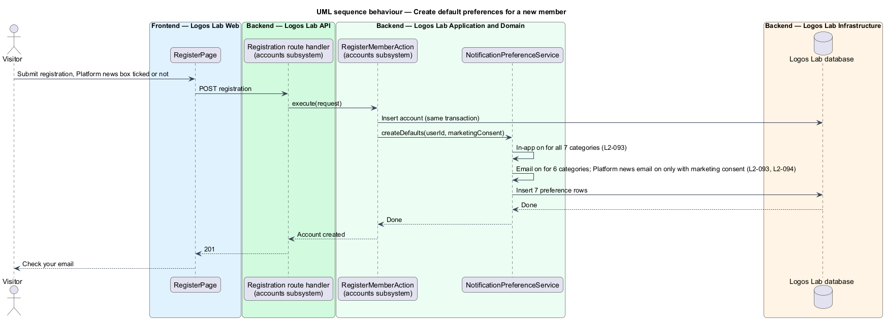

# Manage notification preferences

## Overview

Logos Lab notifies members in two channels: in the app and by email. This feature lets each member
decide, for each kind of notification, which channels reach them. It sits in the notifications
subsystem beside the in-app channel (`L2-091`), the email channel (`L2-092`) and CASL compliance
(`L2-094`), and every notification those features produce passes through the preferences it stores.

- **notification category** — named kind of notification a member controls, such as "Replies to your
  comments" or "Event reminders"
- **channel** — route by which a notification reaches a member: in Logos Lab (in-app) or email
- **always-on email** — security or account email that is sent whatever the member's preferences
- **marketing consent** — express consent to receive Platform news by email, recorded under CASL

Settings > Notifications lists 7 categories, each with an in-app and an email choice set
independently. A folded section lists 5 always-on emails that cannot be turned off. New members start
with every in-app choice on and every email choice on except Platform news, which waits for marketing
consent.

## Description

### Logos Lab Web

- **`SettingsNotificationsPage`** — routed page under the settings layout, reached as Settings >
  Notifications (route `/settings/notifications`, baseline choice). It uses `ll-sidebar-navigation`
  for the settings menu, `ll-page-header`, an `ll-table` captioned "Notification categories, in Logos
  Lab and by email" with one `ll-checkbox` per category and channel, an `ll-accordion` titled "Always
  on: 5 security and account emails", `ll-alert` for errors and success, `ll-skeleton` while loading,
  and an `ll-button` "Save notification settings".
- **Mock states** — `docs/mocks/pages/settings-notifications/` covers `default`, `loading`, `error`
  (Try again and a support address), `locked` (Platform news email locked with "Give consent in
  Privacy and messaging"), `read-only` (the always-on section open), `submitting` and `success` (the
  change applies from the next notification).
- **`NotificationPreferencesApi`** — contract in the shared API library, provided through
  `NOTIFICATION_PREFERENCES_API` and implemented by `HttpNotificationPreferencesApi`. Methods: `get()`
  and `update(changes)`.

### Categories and always-on emails

| Category | Default in-app | Default email |
|---|---|---|
| New content from people you follow | On | On |
| Replies to your comments | On | On |
| Direct messages | On | On |
| Cohort announcements | On | On |
| Event reminders | On | On |
| Event changes | On | On |
| Platform news | On | On only with marketing consent |

Always-on emails, listed and not editable: Email verification, Password reset, Sign-in alerts,
Moderation notices and Event cancellations.

### Logos Lab API

| Method and path | Action | Notes |
|---|---|---|
| `GET /api/v1/me/notification-preferences` | `GetNotificationPreferencesAction` | Returns the 7 category settings, lock flags and the always-on list |
| `PUT /api/v1/me/notification-preferences` | `UpdateNotificationPreferencesAction` | Saves changed categories in one transaction; `422` when Platform news email is turned on without marketing consent |

- Both endpoints act only on the session's user (`L2-017`); the path has no user id.
- **`NotificationPreferenceService`** — domain service. `createDefaults(userId, marketingConsent)`
  writes the defaults when an account is created; the registration action of the accounts subsystem
  calls it in its transaction. `isEnabled(userId, category, channel)` answers for
  `NotificationService` and `EmailService` at the moment a notification is triggered. Always-on emails
  bypass the check.
- **`ConsentService`** — reports whether the member holds marketing consent (`L2-094`). Without it,
  Platform news email is reported as locked and cannot be turned on here; consent is given in Settings
  > Privacy and messaging.
- **`NotificationPreference`** — entity in table `notification_preferences` with primary key
  `(user_id, category)` and the columns `in_app`, `email` and `updated_at`.

## Requirements

| L2 ID | Refines (L1) | Requirement |
|-------|--------------|-------------|
| `L2-093` | `L1-015` | **Notification preferences.** Members control which notifications they receive and on which channel. |

## Diagrams

### System context

A signed-in member sets notification preferences inside Logos Lab; no external system takes part.

### Containers

Logos Lab Web reads and saves preferences through the Logos Lab API, which stores them in the
database beside the consent records.

### Components

`SettingsNotificationsPage` calls the preferences endpoints. `NotificationPreferenceService` holds the
defaults and the channel check, and consults `ConsentService` for Platform news.

### Class structure

The page depends on `NotificationPreferencesApi`. Each member has 7 `NotificationPreference` rows,
and the 5 `AlwaysOnEmail` values are returned for display only.

### Behaviour — view and save preferences

The page loads the settings with their lock flags, then saves the changed categories in one
transaction. Turning on Platform news email without consent is refused.

### Behaviour — apply preferences when notifying

Before storing an in-app notification or queueing an activity email, the notifying service asks
`NotificationPreferenceService`; always-on emails skip the check.

### Behaviour — create default preferences

The registration action writes the 7 default rows in its transaction, with Platform news email on
only when the member ticked marketing consent.

