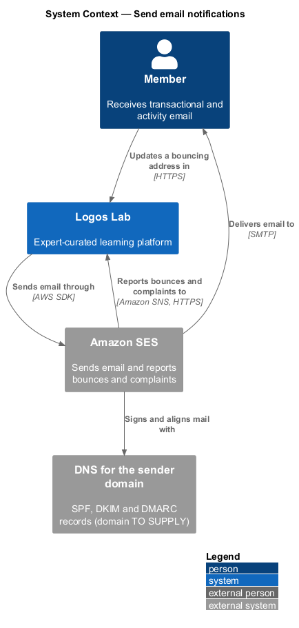
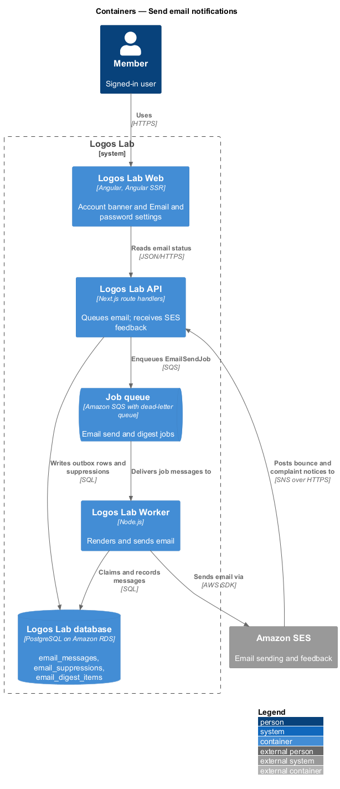
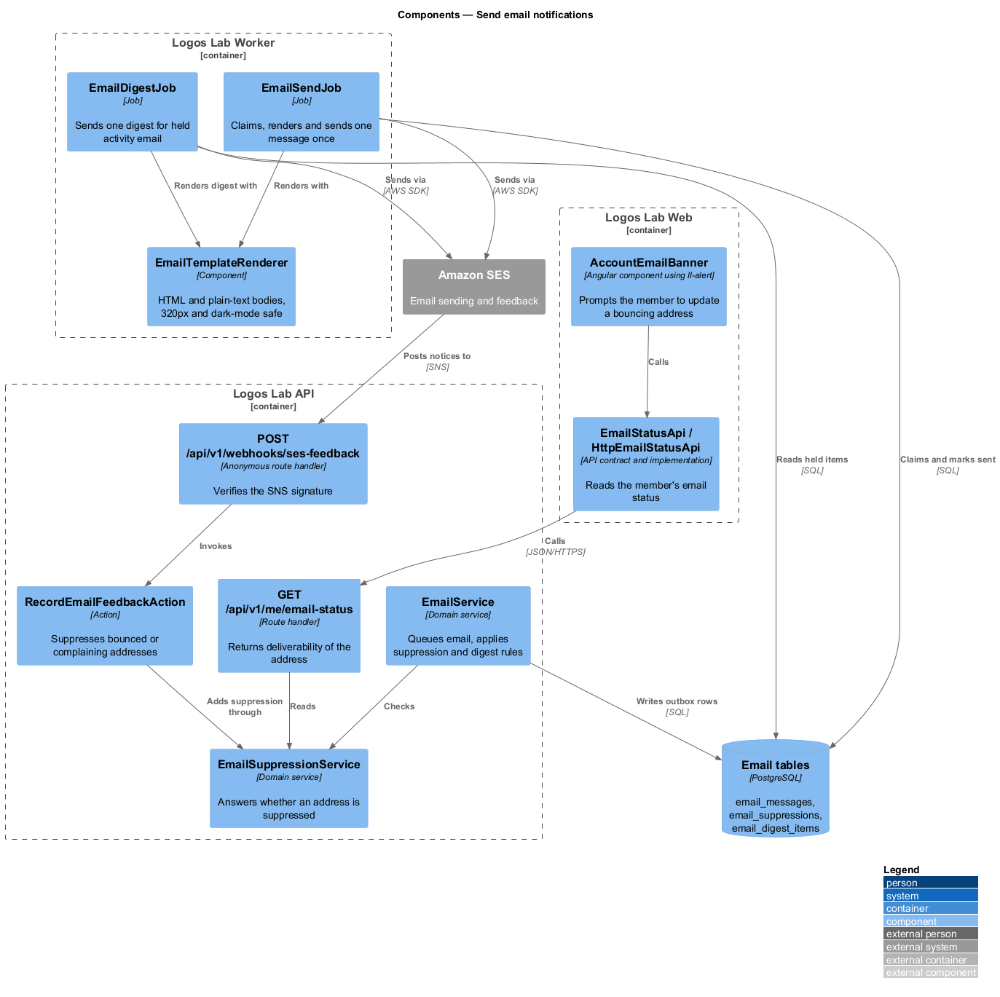
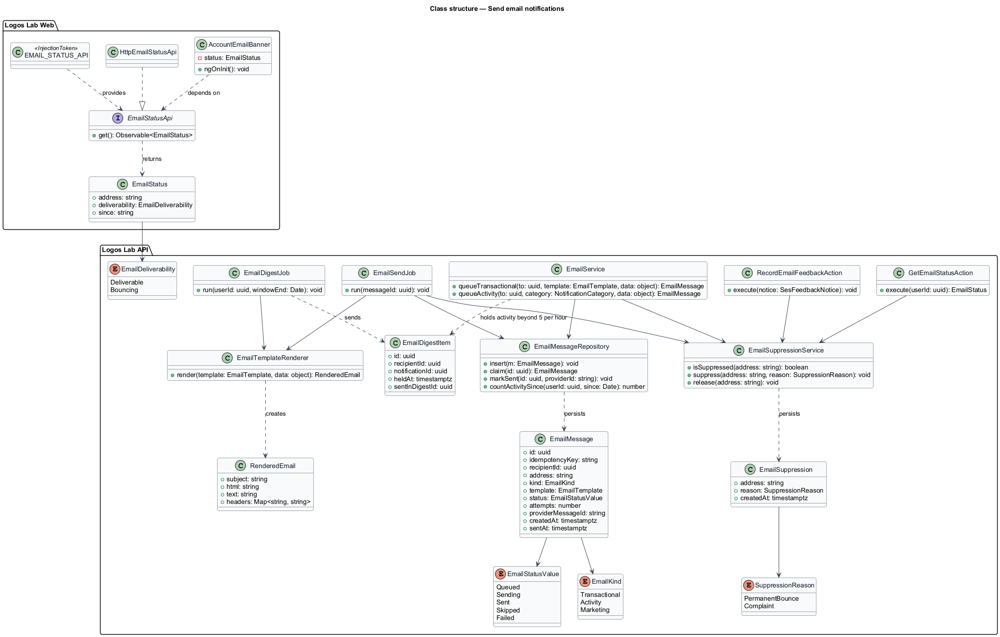
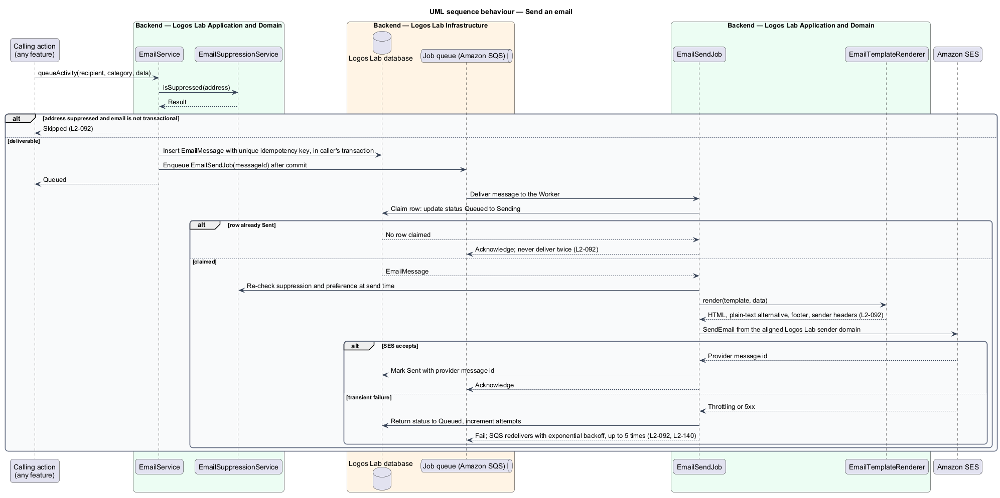
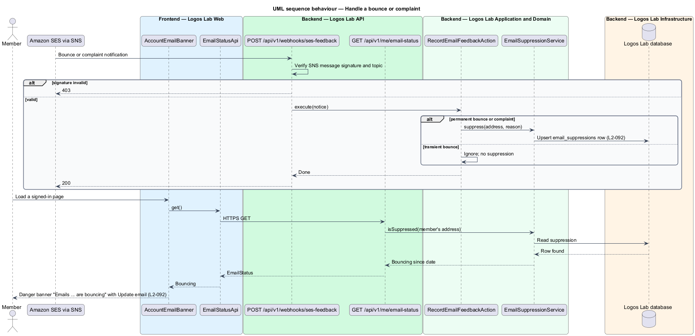
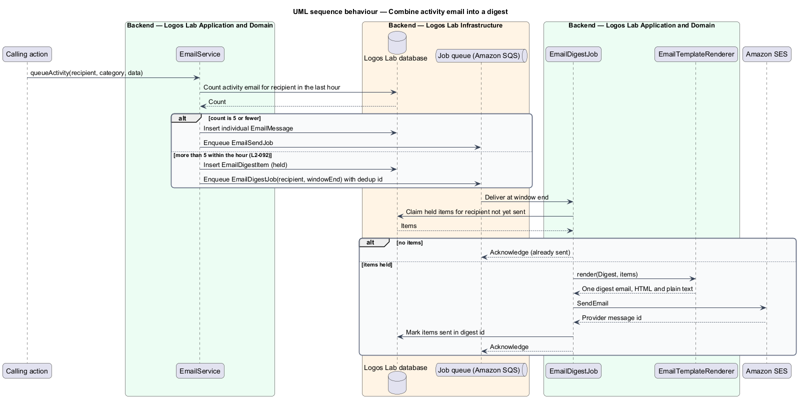

# Send email notifications

## Overview

Logos Lab sends email for two purposes. This feature is the email channel of the notifications
subsystem: it composes, sends and tracks every email the platform sends. The in-app channel, member
preferences and CASL rules are separate features in the same subsystem.

- **transactional email** — email a member needs to use the account or a service they signed up for,
  such as verification, password reset, sign-in alerts, moderation notices and event cancellations
- **activity email** — email about activity a member follows, such as replies, new content or cohort
  announcements, sent only when the member's preference allows it (`L2-093`)
- **suppression** — record that an address shall receive no non-transactional email because it
  bounced permanently or its owner marked mail as spam
- **digest** — single email that combines several activity notifications for one member

Every email carries a plain-text alternative, comes from the Logos Lab sender on an aligned domain,
and reads well on narrow screens and in dark-mode clients. Sending runs in the Worker through Amazon
SES. A failed send is retried, and no email is delivered twice. Bounces and spam complaints suppress
the address, and the member sees a prompt to update it.

## Description

### Logos Lab Web

- **`AccountEmailBanner`** — account banner below the header, built from `ll-alert` in its banner
  form. When the member's address is bouncing it shows the Danger banner "Emails to … are bouncing"
  with "Update email". Mock: `docs/mocks/notifications/account-banner/danger.html`.
- **Settings > Email and password** — the `bounced` state in `docs/mocks/pages/settings-account/`
  explains that activity emails are paused, that security emails still try to reach the member, and
  offers the change-email form. That page belongs to the accounts subsystem; this feature supplies its
  email status.
- **`EmailStatusApi`** — contract in the shared API library, provided through `EMAIL_STATUS_API` and
  implemented by `HttpEmailStatusApi`. `get()` returns `EmailStatus` (`address`, `deliverability`,
  `since`).

### Logos Lab API

| Method and path | Action | Notes |
|---|---|---|
| `GET /api/v1/me/email-status` | `GetEmailStatusAction` | Authenticated; returns `Deliverable` or `Bouncing` for the caller's address |
| `POST /api/v1/webhooks/ses-feedback` | `RecordEmailFeedbackAction` | Anonymous by design; accepts only Amazon SNS messages with a valid signature from the configured topic |

- **`EmailService`** — domain service that other features call. `queueTransactional` and
  `queueActivity` write an `EmailMessage` outbox row in the caller's transaction, then enqueue
  `EmailSendJob` after commit. Non-transactional email to a suppressed address is skipped.
- **Digest rule** — when a member receives more than 5 activity notifications within an hour,
  `EmailService` holds the further items as `EmailDigestItem` rows and `EmailDigestJob` sends them as
  one digest email. The window is a rolling hour per member (baseline choice). Whether the first 5
  items also join the digest is `<TO SUPPLY>`; this design sends them individually.
- **`EmailSuppressionService`** — reads and writes `email_suppressions`. A permanent bounce or a
  complaint adds the address with its `SuppressionReason`. A transient bounce adds nothing. Changing
  to a new verified address releases the suppression for the member.
- **Entities and tables** — `EmailMessage` (`email_messages`: id, unique `idempotencyKey`,
  recipient, address, `EmailKind`, template, status, attempts, SES message id, timestamps),
  `EmailSuppression` (`email_suppressions`) and `EmailDigestItem` (`email_digest_items`).

### Logos Lab Worker

- **`EmailSendJob`** — claims one message by moving it from `Queued` to `Sending` in a conditional
  update, re-checks suppression and preferences, renders it, and sends it through SES. A message
  already `Sent` is acknowledged without sending, so a redelivered job never sends twice. Transient
  failures return the row to `Queued` and let SQS redeliver with exponential backoff up to 5 times,
  after which the message moves to the dead-letter queue (`L2-140`). Recovery when the Worker stops
  between SES acceptance and the `Sent` update is `<TO SUPPLY>`.
- **`EmailDigestJob`** — at the end of the window it claims the member's held items and sends one
  digest. Deduplication on `(recipient, window end)` keeps it idempotent.
- **`EmailTemplateRenderer`** — renders each template to HTML and a plain-text alternative. Layouts
  are single-column and legible at 320px wide, and colours keep contrast in dark-mode email clients.
  The renderer adds the support contact details from site settings (`L2-098`) and, for
  non-transactional email, the CASL footer (`L2-094`).

### External systems

- **Amazon SES** — sends from the Logos Lab sender on a domain with SPF, DKIM and DMARC alignment. The
  sender address and domain are `<TO SUPPLY>`. SES publishes bounce and complaint notices to an Amazon
  SNS topic that posts to the feedback endpoint.

## Requirements

| L2 ID | Refines (L1) | Requirement |
|-------|--------------|-------------|
| `L2-092` | `L1-015` | **Email notifications.** The platform sends transactional and activity emails. |

## Diagrams

### System context

Logos Lab sends email through Amazon SES, which delivers it to the member and reports bounces and
complaints back. The sender domain's DNS records give SPF, DKIM and DMARC alignment.

### Containers

The API writes outbox rows and enqueues jobs; the Worker sends through SES. SES feedback returns to
the API, and Logos Lab Web reads the member's email status.

### Components

`EmailService` and `EmailSuppressionService` hold the rules in the API. `EmailSendJob`,
`EmailDigestJob` and `EmailTemplateRenderer` run in the Worker, and `AccountEmailBanner` shows the
bouncing prompt.

### Class structure

`EmailMessage` carries the idempotency key and status that prevent a second delivery.
`EmailSuppression` and `EmailDigestItem` hold suppression and digest state.

### Behaviour — send an email

`EmailService` writes the outbox row and enqueues the job. `EmailSendJob` claims the row, renders the
plain-text alternative and footer, and sends once; transient failures retry with backoff.

### Behaviour — handle a bounce or complaint

A verified SNS notice of a permanent bounce or complaint suppresses the address. The account banner
then prompts the member to update it.

### Behaviour — combine activity email into a digest

Beyond 5 activity notifications within an hour, items are held and sent as one digest at the end of
the window.

