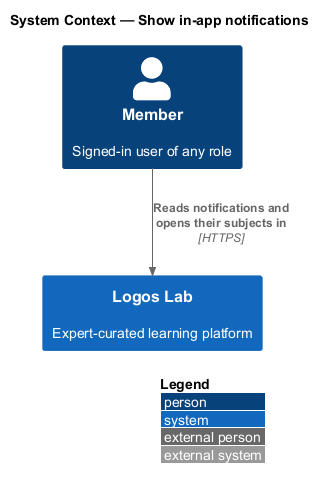
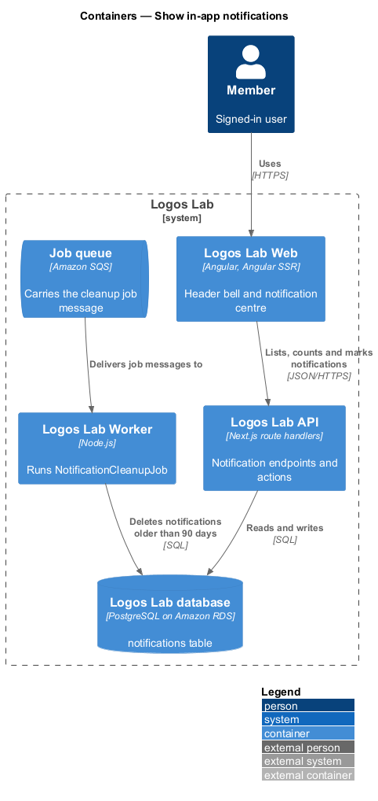
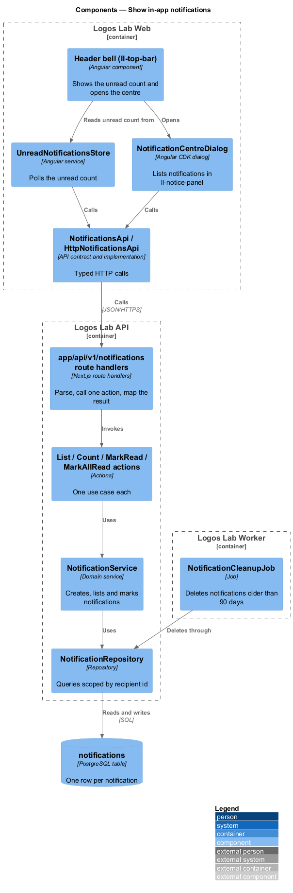
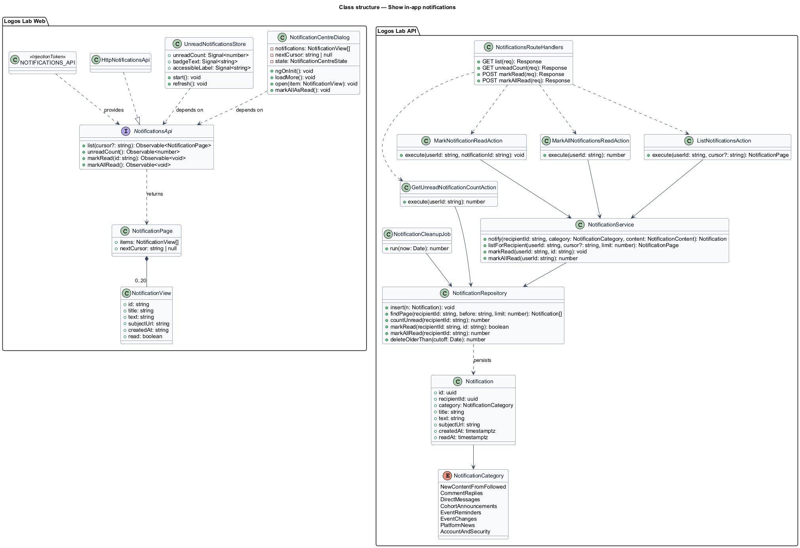
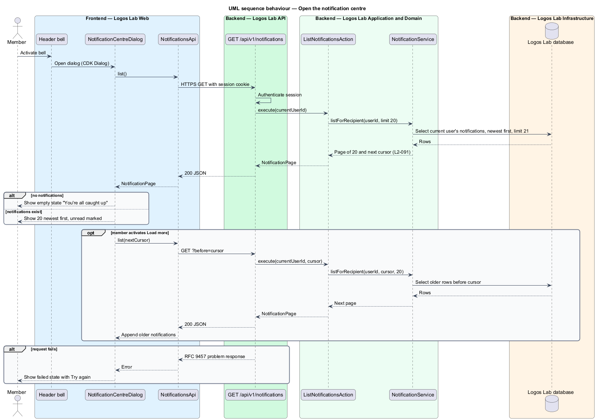
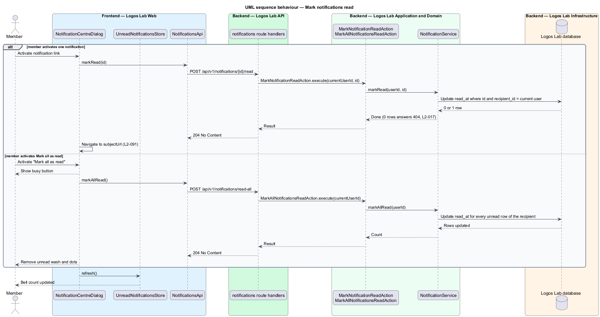
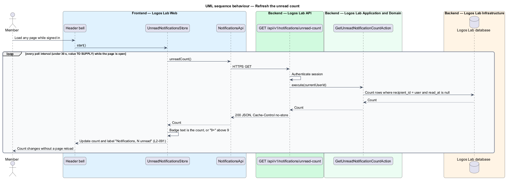
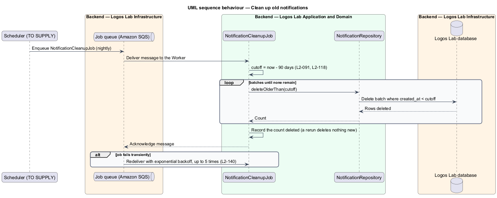

# Show in-app notifications

## Overview

Logos Lab tells signed-in members about activity they care about, such as a reply to their comment, a
post in their cohort, or new content from an expert they follow. This feature is the in-app channel
of the notifications subsystem. The email channel, the preferences that switch each channel on or off
and the CASL rules for marketing email are separate features in the same subsystem.

- **notification** — short, stored message to one member that names an event and links to its subject
- **subject** — page the notification is about, such as a comment thread, a cohort space or a video
- **notification centre** — panel opened from the header bell that lists a member's notifications
- **unread count** — number of the member's notifications not yet opened or marked read

Every page for a signed-in member shows a bell in the global header with the unread count. Opening
the bell shows the notification centre. Opening a notification takes the member to its subject and
marks the notification read. The count refreshes while the member stays on the site, and a nightly job
deletes notifications older than 90 days.

Other features create notifications through `NotificationService`. That service consults the member's
preferences (`L2-093`) before it stores an in-app notification.

## Description

### Logos Lab Web

- **Header bell** — the bell button inside `ll-top-bar`. It shows the unread count from
  `UnreadNotificationsStore`, rendered as the number up to 9 and as "9+" above 9. Its accessible name
  states the count, for example "Notifications, 3 unread". Activating it opens
  `NotificationCentreDialog`.
- **`UnreadNotificationsStore`** — application-wide Angular service. It starts when a signed-in page
  loads and polls `NotificationsApi.unreadCount()` so that a new notification changes the count
  within 30 seconds, without a page reload. The poll interval is below 30 seconds; its exact value is
  `<TO SUPPLY>`. Polling is a baseline choice over a push channel.
- **`NotificationCentreDialog`** — dialog opened with the Angular CDK `Dialog` service. It renders
  `ll-notice-panel`: a head with "Mark all as read" and a close button, a list of `ll-notification-item`
  rows (unread rows carry the sage wash, the dot and a hidden "Unread:" label), and a foot link to
  Settings > Notifications. Under 640px the panel becomes a full-screen sheet. It loads the 20 most
  recent notifications, newest first, and "Load more" appends the next 20 older ones.
- **Mock states** — `docs/mocks/dialogs/notification-centre/` covers `default`, `busy` (Mark all as
  read in progress), `empty` ("You're all caught up"), `failed` (Try again), `long` (20 items and Load
  more) and `success` (everything read, count cleared). `docs/mocks/notifications/notification/` shows
  the `unread`, `read`, `stacked`, `with-action`, `info`, `success`, `warning` and `danger` item forms.
- **`NotificationsApi`** — contract in the shared API library, provided through the
  `NOTIFICATIONS_API` token and implemented by `HttpNotificationsApi`. Methods: `list(cursor?)`,
  `unreadCount()`, `markRead(id)` and `markAllRead()`.

### Logos Lab API

| Method and path | Action | Result |
|---|---|---|
| `GET /api/v1/notifications?before=<cursor>` | `ListNotificationsAction` | Page of 20 notifications, newest first, and the next cursor |
| `GET /api/v1/notifications/unread-count` | `GetUnreadNotificationCountAction` | The unread count, sent with `Cache-Control: no-store` |
| `POST /api/v1/notifications/{id}/read` | `MarkNotificationReadAction` | `204`; `404` when the notification is not the caller's |
| `POST /api/v1/notifications/read-all` | `MarkAllNotificationsReadAction` | `204`; every unread notification of the caller is marked read |

- Each endpoint requires authentication. The recipient is always the session's user; no parameter can
  name another recipient (`L2-017`).
- **`NotificationService`** — domain service. `notify(recipientId, category, content)` stores a
  notification when the recipient's in-app setting for the category is on. `listForRecipient` pages by
  a keyset cursor on `(created_at, id)`. `markRead` and `markAllRead` set `read_at`.
- **`NotificationRepository`** — reads and writes the `notifications` table. Every query filters on
  `recipient_id`.
- **`Notification`** — entity with `id` (UUID), `recipientId`, `category`, `title`, `text`,
  `subjectUrl`, `createdAt` and `readAt`. The table has an index on `(recipient_id, created_at desc)`
  and a partial index on unread rows.
- **`NotificationCategory`** — the 7 member-facing categories of `L2-093` plus `AccountAndSecurity`
  for always-on account notices.

### Logos Lab Worker

- **`NotificationCleanupJob`** — runs nightly with the retention schedule (`L2-118`). It deletes
  notifications whose `created_at` is more than 90 days old, in batches, and records the count. It is
  idempotent and retried with exponential backoff up to 5 times (`L2-140`). The scheduler that enqueues
  it is `<TO SUPPLY>`.

## Requirements

| L2 ID | Refines (L1) | Requirement |
|-------|--------------|-------------|
| `L2-091` | `L1-015` | **In-app notifications.** Signed-in users have a notification centre in the global header. |

## Diagrams

### System context

A signed-in member reads notifications inside Logos Lab; no external system takes part in the in-app
channel.

### Containers

Logos Lab Web calls the Logos Lab API for the list, the count and the read state. The Worker deletes
old notifications from the database on a nightly job.

### Components

The header bell reads the count from `UnreadNotificationsStore` and opens `NotificationCentreDialog`.
Both call `NotificationsApi`, whose route handlers invoke one action each over `NotificationService`
and `NotificationRepository`.

### Class structure

The web types depend on the `NotificationsApi` contract. On the API side, four actions share
`NotificationService` and `NotificationRepository`, and each `Notification` carries a
`NotificationCategory`.

### Behaviour — open the notification centre

The dialog loads the 20 newest notifications for the current user. "Load more" fetches older pages,
and an empty or failed load shows its own state.

### Behaviour — mark notifications read

Activating a notification marks it read and navigates to its subject; "Mark all as read" clears every
unread notification. Both paths refresh the bell count.

### Behaviour — refresh the unread count

`UnreadNotificationsStore` polls the count at an interval below 30 seconds and updates the badge text
and accessible label without a page reload.

### Behaviour — clean up old notifications

`NotificationCleanupJob` deletes notifications older than 90 days in batches. A rerun deletes nothing
new, and transient failures are redelivered with backoff.

