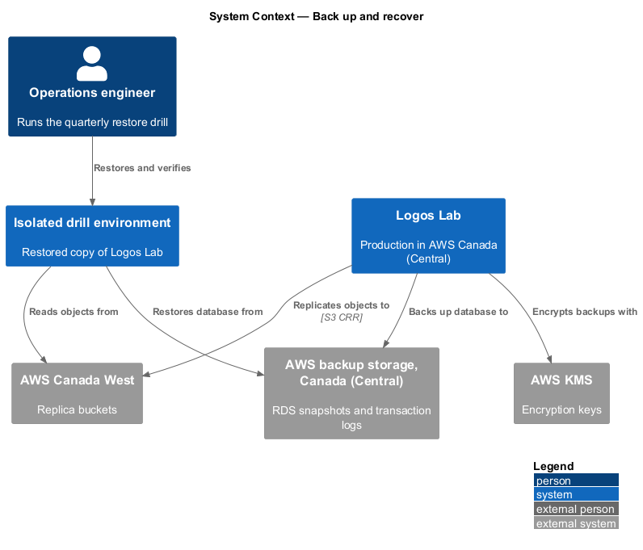
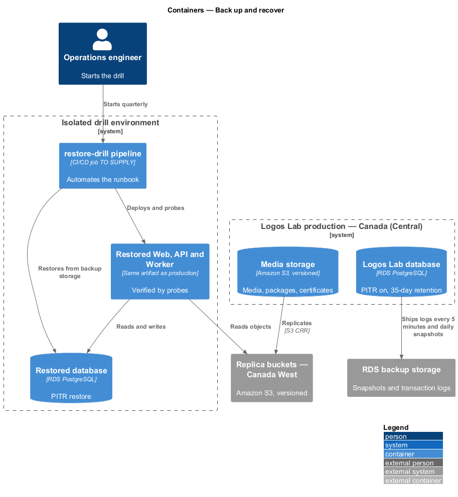
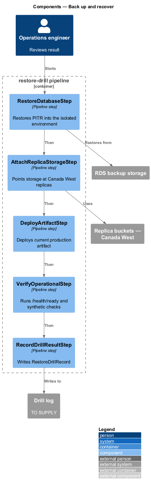
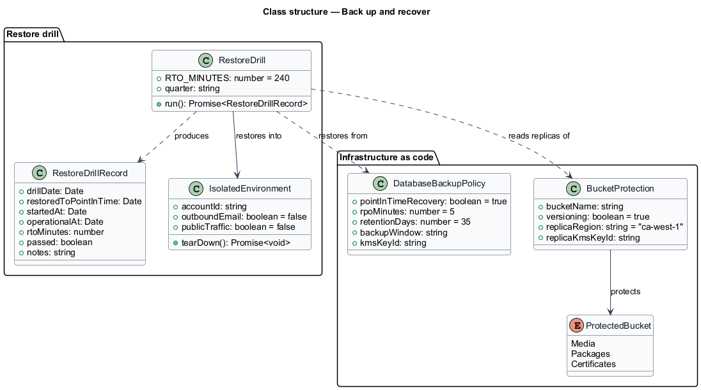
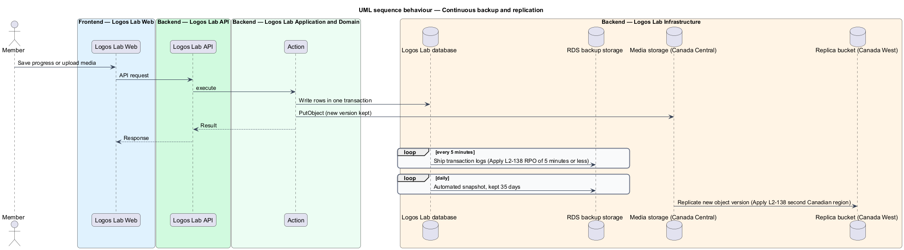
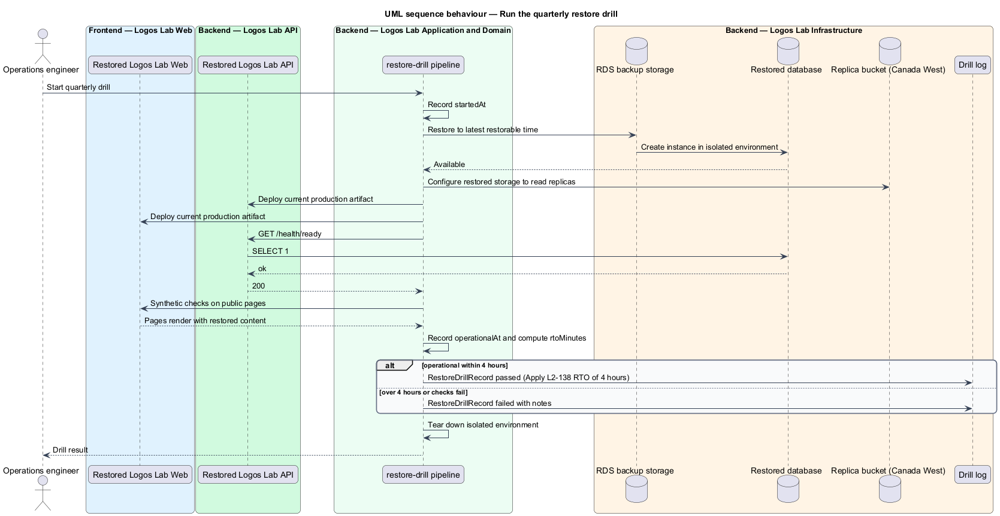

# Back up and recover

## Overview

Logos Lab keeps learner progress, certificates, published content and uploaded media. Losing that data,
or being unable to restore service after a failure, would break trust with learners and experts. This
feature belongs to the operations subsystem and defines how the database and object storage are backed
up, and how the team proves each quarter that the platform can be restored.

The following terms are used throughout:

- **point-in-time recovery (PITR)** — restore of a database to any second inside the retention period, built from a snapshot plus the transaction log
- **recovery point objective (RPO)** — maximum span of data that may be lost, measured back from the moment of failure
- **recovery time objective (RTO)** — maximum time from the decision to restore until the platform is operational again
- **restore drill** — scheduled exercise that restores production backups into an isolated environment and records the outcome
- **isolated environment** — AWS environment with no network path to production and no outbound email, used only for drills

The targets are an RPO of 5 minutes or less, daily snapshots kept for 35 days, and an RTO of 4 hours.
Object storage keeps versions and a copy in a second Canadian region. Backups stay in Canada and are
encrypted (`L2-112`, `L2-113`).

## Description

### Database

- **Amazon RDS automated backups** on the Logos Lab database — PITR enabled. RDS ships transaction logs
  to backup storage every 5 minutes, which meets the RPO of 5 minutes or less.
- **Backup retention** — 35 days. RDS takes one automated snapshot per day inside a backup window of
  `<TO SUPPLY>`, and keeps each for 35 days.
- **Encryption** — snapshots and logs are encrypted with the platform's AWS KMS key.
- **Cross-region snapshot copy** — whether daily snapshots are also copied to Canada West is
  `<TO SUPPLY>`; the specification requires a second region for object storage only.

### Object storage

- **Buckets** — media (images, video sources and renditions), SCORM packages and certificates, all in
  Canada (Central). Exports are short-lived and covered by retention rules (`L2-118`).
- **S3 Versioning** — on for every bucket listed above, so an overwrite or delete keeps the earlier
  version. Lifecycle expiry of non-current versions is `<TO SUPPLY>`.
- **S3 Cross-Region Replication** — each bucket replicates to a bucket in AWS Canada West (Calgary),
  encrypted with a KMS key in that region.

### Restore drill

- **`restore-drill` pipeline** — runbook automated as a pipeline job (tool `<TO SUPPLY>`) run once per
  quarter. It restores the database by PITR into the isolated environment, points that environment's
  storage at the replica buckets in Canada West, deploys the current production artifact, and runs the
  readiness probe (`L2-136`) and synthetic checks against it.
- **`RestoreDrillRecord`** — the recorded result: `drillDate`, `restoredToPointInTime`,
  `startedAt`, `operationalAt`, `rtoMinutes`, `passed` and `notes`. A drill passes when the platform is
  operational within 4 hours. Where the record is kept (for example a drill log in the repository) is
  `<TO SUPPLY>`.
- The isolated environment sends no email and receives no public traffic. It is torn down after the
  drill.

The restore drill is an operations runbook, so it has no member-facing screen and no mock.

## Requirements

| L2 ID | Refines (L1) | Requirement |
|-------|--------------|-------------|
| `L2-138` | `L1-023` | **Backups and disaster recovery.** Data shall be backed up and the platform shall be recoverable. |

## Diagrams

### System context

The operations engineer runs the quarterly drill; Logos Lab stores backups in AWS Canada (Central) and
replicates object storage to AWS Canada West.

### Containers

The database writes continuous backups to RDS backup storage; the buckets replicate to Canada West; the
drill pipeline restores both into the isolated environment.

### Components

The drill pipeline restores the database, attaches the replica buckets, deploys the artifact, checks
readiness and writes a `RestoreDrillRecord`.

### Class structure

The infrastructure definitions are modelled as `DatabaseBackupPolicy` and `BucketProtection`; a
`RestoreDrill` produces a `RestoreDrillRecord` measured against the RTO.

### Behaviour — continuous backup and replication

RDS ships transaction logs every 5 minutes and takes a daily snapshot, while S3 keeps versions and
replicates each new object to Canada West.

### Behaviour — run the quarterly restore drill

The pipeline restores the data into the isolated environment, checks that the platform is operational,
and records whether it met the 4-hour RTO.

