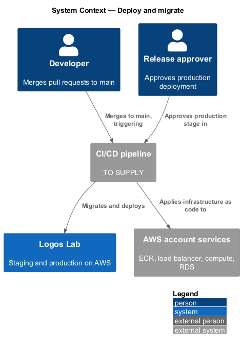
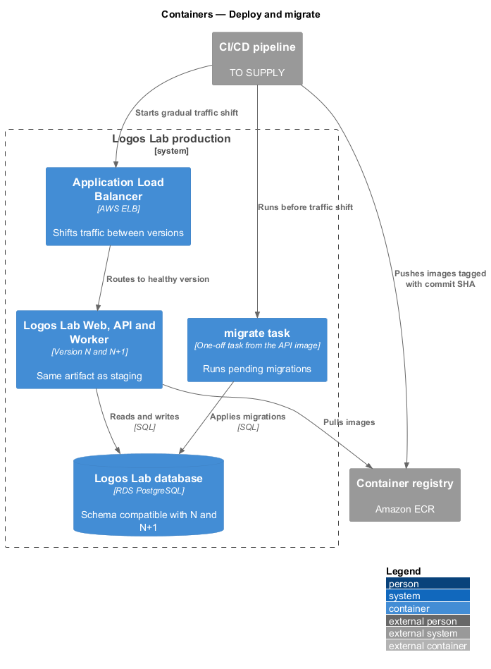
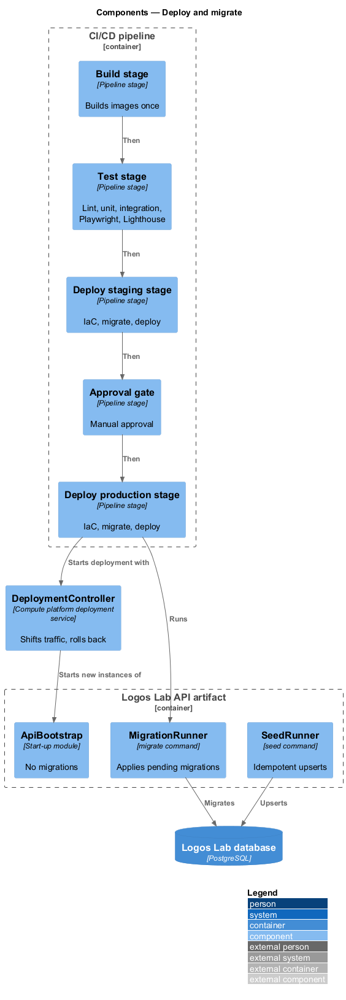
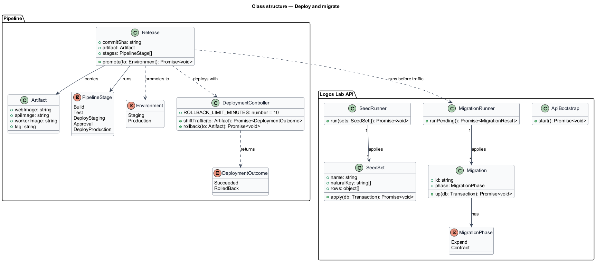
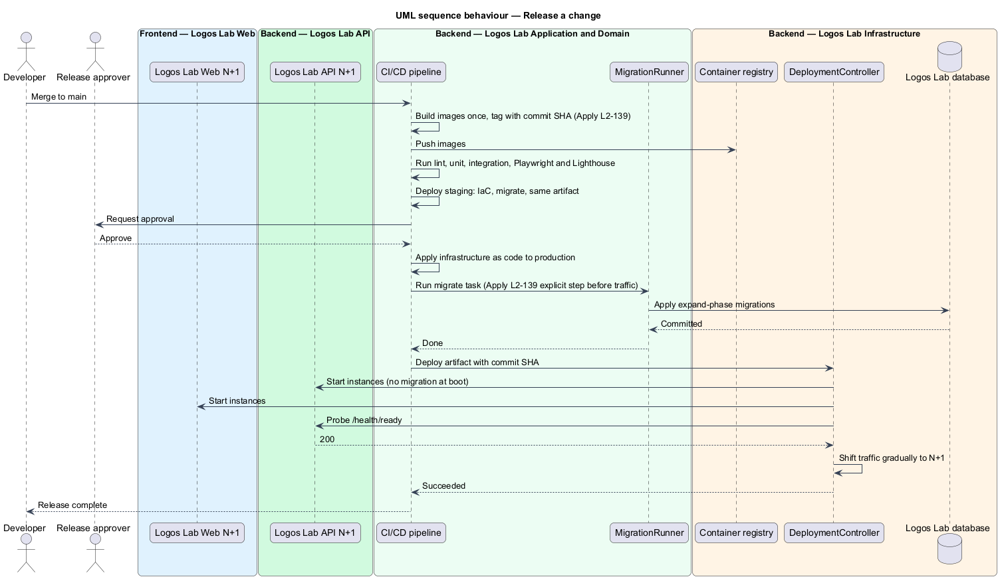
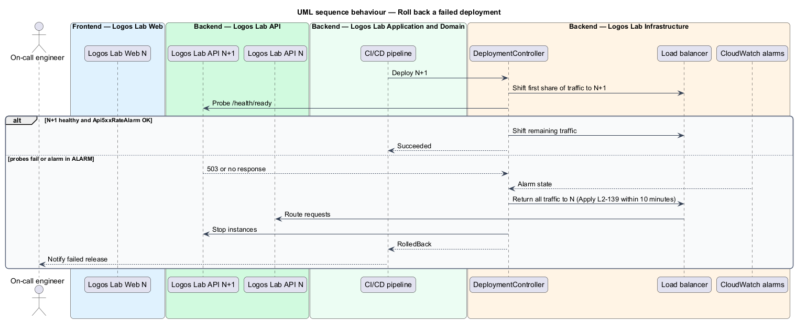
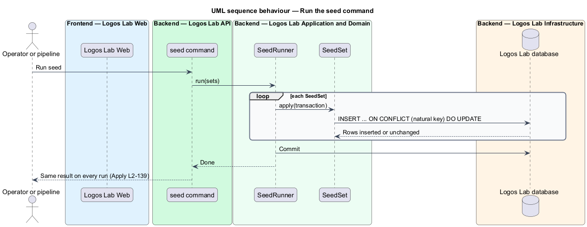

# Deploy and migrate

## Overview

Every change to Logos Lab reaches members through one release pipeline. The pipeline builds the
software once, tests it, and promotes the same build from staging to production. Database schema
changes run as their own explicit step, never as a side effect of the API starting. This feature belongs
to the operations subsystem and defines that pipeline, the migration and seed rules, and automatic
rollback.

The following terms are used throughout:

- **artifact** — immutable, versioned build output (container images and static assets) identified by the commit it was built from
- **infrastructure as code** — definition of every AWS resource in version-controlled source applied by the pipeline
- **migration** — versioned script that changes the database schema or data
- **expand and contract** — migration pattern that first adds new structures alongside old ones, and removes the old ones only in a later release, so both the old and new application versions work during a deployment
- **seed data** — reference data loaded by a seed command, such as roles and the topic taxonomy
- **rollback** — automatic return of traffic to the previously deployed artifact

## Description

### Pipeline

The CI/CD tool is `<TO SUPPLY>`; the infrastructure-as-code tool is `<TO SUPPLY>`. The pipeline runs on
each merge to `main`:

1. **Build** — builds the Logos Lab Web, Logos Lab API and Logos Lab Worker images once, tags each with
   the commit SHA, and pushes them to the container registry (Amazon ECR, baseline choice).
2. **Test** — runs formatting and lint checks, unit tests, API integration tests, Playwright tests in
   Chromium, and the Lighthouse budget check (`L2-120`). Any failure stops the pipeline.
3. **Deploy to staging** — applies infrastructure as code, runs the `migrate` step against the staging
   database, then deploys the tagged artifact.
4. **Approval** — a named approver releases the build to production. Approver group `<TO SUPPLY>`.
5. **Deploy to production** — applies infrastructure as code, runs the `migrate` step, then deploys the
   same tagged artifact with a gradual traffic shift (blue/green, baseline choice).

### Migrations and seed data

- **`migrate` command** — runs pending migrations as a one-off task with the release's artifact, before
  the new version receives traffic. Migration tool `<TO SUPPLY>`.
- **API start-up** — `ApiBootstrap` loads configuration and opens the connection pool. It does not run
  migrations.
- **`MigrationReview` rule** — each migration is backward compatible with the currently deployed
  version (expand and contract). A column rename, for example, becomes add column, back-fill and
  dual-write in one release, then drop the old column in a later release. Review in the pull request
  enforces this.
- **`seed` command** — `SeedRunner` applies each `SeedSet` with upserts keyed by natural keys
  (`INSERT ... ON CONFLICT ... DO UPDATE`). Running it more than once gives the same result as running
  it once.

### Rollback

- **`DeploymentController`** — the deployment service of the compute platform (`<TO SUPPLY>`). It
  shifts traffic to the new version only while its instances pass `/health/ready` (`L2-136`) and the
  `Api5xxRateAlarm` stays in `OK`.
- When health checks fail, the controller returns all traffic to the previous artifact within 10
  minutes. Because migrations follow expand and contract, the previous artifact still runs against the
  migrated schema.

The pipeline has no member-facing screen and no mock.

## Requirements

| L2 ID | Refines (L1) | Requirement |
|-------|--------------|-------------|
| `L2-139` | `L1-023` | **Deployment and database migrations.** Releases shall be repeatable and shall not cause downtime. Migrations run explicitly. |

## Diagrams

### System context

A developer merges to `main`, the CI/CD pipeline builds and tests the change, an approver releases it,
and the pipeline deploys it to AWS.

### Containers

The pipeline pushes one set of images to the registry, applies infrastructure as code, runs the
`migrate` task against the database, and shifts load-balancer traffic to the new version.

### Components

The pipeline stages run in order; the migrate and seed commands are separate entry points of the API
artifact, and `ApiBootstrap` performs no migration.

### Class structure

A `Release` carries one `Artifact` through ordered `PipelineStage` values; `MigrationRunner` applies
`Migration` scripts and `SeedRunner` applies idempotent `SeedSet` upserts.

### Behaviour — release a change

The pipeline builds once, tests, deploys to staging, waits for approval, migrates production and then
shifts traffic to the same artifact.

### Behaviour — roll back a failed deployment

When the new version fails health checks during the traffic shift, the controller returns traffic to
the previous version within 10 minutes.

### Behaviour — run the seed command

Each seed set upserts by natural key, so a second run changes nothing.

