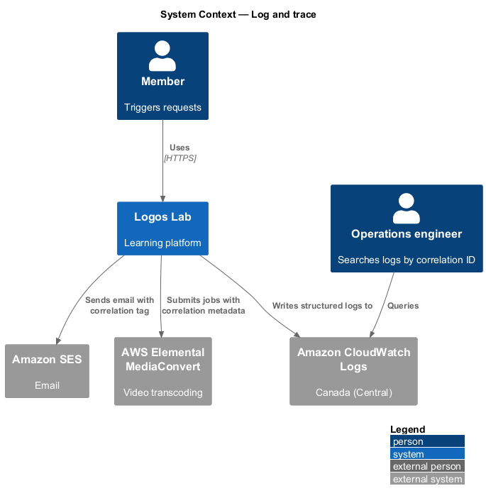
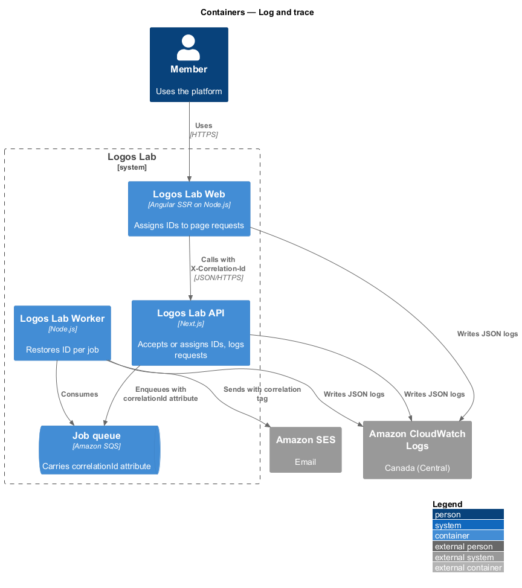
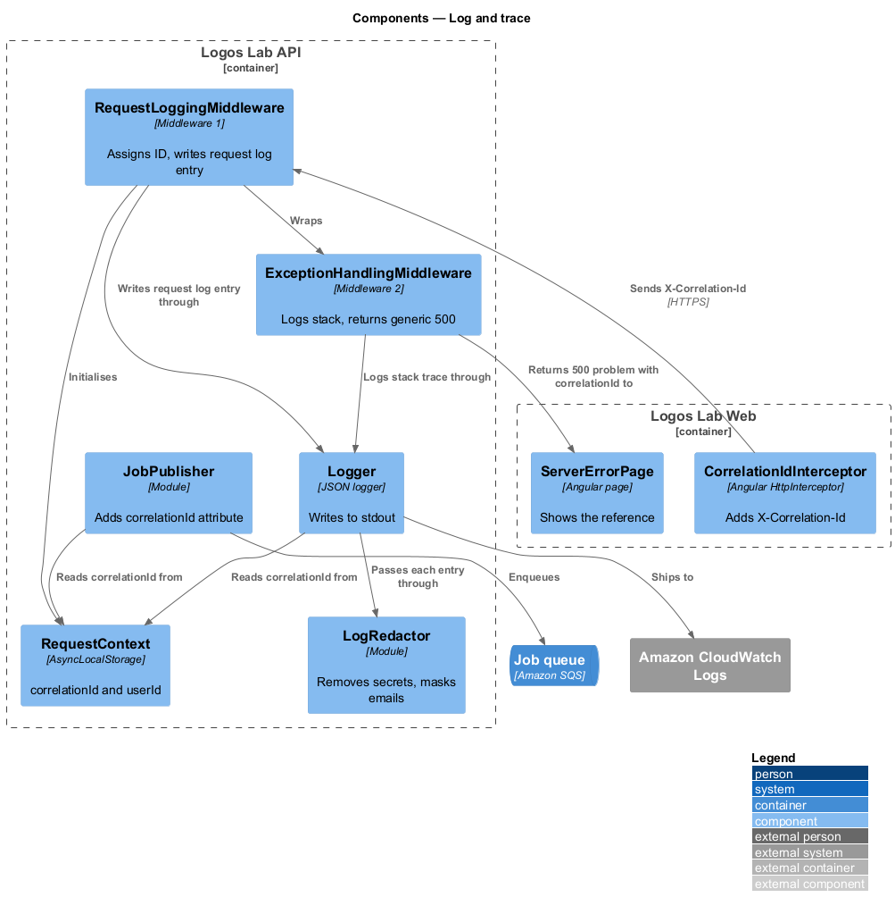
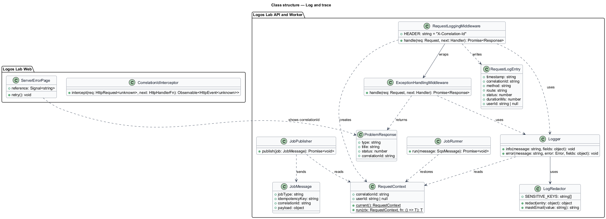
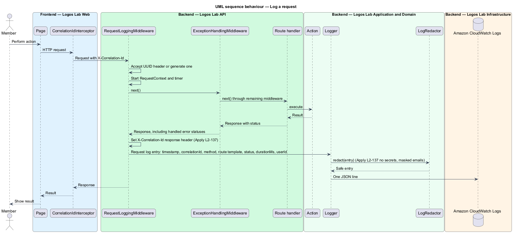
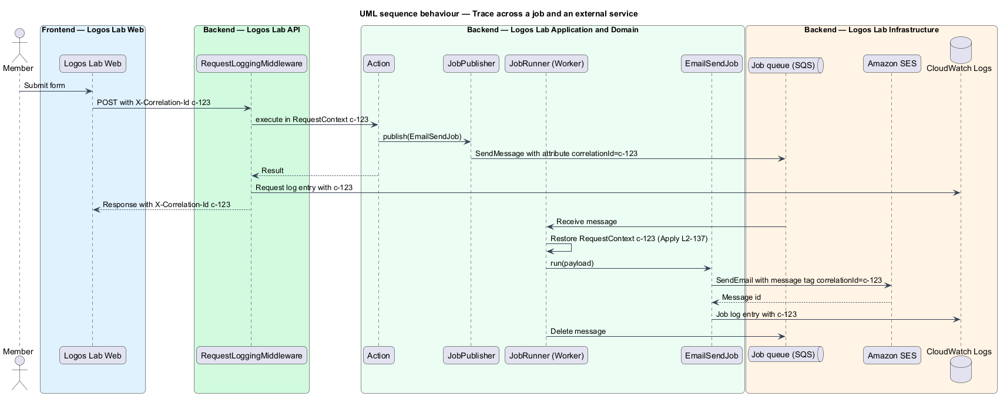
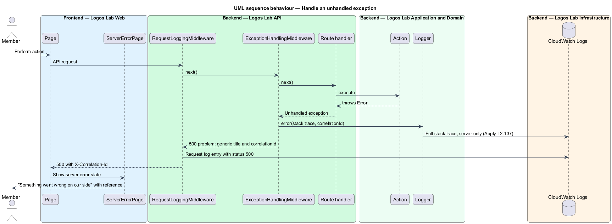

# Log and trace

## Overview

A single member action on Logos Lab can pass through the server-rendered web application, the API, a
background job and an external service such as Amazon SES. When something goes wrong, the operations
team follows that action across every hop. This feature belongs to the operations subsystem and defines
how each container writes logs and how one identifier ties them together.

The following terms are used throughout:

- **structured log entry** — log record written as one JSON object with named fields rather than free text
- **correlation ID** — opaque identifier assigned to one logical request and carried to every log entry, job and external call it causes
- **request log entry** — structured log entry written once per HTTP request after the response status is known
- **redaction** — removal or masking of sensitive values before a log entry is written

The request-logging middleware is the outermost layer of the API middleware pipeline, outside exception
handling, so that statuses set by the exception handler are logged. The server-error page that shows the
correlation ID to the member belongs to the show-error-pages feature (`L2-141`). Security events use the
same logger and are covered by `L2-111`.

## Description

### Correlation

- **`CorrelationIdInterceptor`** — Angular `HttpInterceptor` in `projects/api`. It adds an
  `X-Correlation-Id` header to each API request, reusing the ID of the server-side render when the call
  happens during SSR, and generating a UUID in the browser otherwise.
- **SSR request logger** — Express middleware in the Logos Lab Web server (`server.ts`). It assigns a
  correlation ID to each page request and writes a request log entry with the same fields as the API.
- **`RequestContext`** — `AsyncLocalStorage` store in the API and Worker holding `correlationId` and
  `userId`. Every log call reads it.
- **`RequestLoggingMiddleware`** — first API middleware. It accepts an incoming `X-Correlation-Id` that
  matches the UUID format and otherwise generates a new UUID. It sets the `X-Correlation-Id` response
  header and, after the response completes, writes one request log entry.
- **`JobPublisher`** — adds `correlationId` as an SQS message attribute. **`JobRunner`** in the Worker
  restores it into `RequestContext` before the job runs (`L2-140`).
- **External calls** — the SES client sends the correlation ID as a message tag, and the MediaConvert
  client sends it as job user metadata, so provider events link back to the same ID.

### Log entries

- **Request log entry fields** — `timestamp`, `correlationId`, `method`, `route` (the route template,
  such as `/api/v1/courses/[slug]`, never the raw path), `status`, `durationMs` and `userId` when a
  session exists.
- **`Logger`** — shared JSON logger (library `<TO SUPPLY>`) used by Web server, API and Worker. It
  writes to standard output, which ships to Amazon CloudWatch Logs in Canada (Central) (`L2-113`).
  Retention is `<TO SUPPLY>`.
- **`LogRedactor`** — runs on every entry before it is written. It removes values for keys matching
  `password`, `token`, `secret`, `cookie`, `authorization`, `set-cookie`, `emailBody` and
  `messageBody`, and masks email addresses to the first character of the local part and the domain
  (for example `a***@example.org`). Logs never carry request or response bodies.

### Unhandled exceptions

- **`ExceptionHandlingMiddleware`** — second API middleware. It catches any unhandled exception, logs
  the full stack trace at `error` level with the correlation ID, and returns an RFC 9457 problem
  response with status `500`, a generic title and a `correlationId` extension member. The response never
  contains the stack trace or the exception message.
- **`ServerErrorPage`** — Logos Lab Web page shown for a `500` (`docs/mocks/pages/server-error/`), built
  from `ll-error-page` and `ll-button`. It shows "Something went wrong on our side" and a reference the
  member quotes to `help@logoslab.ca`. The mock shows a short reference (`7f3a-91c2`); whether the page
  shows the full correlation ID or a shortened form is `<TO SUPPLY>`.

## Requirements

| L2 ID | Refines (L1) | Requirement |
|-------|--------------|-------------|
| `L2-137` | `L1-023` | **Structured logging and tracing.** Logs shall be structured, correlated and free of sensitive data. |

## Diagrams

### System context

Logos Lab writes all logs to Amazon CloudWatch Logs and passes the correlation ID to Amazon SES and AWS
Elemental MediaConvert.

### Containers

The correlation ID travels from the web server to the API in a header, from the API to the Worker in an
SQS message attribute, and from the Worker to external services as tags.

### Components

Inside the API, `RequestLoggingMiddleware` wraps `ExceptionHandlingMiddleware`, and every log entry
passes through `LogRedactor` before the `Logger` writes it.

### Class structure

`RequestContext` holds the correlation ID that the middleware, `Logger`, `JobPublisher` and `JobRunner`
read; `RequestLogEntry` names the fields of each request log entry.

### Behaviour — log a request

The middleware assigns or accepts the correlation ID, returns it in `X-Correlation-Id`, and writes one
redacted request log entry after the status is final.

### Behaviour — trace across a job and an external service

The same correlation ID appears in the API entry, the job message, the Worker entries and the SES
message tag.

### Behaviour — handle an unhandled exception

The exception handler logs the stack trace on the server only and returns a generic `500` with the
correlation ID, which the server-error page shows as the reference.

