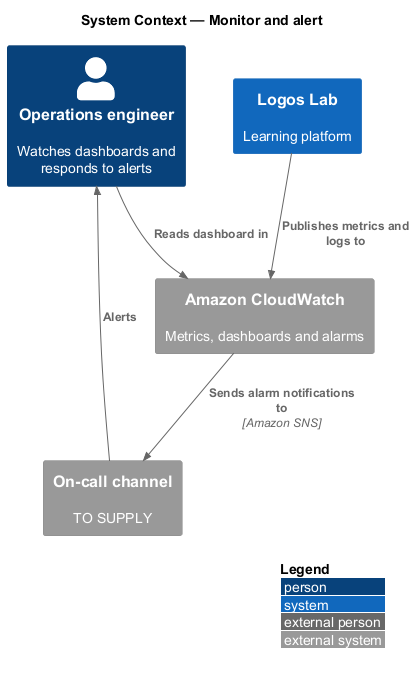
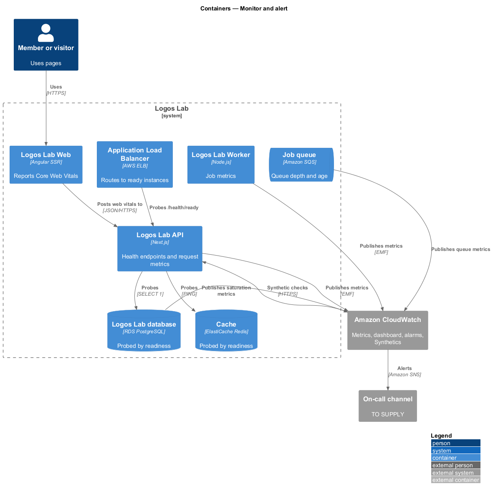
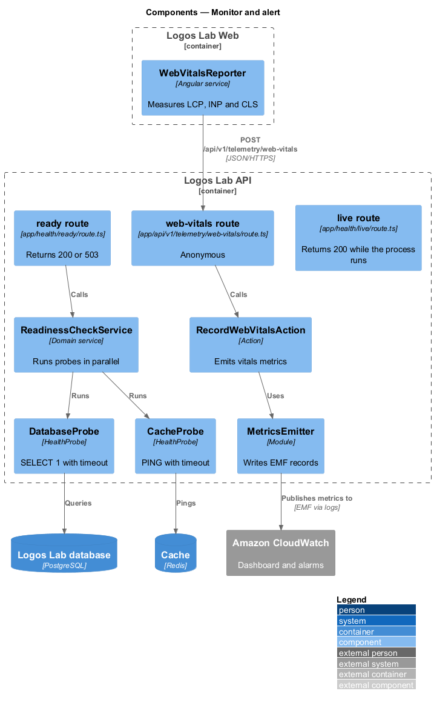
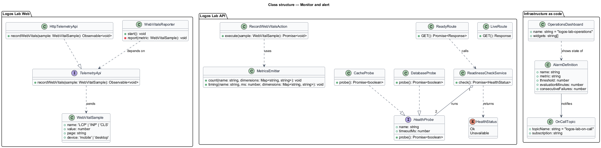
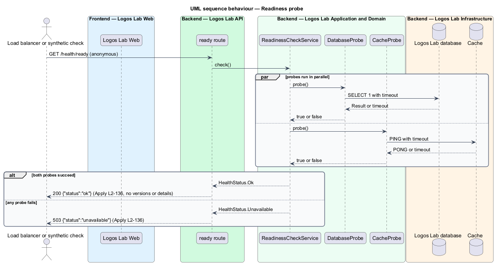
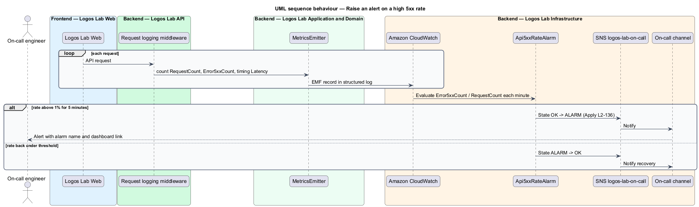

# Monitor and alert

## Overview

Logos Lab runs several containers on AWS: the Angular web application, the Next.js API, a background
Worker, a PostgreSQL database, a Redis cache and an SQS job queue. When one of them degrades, the
operations team learns about it from the platform itself rather than from members. This feature belongs
to the operations subsystem and covers three mechanisms: health endpoints, operational dashboards and
alarms that page the on-call channel.

The following terms are used throughout:

- **liveness probe** — health endpoint that answers whether the API process is running
- **readiness probe** — health endpoint that answers whether the API can serve traffic, which requires a reachable database and cache
- **saturation** — degree to which a finite resource (CPU, memory, database connections) is in use
- **alarm** — CloudWatch rule that watches one metric over a time window and changes state when a threshold is crossed
- **on-call channel** — destination that receives alarm notifications for the person on call (`<TO SUPPLY>`)

The load balancer and the external synthetic checks of the stay-available feature (`L2-135`) both use
the readiness probe. Dead-letter queue alarms for background jobs are defined in the run-background-jobs
feature (`L2-140`); this feature owns the shared alarm-to-on-call route.

## Description

### Health endpoints

- **`GET /health/live`** — route handler `app/health/live/route.ts`, anonymous. It returns `200` with
  the body `{"status":"ok"}` while the process runs. It touches no dependency.
- **`GET /health/ready`** — route handler `app/health/ready/route.ts`, anonymous. It calls
  `ReadinessCheckService`, which runs `DatabaseProbe` (`SELECT 1`) and `CacheProbe` (Redis `PING`) in
  parallel, each with a timeout of `<TO SUPPLY>`. It returns `200` with `{"status":"ok"}` only if both
  succeed, and `503` with `{"status":"unavailable"}` otherwise.
- Neither endpoint reveals versions, host names, dependency names, error messages or stack traces.
  Both are excluded from rate limiting and authentication, and from request-log sampling rules
  `<TO SUPPLY>`.

### Metrics and dashboard

- **`MetricsEmitter`** — API and Worker module that writes CloudWatch Embedded Metric Format records
  through the structured logger (`L2-137`). Metrics: `RequestCount`, `Error5xxCount` and `Latency` with
  dimensions `route` and `kind` (`read` or `write`).
- **AWS-provided metrics** — RDS `CPUUtilization`, `FreeableMemory` and `DatabaseConnections`; compute
  CPU and memory; SQS `ApproximateNumberOfMessagesVisible` and `ApproximateAgeOfOldestMessage`.
- **`WebVitalsReporter`** — Logos Lab Web service that reads Largest Contentful Paint, Interaction to
  Next Paint and Cumulative Layout Shift in the browser and posts them, without user identifiers, to
  `POST /api/v1/telemetry/web-vitals` (anonymous). `RecordWebVitalsAction` emits them as metrics with
  dimensions `page` and `device` (`mobile` or `desktop`). The same data feeds the Core Web Vitals
  requirement (`L2-120`).
- **`logos-lab-operations` dashboard** — CloudWatch dashboard defined as code. It shows request rate,
  error rate, latency percentiles (p50, p95, p99), saturation (CPU, memory, database connections), job
  queue depth and Core Web Vitals.

### Alarms

Each alarm publishes to the SNS topic `logos-lab-on-call`, which forwards to the on-call channel.

| Alarm | Condition |
|-------|-----------|
| `Api5xxRateAlarm` | `Error5xxCount / RequestCount` above 1% for 5 minutes |
| `ApiReadLatencyAlarm` | p95 read latency above 600 ms (twice the 300 ms budget in `L2-121`) for 10 minutes |
| `ApiWriteLatencyAlarm` | p95 write latency above 1,000 ms (twice the 500 ms budget in `L2-121`) for 10 minutes |
| `SyntheticCheckAlarm` | an external synthetic check fails twice in a row |
| `JobQueueAgeAlarm` | `ApproximateAgeOfOldestMessage` on any job queue above 15 minutes |

The alarm-to-channel integration (for example chat or paging tool) is `<TO SUPPLY>`. Dashboards and
alarms are defined in infrastructure as code with the rest of the platform (`L2-139`).

There is no member-facing screen for this feature, so no mock applies.

## Requirements

| L2 ID | Refines (L1) | Requirement |
|-------|--------------|-------------|
| `L2-136` | `L1-023` | **Health checks, monitoring and alerting.** The platform shall expose its health and shall alert on problems. |

## Diagrams

### System context

Logos Lab sends metrics to Amazon CloudWatch, which evaluates alarms and notifies the on-call channel;
the operations engineer reads the dashboard.

### Containers

The load balancer and canaries call the API health endpoints; the API, Worker, database and queue
publish metrics to CloudWatch, and the web application reports Core Web Vitals through the API.

### Components

The readiness route calls `ReadinessCheckService`, which runs one probe per dependency; `MetricsEmitter`
and `RecordWebVitalsAction` publish metrics that the alarms evaluate.

### Class structure

`ReadinessCheckService` aggregates `HealthProbe` implementations into a `HealthStatus`; alarms are
modelled as `AlarmDefinition` values that publish to one `OnCallTopic`.

### Behaviour — readiness probe

The readiness endpoint returns `200` only when both probes succeed and `503` otherwise, with a body
that names no dependency.

### Behaviour — raise an alert

Request metrics flow into CloudWatch; when the 5xx rate stays above 1% for 5 minutes the alarm fires and
the on-call channel is notified, and it notifies again on recovery.

