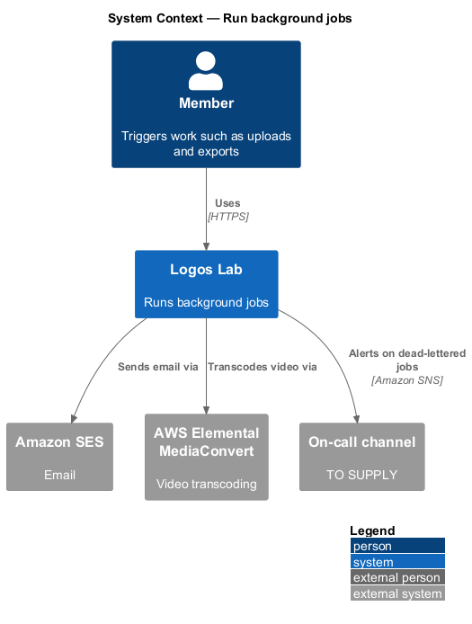
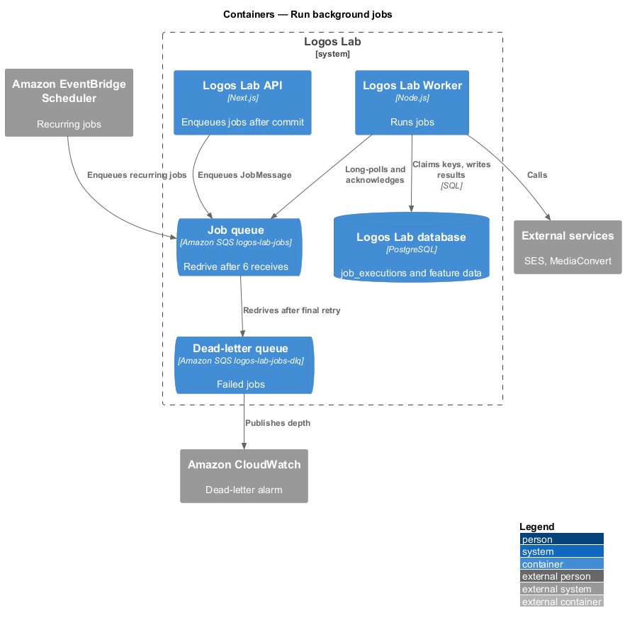
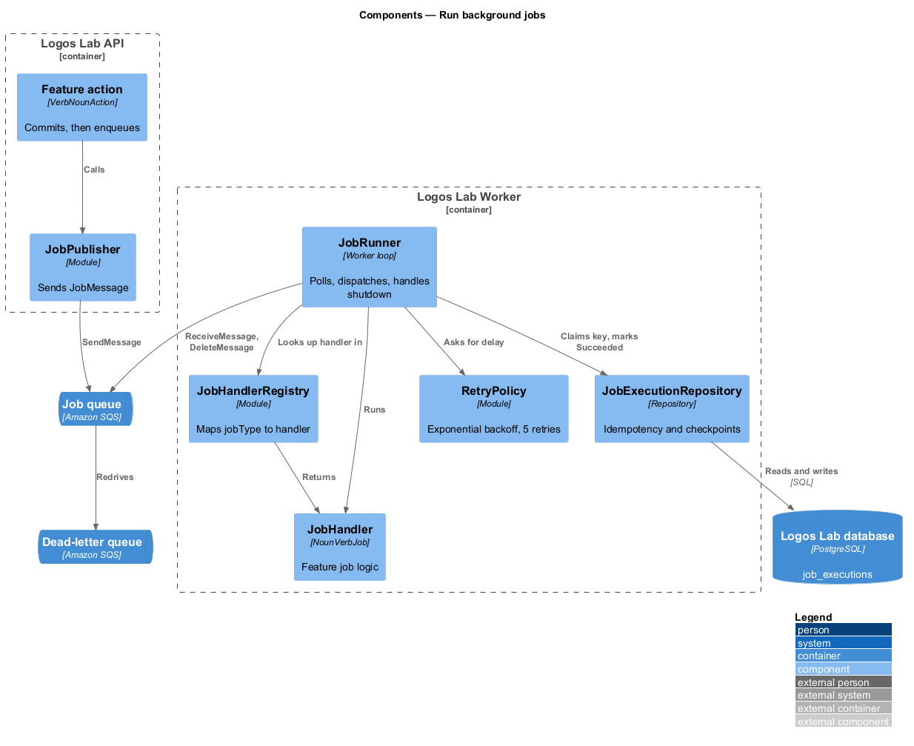
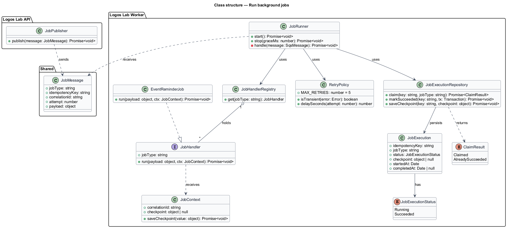
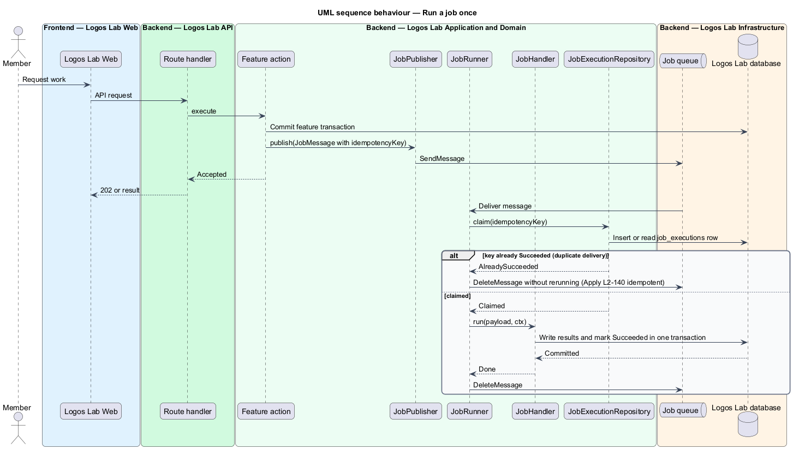
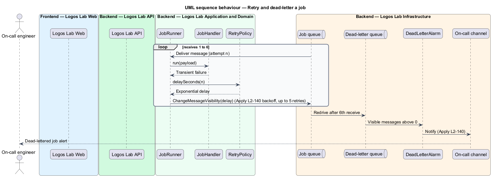
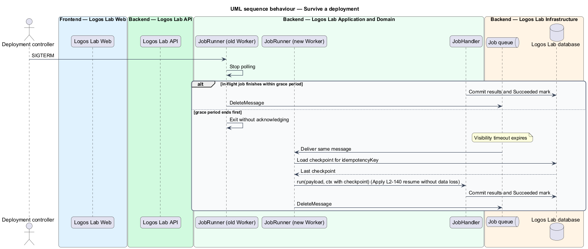

# Run background jobs

## Overview

Some work on Logos Lab is too slow or too failure-prone to run inside a web request: transcoding a
video, sending email, sending event reminders, publishing scheduled content, building data exports and
applying retention rules. The API hands this work to a separate Worker through a queue. This feature
belongs to the operations subsystem and defines the shared job mechanism that every such feature uses.

The following terms are used throughout:

- **job** — unit of background work with a type and a payload, run by the Worker
- **idempotent job** — job whose outcome is the same whether it runs once or more than once for the same input
- **idempotency key** — value derived from a job's type and input that identifies repeated runs of the same work
- **transient failure** — failure expected to clear on its own, such as a timeout or a throttled call to an AWS service
- **dead-letter queue** — queue that receives a job after its final retry fails, for inspection and replay

Each job is idempotent, retried with exponential backoff up to 5 times, and then moved to a dead-letter
queue that alerts the on-call channel. A deployment that interrupts a job loses no data. The job types
themselves belong to their own features; this design covers the mechanism they share.

## Description

### Enqueueing

- **`JobPublisher`** — API module that sends a `JobMessage` to the job queue. An action enqueues a job
  only after its own transaction commits, so a rolled-back action creates no job. The mechanism for this
  (for example a transactional outbox) is `<TO SUPPLY>`.
- **`JobMessage`** — `jobType`, `idempotencyKey`, `correlationId` (`L2-137`), `attempt` and `payload`.
- **Job queue** — Amazon SQS standard queue `logos-lab-jobs` (baseline choice), with redrive to
  `logos-lab-jobs-dlq`. Whether some job types use separate queues is `<TO SUPPLY>`.
- **`JobScheduler`** — Amazon EventBridge Scheduler rules (baseline choice) that enqueue recurring jobs
  such as reminders, scheduled publishing and retention. Their cadences belong to the owning features.

### Running

- **`JobRunner`** — Worker loop that long-polls the queue, restores `RequestContext`, looks up the
  `JobHandler` for `jobType`, and runs it.
- **`JobHandler`** — interface each job implements, named `<Noun><Verb>Job` in the owning feature (for
  example `EventReminderJob`).
- **`JobExecutionRepository`** — table `job_executions` with a unique `idempotency_key`, `job_type`,
  `status` (`Running`, `Succeeded`), `checkpoint` and timestamps. Before running, the runner claims the
  key. A key already marked `Succeeded` causes the runner to acknowledge the message without running
  the job again. A job's database writes and its `Succeeded` mark commit in one transaction.
- **External side effects** — a job that calls an external service passes the idempotency key or a
  derived id where the service supports it, and records the external reference before it marks the
  run `Succeeded`.

### Retries and dead letters

- **`RetryPolicy`** — on a transient failure, the runner changes the message visibility timeout to an
  exponential delay (base delay and cap `<TO SUPPLY>`) and lets it return to the queue. After 5 retries
  (6 receives in all), the SQS redrive policy moves the message to `logos-lab-jobs-dlq`.
- A non-transient failure (for example invalid payload) goes straight to the dead-letter queue.
- **`DeadLetterAlarm`** — CloudWatch alarm on `ApproximateNumberOfMessagesVisible` above 0 for the
  dead-letter queue. It notifies the on-call channel through the `logos-lab-on-call` topic (`L2-136`).
  Replay of dead-lettered jobs is a manual operation through a redrive.

### Deployments

- On `SIGTERM`, `JobRunner` stops polling and gives in-flight jobs a grace period (`<TO SUPPLY>`) to
  finish.
- A job still running at the end of the grace period is not acknowledged. Its message becomes visible
  again after the visibility timeout, and a new Worker reruns it. Idempotency makes the rerun safe.
- Long jobs (for example exports) save a `checkpoint` in `job_executions` and resume from it.

The job mechanism has no member-facing screen and no mock; each owning feature shows its own job states.

## Requirements

| L2 ID | Refines (L1) | Requirement |
|-------|--------------|-------------|
| `L2-140` | `L1-023` | **Background jobs.** Background work (media processing, emails, reminders, scheduled publishing, exports, retention) shall be reliable. |

## Diagrams

### System context

Logos Lab runs background jobs that call external services such as Amazon SES and AWS Elemental
MediaConvert, and dead-lettered jobs alert the on-call channel.

### Containers

The API and the scheduler enqueue to the job queue; the Worker consumes it, writes to the database, and
failed jobs move to the dead-letter queue.

### Components

`JobRunner` claims an idempotency key through `JobExecutionRepository`, dispatches to a `JobHandler`,
and applies `RetryPolicy` on failure.

### Class structure

`JobRunner` depends on the `JobHandler` interface, `RetryPolicy` and `JobExecutionRepository`;
`JobExecution` records the status and checkpoint of each idempotency key.

### Behaviour — run a job once

The runner claims the idempotency key, runs the handler and commits its writes with the `Succeeded`
mark; a duplicate delivery is acknowledged without rerunning.

### Behaviour — retry and dead-letter

A transient failure is retried with exponential backoff up to 5 times; the sixth failure moves the job
to the dead-letter queue, which alerts the on-call channel.

### Behaviour — survive a deployment

On shutdown the runner stops polling and lets in-flight jobs finish; an unfinished job reappears and
resumes from its checkpoint on a new Worker.

