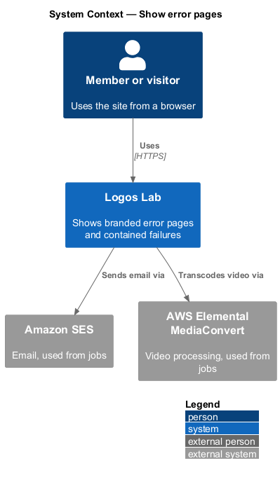
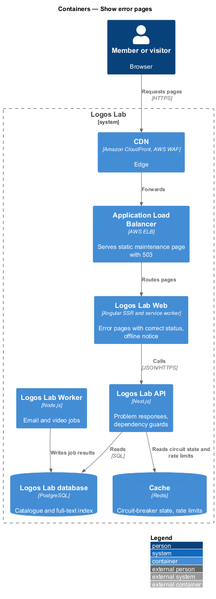
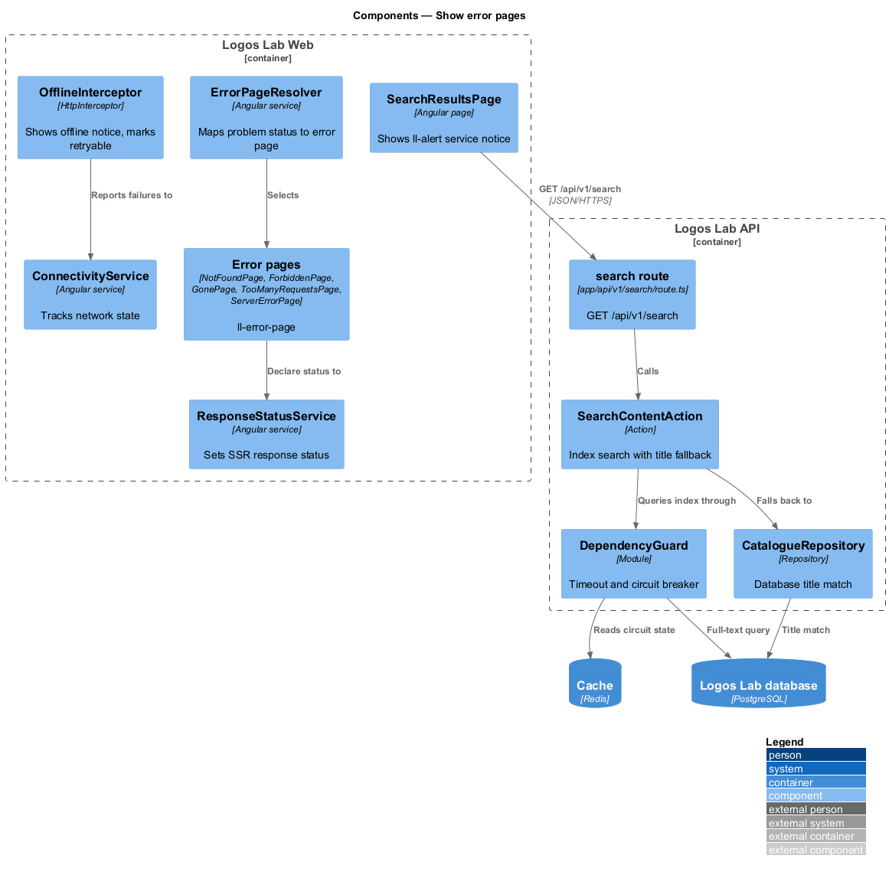
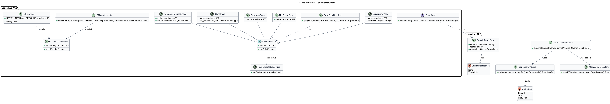
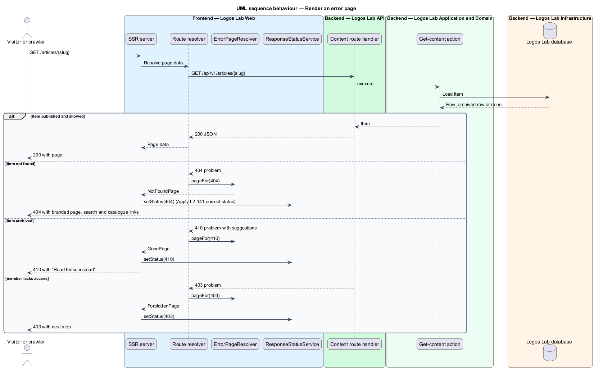
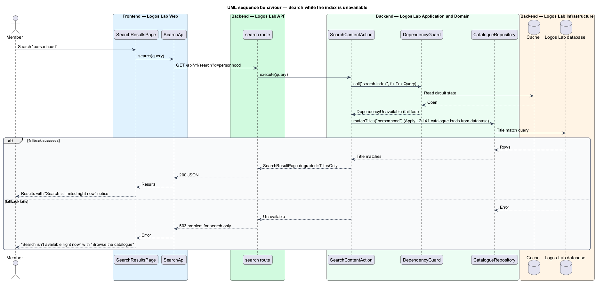
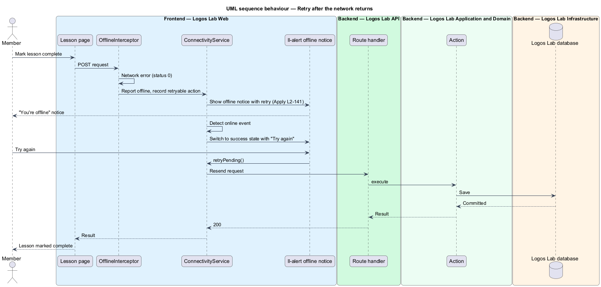

# Show error pages

## Overview

Requests on Logos Lab sometimes fail: a link is old, a member lacks access, an item was archived, a
connection sends too many requests, the server hits a bug, a dependency is down, or the member's network
drops. In each case the member sees a branded page or notice that says what happened in plain language
and offers a next step. Search engines and browsers also receive the correct HTTP status. This feature
belongs to the operations subsystem and covers both the error pages and graceful degradation.

The following terms are used throughout:

- **error page** — full page that replaces the requested content and states a failure, its cause and a next step
- **graceful degradation** — behaviour in which a failing dependency affects only the features that use it, while the rest of the platform keeps working
- **inline error state** — error message shown inside the affected part of a page instead of a full error page
- **service notice** — alert shown at the top of an affected feature while one of its dependencies is limited or unavailable
- **offline notice** — banner shown when the member's browser has lost its network connection

Correlation IDs on the server-error page come from the log-and-trace feature (`L2-137`). The maintenance
page appears during announced windows from the stay-available feature (`L2-135`). Gone pages for
archived items pair with the redirect rules of the keep-stable-urls feature (`L2-146`).

## Description

### Error pages

Each page is a Logos Lab Web component built from `ll-error-page` (BEM `error-page`, `error-page__code`,
`error-page__title`, `error-page__text`, `error-page__actions`) and `ll-button`.

| Page | Status | Mock | Next step offered |
|------|--------|------|-------------------|
| `NotFoundPage` | `404` | `docs/mocks/pages/not-found/` (default, signed-in) | Search box, "Go to the home page", "Browse the catalogue" |
| `ForbiddenPage` | `403` | `docs/mocks/pages/forbidden/` | "Go to your dashboard", contact help |
| `GonePage` | `410` | `docs/mocks/pages/gone/` | "Browse the catalogue" and "Read these instead" cards (`ll-content-card`) |
| `TooManyRequestsPage` | `429` | `docs/mocks/pages/too-many-requests/` | "Try again" after the `Retry-After` wait |
| `ServerErrorPage` | `500` | `docs/mocks/pages/server-error/` | "Try again", "Go to your dashboard", reference for `help@logoslab.ca` |
| `MaintenancePage` | `503` | `docs/mocks/pages/maintenance/` | Return time and contact help |
| `OfflinePage` | none | `docs/mocks/pages/offline/` (default, retrying) | "Try again"; automatic retry every 15 seconds, as the mock states |

- **`ErrorPageResolver`** — maps an API problem response status (`403`, `404`, `410`, `429`, `5xx`)
  from a route resolver to the matching page component. The page renders in place, so the URL stays the
  requested one.
- **`ResponseStatusService`** — Logos Lab Web service that, during server-side rendering, sets the HTTP
  status of the SSR response to the page's status (`L2-142`). In the browser it does nothing.
- **Unknown routes** — the router's wildcard route renders `NotFoundPage` with `404`.
- **`429`** — the API rate limiter returns `Retry-After`; `TooManyRequestsPage` reads it to word the
  wait and enable "Try again".
- **`503` during maintenance** — the load balancer serves a static copy of `MaintenancePage` with
  status `503` and a `Retry-After` header while maintenance mode is on (baseline choice).

### Graceful degradation

- **`DependencyGuard`** — API module that wraps each call to an optional dependency (search index,
  video processing, email) with a timeout and a circuit breaker whose state lives in the cache.
  Thresholds are `<TO SUPPLY>`. When the circuit is open, the call fails fast with a
  `DependencyUnavailable` error and the request does not wait.
- **Search** — `SearchContentAction` queries the full-text index. On `DependencyUnavailable` it falls
  back to `CatalogueRepository.matchTitles`, which matches titles from the database, and returns
  `degraded: "titles-only"`. If the fallback also fails, it returns a `503` problem response for search
  only.
- **Catalogue** — `/explore` loads from the database through `CatalogueRepository` and does not depend
  on the search index, so it keeps working when search is down.
- **`ll-alert` service notice** — `SearchResultsPage` shows "Search is limited right now" (warning) for
  titles-only results and "Search isn't available right now" (danger) with "Browse the catalogue" when
  search fails (`docs/mocks/notifications/service-notice/`, states warning, danger and with-action;
  `docs/mocks/pages/search-results/` states partial and error).
- **Email** — sending runs in background jobs (`L2-140`), so an Amazon SES outage delays email but
  never fails the member's request.
- **Video processing** — transcoding runs in background jobs; while AWS Elemental MediaConvert is
  unavailable, the affected video shows an inline error state in the Studio and other pages keep
  working.

### Offline

- **`ConnectivityService`** — Logos Lab Web service that tracks `navigator.onLine` and requests that
  fail with status `0`.
- **`OfflineInterceptor`** — when a request fails because the network is down, it records the action as
  retryable and shows the offline notice. Whether non-idempotent writes are queued for automatic replay
  or wait for the member to press retry is `<TO SUPPLY>`.
- **`ll-alert` offline notice** — banner variant (BEM `banner banner--warning`) shown on the current page
  (`docs/mocks/notifications/offline-notice/`, states warning, with-action, persistent and success).
  When the connection returns, the banner turns to success and the action can be retried.
- **`OfflinePage`** — shown when navigation fails with no connection. Serving it offline needs a cached
  copy, provided by the Angular service worker (baseline choice).

## Requirements

| L2 ID | Refines (L1) | Requirement |
|-------|--------------|-------------|
| `L2-141` | `L1-023` | **Error pages and graceful degradation.** Users shall see helpful states when something fails, and failures shall stay contained. |

## Diagrams

### System context

Members reach Logos Lab through their browser; Logos Lab depends on Amazon SES and AWS Elemental
MediaConvert, whose failures stay contained to the features that use them.

### Containers

Logos Lab Web renders error pages with the correct status during SSR; the API guards optional
dependencies; the load balancer serves the maintenance page.

### Components

`ErrorPageResolver` and `ResponseStatusService` handle full-page errors in the web application, while
`DependencyGuard` and the search fallback in the API keep search usable when the index fails.

### Class structure

Every error page extends a shared `ErrorPageBase` that declares its status; the API side models the
search result with a `SearchDegradation` value and the guard with a `CircuitState`.

### Behaviour — render an error page

The SSR server resolves the page data, maps a `404`, `403` or `410` problem response to the matching
error page, and returns that status with the branded page.

### Behaviour — search while the index is unavailable

The guard fails fast, the action falls back to title matching from the database, and the page shows the
"Search is limited right now" notice.

### Behaviour — retry after the network returns

An action that fails offline shows the offline notice; when the connection returns, the notice changes
and the member retries the action.

