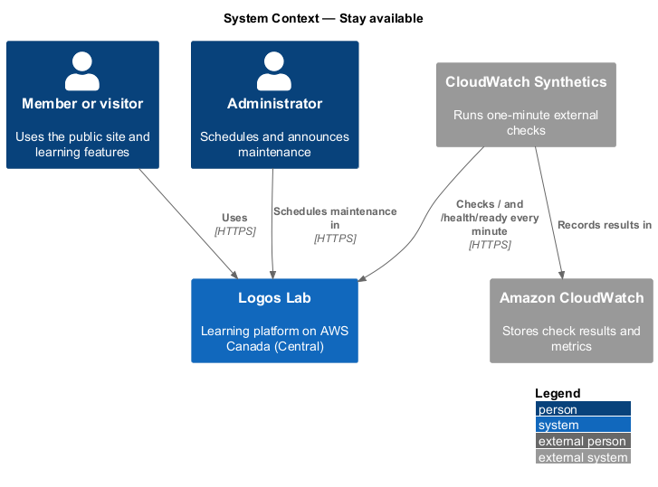
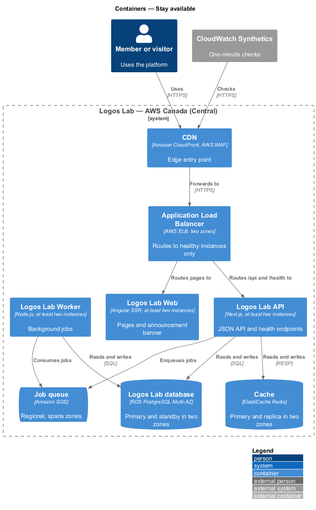
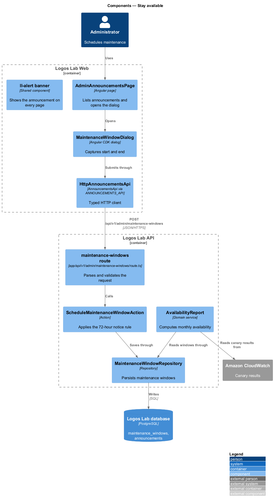
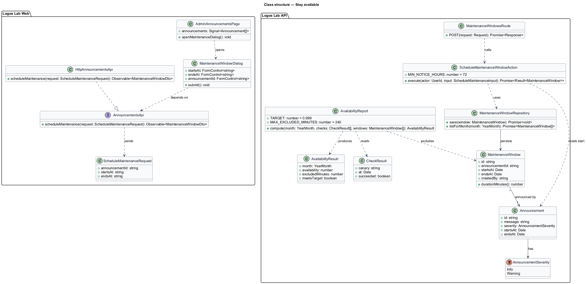
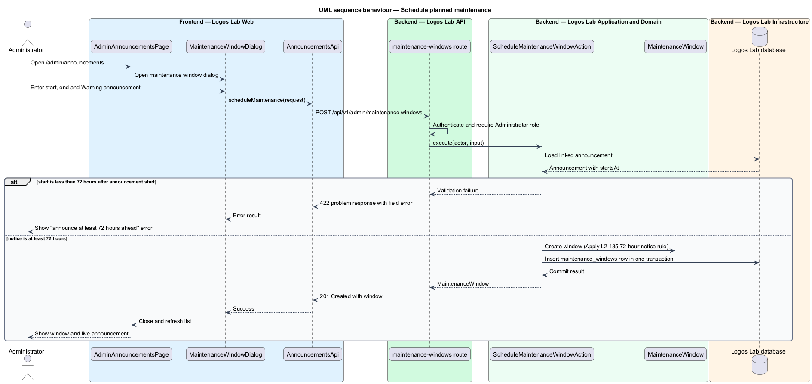
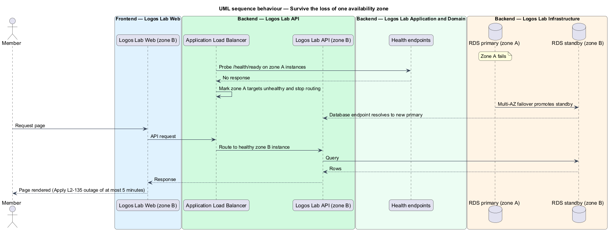
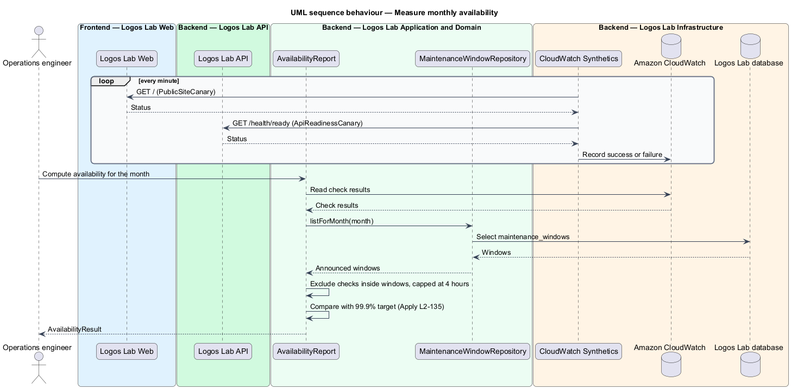

# Stay available

## Overview

Logos Lab is an online learning platform about Christianity and artificial intelligence. Members and
visitors reach it at `www.logoslab.ca` at any hour, so the platform runs with redundancy and states a
measurable availability target. This feature belongs to the operations subsystem and covers three
things: the target itself, the deployment topology that meets it, and the advance notice members get
before planned work.

The following terms are used throughout:

- **availability** — share of one-minute synthetic checks in a calendar month that succeed against the public site and the API
- **synthetic check** — scripted request sent from outside the platform on a fixed schedule to confirm that a page or endpoint answers
- **availability zone** — physically separate data-centre group inside one AWS region
- **maintenance window** — announced period during which the platform is deliberately unavailable for planned work
- **site announcement** — dismissible banner shown on every page during a set window, managed by an Administrator (`L2-098`)

The target is 99.9% per calendar month. Announced maintenance of at most 4 hours per month is excluded
from the calculation. Members see the maintenance announcement at least 72 hours before the window
starts. Health endpoints and alerting are covered by the monitor-and-alert feature
(`L2-136`); error pages, including the maintenance page, are covered by the show-error-pages feature
(`L2-141`).

## Description

### Deployment topology

- **Region** — all production containers run in AWS Canada (Central), as required by data residency
  (`L2-113`).
- **Logos Lab Web, Logos Lab API and Logos Lab Worker** — each runs at least two instances, spread
  across at least two availability zones. The compute service is `<TO SUPPLY>`.
- **Application Load Balancer** (baseline choice) — spans the same zones, sends traffic only to
  instances whose `/health/ready` probe passes, and drains instances in a failed zone.
- **Logos Lab database** — Amazon RDS for PostgreSQL in a Multi-AZ deployment. A standby in a second
  zone takes over automatically when the primary zone fails.
- **Cache** — Amazon ElastiCache for Redis with a replica in a second zone and automatic failover
  (baseline choice).
- **Job queue** — Amazon SQS, which is regional and spans zones by design.
- **CDN** — Amazon CloudFront with AWS WAF in front of Logos Lab Web and the API.

The loss of one zone shall not cause an outage of more than 5 minutes. The load balancer health-check
interval and threshold, and the RDS failover time, shall be configured so that their sum stays inside
that limit; the exact values are `<TO SUPPLY>`.

### Measuring availability

- **`PublicSiteCanary`** — Amazon CloudWatch Synthetics canary (baseline choice) that requests the home
  page `/` once every minute from outside the platform.
- **`ApiReadinessCanary`** — canary that calls the API readiness endpoint `/health/ready` once every
  minute.
- **`AvailabilityReport`** — monthly calculation of successful checks divided by total checks. Checks
  that fall inside announced maintenance windows are excluded, up to a total of 4 hours per month.
  Excluded time beyond 4 hours counts as downtime. Where the report is published is `<TO SUPPLY>`.

### Announcing planned maintenance

- **`AdminAnnouncementsPage`** — the Administrator screen at `/admin/announcements`
  (`docs/mocks/pages/admin-announcements/`, states default, empty, error and loading). Its header copy
  reads "Announce maintenance at least 72 hours ahead." The page is owned by the site-announcements
  feature (`L2-098`).
- **`MaintenanceWindowDialog`** — dialog opened from that page to record the start and end of a
  maintenance window and link it to a Warning announcement.
- **`AnnouncementsApi`** / **`ANNOUNCEMENTS_API`** / **`HttpAnnouncementsApi`** — API contract, token
  and HTTP implementation in `projects/api`.
- **`POST /api/v1/admin/maintenance-windows`** — route handler that calls
  `ScheduleMaintenanceWindowAction`. Administrator role only.
- **`ScheduleMaintenanceWindowAction`** — rejects a window whose start is less than 72 hours after the
  linked announcement starts showing. It returns a `422` problem response with the field error.
- **`MaintenanceWindow`** — entity (table `maintenance_windows`) with `id`, `announcementId`,
  `startsAt`, `endsAt` and `createdBy`. `AvailabilityReport` reads these rows to exclude announced time.
- **`ll-alert`** (banner variant, BEM `banner banner--warning`) — shows the announcement on every page
  (`docs/mocks/notifications/site-announcement/`, states info, warning, with-action and stacked).
- **`MaintenancePage`** — the page served with HTTP `503` during the window
  (`docs/mocks/pages/maintenance/`), built from `ll-error-page`. The serving mechanism is described in
  the show-error-pages feature.

Whether scheduling more than 4 hours of maintenance in one month is blocked or only reported is
`<TO SUPPLY>`.

## Requirements

| L2 ID | Refines (L1) | Requirement |
|-------|--------------|-------------|
| `L2-135` | `L1-023` | **Availability.** The platform shall be highly available. |

## Diagrams

### System context

Members and Administrators use Logos Lab, while an external synthetic-check service measures it every
minute and CloudWatch records the results.

### Containers

Every application container runs in two availability zones behind the load balancer, and the database
and cache each keep a standby in a second zone.

### Components

Inside the API, the maintenance-window route handler calls `ScheduleMaintenanceWindowAction`, which
applies the 72-hour rule and persists a `MaintenanceWindow`; `AvailabilityReport` reads those rows.

### Class structure

The page depends on the `AnnouncementsApi` contract; the action creates a `MaintenanceWindow` linked to
an `Announcement`, and the report combines canary results with maintenance windows.

### Behaviour — schedule planned maintenance

The Administrator records a window; the action rejects a start less than 72 hours after the
announcement starts, otherwise it saves the window and the banner shows from the announcement start.

### Behaviour — survive the loss of one zone

When one zone fails, the load balancer stops routing to its instances and RDS promotes the standby,
which keeps the outage within 5 minutes.

### Behaviour — measure monthly availability

Canaries record a result each minute; at month end the report excludes announced maintenance up to
4 hours and compares the result with the 99.9% target.

