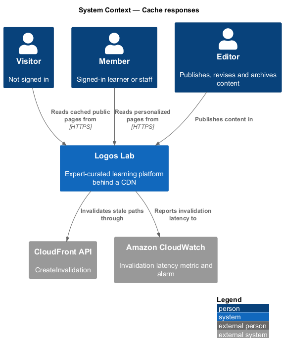
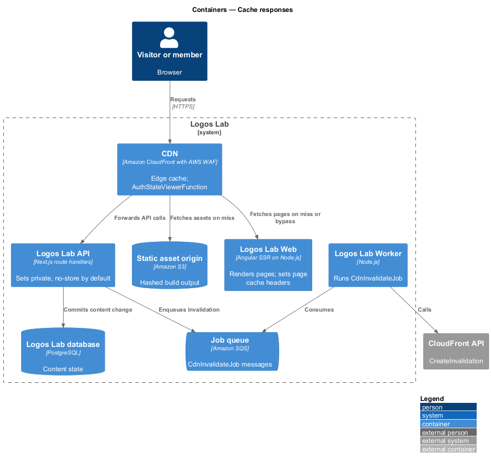
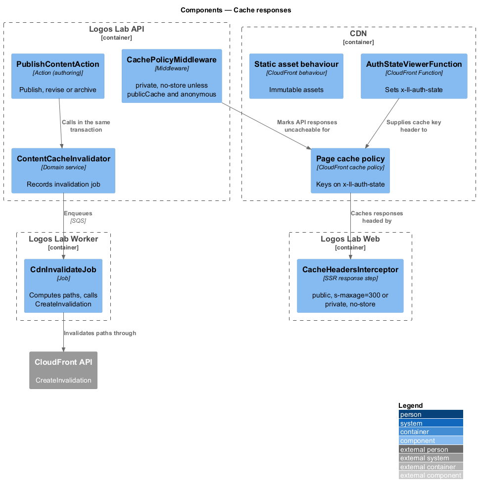
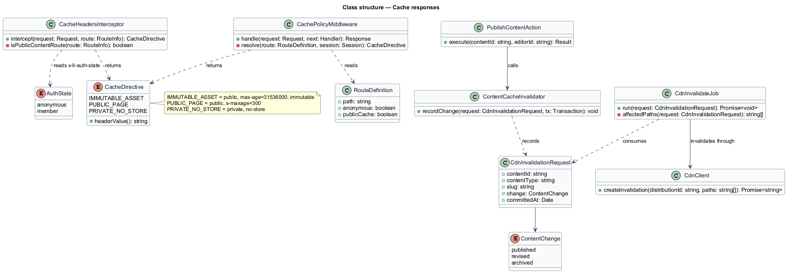
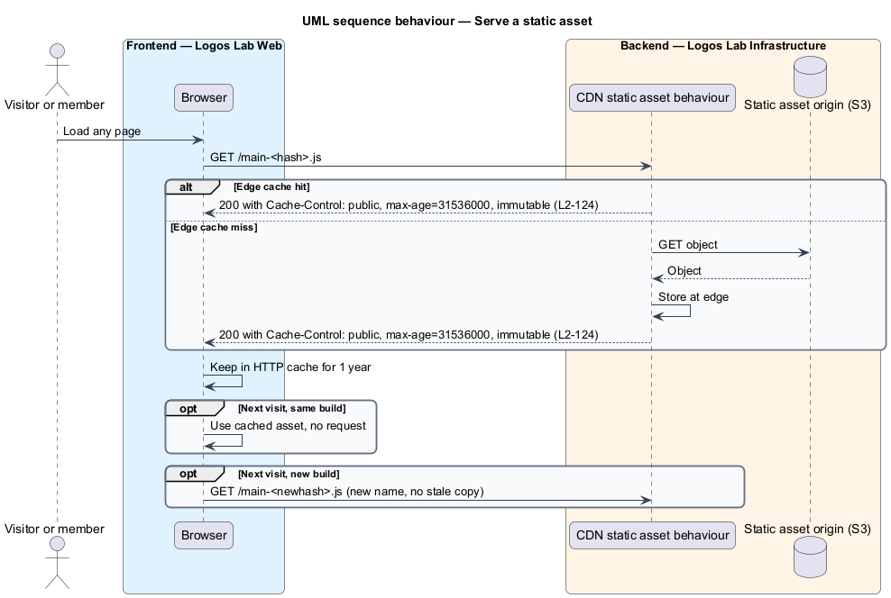
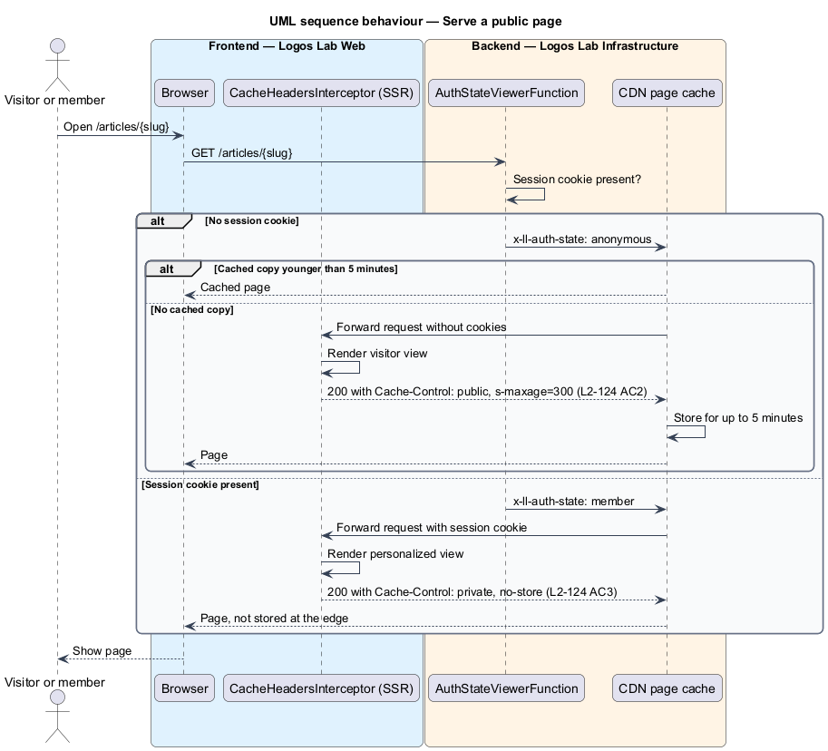
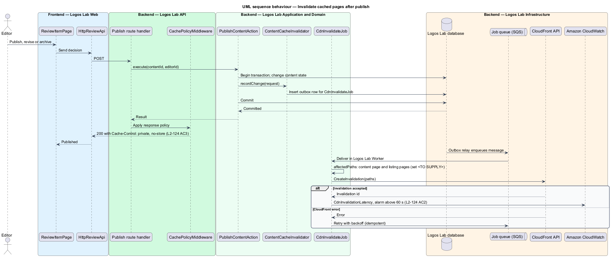

# Cache responses

## Overview

Logos Lab serves 3 kinds of response: static assets such as scripts, styles and fonts; public content
pages that every visitor sees alike; and personal responses that belong to one signed-in member. This
feature caches the first 2 kinds where caching is safe, and keeps the third out of every shared cache.

The feature belongs to the performance subsystem. It works with the CDN, Amazon CloudFront, in front of
Logos Lab Web and Logos Lab API. It also protects privacy: a personal response stored in a shared cache
could be served to someone else.

- **static asset** — build output file (JavaScript, CSS, font, icon) that never changes once published
- **content-hashed file name** — file name that embeds a hash of the file's bytes, so any change
  produces a new name
- **public content page** — server-rendered page of published content, such as a course, video, article,
  collection, event, expert or topic page, rendered for an anonymous visitor
- **personalized response** — response whose content depends on who is signed in
- **CDN invalidation** — request that tells CloudFront to drop cached copies of given paths before they
  expire

## Description

### Static assets

- **Angular production build** — writes every JavaScript, CSS and font file with a content-hashed file
  name (`outputHashing: all`).
- **Static asset behaviour** — CloudFront cache behaviour for the asset paths, backed by an S3 origin
  (baseline choice). Every asset carries `Cache-Control: public, max-age=31536000, immutable`
  (`L2-124` AC1). The HTML document itself never carries this header.

### Public content pages

- **`CacheHeadersInterceptor`** — server-side step in Logos Lab Web's SSR request handling. For an
  anonymous request to a public content route it sets `Cache-Control: public, s-maxage=300` so the CDN
  holds the page for up to 5 minutes (`L2-124` AC2). The browser `max-age` for these pages is
  `<TO SUPPLY>`. For any request with a session it sets `Cache-Control: private, no-store`.
- **Public content routes** — `/`, `/explore`, `/courses/{slug}`, `/modules/{slug}`, `/videos/{slug}`,
  `/articles/{slug}`, `/collections/{slug}`, `/events/{slug}`, `/experts/{slug}` and
  `/topics/{slug}`. Mocks with a visitor state, for example `docs/mocks/pages/article-page/visitor.html`
  and `docs/mocks/pages/home/default.html`, show the cached form. The `signed-in` and `saved` states
  show personalized forms that are never cached.
- **`AuthStateViewerFunction`** — CloudFront Function on viewer request. It sets a normalized
  `x-ll-auth-state` header to `anonymous` or `member` from the presence of the session cookie. The
  page cache policy keys on that header and on no cookie, so a member request never receives a copy
  cached for a visitor.
- **`ContentCacheInvalidator`** — domain service called by the publish, revise and archive actions of
  the authoring subsystem (for example `PublishContentAction`). It records a `CdnInvalidateJob` message
  in the same transaction as the state change.
- **`CdnInvalidateJob`** — Worker job. It computes the affected paths: the content page and each
  listing page that shows the item. The listing set per content type is `<TO SUPPLY>`. It calls the
  CloudFront `CreateInvalidation` API and finishes within 60 seconds of the publish, revision or
  archive (`L2-124` AC2). It is idempotent and retried with backoff.
- **`CdnInvalidationLatency`** — CloudWatch metric of the time from commit to completed invalidation,
  with an alarm above 60 seconds.

### Authenticated and personalized responses

- **`CachePolicyMiddleware`** — response step in Logos Lab API, registered with the security headers
  stage. It sets `Cache-Control: private, no-store` on every API response by default. Only route
  handlers explicitly marked `publicCache` and called without a session may relax it (`L2-124` AC3).
- **API cache behaviour** — CloudFront cache behaviour for `/api/v1/*` that honours the origin header.
  A response with `private` or `no-store` is never stored at the edge.
- **`ResponseCacheHeadersTest`** — integration tests against the API. Each authenticated endpoint
  returns `private, no-store`. Each public endpoint returns a shared-cache header only when called
  anonymously.

### Rules

| Response | `Cache-Control` | CDN behaviour | Source |
|---|---|---|---|
| Static asset with content-hashed name | `public, max-age=31536000, immutable` | Cached | `L2-124` AC1 |
| Public content page, anonymous | `public, s-maxage=300` | Cached up to 5 minutes; invalidated within 60 seconds of publish, revision or archive | `L2-124` AC2 |
| Any authenticated or personalized response | `private, no-store` | Never cached | `L2-124` AC3 |

## Requirements

| L2 ID | Refines (L1) | Requirement |
|-------|--------------|-------------|
| `L2-124` | `L1-020` | **Caching.** Responses shall be cached where safe. |

## Diagrams

### System context

Visitors and members reach Logos Lab through its CDN. Editors' publish decisions trigger invalidations
through the CloudFront API.

### Containers

The CDN fronts the static asset origin, Logos Lab Web and Logos Lab API. The Worker sends invalidations
after content changes.

### Components

`AuthStateViewerFunction` splits anonymous and member traffic at the edge. `CacheHeadersInterceptor` and
`CachePolicyMiddleware` set the headers, and `CdnInvalidateJob` clears stale pages.

### Class structure

`CacheDirective` values name the 3 header policies. `ContentCacheInvalidator` and `CdnInvalidateJob`
share a `CdnInvalidationRequest`.

### Behaviour — serve a static asset

A hashed asset is served from the edge with a 1-year immutable header, so a returning browser does not
request it again.

### Behaviour — serve a public page

An anonymous request is answered from the edge for up to 5 minutes. A member request bypasses the
shared copy and receives a personalized, uncached page.

### Behaviour — invalidate after publish

The publish, revise or archive transaction records an invalidation job. The Worker invalidates the
affected paths within 60 seconds.

