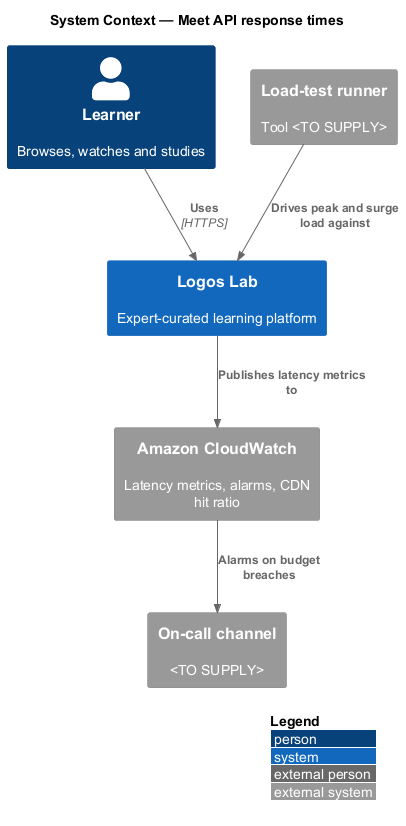
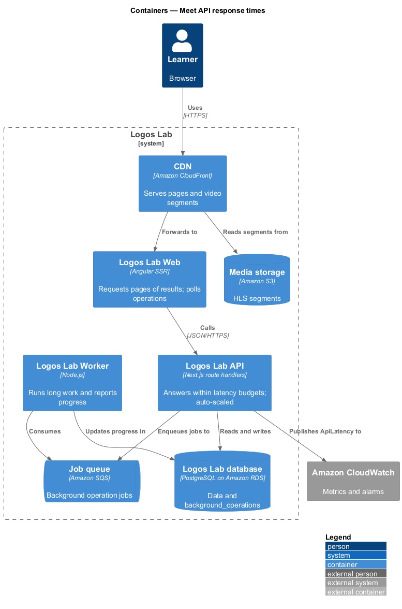
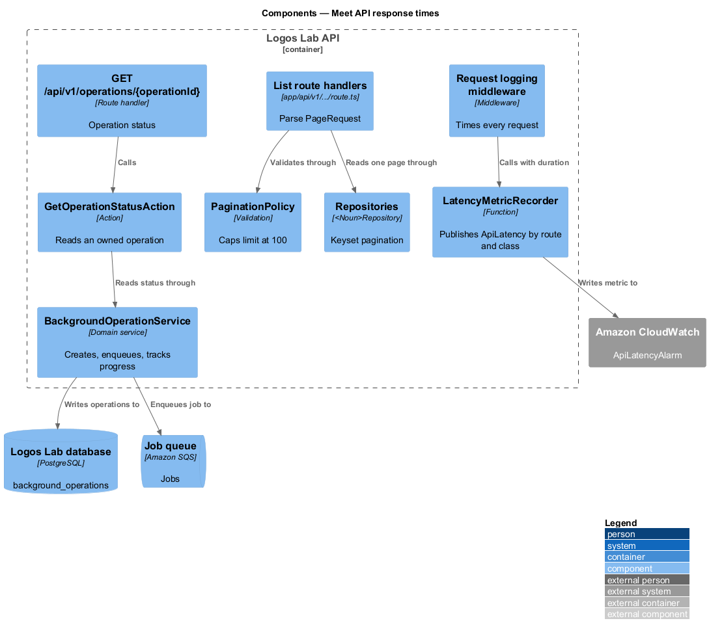
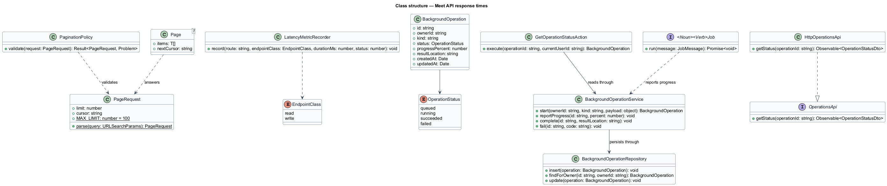
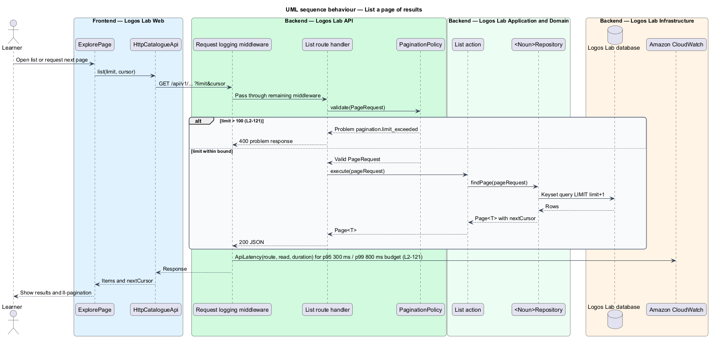
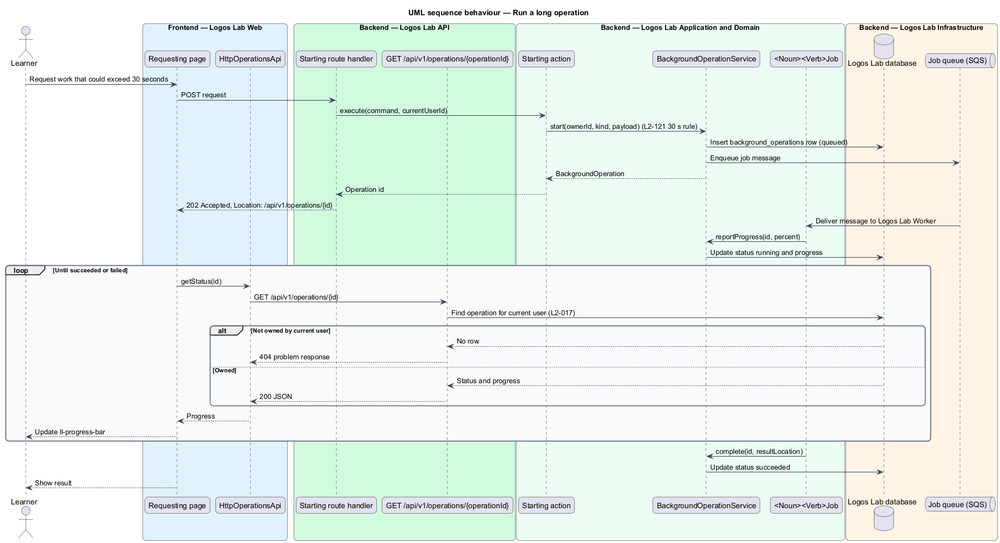
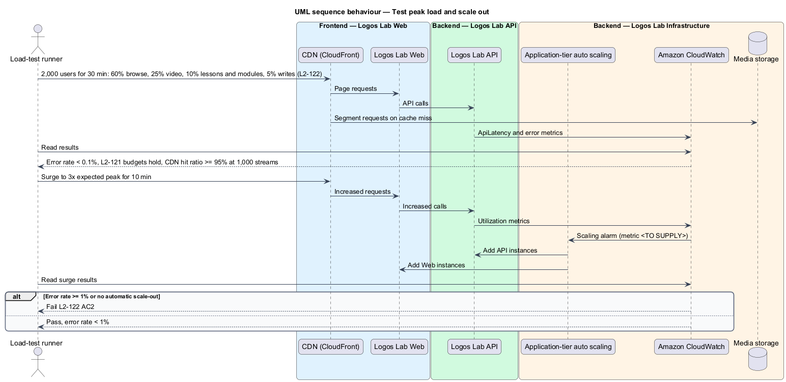

# Meet API response times

## Overview

Logos Lab API is the JSON API under `/api/v1` that every Logos Lab page calls. This feature keeps that
API fast under the heaviest traffic the platform expects, and lets the platform add capacity when
traffic rises beyond it.

The feature belongs to the performance subsystem. It is a cross-cutting slice that applies to every
endpoint. It fixes 4 mechanisms: a latency budget per endpoint class, a pagination contract for every
list, a background-operation pattern for work that would hold a request open too long, and a load test
with automatic scale-out.

- **latency budget** — maximum response time, at a stated percentile, that an endpoint class may take
  under expected peak load
- **p95, p99** — 95th and 99th percentile of measured response times
- **read endpoint** — endpoint that answers `GET` and changes no state
- **write endpoint** — endpoint that answers `POST`, `PUT`, `PATCH` or `DELETE`
- **expected peak load** — 2,000 concurrent signed-in users following the mix that `L2-122` AC1 gives
- **background operation** — unit of long-running work that the API hands to the Worker and that
  reports progress to the caller instead of holding the HTTP request open
- **scale-out** — automatic addition of application-tier instances when load rises

## Description

### Latency measurement and alarms

- **Request logging middleware** — first stage of the API middleware pipeline. It records method,
  route template, status and duration for every request. Because it sits outside exception handling,
  handled error statuses are timed and logged as well.
- **`LatencyMetricRecorder`** — function called by the request logging middleware. It publishes a
  CloudWatch metric `ApiLatency` with dimensions `route` and `endpointClass` (`read` or `write`).
- **`ApiLatencyAlarm`** — CloudWatch alarms on `ApiLatency`. They notify the on-call channel when read
  p95 exceeds 300 ms, read p99 exceeds 800 ms, or write p95 exceeds 500 ms (`L2-121` AC1 and AC2). The
  alarm evaluation window is `<TO SUPPLY>`.

### Pagination contract

- **`PageRequest`** — value object parsed from the `limit` and `cursor` query parameters of every list
  endpoint. `limit` defaults to `<TO SUPPLY>` and is capped at 100 (`L2-121` AC3).
- **`PaginationPolicy`** — validation used by every list route handler. A `limit` above 100 yields a 400
  problem response with error code `pagination.limit_exceeded`. No route handler may return a list
  without it.
- **`Page<T>`** — response envelope `{ items, nextCursor }`. Repositories accept a `PageRequest` and
  return a `Page<T>` using keyset pagination, so a page costs the same at any depth.
- **`PageRequest` in Logos Lab Web** — the `projects/api` library uses the same shape. Pages such as
  `ExplorePage` (`docs/mocks/pages/explore/`, state `long`) request the next page through
  `ll-pagination`.

### Background operations

- **`BackgroundOperation`** — entity in table `background_operations`: `id`, `ownerId`, `kind`,
  `status` (`queued`, `running`, `succeeded`, `failed`), `progressPercent`, `resultLocation`,
  `createdAt`, `updatedAt`. Each row belongs to one user and is scoped to that user (`L2-017`).
- **`BackgroundOperationService`** — creates an operation, enqueues its job to the Job queue, and
  updates progress. Any endpoint whose work could exceed 30 seconds starts an operation instead
  (`L2-121` AC4). Data exports and media processing are examples.
- **`202 Accepted`** — response of an endpoint that starts an operation. It carries the operation `id`
  and a `Location` header for the status endpoint.
- **`GET /api/v1/operations/{operationId}`** — route handler that calls `GetOperationStatusAction`. It
  returns status and progress for an operation owned by the current user, and 404 otherwise.
- **`OperationsApi`**, **`OPERATIONS_API`**, **`HttpOperationsApi`** — API contract, injection token
  and HTTP implementation. The page polls the status endpoint and shows progress in `ll-progress-bar`.
  The polling interval is `<TO SUPPLY>`.
- **`<Noun><Verb>Job`** — the Worker job that does the work, for example `DataExportBuildJob` from the
  privacy subsystem. Each job reports progress through `BackgroundOperationService`.

### Load capacity and scaling

- **`PeakLoadTest`** — scheduled load test against a production-like environment (tool `<TO SUPPLY>`).
  It drives 2,000 concurrent signed-in users for 30 minutes: 60% browsing, 25% video playback, 10%
  lessons and modules, 5% writes. It passes when the error rate is below 0.1% and the `L2-121` budgets
  hold (`L2-122` AC1).
- **`SurgeLoadTest`** — raises traffic to 3 times the expected peak for 10 minutes. It passes when the
  application tier scales out automatically and the error rate stays below 1% (`L2-122` AC2).
- **Application-tier auto scaling** — scaling policy on the Logos Lab API and Logos Lab Web compute.
  The AWS compute service and the scaling metric are `<TO SUPPLY>`. The database stays on Amazon RDS
  Multi-AZ; read replicas are `<TO SUPPLY>`.
- **Video segment delivery** — the CDN serves HLS segments from Media storage. With 1,000 concurrent
  streams, its cache hit ratio shall be at least 95% (`L2-122` AC3). The CloudWatch metric
  `CacheHitRate` for the video distribution is checked during the load test.
- **Environment and schedule** — which environment receives the load tests, and how often they run, are
  `<TO SUPPLY>`.

### Rules

| Rule | Value | Source |
|---|---|---|
| Read endpoints at expected peak | p95 300 ms or less; p99 800 ms or less | `L2-121` AC1 |
| Write endpoints at expected peak | p95 500 ms or less | `L2-121` AC2 |
| List page size | at most 100; no unbounded list | `L2-121` AC3 |
| Work over 30 seconds | background job reporting progress | `L2-121` AC4 |
| Peak load test | 2,000 users, 30 minutes, error rate below 0.1% | `L2-122` AC1 |
| Surge | 3x peak for 10 minutes, automatic scale-out, error rate below 1% | `L2-122` AC2 |
| Video segments | 1,000 streams, CDN cache hit ratio at least 95% | `L2-122` AC3 |

## Requirements

| L2 ID | Refines (L1) | Requirement |
|-------|--------------|-------------|
| `L2-121` | `L1-020` | **API response times.** API endpoints shall respond within defined latency budgets. |
| `L2-122` | `L1-020` | **Load capacity and scalability.** The platform shall sustain expected peak load and scale beyond it. |

## Diagrams

### System context

Learners call Logos Lab, which reports latency to Amazon CloudWatch. A load-test runner exercises the
platform at expected peak and at 3 times that peak.

### Containers

Logos Lab API answers within budget and hands long work to the Worker through the Job queue. The CDN
serves video segments from Media storage.

### Components

Inside Logos Lab API, the request logging middleware records latency and `PaginationPolicy` bounds every
list. `BackgroundOperationService` turns long work into a tracked operation.

### Class structure

Every list route uses `PageRequest`, `PaginationPolicy` and `Page<T>`. Long work is a
`BackgroundOperation` owned by one user and driven by a Worker job.

### Behaviour — list a page of results

A list request passes through the middleware, which records its latency. `PaginationPolicy` rejects a
page size above 100, and the repository returns one keyset page.

### Behaviour — run a long operation

An endpoint whose work could exceed 30 seconds answers `202 Accepted` at once. The Worker runs the job
and the page polls the operation's progress.

### Behaviour — test peak load and scale out

The load-test runner drives the expected peak and then a surge. The application tier scales out and
CloudWatch confirms the error rates, latency budgets and CDN hit ratio.

