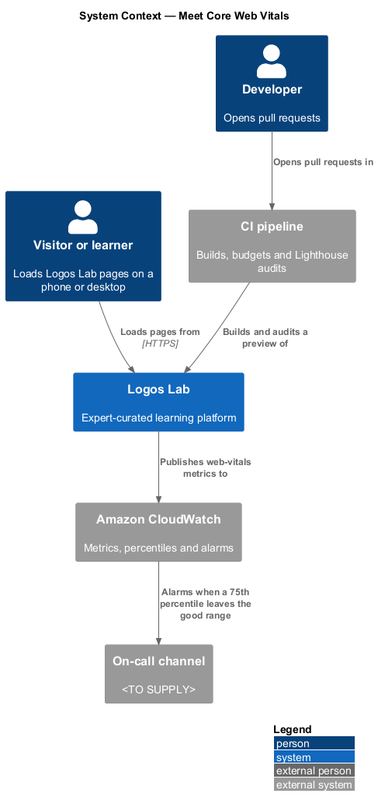
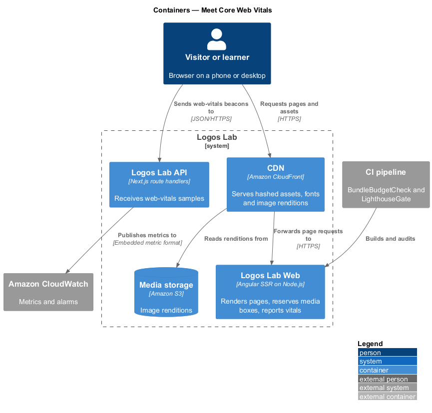
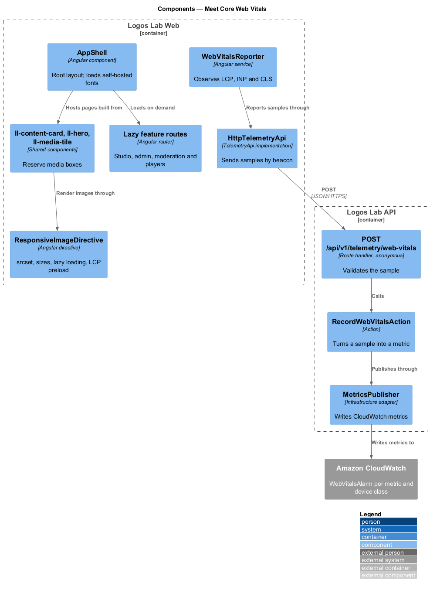
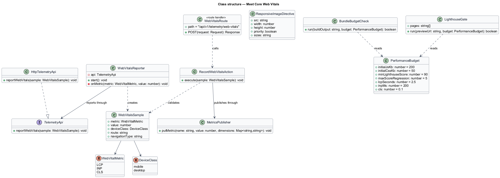
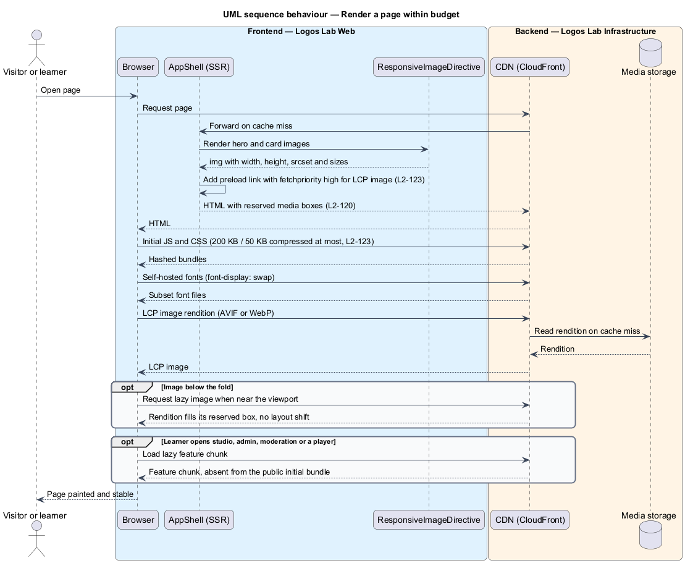
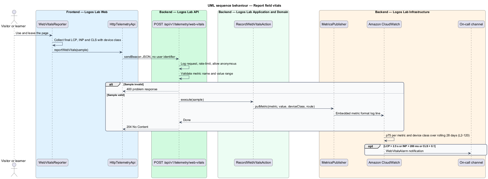
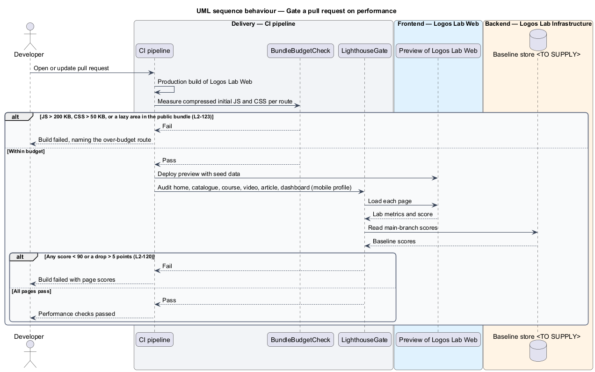

# Meet Core Web Vitals

## Overview

Logos Lab is an expert-curated learning platform about Christian faith and artificial intelligence. Its
pages are served by Logos Lab Web, an Angular application that is server-rendered for public pages and
then runs as a single-page application. This feature keeps those pages fast to load and stable while
they load, on phones and on desktops.

The feature belongs to the performance subsystem. It is a cross-cutting slice: it adds no screen of its
own, but it constrains how every page is built, shipped and measured.

- **Core Web Vitals** — set of 3 user-centred page metrics defined by Google: Largest Contentful Paint,
  Interaction to Next Paint and Cumulative Layout Shift
- **Largest Contentful Paint (LCP)** — time from navigation until the largest image or text block in
  the viewport is rendered
- **Interaction to Next Paint (INP)** — latency from a user interaction until the next frame is painted
- **Cumulative Layout Shift (CLS)** — score of unexpected movement of visible content while a page loads
- **real-user monitoring (RUM)** — measurement of these metrics in real visitors' browsers rather than
  in a lab
- **asset budget** — maximum compressed size of the JavaScript or CSS that a route loads initially
- **Lighthouse** — Google lab tool that loads a page under a simulated device profile and scores its
  performance from 0 to 100

The requirement has 3 enforcement points. The build fails when a bundle exceeds its budget. Continuous
integration (CI) fails when a Lighthouse score drops. Production monitoring raises an alarm when the
75th percentile of a Core Web Vital leaves the "good" range.

## Description

### Run-time building blocks in Logos Lab Web

- **`AppShell`** — root layout component. It loads the self-hosted fonts and hosts the routed pages.
  It applies to every page in `docs/mocks/pages/`. The reference page for this feature is
  `docs/mocks/pages/home/` (states `default`, `loading`, `signed-in`, `partial`, `long`, `empty`,
  `error`).
- **`ll-content-card`, `ll-hero`, `ll-media-tile`, `ll-player`** — design-system components that show
  images or embeds. Each reserves its box with explicit `width` and `height` attributes or an
  `aspect-ratio`, so a late image causes no layout shift (`L2-120` AC3).
- **`ll-skeleton`** — placeholder component used by the `loading` states. It occupies the same box as
  the content it stands in for, so the swap causes no shift.
- **`ResponsiveImageDirective`** — Angular directive on every content image (baseline choice: built on
  Angular `NgOptimizedImage`). It emits a responsive `srcset` and `sizes`, requests modern formats
  (AVIF or WebP, with a fallback) and sets `loading="lazy"` below the fold. It marks the LCP image with
  `fetchpriority="high"` and a `<link rel="preload">` in the server-rendered head (`L2-123` AC3).
- **Image renditions** — resized and re-encoded copies of each uploaded image, held in Media storage and
  served through the CDN. The rendition widths are `<TO SUPPLY>`.
- **Fonts** — Manrope and JetBrains Mono, the 2 families the design system defines
  (`--font-family-sans`, `--font-family-mono`). Both are self-hosted, subset to the characters in use,
  and declared with `font-display: swap` (`L2-123` AC4).
- **Lazy feature areas** — the studio, admin, moderation and player areas are lazy-loaded routes
  (`loadChildren` or `loadComponent`). None is part of the public initial bundle (`L2-123` AC2).
- **`WebVitalsReporter`** — service in Logos Lab Web (baseline choice: the open-source `web-vitals`
  library). It observes LCP, INP and CLS in the browser and sends each final value with the route
  template and the device class (`mobile` or `desktop`). It sends no user identifier.
- **`TelemetryApi`**, **`TELEMETRY_API`**, **`HttpTelemetryApi`** — API contract, injection token and
  HTTP implementation. `reportWebVitals(sample)` sends the sample with `navigator.sendBeacon`.

### Run-time building blocks in Logos Lab API and AWS

- **`POST /api/v1/telemetry/web-vitals`** — anonymous route handler. It validates the sample shape and
  the metric name, then calls the action. The standard middleware rate-limits it.
- **`RecordWebVitalsAction`** — publishes each sample as a CloudWatch metric with the dimensions
  `metric`, `deviceClass` and `route`. It stores nothing in the Logos Lab database.
- **`MetricsPublisher`** — infrastructure adapter that writes CloudWatch metrics in the embedded metric
  format through the API log stream.
- **`WebVitalsAlarm`** — CloudWatch alarm per metric and device class. It evaluates the 75th percentile
  over a rolling 28-day period. It notifies the on-call channel when LCP exceeds 2.5 s, INP exceeds
  200 ms or CLS exceeds 0.1 (`L2-120` AC1).
- Whether field sampling requires analytics consent is `<TO SUPPLY>` (privacy subsystem). The sampling
  rate is `<TO SUPPLY>`.

### Build and CI building blocks

- **`BundleBudgetCheck`** — CI stage after the production build. It compresses each route's initial
  JavaScript and CSS. It fails the build when JavaScript exceeds 200 KB or CSS exceeds 50 KB compressed
  (`L2-123` AC1). It also fails when a studio, admin, moderation or player chunk appears in the public
  initial bundle (`L2-123` AC2). The compression algorithm measured (gzip or Brotli) is `<TO SUPPLY>`.
- **Angular `budgets`** — entries in `angular.json` that warn earlier, on uncompressed sizes, during
  local builds.
- **`LighthouseGate`** — CI stage on every pull request. It runs Lighthouse with the mobile profile
  against the home, catalogue, course, video, article and dashboard pages of a preview deployment. It
  fails when any page scores under 90 for performance. It also fails when any score drops more than 5
  points from the stored main-branch baseline (`L2-120` AC2). The baseline store is `<TO SUPPLY>`.
- **Seeded preview data** — the idempotent seed data gives the 6 audited pages realistic content. The
  gate audits the dashboard signed in as the seeded learner.

### Rules

| Rule | Value | Source |
|---|---|---|
| LCP, 75th percentile, mobile and desktop measured separately, rolling 28 days | 2.5 s or less | `L2-120` AC1 |
| INP, 75th percentile | 200 ms or less | `L2-120` AC1 |
| CLS, 75th percentile | 0.1 or less | `L2-120` AC1 |
| Lighthouse performance score, mobile profile | at least 90; a drop of more than 5 points fails | `L2-120` AC2 |
| Image and embed dimensions | reserved before load | `L2-120` AC3 |
| Initial JavaScript per route, compressed | 200 KB or less | `L2-123` AC1 |
| Initial CSS, compressed | 50 KB or less | `L2-123` AC1 |
| Font families | at most 2, self-hosted, subset, `font-display: swap` | `L2-123` AC4 |

## Requirements

| L2 ID | Refines (L1) | Requirement |
|-------|--------------|-------------|
| `L2-120` | `L1-020` | **Core Web Vitals.** Public and member pages shall meet Google's "good" Core Web Vitals thresholds. |
| `L2-123` | `L1-020` | **Front-end asset budgets.** The front end shall stay within size budgets. |

## Diagrams

### System context

Visitors and learners load pages from Logos Lab. Field measurements flow to Amazon CloudWatch, which
alerts the on-call channel, and the CI pipeline audits every pull request before it merges.

### Containers

The CDN serves hashed assets and image renditions. Logos Lab Web renders the page and the browser
reports vitals to Logos Lab API, which publishes metrics to CloudWatch.

### Components

Inside Logos Lab Web, the image directive and lazy routes keep the initial load small. The reporter
sends field samples to the telemetry route handler and its action.

### Class structure

`WebVitalsReporter` depends on the `TelemetryApi` contract. `RecordWebVitalsAction` validates a
`WebVitalsSample` and publishes it through `MetricsPublisher`. Both CI gates read `PerformanceBudget`.

### Behaviour — render a page within budget

The server-rendered page preloads its LCP image, reserves every media box and loads lazy images only
near the viewport. These steps enforce `L2-120` AC3 and `L2-123` AC2 and AC3.

### Behaviour — report field vitals

The browser sends final LCP, INP and CLS values after the page is used. CloudWatch computes the 28-day
75th percentile per device class and alarms when a threshold is crossed.

### Behaviour — gate a pull request

CI builds the application and checks the compressed bundle budgets. It then runs Lighthouse against the
6 audited pages and compares each score with the main-branch baseline.

