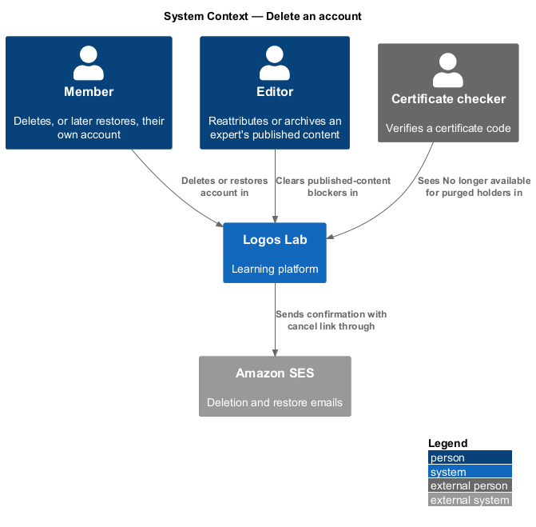
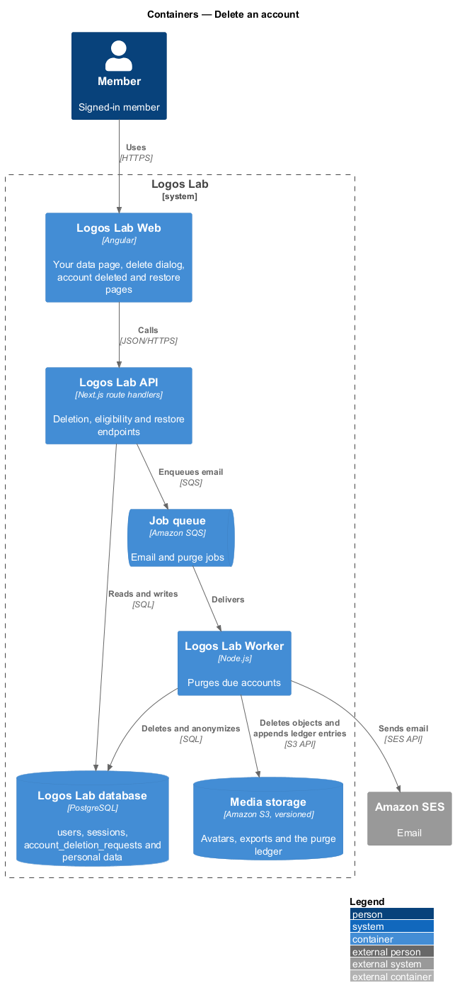
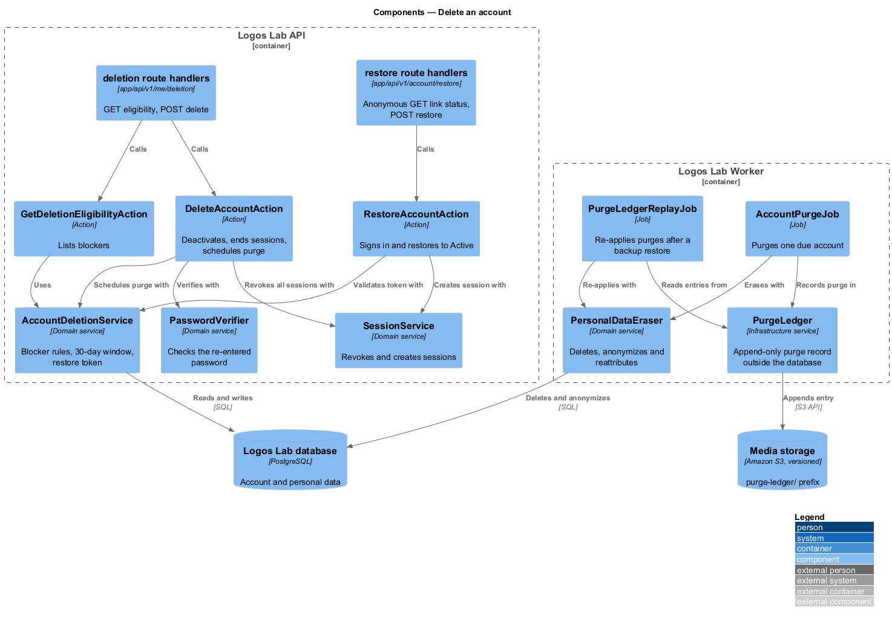
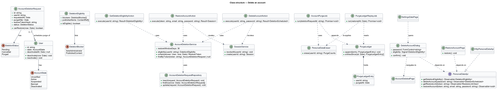
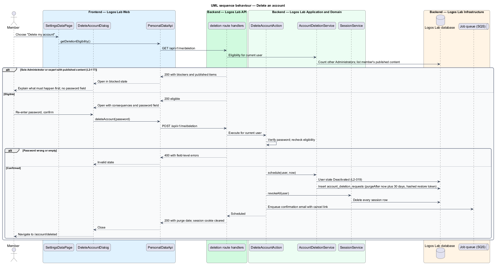
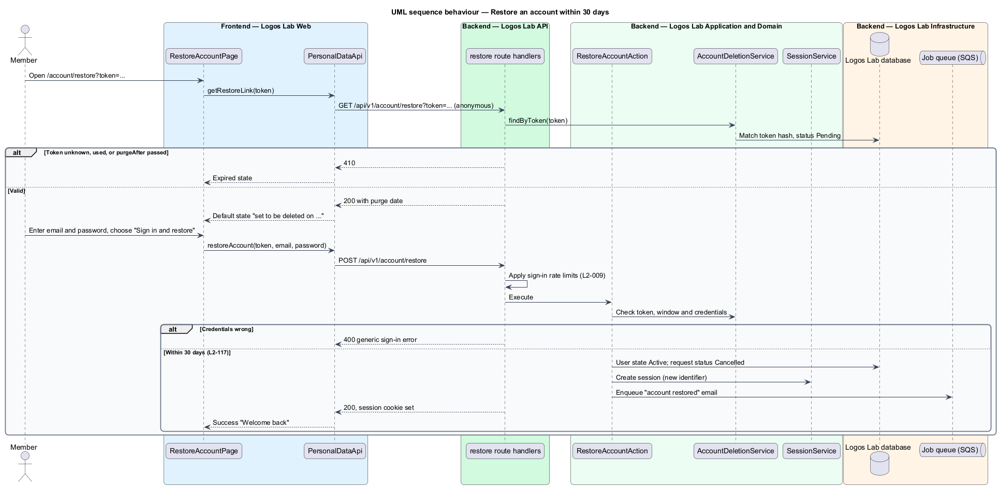
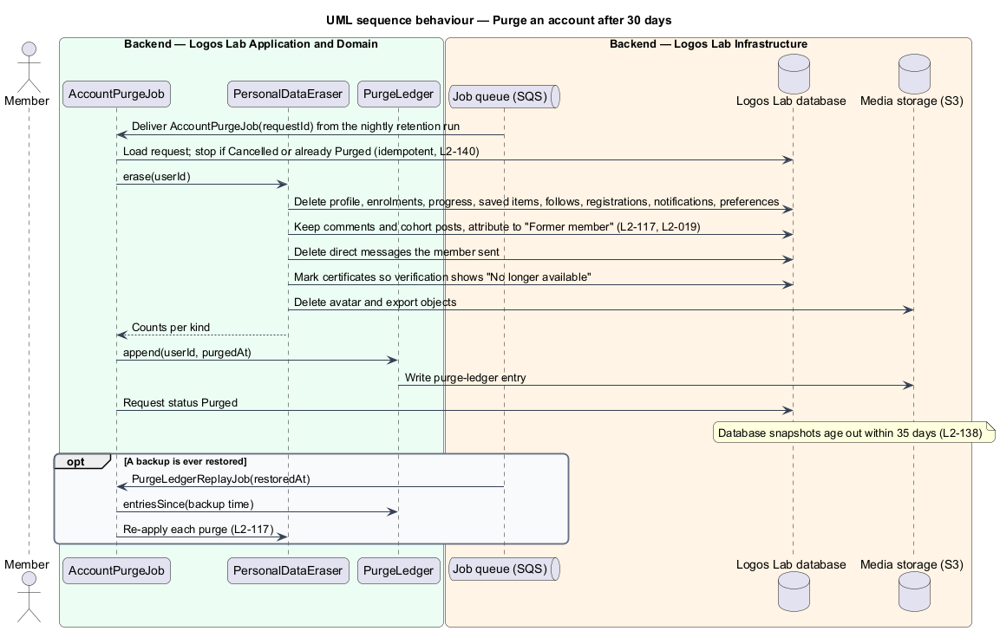

# Delete an account

## Overview

Canadian privacy law lets a person withdraw from a service and have their personal data removed
(`L1-019`). Logos Lab offers self-service account deletion with a 30-day grace period. During that
period the member may change their mind and restore everything; afterwards a job purges their
personal data.

**deactivated account** — account in the `Deactivated` state (`L2-019`) after its owner asks for deletion; nobody can sign in to it

**grace period** — 30 days after a deletion request during which the owner may restore the account

**purge** — irreversible removal of a member's personal data once the grace period ends

**deletion blocker** — condition that prevents deletion until someone else acts: the member is the only Administrator, or the member is an expert with published content

**purge ledger** — append-only record of each completed purge, kept outside the database so purges can be re-applied after a backup restore

This feature belongs to the privacy subsystem. It shares the "Your data" settings page with the data
export, uses the account states of the identity subsystem, and relies on the nightly retention run
(`enforce-data-retention`) to start each purge.

## Description

**Screens.**

- **`SettingsDataPage`** (`/settings/data`, mock `docs/mocks/pages/settings-data/`) — holds the
  "Delete your account" `ll-danger-zone` with "Delete my account". The deletion-blocked state names
  the member's published items and offers "Ask an editor".
- **`DeleteAccountDialog`** (CDK dialog, mock `docs/mocks/dialogs/delete-account/`) — explains the
  consequences in an `ll-list`: the account is deactivated now and signed out on every device, a
  cancel link is emailed and works until the purge date, comments and cohort posts stay as "Former
  member", sent direct messages are deleted, and certificates show "No longer available". It asks for
  the password. States: default, scroll, busy, invalid, failed ("Nothing changed; your account is
  still active"), blocked (no password field, lists the blockers).
- **`AccountDeletedPage`** (`/account/deleted`, mock `docs/mocks/pages/account-deleted/`) — confirms
  the deletion with an `ll-description-list` timeline: now, the purge date (with "Backups age out
  within 35 days after that"), comments, messages and certificates.
- **`RestoreAccountPage`** (`/account/restore?token=…`, mock `docs/mocks/pages/restore-account/`) —
  shows the purge date and a sign-in form with "Sign in and restore". States: default, submitting,
  error, expired ("This restore link no longer works"), success ("Welcome back").
- **`CertificateVerifyPage`** (`/certificates/{code}`, owned by the certificate verification design,
  `L2-032`) — its unavailable state (mock `docs/mocks/pages/certificate-verify/unavailable.html`)
  shows "No longer available" for a purged holder.
- **`ChangeAttributionDialog`** (mock `docs/mocks/dialogs/change-attribution/`, owned by the
  authoring workspace design, `L2-075`) — lets an editor reattribute an expert's content to Logos Lab,
  which clears the published-content blocker.

**API library.** **`PersonalDataApi`** (`PERSONAL_DATA_API`, `HttpPersonalDataApi`) —
`getDeletionEligibility()`, `deleteAccount(password)`, `getRestoreLink(token)`,
`restoreAccount(token, email, password)`.

**Endpoints.**

| Method and path | Access | Purpose |
|---|---|---|
| `GET /api/v1/me/deletion` | Member | Eligibility with blockers and published items |
| `POST /api/v1/me/deletion` | Member | Verify password and deactivate; clears the session cookie |
| `GET /api/v1/account/restore?token=…` | Anonymous | Purge date for a valid link; 410 otherwise |
| `POST /api/v1/account/restore` | Anonymous | Sign in and restore; sign-in rate limits apply (`L2-009`) |

**Application and domain.**

- **`GetDeletionEligibilityAction`** — returns a **`DeletionEligibility`** with each
  **`DeletionBlocker`** (`SoleAdministrator`, `PublishedContent`) and the published items.
- **`DeleteAccountAction`** — verifies the password, rechecks eligibility, and calls
  **`AccountDeletionService.schedule`**. The service sets the user to `Deactivated` and inserts an
  **`AccountDeletionRequest`**. The action then revokes every session through **`SessionService`** and
  enqueues the confirmation email with the cancel link.
- **`AccountDeletionService`** — holds the 30-day window and the blocker rules. It generates the
  restore token and stores only its hash.
- **`RestoreAccountAction`** — validates the token and the window, checks the credentials, sets the
  user to `Active`, marks the request `Cancelled`, creates a new session and enqueues an "account
  restored" email. All data is intact because nothing was removed during the grace period.
- **`AccountDeletionRequest`** (table `account_deletion_requests`) — `userId`, `requestedAt`,
  `purgeAfter` (30 days after the request), `restoreTokenHash`, `status` (`DeletionStatus`:
  `Pending`, `Cancelled`, `Purged`).

**Worker.**

- **`AccountPurgeJob`** — enqueued by the nightly retention run for each request past `purgeAfter`.
  It is idempotent and stops if the request is `Cancelled` or already `Purged` (`L2-140`).
- **`PersonalDataEraser`** — deletes the member's personal data. It keeps comments and cohort posts
  attributed to "Former member" (`L2-019`), deletes direct messages the member sent, marks
  certificates so verification shows "No longer available", and deletes the avatar and export
  objects. Retention of the purged account's audit and security log entries follows their own
  schedule (`L2-118`).
- **`PurgeLedger`** — appends a **`PurgeLedgerEntry`** (`userId`, `purgedAt`) to a versioned
  `purge-ledger/` prefix in media storage. The ledger lives outside the database so a database
  restore cannot roll it back; this is a design choice to confirm by ADR.
- **`PurgeLedgerReplayJob`** — runs after any database restore (`L2-138`) and re-applies every purge
  recorded after the backup's time.

**Rules from the acceptance criteria.**

- Deletion requires "Delete my account", the password and confirmation in a dialog that explains the
  consequences. The account is then `Deactivated` immediately, all sessions end, and a confirmation
  email carries a link to cancel within 30 days.
- After 30 days without cancellation the purge job deletes the personal data, with the exceptions
  above for comments, cohort posts, sent messages and certificates.
- Within 30 days the link and a sign-in restore the account to `Active` with all data intact.
- The only Administrator is told to assign another Administrator first. An expert with published
  content is told to have it reattributed to Logos Lab or archived by an editor.
- Each purge is recorded and re-applied if a backup is restored, and backups age out within 35 days.

## Requirements

| L2 ID | Refines (L1) | Requirement |
|-------|--------------|-------------|
| `L2-117` | `L1-019` | **Account deletion.** Members shall be able to delete their account and personal data. |

## Diagrams

### System context

A member deletes or restores their own account, and an editor clears a published-content blocker.
Anyone checking a purged member's certificate sees "No longer available".

### Containers

The API deactivates the account and records the request. The Worker later purges the data from the
database and media storage and writes the purge ledger.

### Components

`DeleteAccountAction` and `RestoreAccountAction` share `AccountDeletionService` and `SessionService`.
In the Worker, `AccountPurgeJob` uses `PersonalDataEraser` and `PurgeLedger`, which
`PurgeLedgerReplayJob` reads after a restore.

### Class structure

An `AccountDeletionRequest` schedules the purge of one `User`. `DeletionEligibility` lists the
blockers, and `PurgeLedger` holds one `PurgeLedgerEntry` per purge.

### Behaviour — delete an account

The dialog opens in the blocked state when a blocker exists. Otherwise a confirmed request deactivates
the account, schedules the purge 30 days ahead, ends every session and sends the cancel link.

### Behaviour — restore an account

A valid link within 30 days, followed by a successful sign-in, returns the account to `Active`. A used
or expired link shows the expired state.

### Behaviour — purge an account

The purge job erases personal data and keeps reattributed comments and cohort posts. It records the
purge in the ledger so a later backup restore re-applies it.

